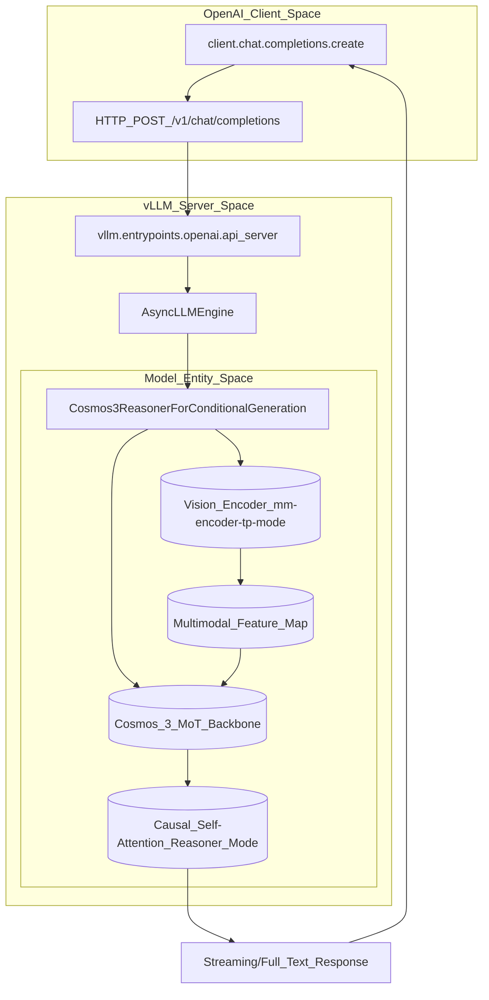
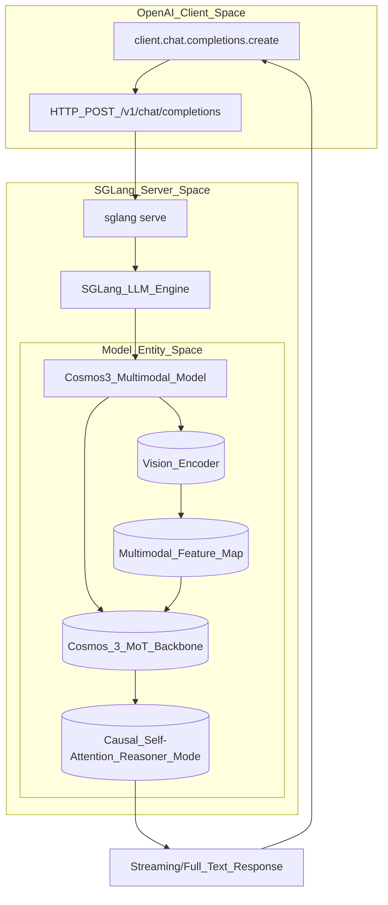
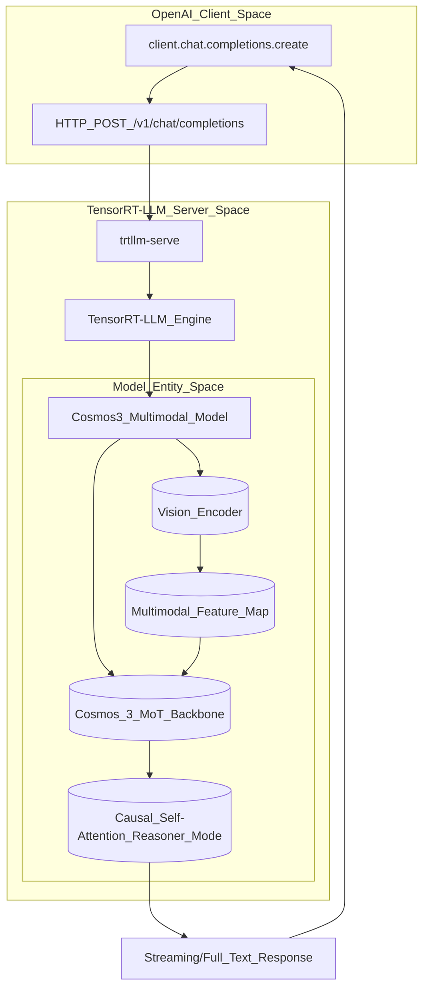
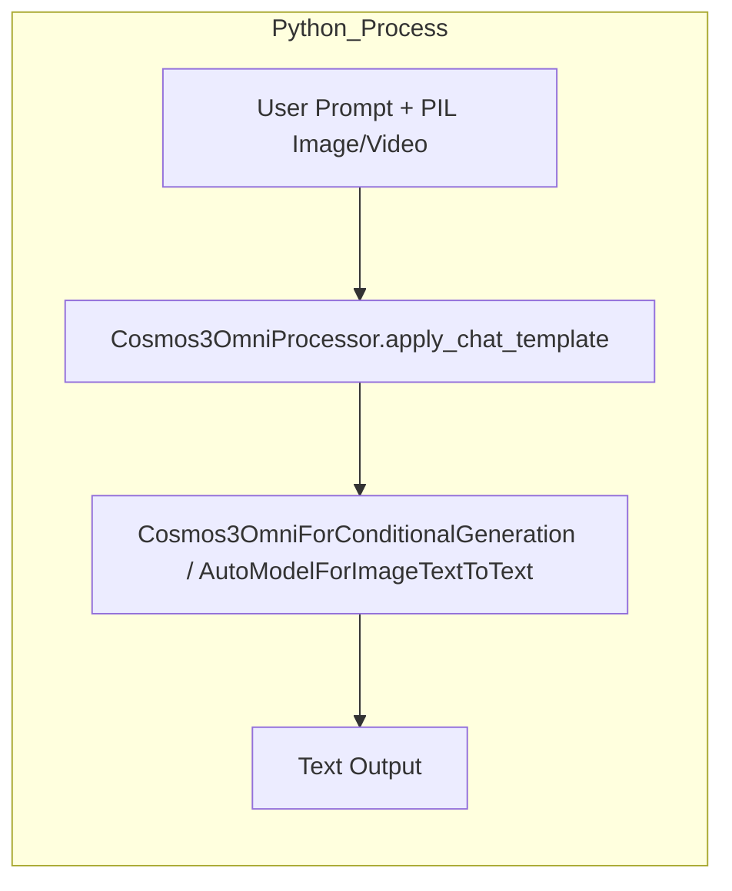
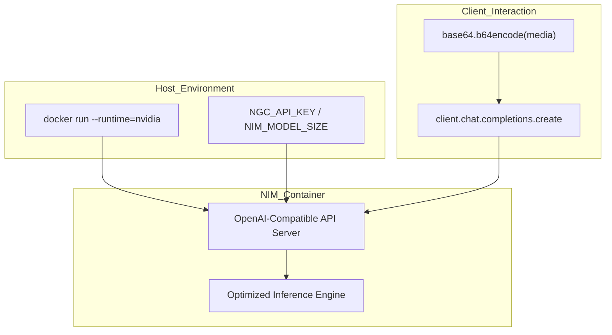

<!-- source: DeepWiki mcp.deepwiki.com · repo NVIDIA/cosmos · page 3.2 Reasoner with vLLM, SGLang, TensorRT-LLM, Transformers, and NIM · fetched 2026-10-26 -->

# Reasoner with vLLM, SGLang, TensorRT-LLM, Transformers, and NIM

<details>
<summary>Relevant source files</summary>

The following files were used as context for generating this wiki page:

- [cookbooks/cosmos3/reasoner/README.md](cookbooks/cosmos3/reasoner/README.md)
- [cookbooks/cosmos3/reasoner/assets/robot_153.jpg](cookbooks/cosmos3/reasoner/assets/robot_153.jpg)
- [cookbooks/cosmos3/reasoner/reasoner_prompt_guide.md](cookbooks/cosmos3/reasoner/reasoner_prompt_guide.md)
- [cookbooks/cosmos3/reasoner/run_with_nim.ipynb](cookbooks/cosmos3/reasoner/run_with_nim.ipynb)
- [cookbooks/cosmos3/reasoner/run_with_sglang.ipynb](cookbooks/cosmos3/reasoner/run_with_sglang.ipynb)
- [cookbooks/cosmos3/reasoner/run_with_tensorrt_llm.ipynb](cookbooks/cosmos3/reasoner/run_with_tensorrt_llm.ipynb)
- [cookbooks/cosmos3/reasoner/run_with_transformers.ipynb](cookbooks/cosmos3/reasoner/run_with_transformers.ipynb)
- [cookbooks/cosmos3/reasoner/run_with_vllm.ipynb](cookbooks/cosmos3/reasoner/run_with_vllm.ipynb)

</details>


The Cosmos 3 Reasoner can be deployed as a high-performance, production-ready inference service using **vLLM**, **SGLang**, **TensorRT-LLM**, **Hugging Face Transformers**, or **NVIDIA NIM**. These integrations provide an OpenAI-compatible Chat Completions API for complex vision-language reasoning tasks, including detailed captioning, 2D grounding, temporal localization, and embodied Action CoT.

Unlike the Cosmos Framework backend which loads full omni weights (including generation experts), these backends load **only the Reasoner (VLM) weights**, significantly reducing the GPU memory footprint (e.g., ~17 GB for Cosmos3-Nano vs ~34 GB in the Framework) [cookbooks/cosmos3/reasoner/README.md:12-29]().

## 1. Reasoner with vLLM

The vLLM integration leverages the `Cosmos3ReasonerForConditionalGeneration` architecture to serve **Edge**, **Nano**, and **Super** model variants with optimized kernels and asynchronous scheduling [cookbooks/cosmos3/reasoner/run_with_vllm.ipynb:16-16]().

### Server Architecture and Implementation
*   **Architecture**: Registered as `Cosmos3ReasonerForConditionalGeneration` [cookbooks/cosmos3/reasoner/run_with_vllm.ipynb:168-168]().
*   **Parallelism**: Supports Tensor Parallelism (TP) via `--tensor-parallel-size` to scale **Cosmos3-Super** across multiple GPUs [cookbooks/cosmos3/reasoner/run_with_vllm.ipynb:113-113]().
*   **Media Processing**: Ingests media via `--allowed-local-media-path` for `file://` URIs and uses `--mm-encoder-tp-mode data` for TP configurations [cookbooks/cosmos3/reasoner/run_with_vllm.ipynb:122-122]().

**Reasoner Request Pipeline (vLLM)**

Sources: [cookbooks/cosmos3/reasoner/run_with_vllm.ipynb:122-123](), [cookbooks/cosmos3/reasoner/README.md:109-124]()

### Server Launch
Launch the server using the `vllm/vllm-openai:cosmos3` Docker image [cookbooks/cosmos3/reasoner/run_with_vllm.ipynb:88-88]().

#### Cosmos3-Super (4 GPUs)
```bash
docker run -d --name cosmos3-reasoner-vllm \
  --runtime nvidia --gpus all \
  -v "$HOME/.cache/huggingface:/root/.cache/huggingface" \
  -v "$COSMOS_ROOT:$COSMOS_ROOT" \
  -p 8001:8000 --ipc=host \
  vllm/vllm-openai:cosmos3 \
  nvidia/Cosmos3-Super \
    --tensor-parallel-size 4 \
    --mm-encoder-tp-mode data \
    --allowed-local-media-path "$COSMOS3_MEDIA_ROOT" \
    --media-io-kwargs '{"video": {"num_frames": -1}}'
```
Sources: [cookbooks/cosmos3/reasoner/run_with_vllm.ipynb:122-122]()

### Readiness Polling
The server's readiness can be polled by checking the `/health` endpoint. The first launch may take several minutes as weights are downloaded and CUDA graphs are compiled.
```python
import requests
import time

def wait_for_server(url, timeout=3600):
    start_time = time.time()
    while True:
        try:
            response = requests.get(f"{url}/health")
            if response.status_code == 200:
                print("Server is ready.")
                break
        except requests.exceptions.ConnectionError:
            pass
        if time.time() - start_time > timeout:
            raise TimeoutError("Server did not become ready in time.")
        time.sleep(5)

wait_for_server("http://localhost:8001/v1")
```
Sources: [cookbooks/cosmos3/reasoner/run_with_vllm.ipynb:126-149]()

## 2. Reasoner with SGLang

The SGLang integration serves the Cosmos3 Reasoner using the `lmsysorg/sglang:dev` Docker image, providing an OpenAI-compatible server. It supports both Cosmos3-Edge and Cosmos3-Super. [cookbooks/cosmos3/reasoner/run_with_sglang.ipynb:17-28]()

### Server Architecture and Implementation
*   **Docker Image**: `lmsysorg/sglang:dev` [cookbooks/cosmos3/reasoner/run_with_sglang.ipynb:123-124]()
*   **Model Type**: `--model-type llm` [cookbooks/cosmos3/reasoner/run_with_sglang.ipynb:181-181]()
*   **Multimodal Support**: `--enable-multimodal` [cookbooks/cosmos3/reasoner/run_with_sglang.ipynb:182-182]()
*   **Parallelism**: Supports `--tp-size` for Tensor Parallelism, e.g., `4` for Cosmos3-Super [cookbooks/cosmos3/reasoner/run_with_sglang.ipynb:181-181](), [cookbooks/cosmos3/reasoner/run_with_sglang.ipynb:226-226]()

**Reasoner Request Pipeline (SGLang)**

Sources: [cookbooks/cosmos3/reasoner/run_with_sglang.ipynb:178-185](), [cookbooks/cosmos3/reasoner/run_with_sglang.ipynb:223-230]()

### Server Launch
Launch the server using the `lmsysorg/sglang:dev` Docker image.

#### Cosmos3-Super (4 GPUs)
```bash
docker run -d --name cosmos3-reasoner-sglang \
  --runtime nvidia --gpus all \
  -e HF_HOME=/root/.cache/huggingface \
  -v "$SGLANG_HF_CACHE:/root/.cache/huggingface" \
  -v "$COSMOS_ROOT:$COSMOS_ROOT" \
  -p 8001:8000 --ipc=host \
  lmsysorg/sglang:dev \
  sglang serve \
    --model-type llm \
    --model-path nvidia/Cosmos3-Super \
    --tp-size 4 \
    --enable-multimodal \
    --host 0.0.0.0 \
    --port 8000
```
Sources: [cookbooks/cosmos3/reasoner/run_with_sglang.ipynb:219-230]()

### Readiness Polling
Similar to vLLM, SGLang servers can be polled for readiness via the `/health` endpoint.
```python
import requests
import time

def wait_for_server(url, timeout=3600):
    start_time = time.time()
    while True:
        try:
            response = requests.get(f"{url}/health")
            if response.status_code == 200:
                print("Server is ready.")
                break
        except requests.exceptions.ConnectionError:
            pass
        if time.time() - start_time > timeout:
            raise TimeoutError("Server did not become ready in time.")
        time.sleep(5)

wait_for_server("http://localhost:8001/v1")
```
Sources: [cookbooks/cosmos3/reasoner/run_with_sglang.ipynb:233-256]()

## 3. Reasoner with TensorRT-LLM

The TensorRT-LLM integration serves the Cosmos3 Reasoner through an OpenAI-compatible server using the `nvcr.io/nvidia/tensorrt-llm/release:1.3.0rc22` Docker image. It supports Cosmos3-Nano and Cosmos3-Super. [cookbooks/cosmos3/reasoner/run_with_tensorrt_llm.ipynb:8-19]()

### Server Architecture and Implementation
*   **Docker Image**: `nvcr.io/nvidia/tensorrt-llm/release:1.3.0rc22` or newer [cookbooks/cosmos3/reasoner/run_with_tensorrt_llm.ipynb:32-33]()
*   **Serving Command**: `trtllm-serve` [cookbooks/cosmos3/reasoner/run_with_tensorrt_llm.ipynb:167-167]()
*   **Parallelism**: Supports `--tensor_parallel_size` for Tensor Parallelism, e.g., `4` for Cosmos3-Super [cookbooks/cosmos3/reasoner/run_with_tensorrt_llm.ipynb:180-180](), [cookbooks/cosmos3/reasoner/run_with_tensorrt_llm.ipynb:219-219]()
*   **ModelOpt FP8**: TensorRT-LLM can leverage FP8 quantization for improved performance and reduced memory footprint. This is typically configured during model conversion to TensorRT-LLM engine format.

**Reasoner Request Pipeline (TensorRT-LLM)**

Sources: [cookbooks/cosmos3/reasoner/run_with_tensorrt_llm.ipynb:167-169](), [cookbooks/cosmos3/reasoner/run_with_tensorrt_llm.ipynb:219-221]()

### Server Launch
Launch the server using the specified TensorRT-LLM Docker image.

#### Cosmos3-Super (4 GPUs)
```bash
docker run -d --name cosmos3-reasoner-trtllm \
  --runtime nvidia --gpus all \
  --ulimit memlock=-1 --ulimit stack=67108864 \
  -e HF_HOME=/root/.cache/huggingface \
  -e HF_TOKEN \
  -v "$HOME/.cache/huggingface:/root/.cache/huggingface" \
  -v "$COSMOS_ROOT:$COSMOS_ROOT" \
  -p 8001:8000 --ipc=host \
  "$COSMOS3_TRTLLM_IMAGE" \
  bash -lc 'python -m pip install --no-cache-dir opencv-python-headless && \
    exec trtllm-serve nvidia/Cosmos3-Super \
      --host 0.0.0.0 --port 8000 \
      --tensor_parallel_size 4 \
      --max_num_tokens 32768'
```
Sources: [cookbooks/cosmos3/reasoner/run_with_tensorrt_llm.ipynb:210-222]()

### Readiness Polling
The TensorRT-LLM server also exposes a `/health` endpoint for readiness checks.
```python
import requests
import time

def wait_for_server(url, timeout=3600):
    start_time = time.time()
    while True:
        try:
            response = requests.get(f"{url}/health")
            if response.status_code == 200:
                print("Server is ready.")
                break
        except requests.exceptions.ConnectionError:
            pass
        if time.time() - start_time > timeout:
            raise TimeoutError("Server did not become ready in time.")
        time.sleep(5)

wait_for_server("http://localhost:8001/v1")
```
Sources: [cookbooks/cosmos3/reasoner/run_with_tensorrt_llm.ipynb:225-248]()

## 4. Reasoner with Transformers

The Hugging Face Transformers integration provides a Python-first path without requiring a separate server process. It uses the `Cosmos3OmniForConditionalGeneration` class for Nano/Super and `AutoModelForImageTextToText` (which resolves to `Cosmos3EdgeForConditionalGeneration`) for Edge models [cookbooks/cosmos3/reasoner/run_with_transformers.ipynb:23-29]().

### Implementation Details
*   **Classes**: `Cosmos3OmniForConditionalGeneration` for Nano/Super and `AutoModelForImageTextToText` for Edge [cookbooks/cosmos3/reasoner/run_with_transformers.ipynb:23-29]().
*   **Device Mapping**: Supports `device_map="auto"` for automatic model sharding across available GPUs.
*   **Chat Template**: Uses `processor.apply_chat_template` to format multimodal messages.

**Transformers Data Flow**

Sources: [cookbooks/cosmos3/reasoner/run_with_transformers.ipynb:23-29]()

## 5. Reasoner with NIM

NVIDIA NIM (NVIDIA Inference Microservice) offers a turnkey, optimized container for the Reasoner [cookbooks/cosmos3/reasoner/run_with_nim.ipynb:17-20]().

### Implementation and Media Ingestion
NIM containers are isolated from the host filesystem; local media must be converted to **base64 data URIs** [cookbooks/cosmos3/reasoner/run_with_nim.ipynb:84-94]().

**NIM Deployment Flow**

Sources: [cookbooks/cosmos3/reasoner/run_with_nim.ipynb:124-133](), [cookbooks/cosmos3/reasoner/README.md:143-163]()

### NIM Launch
```bash
docker run -d --rm --name="nvidia-cosmos3-reasoner" \
  --runtime=nvidia --gpus all \
  -e NGC_API_KEY="$NGC_API_KEY" \
  -e NIM_MODEL_SIZE="nano" \
  -p 8000:8000 \
  nvcr.io/nim/nvidia/cosmos3-reasoner:1.7.0
```
Sources: [cookbooks/cosmos3/reasoner/run_with_nim.ipynb:124-133]()

### Readiness Polling
The NIM server's readiness can be checked by polling the `/v1/health/ready` endpoint.
```python
import requests
import time

def wait_for_nim_server(port, container_name, timeout=3600):
    start_time = time.time()
    print(f"Waiting for NIM server on port {port} (first run downloads the model)...")
    while True:
        try:
            response = requests.get(f"http://127.0.0.1:{port}/v1/health/ready")
            if response.status_code == 200:
                print("NIM server is ready.")
                break
        except requests.exceptions.ConnectionError:
            pass
        # Check if container is still running
        # This part would typically involve a docker command to check container status
        # For simplicity, assuming the container is managed externally or will error out
        if time.time() - start_time > timeout:
            raise TimeoutError("NIM server did not become ready in time.")
        time.sleep(5)

wait_for_nim_server(8000, "nvidia-cosmos3-reasoner")
```
Sources: [cookbooks/cosmos3/reasoner/run_with_nim.ipynb:149-171]()

## 6. Supported Reasoning Tasks and Configuration

### Task Capabilities
*   **Detailed Captioning**: Image and video descriptions [cookbooks/cosmos3/reasoner/reasoner_prompt_guide.md:105-148]().
*   **2D Grounding**: Object detection using normalized `0-1000` coordinates `[x1, y1, x2, y2]` [cookbooks/cosmos3/reasoner/reasoner_prompt_guide.md:77-92]().
*   **Temporal Localization**: Identifying event segments with `start` and `end` timestamps [cookbooks/cosmos3/reasoner/reasoner_prompt_guide.md:149-177]().
*   **Action CoT**: Embodied reasoning for robotic trajectories [cookbooks/cosmos3/reasoner/reasoner_prompt_guide.md:231-255]().
*   **Physical Plausibility**: Analyzing common-sense physics in scenes [cookbooks/cosmos3/reasoner/reasoner_prompt_guide.md:257-281]().

### Sampling and Processor Configuration
For video reasoning, `mm_processor_kwargs` in the `extra_body` controls frame sampling [cookbooks/cosmos3/reasoner/reasoner_prompt_guide.md:29-33]().

| Backend | Media Ingestion | Configuration Method |
| :--- | :--- | :--- |
| **vLLM** | `file://` or `http://` | `--media-io-kwargs` CLI flag [cookbooks/cosmos3/reasoner/run_with_vllm.ipynb:122-122]() |
| **SGLang** | `file://` or `http://` | `--allowed-local-media-path` CLI flag |
| **TensorRT-LLM** | `file://` or `http://` | `--allowed-local-media-path` CLI flag |
| **Transformers** | PIL Objects / Tensors | `processor` kwargs |
| **NIM** | Base64 Data URIs | `extra_body` in API request |

Sources: [cookbooks/cosmos3/reasoner/reasoner_prompt_guide.md:7-33]()

---

