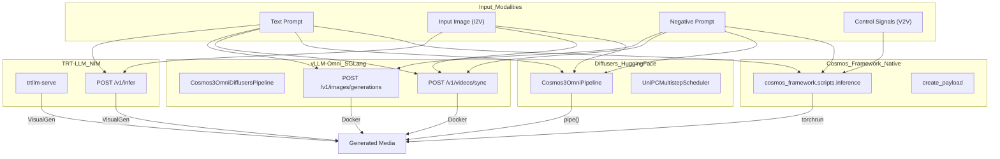
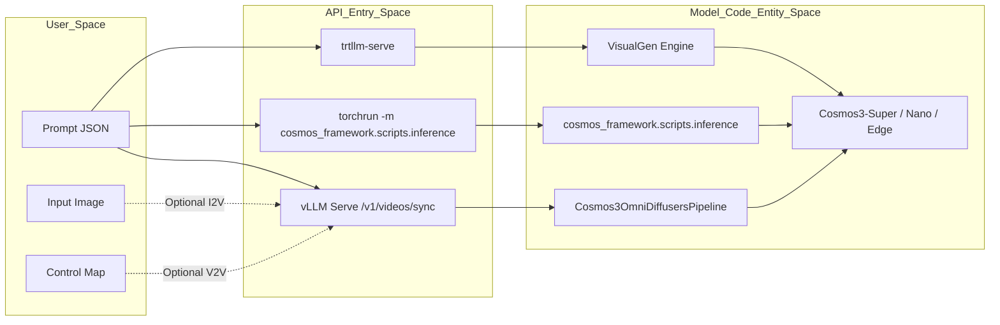

<!-- source: DeepWiki mcp.deepwiki.com · repo NVIDIA/cosmos · page 4 Generator: Audiovisual Content Generation · fetched 2026-10-26 -->

# Generator: Audiovisual Content Generation

Relevant source files

The following files were used as context for generating this wiki page:

- [README.md](README.md)
- [cookbooks/cosmos3/README.md](cookbooks/cosmos3/README.md)
- [cookbooks/cosmos3/generator/audiovisual/README.md](cookbooks/cosmos3/generator/audiovisual/README.md)
- [cookbooks/cosmos3/generator/audiovisual/assets/prompts/image2video/car_driving_edge.json](cookbooks/cosmos3/generator/audiovisual/assets/prompts/image2video/car_driving_edge.json)
- [cookbooks/cosmos3/generator/audiovisual/run_with_cosmos_framework.ipynb](cookbooks/cosmos3/generator/audiovisual/run_with_cosmos_framework.ipynb)
- [cookbooks/cosmos3/generator/audiovisual/run_with_diffusers.ipynb](cookbooks/cosmos3/generator/audiovisual/run_with_diffusers.ipynb)
- [cookbooks/cosmos3/generator/audiovisual/run_with_vllm_omni.ipynb](cookbooks/cosmos3/generator/audiovisual/run_with_vllm_omni.ipynb)

The Cosmos 3 Generator surface provides high-fidelity synthesis of images, videos, and synchronized audio. It supports three primary generation modes: **Text-to-Image (T2I)**, **Text-to-Video (T2V)**, and **Image-to-Video (I2V)**. These capabilities are accessible across five distinct backends designed for research, local experimentation, and production serving.

### Generation Backends
Cosmos 3 offers flexibility in how generation is executed:
1.  **Cosmos Framework**: The native PyTorch implementation used for high-throughput distributed inference and research.
2.  **Diffusers**: Integration with the HuggingFace `diffusers` library for ease of use in local Python environments.
3.  **vLLM-Omni and SGLang**: High-performance serving backends for production-grade API deployments.
4.  **TensorRT-LLM and NIM**: Optimized inference engines for maximum throughput and turnkey containerized deployment.

### Logical Architecture to Code Mapping

The following diagram maps the high-level generation concepts to the specific classes and entry points within the codebase.

**Generator Backend Mapping**

**Sources:** [cookbooks/cosmos3/generator/audiovisual/README.md:29-181](), [cookbooks/cosmos3/generator/audiovisual/run_with_cosmos_framework.ipynb:19-21](), [cookbooks/cosmos3/generator/audiovisual/run_with_vllm_omni.ipynb:59-62](), [cookbooks/cosmos3/generator/audiovisual/run_with_trt_llm.ipynb:58-58]()

---

## Audiovisual Generation with Cosmos Framework

The Cosmos Framework backend is the native implementation designed for maximum performance and multi-GPU scalability. It uses a structured JSON payload to define generation parameters and is invoked via `torchrun` to handle distributed execution for larger models like `Cosmos3-Super`.

*   **Entry Point**: `cosmos_framework.scripts.inference` [cookbooks/cosmos3/generator/audiovisual/README.md:72-73]().
*   **Key Features**: Supports `model_mode` settings for `text2video` and `image2video`, resolution scaling, and synchronized audio generation via the `enable_sound` flag [cookbooks/cosmos3/generator/audiovisual/README.md:54-68]().
*   **Parallelism**: Automatically handles tensor parallelism and CFG parallelism based on the `--nproc-per-node` and `--parallelism-preset` arguments [cookbooks/cosmos3/generator/audiovisual/README.md:72-78]().

For details, see [Audiovisual Generation with Cosmos Framework](#4.1).

**Sources:** [cookbooks/cosmos3/generator/audiovisual/README.md:29-88](), [cookbooks/cosmos3/generator/audiovisual/run_with_cosmos_framework.ipynb:15-23]()

---

## Audiovisual Generation with Diffusers

The Diffusers backend provides a familiar interface for developers integrated into the HuggingFace ecosystem. It uses the `Cosmos3OmniPipeline` to load models from the `nvidia/Cosmos3-Nano` or `nvidia/Cosmos3-Super` repositories.

*   **Pipeline**: `Cosmos3OmniPipeline` [cookbooks/cosmos3/generator/audiovisual/README.md:115-124]().
*   **Scheduler**: Utilizes `UniPCMultistepScheduler` with a specialized `flow_shift` parameter (typically set to `10.0`) to manage the flow-matching generation process [cookbooks/cosmos3/generator/audiovisual/README.md:116-125]().
*   **Safety**: To disable the guardrail, set `enable_safety_checker=False` [cookbooks/cosmos3/generator/audiovisual/README.md:19-20]().

For details, see [Audiovisual Generation with Diffusers](#4.2).

**Sources:** [cookbooks/cosmos3/generator/audiovisual/README.md:105-154]()

---

## Audiovisual Generation with vLLM-Omni and SGLang

vLLM-Omni serves the Generator via an OpenAI-compatible API, making it suitable for production applications. It wraps the diffusion logic in a high-performance serving container.

*   **Container**: `vllm/vllm-omni:cosmos3` (Docker recommended) [cookbooks/cosmos3/generator/audiovisual/run_with_vllm_omni.ipynb:59-59]().
*   **Endpoints**:
    *   `POST /v1/videos/sync`: For T2V, I2V, and V2V generation [cookbooks/cosmos3/generator/audiovisual/README.md:177]().
    *   `POST /v1/images/generations`: For T2I generation [cookbooks/cosmos3/generator/audiovisual/run_with_vllm_omni.ipynb:30-30]().
*   **Optimization**: Supports `extra_params` for toggling `guardrails`, `use_resolution_template`, and `use_duration_template` [cookbooks/cosmos3/generator/audiovisual/README.md:188-194]().

For details, see [Audiovisual Generation with vLLM-Omni and SGLang](#4.3).

**Sources:** [cookbooks/cosmos3/generator/audiovisual/README.md:155-200](), [cookbooks/cosmos3/generator/audiovisual/run_with_vllm_omni.ipynb:47-66]()

---

## Audiovisual Generation with TensorRT-LLM and NIM

TensorRT-LLM provides highly optimized C++ inference for Cosmos 3, supporting multi-GPU configurations and Ulysses sequence parallelism.

*   **TRT-LLM Serve**: Invoked via `trtllm-serve` or `tensorrt_llm.commands.serve` [cookbooks/cosmos3/generator/audiovisual/run_with_trt_llm.ipynb:58-68]().
*   **NIM Container**: A turnkey solution for deploying Cosmos 3 via a `POST /v1/infer` endpoint, returning base64-encoded video [cookbooks/cosmos3/generator/audiovisual/README.md:8-10]().
*   **Configuration**: Uses YAML files to define `cfg_size`, `ulysses_size`, and `parallel_vae_size` for multi-GPU scaling [cookbooks/cosmos3/generator/audiovisual/run_with_trt_llm.ipynb:63-68]().

For details, see [Audiovisual Generation with TensorRT-LLM](#4.4).

**Sources:** [cookbooks/cosmos3/generator/audiovisual/README.md:8-27](), [cookbooks/cosmos3/generator/audiovisual/run_with_trt_llm.ipynb:16-71]()

---

## Video Transfer (Controlled Generation)

Cosmos3 supports controlled generation (Video-to-Video or Video Transfer) via the Cosmos Framework and vLLM-Omni. This allows generating target video clips from precomputed control signals paired with text prompts.

*   **Mode**: Set `model_mode: video2video` in the inference spec [cookbooks/cosmos3/generator/transfer/run_video_transfer_with_vllm_omni.ipynb:167-167]().
*   **Control Types**: Supports Edge/Canny, Blur, Depth, Segmentation (Seg), and World Scenario Map (WSM) [cookbooks/cosmos3/generator/transfer/run_video_transfer_with_vllm_omni.ipynb:166-166]().
*   **Multi-Control**: Supports blending multiple control signals with per-hint weights (Cosmos Framework only) [cookbooks/cosmos3/generator/transfer/run_video_transfer_with_vllm_omni.ipynb:19-19]().

For details, see [Video Transfer (Controlled Generation)](#4.5).

**Sources:** [cookbooks/cosmos3/generator/transfer/run_video_transfer_with_vllm_omni.ipynb:15-22](), [cookbooks/cosmos3/generator/transfer/run_video_transfer_with_vllm_omni.ipynb:166-190]()

---

### Request Flow and Entity Association

This diagram illustrates how a request traverses the system from a user-defined prompt to the internal model classes.

**Generator Entity Association**

**Sources:** [cookbooks/cosmos3/generator/audiovisual/README.md:72-78](), [cookbooks/cosmos3/generator/audiovisual/README.md:176-194](), [cookbooks/cosmos3/generator/audiovisual/run_with_trt_llm.ipynb:58-68]()

---

