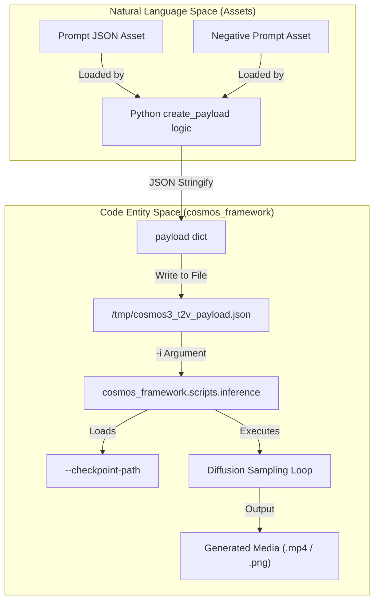
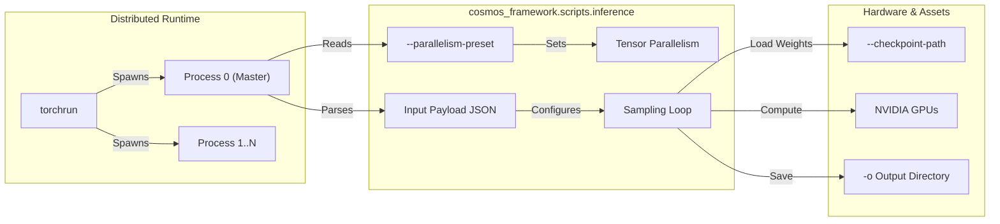

<!-- source: DeepWiki mcp.deepwiki.com · repo NVIDIA/cosmos · page 4.1 Audiovisual Generation with Cosmos Framework · fetched 2026-10-26 -->

# Audiovisual Generation with Cosmos Framework

<details>
<summary>Relevant source files</summary>

The following files were used as context for generating this wiki page:

- [cookbooks/cosmos3/generator/audiovisual/assets/negative_prompts/image2video/neg_prompt.json](cookbooks/cosmos3/generator/audiovisual/assets/negative_prompts/image2video/neg_prompt.json)
- [cookbooks/cosmos3/generator/audiovisual/assets/negative_prompts/text2video/neg_prompt.json](cookbooks/cosmos3/generator/audiovisual/assets/negative_prompts/text2video/neg_prompt.json)
- [cookbooks/cosmos3/generator/audiovisual/assets/prompts/image2video/car_driving_edge.json](cookbooks/cosmos3/generator/audiovisual/assets/prompts/image2video/car_driving_edge.json)
- [cookbooks/cosmos3/generator/audiovisual/run_distilled_with_trt_llm.ipynb](cookbooks/cosmos3/generator/audiovisual/run_distilled_with_trt_llm.ipynb)
- [cookbooks/cosmos3/generator/audiovisual/run_with_cosmos_framework.ipynb](cookbooks/cosmos3/generator/audiovisual/run_with_cosmos_framework.ipynb)
- [cookbooks/cosmos3/generator/audiovisual/run_with_diffusers.ipynb](cookbooks/cosmos3/generator/audiovisual/run_with_diffusers.ipynb)
- [cookbooks/cosmos3/generator/audiovisual/run_with_vllm_omni.ipynb](cookbooks/cosmos3/generator/audiovisual/run_with_vllm_omni.ipynb)

</details>


The Cosmos Framework provides a native PyTorch execution environment for performing high-fidelity audiovisual generation. Using the `cosmos_framework.scripts.inference` module, users can generate images, videos, and synchronized audio from text or image prompts. This interface is designed for research and development, supporting multi-GPU execution through `torchrun` to accommodate **Cosmos3-Nano**, **Cosmos3-Super**, and **Cosmos3-Edge** models.

## Execution via Cosmos Framework

The primary entry point for generation is the `cosmos_framework.scripts.inference` module [cookbooks/cosmos3/generator/audiovisual/run_with_cosmos_framework.ipynb:19-21](). It leverages `torchrun` to manage distributed processes, which is required for the larger Super models or when using tensor parallelism to reduce latency [cookbooks/cosmos3/generator/audiovisual/README.md:72-73]().

### Basic Command Structure
To run a generation, a JSON payload must be constructed and passed to the script via the `-i` (input) flag. The `--parallelism-preset` flag is used to automatically configure distributed settings [cookbooks/cosmos3/generator/audiovisual/README.md:74-75]().

```bash
torchrun --nproc-per-node=<NUM_GPUS> \
  -m cosmos_framework.scripts.inference \
  --parallelism-preset=throughput \
  -i /path/to/payload.json \
  -o /path/to/output_dir \
  --checkpoint-path <MODEL_NAME_OR_PATH> \
  --seed=0
```

For **Cosmos3-Super**, users should increase `--nproc-per-node` to leverage multi-GPU parallelism [cookbooks/cosmos3/generator/audiovisual/README.md:81-82]().

Sources: [cookbooks/cosmos3/generator/audiovisual/README.md:72-82](), [cookbooks/cosmos3/generator/audiovisual/run_with_cosmos_framework.ipynb:19-21]()

## JSON Payload Schema

The generation process is governed by a JSON payload that defines the task, model behavior, and output characteristics. This payload is typically constructed by loading prompt assets from the `assets/` directory and wrapping them in a task-specific dictionary [cookbooks/cosmos3/generator/audiovisual/README.md:40-70]().

### Schema Fields
| Field | Type | Description |
| :--- | :--- | :--- |
| `model_mode` | String | The generation task: `text2image`, `text2video`, or `image2video` [cookbooks/cosmos3/generator/audiovisual/README.md:55](). |
| `prompt` | String | A JSON-stringified representation of the prompt asset [cookbooks/cosmos3/generator/audiovisual/README.md:44-48](). |
| `negative_prompt` | String | A JSON-stringified negative prompt asset [cookbooks/cosmos3/generator/audiovisual/README.md:49-53](). |
| `num_steps` | Integer | Number of diffusion sampling steps (e.g., 35) [cookbooks/cosmos3/generator/audiovisual/README.md:60](). |
| `guidance` | Float | Classifier-free guidance (CFG) scale (e.g., 6.0) [cookbooks/cosmos3/generator/audiovisual/README.md:61](). |
| `shift` | Float | Flow matching shift parameter (e.g., 10.0) [cookbooks/cosmos3/generator/audiovisual/README.md:62](). |
| `fps` | Integer | Frames per second for video generation [cookbooks/cosmos3/generator/audiovisual/README.md:63](). |
| `num_frames` | Integer | Total number of frames (e.g., 189 for video) [cookbooks/cosmos3/generator/audiovisual/README.md:64](). |
| `resolution` | String | Vertical resolution (e.g., "720") [cookbooks/cosmos3/generator/audiovisual/README.md:65](). |
| `aspect_ratio` | String | Target aspect ratio (e.g., "16,9") [cookbooks/cosmos3/generator/audiovisual/README.md:66](). |
| `enable_sound` | Boolean | Whether to generate a synchronized audio track [cookbooks/cosmos3/generator/audiovisual/README.md:59](). |

### Frame Cadence Constraints
Cosmos 3 Generator models follow a **4k+1** frame cadence constraint (e.g., 1, 121, 189 frames). **Cosmos3-Edge** is optimized for lower resource settings and typically uses `"num_frames": 121` at `"resolution": "480"` [cookbooks/cosmos3/generator/audiovisual/README.md:84-87]().

Sources: [cookbooks/cosmos3/generator/audiovisual/README.md:40-70](), [cookbooks/cosmos3/generator/audiovisual/README.md:84-87]()

## Data Flow: From Prompt to Media

The generation pipeline transforms structured JSON prompts into high-dimensional latent representations, which are then decoded into pixels and audio waveforms.

### Natural Language to Code Entity Mapping
This diagram bridges the conceptual "Natural Language Space" (prompts) to the "Code Entity Space" (the Framework's inference script).

**Prompt to Script Association**


Sources: [cookbooks/cosmos3/generator/audiovisual/README.md:40-79](), [cookbooks/cosmos3/generator/audiovisual/run_with_cosmos_framework.ipynb:19-21]()

## Asset Directory Structure

The framework expects prompt assets to be organized by task. These assets are detailed JSON files containing subject descriptions, lighting, aesthetics, and cinematography details [cookbooks/cosmos3/generator/audiovisual/README.md:6]().

```text
assets/
├── prompts/
│   ├── text2image/
│   ├── text2video/
│   │   └── robot_kitchen.json
│   └── image2video/
│       └── car_driving_edge.json
└── negative_prompts/
    ├── text2video/
    │   └── neg_prompt.json
    └── image2video/
        └── neg_prompt.json
```

Sources: [cookbooks/cosmos3/generator/audiovisual/README.md:6](), [cookbooks/cosmos3/generator/audiovisual/README.md:45](), [cookbooks/cosmos3/generator/audiovisual/README.md:50](), [cookbooks/cosmos3/generator/audiovisual/assets/prompts/image2video/car_driving_edge.json:1-124](), [cookbooks/cosmos3/generator/audiovisual/assets/negative_prompts/image2video/neg_prompt.json:1-63](), [cookbooks/cosmos3/generator/audiovisual/assets/negative_prompts/text2video/neg_prompt.json:1-63]()

## Multi-GPU Execution and Parallelism

The Cosmos Framework uses `torchrun` to scale generation across multiple GPUs. This is critical for **Cosmos3-Super**, which typically requires higher memory and compute than a single GPU can provide [cookbooks/cosmos3/generator/audiovisual/README.md:81-82]().

### Component Interaction
The following diagram illustrates how the `inference` script interacts with system resources and the model weights.

**Inference Execution Flow**


Sources: [cookbooks/cosmos3/generator/audiovisual/README.md:72-82](), [cookbooks/cosmos3/generator/audiovisual/run_with_cosmos_framework.ipynb:108-121]()

## Implementation Details

### Key Functions and Modules
- **Payload Construction**: The notebook provides a factory pattern where raw prompt assets are loaded and assembled into the required `payload` dictionary with task-specific parameters [cookbooks/cosmos3/generator/audiovisual/README.md:40-70]().
- **`cosmos_framework.scripts.inference`**: The main module that initializes the distributed environment, loads the model into the specified parallelism configuration, and runs the diffusion sampling [cookbooks/cosmos3/generator/audiovisual/README.md:73]().
- **`--parallelism-preset`**: A CLI flag that automatically configures tensor parallelism and other distributed settings based on the available GPU count (e.g., `throughput`) [cookbooks/cosmos3/generator/audiovisual/README.md:74]().

### Guardrails
The Generator requires a safety checker. By default, it is enabled. To disable the guardrail in the Cosmos Framework, the `--no-guardrails` flag must be passed to the inference script [cookbooks/cosmos3/generator/audiovisual/README.md:23]().

Sources: [cookbooks/cosmos3/generator/audiovisual/README.md:17-23](), [cookbooks/cosmos3/generator/audiovisual/README.md:72-82](), [cookbooks/cosmos3/generator/audiovisual/run_with_cosmos_framework.ipynb:19-21]()

---

