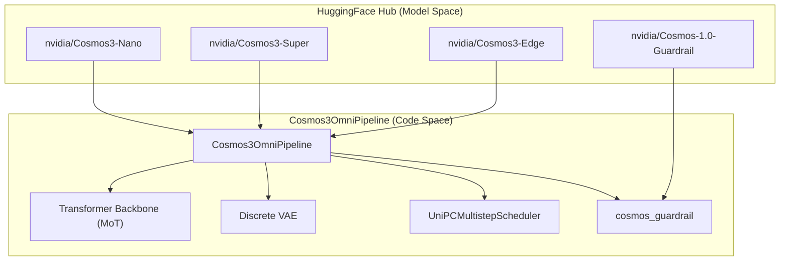
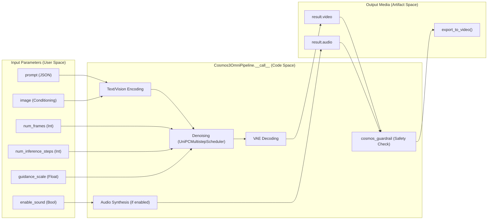

<!-- source: DeepWiki mcp.deepwiki.com · repo NVIDIA/cosmos · page 4.2 Audiovisual Generation with Diffusers · fetched 2026-10-26 -->

# Audiovisual Generation with Diffusers

<details>
<summary>Relevant source files</summary>

The following files were used as context for generating this wiki page:

- [cookbooks/cosmos3/generator/audiovisual/assets/prompts/image2video/car_driving_edge.json](cookbooks/cosmos3/generator/audiovisual/assets/prompts/image2video/car_driving_edge.json)
- [cookbooks/cosmos3/generator/audiovisual/run_with_cosmos_framework.ipynb](cookbooks/cosmos3/generator/audiovisual/run_with_cosmos_framework.ipynb)
- [cookbooks/cosmos3/generator/audiovisual/run_with_diffusers.ipynb](cookbooks/cosmos3/generator/audiovisual/run_with_diffusers.ipynb)
- [cookbooks/cosmos3/generator/audiovisual/run_with_vllm_omni.ipynb](cookbooks/cosmos3/generator/audiovisual/run_with_vllm_omni.ipynb)

</details>


The Cosmos 3 Generator surface supports high-fidelity image, video, and synchronized audio generation through the HuggingFace `diffusers` library. This integration path is optimized for local inference, providing a high-level API via the `Cosmos3OmniPipeline` to interact with `Cosmos3-Nano`, `Cosmos3-Super`, and `Cosmos3-Edge` models [cookbooks/cosmos3/generator/audiovisual/run_with_diffusers.ipynb:18-20]().

### Pipeline Architecture and Loading

The `Cosmos3OmniPipeline` serves as the unified entry point for text-to-image (T2I), text-to-video (T2V), and image-to-video (I2V) tasks. It manages the loading of the Mixture-of-Transformers (MoT) backbone, the VAE, and the text encoders [cookbooks/cosmos3/generator/audiovisual/run_with_diffusers.ipynb:18-20]().

#### Model Variants
The pipeline can be initialized from the primary checkpoints published by NVIDIA:
*   **nvidia/Cosmos3-Nano**: A 16B parameter model optimized for lower VRAM environments [cookbooks/cosmos3/generator/audiovisual/run_with_diffusers.ipynb:20-20]().
*   **nvidia/Cosmos3-Super**: The 64B parameter model for maximum quality, loaded via the same pipeline class [cookbooks/cosmos3/generator/audiovisual/run_with_diffusers.ipynb:20-20]().
*   **nvidia/Cosmos3-Edge**: A 4B parameter model designed for edge devices. Note that Edge models do not support audio generation and use 480p generation settings [cookbooks/cosmos3/generator/audiovisual/run_with_diffusers.ipynb:20-20]().

#### System Dependencies
Running the pipeline on headless servers requires specific system graphics libraries to handle media processing and avoid `libxcb.so.1` errors during pipeline import:
*   `libxcb1`, `libgl1`, and `libglib2.0-0` are required system packages [cookbooks/cosmos3/generator/audiovisual/run_with_diffusers.ipynb:34-38]().
*   The `cosmos_guardrail` package is a mandatory safety dependency for content filtering. Request access to the gated [nvidia/Cosmos-1.0-Guardrail](https://huggingface.co/nvidia/Cosmos-1.0-Guardrail) HF repository before running these examples [cookbooks/cosmos3/generator/audiovisual/run_with_diffusers.ipynb:31-32](). Safety filtering can be toggled via the `enable_safety_checker=False` parameter in the pipeline call [cookbooks/cosmos3/generator/audiovisual/run_with_diffusers.ipynb:32-32]().

**Diagram: Diffusers Pipeline Initialization Flow**
This diagram maps the high-level `from_pretrained` call to the underlying components loaded into the `Cosmos3OmniPipeline`.


Sources: [cookbooks/cosmos3/generator/audiovisual/run_with_diffusers.ipynb:18-20](), [cookbooks/cosmos3/generator/audiovisual/run_with_diffusers.ipynb:31-32](), [cookbooks/cosmos3/generator/audiovisual/run_with_diffusers.ipynb:151-151]()

---

### Scheduler Configuration

Cosmos 3 utilizes a flow-matching formulation. In the `diffusers` implementation, the `UniPCMultistepScheduler` is used to manage the sampling process. A critical parameter for generation quality is the `flow_shift`, which adjusts the noise schedule to better handle different resolutions and temporal lengths.

The scheduler is typically initialized from the pipeline's existing configuration with a `flow_shift` of `10.0` [cookbooks/cosmos3/generator/audiovisual/run_with_diffusers.ipynb:169-170]().

Sources: [cookbooks/cosmos3/generator/audiovisual/run_with_diffusers.ipynb:169-170]()

---

### Inference Execution

The pipeline's `__call__` method accepts parameters that define the modality and quality of the output.

#### Key Parameters
| Parameter | Description |
| :--- | :--- |
| `prompt` | JSON-encoded string containing the text description [cookbooks/cosmos3/generator/audiovisual/run_with_diffusers.ipynb:1000-1000]() |
| `negative_prompt` | JSON-encoded string for features to avoid [cookbooks/cosmos3/generator/audiovisual/run_with_diffusers.ipynb:1001-1001]() |
| `image` | A `PIL.Image` or `torch.Tensor` used as conditioning for I2V. Set to `None` for T2V/T2I [cookbooks/cosmos3/generator/audiovisual/run_with_diffusers.ipynb:1002-1002]() |
| `num_frames` | Total frames to generate. Use `1` for images, `189` for standard video [cookbooks/cosmos3/generator/audiovisual/run_with_diffusers.ipynb:1003-1003]() |
| `num_inference_steps` | Number of denoising steps (typically `35`) [cookbooks/cosmos3/generator/audiovisual/run_with_diffusers.ipynb:1007-1007]() |
| `guidance_scale` | Classifier-free guidance scale (typically `6.0`) [cookbooks/cosmos3/generator/audiovisual/run_with_diffusers.ipynb:1008-1008]() |
| `enable_sound` | Boolean flag to trigger synchronized audio generation. Must be `False` for Edge models [cookbooks/cosmos3/generator/audiovisual/run_with_diffusers.ipynb:1009-1009]() |

#### Implementation Example (T2V)
The following code snippet demonstrates the standard call pattern for generating video with the `Cosmos3OmniPipeline` [cookbooks/cosmos3/generator/audiovisual/run_with_diffusers.ipynb:998-1012]().

```python
result = pipe(
    prompt=json.dumps(prompt),
    negative_prompt=json.dumps(negative),
    image=None,
    num_frames=189,
    height=720,
    width=1280,
    fps=24,
    num_inference_steps=35,
    guidance_scale=6.0,
    enable_sound=False,
    add_resolution_template=False,
    add_duration_template=False,
    generator=torch.Generator(device="cuda").manual_seed(1234),
)
```

**Diagram: Data Flow from Call to Output**
This diagram bridges the user-provided parameters to the internal processing and final media export.


Sources: [cookbooks/cosmos3/generator/audiovisual/run_with_diffusers.ipynb:998-1012]()

---

### Environment and Hardware Requirements

Local inference with Diffusers requires a specific environment setup to ensure compatibility with the model's tensor formats and CUDA requirements.

*   **Python Version**: Python 3.13 is the standard for the Diffusers integration in the provided cookbooks [cookbooks/cosmos3/generator/audiovisual/run_with_diffusers.ipynb:145-145]().
*   **CUDA Backends**: Supports `cu128` or `cu130` via the `uv pip install --torch-backend` flag [cookbooks/cosmos3/generator/audiovisual/run_with_diffusers.ipynb:147-147]().
*   **Memory Management**: For `Cosmos3-Super`, users should utilize `device_map="cuda"` for automatic placement or manual device management if multiple GPUs are available.
*   **Tooling**: The `uv` package manager is used for dependency management, requiring version `>= 0.11.3` to support the required torch backends and project configurations [cookbooks/cosmos3/generator/audiovisual/run_with_diffusers.ipynb:40-40]().

Sources: [cookbooks/cosmos3/generator/audiovisual/run_with_diffusers.ipynb:48-58](), [cookbooks/cosmos3/generator/audiovisual/run_with_diffusers.ipynb:143-162]()

---

