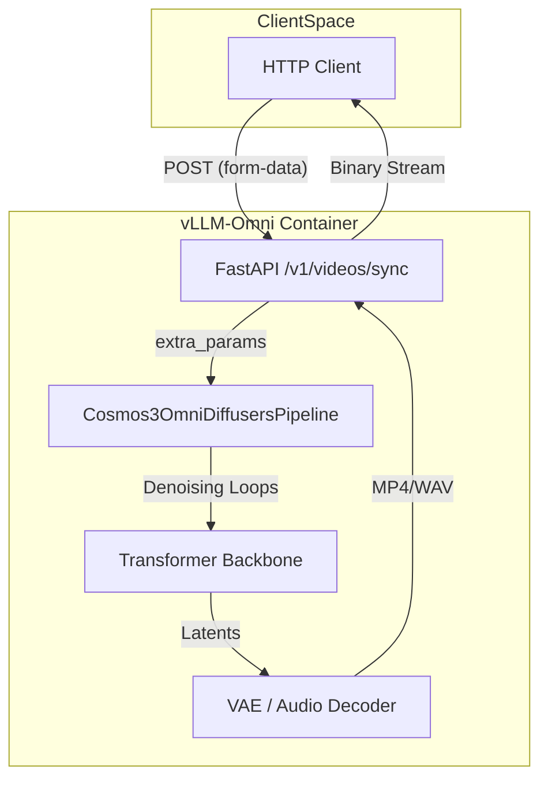
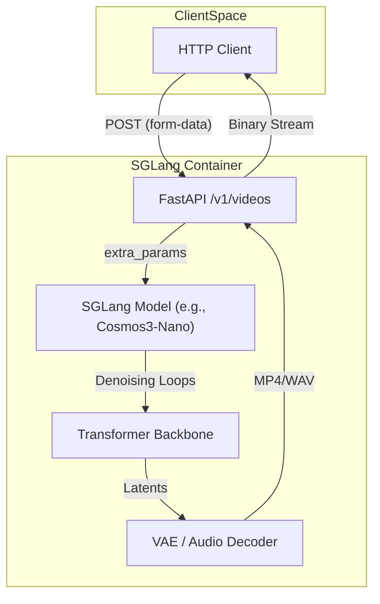
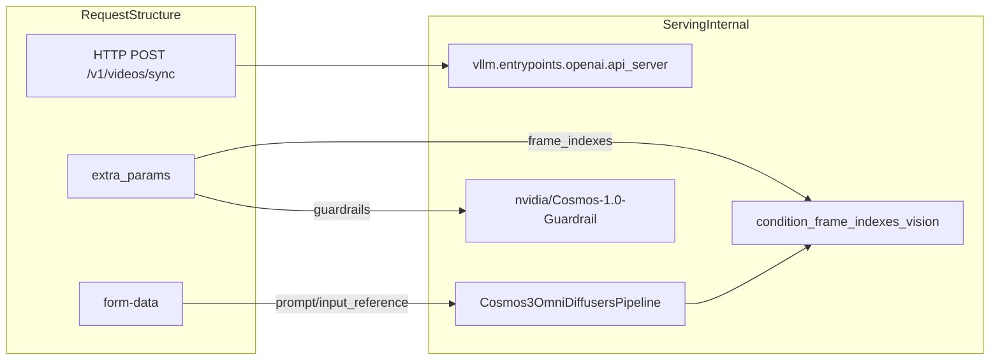

<!-- source: DeepWiki mcp.deepwiki.com · repo NVIDIA/cosmos · page 4.3 Audiovisual Generation with vLLM-Omni and SGLang · fetched 2026-10-26 -->

# Audiovisual Generation with vLLM-Omni and SGLang

Relevant source files

The following files were used as context for generating this wiki page:

- [cookbooks/cosmos3/generator/action/run_id_with_sglang.ipynb](cookbooks/cosmos3/generator/action/run_id_with_sglang.ipynb)
- [cookbooks/cosmos3/generator/action/run_id_with_vllm_omni.ipynb](cookbooks/cosmos3/generator/action/run_id_with_vllm_omni.ipynb)
- [cookbooks/cosmos3/generator/action/run_policy_with_sglang.ipynb](cookbooks/cosmos3/generator/action/run_policy_with_sglang.ipynb)
- [cookbooks/cosmos3/generator/action/run_policy_with_vllm_omni.ipynb](cookbooks/cosmos3/generator/action/run_policy_with_vllm_omni.ipynb)
- [cookbooks/cosmos3/generator/audiovisual/assets/prompts/image2video/car_driving_edge.json](cookbooks/cosmos3/generator/audiovisual/assets/prompts/image2video/car_driving_edge.json)
- [cookbooks/cosmos3/generator/audiovisual/assets/videos/car_driving_plain.mp4](cookbooks/cosmos3/generator/audiovisual/assets/videos/car_driving_plain.mp4)
- [cookbooks/cosmos3/generator/audiovisual/run_with_cosmos_framework.ipynb](cookbooks/cosmos3/generator/audiovisual/run_with_cosmos_framework.ipynb)
- [cookbooks/cosmos3/generator/audiovisual/run_with_diffusers.ipynb](cookbooks/cosmos3/generator/audiovisual/run_with_diffusers.ipynb)
- [cookbooks/cosmos3/generator/audiovisual/run_with_sglang.ipynb](cookbooks/cosmos3/generator/audiovisual/run_with_sglang.ipynb)
- [cookbooks/cosmos3/generator/audiovisual/run_with_vllm_omni.ipynb](cookbooks/cosmos3/generator/audiovisual/run_with_vllm_omni.ipynb)

The vLLM-Omni and SGLang integrations provide high-performance, production-ready serving solutions for the NVIDIA Cosmos 3 Generator. These backends utilize specialized Docker environments to expose OpenAI-compatible endpoints for synchronized audiovisual generation, supporting advanced features like tensor parallelism for Super models, CFG parallelism, and video-to-video (V2V) conditioning.

## 1. Serving with vLLM-Omni

vLLM-Omni serves the Generator via the `vllm/vllm-omni:cosmos3` Docker container [cookbooks/cosmos3/generator/audiovisual/run_with_vllm_omni.ipynb:57-59](). It leverages the `Cosmos3OmniDiffusersPipeline` to handle the multimodal generation logic, including synchronized audio [cookbooks/cosmos3/generator/audiovisual/run_with_vllm_omni.ipynb:62-62]().

### Server Deployment and Configuration
When launching the server, several CLI arguments are critical for performance and stability:

*   `--model-class-name Cosmos3OmniDiffusersPipeline`: Specifies the specialized pipeline for Cosmos 3 generation tasks [cookbooks/cosmos3/generator/audiovisual/run_with_vllm_omni.ipynb:62-62]().
*   `--init-timeout 1800`: Required to prevent timeouts during the extensive initialization of large model weights (e.g., the 64B Super model) [cookbooks/cosmos3/generator/audiovisual/run_with_vllm_omni.ipynb:65-65]().
*   `--allowed-local-media-path /`: Enables the server to access local file system assets for Image-to-Video (I2V) and Video-to-Video (V2V) tasks [cookbooks/cosmos3/generator/audiovisual/run_with_vllm_omni.ipynb:63-63]().
*   `--tensor-parallel-size`: Shards model weights across multiple GPUs. For `Cosmos3-Super`, this is often required to fit the model in VRAM [cookbooks/cosmos3/generator/audiovisual/run_with_vllm_omni.ipynb:102-102]().
*   `--enable-layerwise-offload`: Further reduces peak GPU memory by offloading transformer blocks to CPU RAM during the forward pass [cookbooks/cosmos3/generator/audiovisual/run_with_vllm_omni.ipynb:103-103]().

### Parallelism Strategy
vLLM-Omni supports Classifier-Free Guidance (CFG) parallelism via `--cfg-parallel-size 2`, which processes the positive and negative prompt branches simultaneously on separate GPUs [cookbooks/cosmos3/generator/audiovisual/run_with_vllm_omni.ipynb:155-159](). In this mode, the CFG strength is controlled via the request-level `guidance_scale` field [cookbooks/cosmos3/generator/audiovisual/run_with_vllm_omni.ipynb:161-161]().

**vLLM-Omni Generator Request Flow**
The following diagram illustrates the data flow from a client request through the vLLM-Omni server components.

Title: "vLLM-Omni Generator Request Flow"

Sources: [cookbooks/cosmos3/generator/audiovisual/run_with_vllm_omni.ipynb:53-122]()

---

## 2. Serving with SGLang

SGLang provides an OpenAI-compatible serving layer for Cosmos 3, using the `lmsysorg/sglang:dev` container [cookbooks/cosmos3/generator/audiovisual/run_with_sglang.ipynb:67-67](). It is particularly suited for tasks requiring standard API compatibility and handles both audiovisual generation and action modeling (Forward/Inverse Dynamics and Policy).

### Deployment Options
*   **Standard Serving**: Launched via `sglang serve --model-path nvidia/Cosmos3-Nano` [cookbooks/cosmos3/generator/audiovisual/run_with_sglang.ipynb:68-70]().
*   **Memory Optimization**: For Super models, use `--performance-mode memory` and `--num-gpus` for tensor parallelism [cookbooks/cosmos3/generator/audiovisual/run_with_sglang.ipynb:89-90]().
*   **CFG Parallelism**: Enabled via `--enable-cfg-parallel --cfg-parallel-size 2` [cookbooks/cosmos3/generator/audiovisual/run_with_sglang.ipynb:102-103]().

### SGLang Generator Request Flow
The following diagram illustrates the data flow from a client request through the SGLang server components.

Title: "SGLang Generator Request Flow"

Sources: [cookbooks/cosmos3/generator/audiovisual/run_with_sglang.ipynb:67-134]()

---

## 3. API Endpoints and Request Formats

Both backends accept `multipart/form-data` to accommodate media uploads and complex parameter structures.

### Video Generation (`POST /v1/videos/sync` or `/v1/videos`)
Used for T2V, I2V, and V2V. vLLM-Omni uses `/v1/videos/sync` [cookbooks/cosmos3/generator/audiovisual/run_with_vllm_omni.ipynb:30-30](), while SGLang uses `/v1/videos` [cookbooks/cosmos3/generator/audiovisual/run_with_sglang.ipynb:31-31]().

| Parameter | Type | Description |
| :--- | :--- | :--- |
| `prompt` | String | The text prompt for generation [cookbooks/cosmos3/generator/audiovisual/run_with_vllm_omni.ipynb:217-217]() [cookbooks/cosmos3/generator/audiovisual/run_with_sglang.ipynb:230-230](). |
| `input_reference` | File | The conditioning image (I2V) or video (V2V) [cookbooks/cosmos3/generator/audiovisual/run_with_vllm_omni.ipynb:265-265](). |
| `size` | String | Format: "WidthxHeight" (e.g., "1280x720") [cookbooks/cosmos3/generator/audiovisual/run_with_vllm_omni.ipynb:219-219](). |
| `num_frames` | String | Total frames to generate (e.g., "189") [cookbooks/cosmos3/generator/audiovisual/run_with_vllm_omni.ipynb:220-220](). |
| `extra_params` | JSON String | Contains specialized flags like `guardrails`, `use_resolution_template`, and `condition_frame_indexes_vision` [cookbooks/cosmos3/generator/audiovisual/run_with_vllm_omni.ipynb:222-226](). |

### Asynchronous Video Generation (`POST /v1/videos` with polling)
Both vLLM-Omni and SGLang support asynchronous video generation. For vLLM-Omni, this is typically handled by sending a `POST /v1/videos` request and then polling a status endpoint (not explicitly shown in provided snippets but standard for async operations). SGLang's `/v1/videos` endpoint can also be used for asynchronous generation, returning a task ID for later retrieval of results. This is particularly useful for longer video generations or policy rollouts [cookbooks/cosmos3/generator/action/run_policy_with_vllm_omni.ipynb:26-28](), [cookbooks/cosmos3/generator/action/run_policy_with_sglang.ipynb:20-22]().

### Image Generation (`POST /v1/images/generations`)
Used for Text-to-Image (T2I) tasks, following the standard OpenAI image generation schema [cookbooks/cosmos3/generator/audiovisual/run_with_vllm_omni.ipynb:30-30](), [cookbooks/cosmos3/generator/audiovisual/run_with_sglang.ipynb:31-31]().

---

## 4. Advanced Conditioning and Guardrails

### Video-to-Video (V2V) and Frame Conditioning
Cosmos 3 supports complex conditioning via `condition_frame_indexes_vision` in `extra_params`. This allows the model to treat specific frames of the input as ground truth (e.g., the first frame for I2V, or a subset of frames for V2V) [cookbooks/cosmos3/generator/audiovisual/run_with_vllm_omni.ipynb:332-332]().

### Prompt Templates
*   `use_resolution_template`: When `True`, the pipeline wraps the prompt with tokens indicating the target resolution [cookbooks/cosmos3/generator/audiovisual/run_with_vllm_omni.ipynb:224-224]().
*   `use_duration_template`: When `True`, the pipeline appends duration-specific tokens to the prompt [cookbooks/cosmos3/generator/audiovisual/run_with_vllm_omni.ipynb:225-225]().

### Safety Guardrails
Both backends support the `nvidia/Cosmos-1.0-Guardrail` safety checker. It can be toggled via the `guardrails` parameter in `extra_params` [cookbooks/cosmos3/generator/audiovisual/run_with_vllm_omni.ipynb:32-32](). Alternatively, it can be disabled server-wide by passing `--no-guardrails` to `vllm serve` [cookbooks/cosmos3/generator/audiovisual/run_with_vllm_omni.ipynb:52-52]() or `guardrails: false` in `extra_params` [cookbooks/cosmos3/generator/audiovisual/run_with_vllm_omni.ipynb:32-32]().

**API to Code Entity Mapping**
The following diagram maps the API request structure to the internal code entities.

Title: "API to Code Entity Mapping"

Sources: [cookbooks/cosmos3/generator/audiovisual/run_with_vllm_omni.ipynb:30-122](), [cookbooks/cosmos3/generator/audiovisual/run_with_vllm_omni.ipynb:222-226]()

Sources:
- [cookbooks/cosmos3/generator/audiovisual/run_with_vllm_omni.ipynb:1-350]()
- [cookbooks/cosmos3/generator/audiovisual/run_with_sglang.ipynb:1-100]()
- [cookbooks/cosmos3/generator/action/run_id_with_sglang.ipynb:16-51]()
- [cookbooks/cosmos3/generator/action/run_policy_with_sglang.ipynb:20-22]()
- [cookbooks/cosmos3/generator/action/run_id_with_vllm_omni.ipynb:30-30]()
- [cookbooks/cosmos3/generator/action/run_policy_with_vllm_omni.ipynb:26-28]()

---

