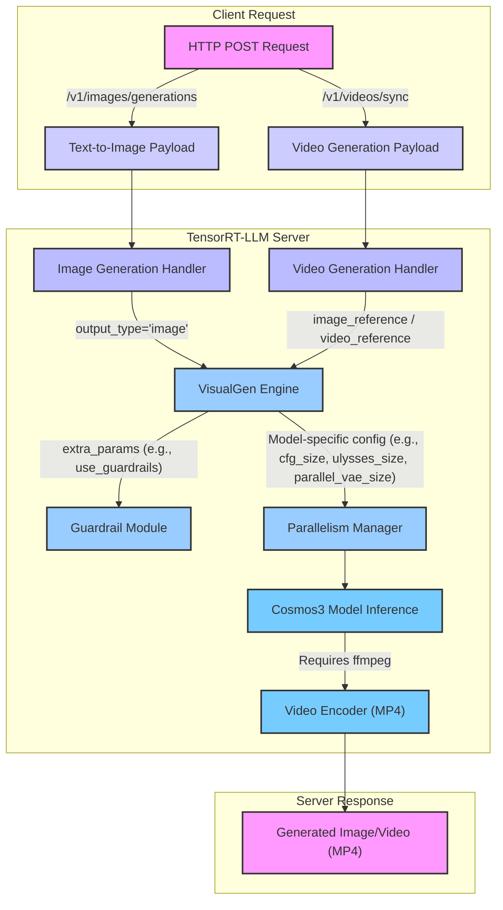
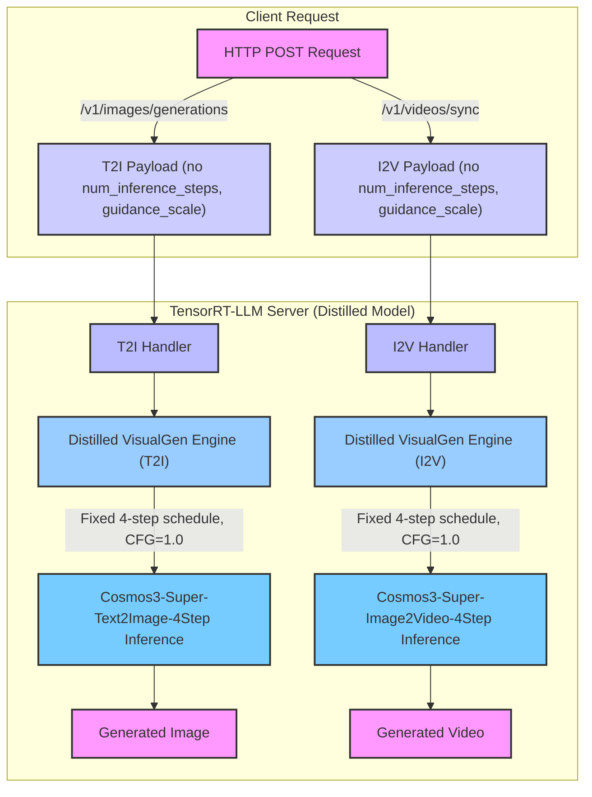

<!-- source: DeepWiki mcp.deepwiki.com · repo NVIDIA/cosmos · page 4.4 Audiovisual Generation with TensorRT-LLM · fetched 2026-10-26 -->

# Audiovisual Generation with TensorRT-LLM

<details>
<summary>Relevant source files</summary>

The following files were used as context for generating this wiki page:

- [cookbooks/cosmos3/generator/action/run_fd_with_trt_llm.ipynb](cookbooks/cosmos3/generator/action/run_fd_with_trt_llm.ipynb)
- [cookbooks/cosmos3/generator/action/run_id_with_trt_llm.ipynb](cookbooks/cosmos3/generator/action/run_id_with_trt_llm.ipynb)
- [cookbooks/cosmos3/generator/audiovisual/assets/negative_prompts/image2video/neg_prompt.json](cookbooks/cosmos3/generator/audiovisual/assets/negative_prompts/image2video/neg_prompt.json)
- [cookbooks/cosmos3/generator/audiovisual/assets/negative_prompts/text2video/neg_prompt.json](cookbooks/cosmos3/generator/audiovisual/assets/negative_prompts/text2video/neg_prompt.json)
- [cookbooks/cosmos3/generator/audiovisual/run_distilled_with_trt_llm.ipynb](cookbooks/cosmos3/generator/audiovisual/run_distilled_with_trt_llm.ipynb)
- [cookbooks/cosmos3/generator/audiovisual/run_with_trt_llm.ipynb](cookbooks/cosmos3/generator/audiovisual/run_with_trt_llm.ipynb)
- [cookbooks/cosmos3/generator/transfer/assets/depth/prompt.json](cookbooks/cosmos3/generator/transfer/assets/depth/prompt.json)
- [cookbooks/cosmos3/generator/transfer/assets/edge/prompt.json](cookbooks/cosmos3/generator/transfer/assets/edge/prompt.json)
- [cookbooks/cosmos3/generator/transfer/assets/negative_prompt.json](cookbooks/cosmos3/generator/transfer/assets/negative_prompt.json)
- [cookbooks/cosmos3/generator/transfer/run_video_transfer_with_trt_llm.ipynb](cookbooks/cosmos3/generator/transfer/run_video_transfer_with_trt_llm.ipynb)

</details>


This page details the high-performance serving paths for the Cosmos 3 Generator using NVIDIA TensorRT-LLM. These backends are optimized for production environments, offering advanced parallelism strategies and turnkey containerization for text-to-image (T2I), text-to-video (T2V), image-to-video (I2V), and video-to-video (V2V) workflows.

## TensorRT-LLM VisualGen Serving

TensorRT-LLM provides a high-performance inference engine for Cosmos 3 models, supporting complex parallelism configurations to scale across multiple GPUs. The Generator is served via the `trtllm-serve` command, utilizing the VisualGen API schema [cookbooks/cosmos3/generator/audiovisual/run_with_trt_llm.ipynb:30-32]().

### Server Configuration and Launch
The server is launched using `trtllm-serve` for Cosmos3-Nano or `torchrun` for Cosmos3-Super to handle multi-GPU distribution [cookbooks/cosmos3/generator/audiovisual/run_with_trt_llm.ipynb:58-68](). Configuration is managed via YAML files that define the parallelism strategy.

| Model Tier | Command | Parallelism Config |
| :--- | :--- | :--- |
| **Cosmos3-Nano** | `trtllm-serve` | 1-GPU config [cookbooks/cosmos3/generator/audiovisual/run_with_trt_llm.ipynb:58-59]() |
| **Cosmos3-Super** | `torchrun --nproc_per_node=4 -m tensorrt_llm.commands.serve` | 4-GPU config (Ulysses + Parallel VAE) [cookbooks/cosmos3/generator/audiovisual/run_with_trt_llm.ipynb:63-68]() |
| **Cosmos3-Edge** | `trtllm-serve` | 1-GPU config [cookbooks/cosmos3/generator/audiovisual/run_with_trt_llm.ipynb:85-86]() |

**Key Parallelism Parameters for Super:**
* `cfg_size=2`: Parallelizes Classifier-Free Guidance [cookbooks/cosmos3/generator/audiovisual/run_with_trt_llm.ipynb:63]().
* `ulysses_size=2`: DeepSpeed-Ulysses sequence parallelism for the transformer backbone [cookbooks/cosmos3/generator/audiovisual/run_with_trt_llm.ipynb:63]().
* `parallel_vae_size=4`: Parallelizes the VAE decoding process across all 4 GPUs [cookbooks/cosmos3/generator/audiovisual/run_with_trt_llm.ipynb:63]().

Cosmos3-Edge is a compact 4B Nemotron-dense checkpoint designed for single-GPU deployment. It supports text-to-image, text-to-video, and image-to-video generation. It does not include an audio tower, and its action weights are not served by this pipeline [cookbooks/cosmos3/generator/audiovisual/run_with_trt_llm.ipynb:88-89]().

### API Usage
The TensorRT-LLM backend exposes an OpenAI-compatible video generation endpoint at `POST /v1/videos/sync` and an image generation endpoint at `POST /v1/images/generations` [cookbooks/cosmos3/generator/audiovisual/run_with_trt_llm.ipynb:30-30]().

*   **Text-to-Image (T2I):** Uses `/v1/images/generations` with `output_type="image"` [cookbooks/cosmos3/generator/audiovisual/run_with_trt_llm.ipynb:88-89]().
*   **Video Generation (T2V, I2V, V2V):** Uses `/v1/videos/sync` [cookbooks/cosmos3/generator/audiovisual/run_with_trt_llm.ipynb:30-30]().
    *   Image-to-video uploads multipart `image_reference` [cookbooks/cosmos3/generator/audiovisual/run_with_trt_llm.ipynb:30-30]().
    *   Video-to-video uploads multipart `video_reference` [cookbooks/cosmos3/generator/audiovisual/run_with_trt_llm.ipynb:30-30]().
*   **Guardrails:** Enabled by default. Can be disabled via environment variable `TRTLLM_DISABLE_COSMOS3_GUARDRAILS=1` before starting the server or by setting `use_guardrails` to `False` in the request `extra_params` [cookbooks/cosmos3/generator/audiovisual/run_with_trt_llm.ipynb:32-32]().
*   **FFmpeg:** The `ffmpeg` CLI must be installed in the server environment for MP4 encoding and synchronized audio muxing [cookbooks/cosmos3/generator/audiovisual/run_with_trt_llm.ipynb:31-31]().

### Data Flow: TensorRT-LLM Request to Code Entity
The following diagram maps the HTTP request structure to the internal server logic.

**TensorRT-LLM VisualGen Flow**

Sources: [cookbooks/cosmos3/generator/audiovisual/run_with_trt_llm.ipynb:30-32](), [cookbooks/cosmos3/generator/audiovisual/run_with_trt_llm.ipynb:58-68](), [cookbooks/cosmos3/generator/audiovisual/run_with_trt_llm.ipynb:88-89]().

## Distilled 4-Step Model Notebook

TensorRT-LLM also supports serving the DMD2-distilled Cosmos3-Super students for faster inference:
*   `nvidia/Cosmos3-Super-Text2Image-4Step` (text-to-image)
*   `nvidia/Cosmos3-Super-Image2Video-4Step` (image-to-video)

These distilled checkpoints are designed for single-GPU deployment and have specific inference parameters baked into their weights [cookbooks/cosmos3/generator/audiovisual/run_distilled_with_trt_llm.ipynb:18-22]().

### Key Characteristics of Distilled Models
*   **Fixed 4-step schedule:** They use a `FlowMatchEulerDiscreteScheduler` with a locked `t_list` for four stochastic (SDE) steps [cookbooks/cosmos3/generator/audiovisual/run_distilled_with_trt_llm.ipynb:25-26]().
*   **Baked-in CFG:** Classifier-free guidance is integrated into the weights, meaning `guidance_scale` must be `1.0` [cookbooks/cosmos3/generator/audiovisual/run_distilled_with_trt_llm.ipynb:26-27]().
*   **No `flow_shift`:** `flow_shift` is a UniPC knob and does not apply to distilled checkpoints [cookbooks/cosmos3/generator/audiovisual/run_distilled_with_trt_llm.ipynb:29-29]().
*   **System Prompt:** `Cosmos3-Super-Image2Video-4Step` defaults to `default_use_system_prompt: true` [cookbooks/cosmos3/generator/audiovisual/run_distilled_with_trt_llm.ipynb:28-28]().

### Serving Distilled Models
To serve these models, use `trtllm-serve` with the appropriate model name.
*   **Text-to-Image:**
    ```bash
    trtllm-serve nvidia/Cosmos3-Super-Text2Image-4Step \
      --visual_gen_args "$TRTLLM_ROOT/examples/visual_gen/configs/cosmos3-t2i-1gpu.yaml" \
      --port 8000
    ```
    This uses a specific config to warm the 1024x1024 single-frame shape [cookbooks/cosmos3/generator/audiovisual/run_distilled_with_trt_llm.ipynb:79-82]().
*   **Image-to-Video:**
    ```bash
    trtllm-serve nvidia/Cosmos3-Super-Image2Video-4Step \
      --port 8000
    ```
    This model uses the default omni video shape (720p x 189 frames) and requires no additional config file [cookbooks/cosmos3/generator/audiovisual/run_distilled_with_trt_llm.ipynb:87-90]().

### Distilled Model Inference Flow

Sources: [cookbooks/cosmos3/generator/audiovisual/run_distilled_with_trt_llm.ipynb:18-29](), [cookbooks/cosmos3/generator/audiovisual/run_distilled_with_trt_llm.ipynb:79-90]().

## Video Transfer (Controlled Generation)

TensorRT-LLM also supports controlled video generation (video transfer) using precomputed control signals like Canny edges, blur, depth, segmentation, and WSM. This functionality is available for Cosmos3-Nano and Cosmos3-Super [cookbooks/cosmos3/generator/transfer/run_video_transfer_with_trt_llm.ipynb:17-20]().

### Request Structure
Controlled generation requests are sent to `POST /v1/videos/sync`. The precomputed control video is sent as base64 media within the `extra_params` JSON, rather than as a top-level multipart reference [cookbooks/cosmos3/generator/transfer/run_video_transfer_with_trt_llm.ipynb:52-54]().

Example `extra_params` for an edge control:
```json
{
    "hint": {"preset_edge_threshold": "medium"},
    "control_guidance": 1.5,
    "control_video": "base64_encoded_control_video_data"
}
```
Sources: [cookbooks/cosmos3/generator/transfer/run_video_transfer_with_trt_llm.ipynb:152-161]().

### Control Types and Parameters
The following table summarizes the supported control types and their typical parameters:

| Control | Transport | Frames / FPS | Text / Control Guidance | Size | Hint |
| :--- | :--- | :---: | :---: | :--- | :--- |
| **Edge** | Base64 precomputed control | 121 / 30 | 3.0 / 1.5 | 1280x720 | `{"preset_edge_threshold": "medium"}` |
| **Blur** | Base64 precomputed control | 121 / 30 | 3.0 / 1.5 | 1104x832 | N/A |
| **Depth** | Base64 precomputed control | 121 / 30 | 3.0 / 1.5 | 1280x720 | N/A |
| **Segmentation** | Base64 precomputed control | 121 / 30 | 3.0 / 2.0 | 1280x720 | N/A |
| **WSM** | Base64 precomputed control | 100 / 10 | 1.0 / 3.0 | 1280x720 | N/A |

Sources: [cookbooks/cosmos3/generator/transfer/run_video_transfer_with_trt_llm.ipynb:99-103](), [cookbooks/cosmos3/generator/transfer/run_video_transfer_with_trt_llm.ipynb:152-169]().

## Action Modeling

TensorRT-LLM also supports action modeling, including Inverse Dynamics (ID) and Forward Dynamics (FD). These requests typically return `safetensors` payloads containing video and action tensors.

### Inverse Dynamics (ID)
ID recovers an action trajectory from an observation clip. The `av` domain preset selects a 60-step, 9D trajectory shape and a 480p/10 fps recipe [cookbooks/cosmos3/generator/action/run_id_with_trt_llm.ipynb:17-20]().
*   **Request:** `POST /v1/videos/sync` with `format=safetensors` and `response_format=file`. The observation clip is sent as multipart `video_reference` [cookbooks/cosmos3/generator/action/run_id_with_trt_llm.ipynb:145-160]().
*   **Response:** `application/octet-stream` containing named `video`, `action`, and `frame_rate` tensors [cookbooks/cosmos3/generator/action/run_id_with_trt_llm.ipynb:88-91]().

### Forward Dynamics (FD)
FD generates a video rollout from a first frame and an action trajectory. The `av` domain preset provides the trained 480p, 10 fps recipe [cookbooks/cosmos3/generator/action/run_fd_with_trt_llm.ipynb:17-21]().
*   **Request:** `POST /v1/videos/sync` with `format=safetensors` and `response_format=file`. The first frame is sent as multipart `image_reference`, and the action trajectory is included in `extra_params` [cookbooks/cosmos3/generator/action/run_fd_with_trt_llm.ipynb:149-162]().
*   **Response:** `application/octet-stream` containing named `video`, `action`, and `frame_rate` tensors [cookbooks/cosmos3/generator/action/run_fd_with_trt_llm.ipynb:88-91]().

### Asynchronous API
TensorRT-LLM also implements an asynchronous API for video generation (`POST /v1/videos`). This route returns an HTTP 202, and the status can be polled via `GET /v1/videos/{id}`. The final payload is retrieved from `GET /v1/videos/{id}/content` [cookbooks/cosmos3/generator/action/run_id_with_trt_llm.ipynb:93-95](), [cookbooks/cosmos3/generator/action/run_fd_with_trt_llm.ipynb:93-95]().

Sources: [cookbooks/cosmos3/generator/action/run_id_with_trt_llm.ipynb:17-20](), [cookbooks/cosmos3/generator/action/run_id_with_trt_llm.ipynb:88-95](), [cookbooks/cosmos3/generator/action/run_id_with_trt_llm.ipynb:145-160](), [cookbooks/cosmos3/generator/action/run_fd_with_trt_llm.ipynb:17-21](), [cookbooks/cosmos3/generator/action/run_fd_with_trt_llm.ipynb:88-95](), [cookbooks/cosmos3/generator/action/run_fd_with_trt_llm.ipynb:149-162]().

---

