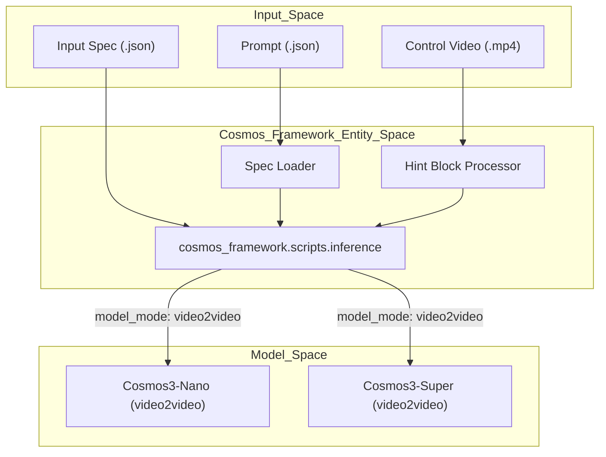
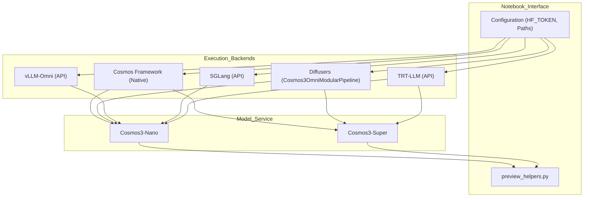

<!-- source: DeepWiki mcp.deepwiki.com · repo NVIDIA/cosmos · page 4.5 Video Transfer (Controlled Generation) · fetched 2026-10-26 -->

# Video Transfer (Controlled Generation)

<details>
<summary>Relevant source files</summary>

The following files were used as context for generating this wiki page:

- [cookbooks/cosmos3/generator/action/run_id_with_diffusers.ipynb](cookbooks/cosmos3/generator/action/run_id_with_diffusers.ipynb)
- [cookbooks/cosmos3/generator/action/run_policy_with_diffusers.ipynb](cookbooks/cosmos3/generator/action/run_policy_with_diffusers.ipynb)
- [cookbooks/cosmos3/generator/transfer/.gitignore](cookbooks/cosmos3/generator/transfer/.gitignore)
- [cookbooks/cosmos3/generator/transfer/assets/blur/control_blur.mp4](cookbooks/cosmos3/generator/transfer/assets/blur/control_blur.mp4)
- [cookbooks/cosmos3/generator/transfer/assets/blur/prompt.json](cookbooks/cosmos3/generator/transfer/assets/blur/prompt.json)
- [cookbooks/cosmos3/generator/transfer/assets/depth/control_depth.mp4](cookbooks/cosmos3/generator/transfer/assets/depth/control_depth.mp4)
- [cookbooks/cosmos3/generator/transfer/assets/edge/control_edge.mp4](cookbooks/cosmos3/generator/transfer/assets/edge/control_edge.mp4)
- [cookbooks/cosmos3/generator/transfer/assets/multi_control/prompt.json](cookbooks/cosmos3/generator/transfer/assets/multi_control/prompt.json)
- [cookbooks/cosmos3/generator/transfer/assets/seg/control_seg.mp4](cookbooks/cosmos3/generator/transfer/assets/seg/control_seg.mp4)
- [cookbooks/cosmos3/generator/transfer/preview_helpers.py](cookbooks/cosmos3/generator/transfer/preview_helpers.py)
- [cookbooks/cosmos3/generator/transfer/run_video_transfer_with_cosmos_framework.ipynb](cookbooks/cosmos3/generator/transfer/run_video_transfer_with_cosmos_framework.ipynb)
- [cookbooks/cosmos3/generator/transfer/run_video_transfer_with_diffusers.ipynb](cookbooks/cosmos3/generator/transfer/run_video_transfer_with_diffusers.ipynb)
- [cookbooks/cosmos3/generator/transfer/run_video_transfer_with_sglang.ipynb](cookbooks/cosmos3/generator/transfer/run_video_transfer_with_sglang.ipynb)
- [cookbooks/cosmos3/generator/transfer/run_video_transfer_with_vllm_omni.ipynb](cookbooks/cosmos3/generator/transfer/run_video_transfer_with_vllm_omni.ipynb)
- [cookbooks/cosmos3/generator/transfer/specs/blur.json](cookbooks/cosmos3/generator/transfer/specs/blur.json)
- [cookbooks/cosmos3/generator/transfer/specs/depth.json](cookbooks/cosmos3/generator/transfer/specs/depth.json)
- [cookbooks/cosmos3/generator/transfer/specs/edge.json](cookbooks/cosmos3/generator/transfer/specs/edge.json)
- [cookbooks/cosmos3/generator/transfer/specs/multi_control.json](cookbooks/cosmos3/generator/transfer/specs/multi_control.json)
- [cookbooks/cosmos3/generator/transfer/specs/seg.json](cookbooks/cosmos3/generator/transfer/specs/seg.json)
- [cookbooks/cosmos3/generator/transfer/specs/wsm.json](cookbooks/cosmos3/generator/transfer/specs/wsm.json)

</details>


Video transfer allows Cosmos3 models to generate target video clips guided by spatial control signals (hints) paired with text prompts. This capability is implemented within the Cosmos Framework using the `video2video` model mode, where precomputed control videos (such as depth maps or edge detections) provide the structural backbone for the generation process [cookbooks/cosmos3/generator/transfer/run_video_transfer_with_cosmos_framework.ipynb:16-18]().

## Overview

Unlike standard text-to-video or image-to-video tasks, video transfer generates a target clip from a `prompt.json` caption and one or more spatial control signals [cookbooks/cosmos3/generator/transfer/run_video_transfer_with_cosmos_framework.ipynb:24-25](). The Cosmos Framework automatically selects transfer inference when any hint key is present in the input specification or vLLM-Omni `extra_params` [cookbooks/cosmos3/generator/transfer/run_video_transfer_with_vllm_omni.ipynb:19-20]().

### Supported Control Types

The system supports five primary spatial control signals, each mapped to specific asset directories and configuration keys:

| Control Type | Asset Folder | Hint Key | Description |
| :--- | :--- | :--- | :--- |
| **Edge (Canny)** | `assets/edge/` | `edge` | Canny edge map control for structural outlines [cookbooks/cosmos3/generator/transfer/run_video_transfer_with_cosmos_framework.ipynb:26-26](). |
| **Blur** | `assets/blur/` | `blur` | Blurred reference control for color and layout guidance [cookbooks/cosmos3/generator/transfer/run_video_transfer_with_cosmos_framework.ipynb:27-27](). |
| **Depth** | `assets/depth/` | `depth` | Depth map control for 3D spatial geometry [cookbooks/cosmos3/generator/transfer/run_video_transfer_with_cosmos_framework.ipynb:28-28](). |
| **Segmentation** | `assets/seg/` | `seg` | Semantic segmentation maps for object placement [cookbooks/cosmos3/generator/transfer/run_video_transfer_with_cosmos_framework.ipynb:29-29](). |
| **World Scenario (WSM)** | `assets/wsm/` | `wsm` | World-scenario map control for high-level scene structure [cookbooks/cosmos3/generator/transfer/run_video_transfer_with_cosmos_framework.ipynb:30-30](). |

Sources: [cookbooks/cosmos3/generator/transfer/run_video_transfer_with_cosmos_framework.ipynb:26-30]()

## Technical Implementation

Video transfer is executed via the `cosmos_framework.scripts.inference` module [cookbooks/cosmos3/generator/transfer/run_video_transfer_with_cosmos_framework.ipynb:18-20](). The following diagram illustrates the data flow from the JSON specification to the model execution.

### Logic Flow: Specification to Inference

Sources: [cookbooks/cosmos3/generator/transfer/run_video_transfer_with_cosmos_framework.ipynb:18-20](), [cookbooks/cosmos3/generator/transfer/specs/edge.json:3-3]()

### Spec Field Reference

The input JSON spec defines the dimensions, conditioning signals, and paths for the transfer task. Below is a breakdown of critical fields used in transfer specifications such as `specs/edge.json` [cookbooks/cosmos3/generator/transfer/specs/edge.json:1-26]().

| Field | Type | Description |
| :--- | :--- | :--- |
| `model_mode` | String | Must be set to `video2video` [cookbooks/cosmos3/generator/transfer/specs/edge.json:3-3](). |
| `resolution` | String | Target vertical resolution (e.g., `"720"`) [cookbooks/cosmos3/generator/transfer/specs/edge.json:4-4](). |
| `aspect_ratio` | String | Ratio matching the control video (e.g., `"16,9"`) [cookbooks/cosmos3/generator/transfer/specs/edge.json:5-5](). |
| `fps` | Integer | Playback rate; must match control video (e.g., 30 for Edge, 10 for WSM) [cookbooks/cosmos3/generator/transfer/specs/edge.json:7-7](), [cookbooks/cosmos3/generator/transfer/specs/wsm.json:7-7](). |
| `num_frames` | Integer | Total number of video frames to generate [cookbooks/cosmos3/generator/transfer/specs/edge.json:6-6](). |
| `control_guidance` | Float | Strength of the spatial control signal (typically `1.5` to `3.0`) [cookbooks/cosmos3/generator/transfer/specs/edge.json:18-18](), [cookbooks/cosmos3/generator/transfer/specs/wsm.json:18-18](). |
| `[hint_key]` | Object | Contains `control_path` and optional parameters like `preset_edge_threshold` [cookbooks/cosmos3/generator/transfer/specs/edge.json:21-24](). |

Sources: [cookbooks/cosmos3/generator/transfer/specs/edge.json:1-26](), [cookbooks/cosmos3/generator/transfer/specs/wsm.json:1-25]()

### Multi-Control Blending
Cosmos Framework supports multi-control transfer where two or more hints are blended in a single pass [cookbooks/cosmos3/generator/transfer/run_video_transfer_with_cosmos_framework.ipynb:31-31](). Per-hint weighting is supported exclusively by the Cosmos Framework path; vLLM-Omni and SGLang accept multiple controls but do not support per-hint weights [cookbooks/cosmos3/generator/transfer/run_video_transfer_with_vllm_omni.ipynb:19-20](), [cookbooks/cosmos3/generator/transfer/run_video_transfer_with_sglang.ipynb:19-20]().

## Running Inference

### Cosmos Framework (Native PyTorch)
Inference is launched using either standard Python (for Nano) or `torchrun` (for Super) [cookbooks/cosmos3/generator/transfer/run_video_transfer_with_cosmos_framework.ipynb:39-41]().

*   **Cosmos3-Nano (Single GPU):**
    ```bash
    .venv/bin/python -m cosmos_framework.scripts.inference \
      --parallelism-preset=latency \
      -i "$TRANSFER_ROOT/specs/edge.json" \
      -o "$TRANSFER_ROOT/outputs/Cosmos3-Nano/" \
      --checkpoint-path Cosmos3-Nano
    ```
    Sources: [cookbooks/cosmos3/generator/transfer/run_video_transfer_with_cosmos_framework.ipynb:1010-1015]()

*   **Cosmos3-Super (Multi-GPU):**
    ```bash
    .venv/bin/torchrun --nproc-per-node=4 \
      -m cosmos_framework.scripts.inference \
      --parallelism-preset=latency \
      -i "$TRANSFER_ROOT/specs/edge.json" \
      -o "$TRANSFER_ROOT/outputs/Cosmos3-Super/" \
      --checkpoint-path Cosmos3-Super
    ```
    Sources: [cookbooks/cosmos3/generator/transfer/run_video_transfer_with_cosmos_framework.ipynb:1200-1205]()

### Diffusers (`Cosmos3OmniModularPipeline`)
The `Cosmos3OmniModularPipeline` in Diffusers exposes control inputs for transfer generation [cookbooks/cosmos3/generator/transfer/run_video_transfer_with_diffusers.ipynb:19-19](). The process involves configuring the environment, installing dependencies, and then running the pipeline with specific control types.

**Environment Configuration:**
The Diffusers environment is configured using `configure_diffusers_environment()` [cookbooks/cosmos3/generator/transfer/run_video_transfer_with_diffusers.ipynb:82-128](), which sets paths for the virtual environment, Hugging Face cache, and output directories.

**Installation:**
Dependencies are installed using `uv pip install` with the appropriate `--torch-backend` [cookbooks/cosmos3/generator/transfer/run_video_transfer_with_diffusers.ipynb:157-164]().

**Example Usage (Edge Control):**
```python
pipe = Cosmos3OmniModularPipeline.from_pretrained(
    "nvidia/Cosmos3-Nano",
    torch_dtype=torch.bfloat16,
    variant="bf16",
    use_safetensors=True,
)
pipe.to("cuda")

# Load control video and prompt
control_video = load_video_frames(control_path)
prompt_data = json.loads(prompt_path.read_text())

# Run inference
output = pipe(
    prompt=prompt_data["prompt"],
    negative_prompt=negative_prompt_data["negative_prompt"],
    video_length=spec["num_frames"],
    height=height,
    width=width,
    num_inference_steps=spec["num_steps"],
    guidance_scale=spec["guidance"],
    control_guidance_scale=spec["control_guidance"],
    generator=torch.Generator(device="cuda").manual_seed(spec["seed"]),
    control_edge=control_video,
    disable_safety_checker=True,
).frames[0]
```
Sources: [cookbooks/cosmos3/generator/transfer/run_video_transfer_with_diffusers.ipynb:19-21](), [cookbooks/cosmos3/generator/transfer/run_video_transfer_with_diffusers.ipynb:82-128](), [cookbooks/cosmos3/generator/transfer/run_video_transfer_with_diffusers.ipynb:157-164](), [cookbooks/cosmos3/generator/transfer/run_video_transfer_with_diffusers.ipynb:300-322]()

### vLLM-Omni (Production Serving)
The vLLM-Omni path uses the `POST /v1/videos/sync` endpoint. One or more hint keys (`edge`, `blur`, `depth`, `seg`, or `wsm`) are passed inside the `extra_params` field of the request [cookbooks/cosmos3/generator/transfer/run_video_transfer_with_vllm_omni.ipynb:19-20]().

**Docker Launch for vLLM-Omni:**
```bash
docker run --runtime nvidia --gpus all \
  -e CUDA_DEVICE_ORDER=PCI_BUS_ID \
  -v "${HF_HOME}:/root/.cache/huggingface" \
  -v "${COSMOS3_WORKDIR}:/workspace" \
  -p "${COSMOS3_HOST_PORT}:8000" --ipc=host \
  -w /workspace \
  vllm/vllm-omni:cosmos3 \
  vllm serve nvidia/Cosmos3-Nano \
    --omni \
    --model-class-name Cosmos3OmniDiffusersPipeline \
    --allowed-local-media-path / \
    --port 8000 \
    --init-timeout 1800
```
Sources: [cookbooks/cosmos3/generator/transfer/run_video_transfer_with_vllm_omni.ipynb:40-53]()

### SGLang
SGLang also supports controlled video generation via its OpenAI-compatible video API, specifically the `POST /v1/videos` endpoint [cookbooks/cosmos3/generator/transfer/run_video_transfer_with_sglang.ipynb:17-17](). Similar to vLLM-Omni, it accepts unweighted multi-control requests by providing a list of control videos in the API request [cookbooks/cosmos3/generator/transfer/run_video_transfer_with_sglang.ipynb:19-19]().

**Docker Launch for SGLang:**
```bash
docker run --runtime nvidia --gpus all \
  -v $SGLANG_HF_CACHE:/root/.cache/huggingface \
  -v "${COSMOS3_WORKDIR}:${COSMOS3_WORKDIR}" \
  -p 30000:30000 \
  --ipc=host \
  lmsysorg/sglang:dev \
  sglang serve \
  --model-path nvidia/Cosmos3-Nano \
  --host 0.0.0.0
```
Sources: [cookbooks/cosmos3/generator/transfer/run_video_transfer_with_sglang.ipynb:40-49]()

### TRT-LLM
TensorRT-LLM (TRT-LLM) also supports controlled generation. While specific examples for controlled video transfer are not detailed in the provided context, TRT-LLM's VisualGen capabilities generally extend to video generation, including conditioning. Text-to-image generation is treated as a 1-frame video in TRT-LLM, implying that video conditioning mechanisms can be adapted for controlled generation.

Sources: [4.4. Audiovisual Generation with TensorRT-LLM]()

### System Architecture: Environment and Execution

Sources: [cookbooks/cosmos3/generator/transfer/run_video_transfer_with_cosmos_framework.ipynb:84-107](), [cookbooks/cosmos3/generator/transfer/preview_helpers.py:98-107](), [cookbooks/cosmos3/generator/transfer/run_video_transfer_with_diffusers.ipynb:82-128](), [cookbooks/cosmos3/generator/transfer/run_video_transfer_with_vllm_omni.ipynb:40-53](), [cookbooks/cosmos3/generator/transfer/run_video_transfer_with_sglang.ipynb:40-49]()

## Preview Helpers

The `preview_helpers.py` module provides utility functions for generating and displaying video previews within Jupyter notebooks [cookbooks/cosmos3/generator/transfer/preview_helpers.py:3-3]().

*   `make_preview(src: Path, crf: int = 28) -> Path`: Converts a source video (`src`) into a smaller, web-friendly MP4 preview using `ffmpeg`. It checks if a preview already exists and is up-to-date before re-encoding [cookbooks/cosmos3/generator/transfer/preview_helpers.py:71-95]().
*   `preview_transfer(control: str, *, model: str | None = None) -> None`: Displays the control input video and the generated output video for a given control type. It resolves paths based on the `COSMOS3_TRANSFER_ROOT` and `COSMOS3_TRANSFER_OUTPUT_ROOT` environment variables [cookbooks/cosmos3/generator/transfer/preview_helpers.py:98-132]().
*   `preview_multi_control(*, model: str | None = None) -> None`: Specifically designed to preview computed control signals (like edge and blur) and the final generated output for multi-control transfer scenarios [cookbooks/cosmos3/generator/transfer/preview_helpers.py:135-173]().

These helpers are crucial for visualizing the results of controlled generation directly within the interactive notebook environment. Generated preview files are typically ignored by Git [cookbooks/cosmos3/generator/transfer/.gitignore:2-2]().

Sources: [cookbooks/cosmos3/generator/transfer/preview_helpers.py:3-3](), [cookbooks/cosmos3/generator/transfer/preview_helpers.py:71-95](), [cookbooks/cosmos3/generator/transfer/preview_helpers.py:98-132](), [cookbooks/cosmos3/generator/transfer/preview_helpers.py:135-173](), [cookbooks/cosmos3/generator/transfer/.gitignore:2-2]()

## Troubleshooting

### NATTEN and libnatten Errors
If inference fails with `libnatten` or NATTEN-related errors, verify the installation of the `natten` package within the virtual environment [cookbooks/cosmos3/generator/transfer/run_video_transfer_with_diffusers.ipynb:165-165](). The `run_video_transfer_with_cosmos_framework.ipynb` notebook handles the automatic installation of dependencies via `uv sync` [cookbooks/cosmos3/generator/transfer/run_video_transfer_with_cosmos_framework.ipynb:300-300]().

### Asset Path Resolution
When using vLLM-Omni in Docker, `control_path` strings sent to the server must be visible from the server's working directory [cookbooks/cosmos3/generator/transfer/run_video_transfer_with_vllm_omni.ipynb:30-30](). It is recommended to mount the `cosmos` repository root to `/workspace` so that repo-local paths resolve correctly [cookbooks/cosmos3/generator/transfer/run_video_transfer_with_vllm_omni.ipynb:30-30]().

Sources: [cookbooks/cosmos3/generator/transfer/run_video_transfer_with_vllm_omni.ipynb:30-30](), [cookbooks/cosmos3/generator/transfer/run_video_transfer_with_diffusers.ipynb:165-165](), [cookbooks/cosmos3/generator/transfer/run_video_transfer_with_cosmos_framework.ipynb:300-300]()

---

