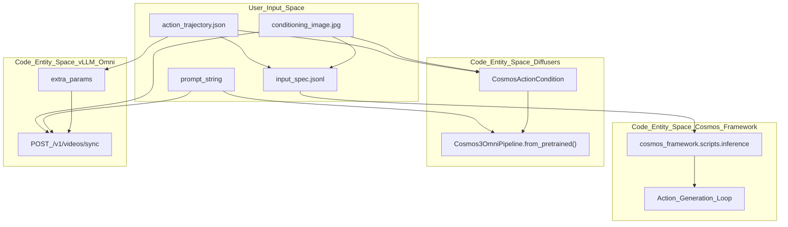
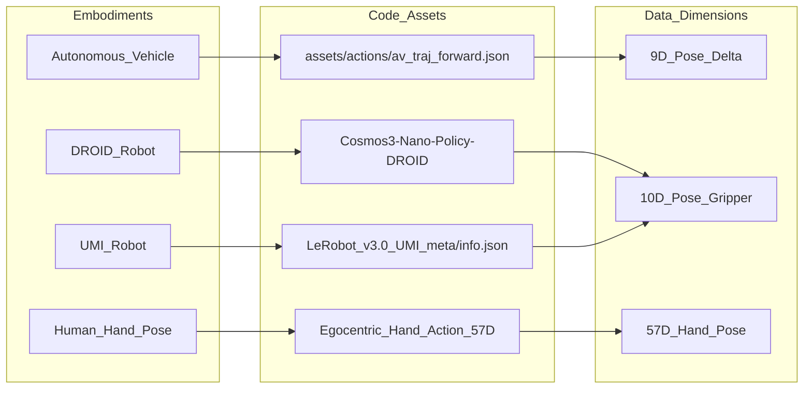

<!-- source: DeepWiki mcp.deepwiki.com · repo NVIDIA/cosmos · page 5 Generator: Action Modeling · fetched 2026-10-26 -->

# Generator: Action Modeling

Relevant source files

The following files were used as context for generating this wiki page:

- [cookbooks/cosmos3/generator/action/README.md](cookbooks/cosmos3/generator/action/README.md)
- [cookbooks/cosmos3/generator/action/assets/actions/camera_action.json](cookbooks/cosmos3/generator/action/assets/actions/camera_action.json)
- [cookbooks/cosmos3/generator/action/assets/images/lighthouse_720.png](cookbooks/cosmos3/generator/action/assets/images/lighthouse_720.png)
- [cookbooks/cosmos3/generator/action/assets/images/mountain_720.png](cookbooks/cosmos3/generator/action/assets/images/mountain_720.png)
- [cookbooks/cosmos3/generator/action/assets/images/solar_720.png](cookbooks/cosmos3/generator/action/assets/images/solar_720.png)
- [cookbooks/cosmos3/generator/action/assets/prompts/lighthouse.txt](cookbooks/cosmos3/generator/action/assets/prompts/lighthouse.txt)
- [cookbooks/cosmos3/generator/action/assets/prompts/mountain.txt](cookbooks/cosmos3/generator/action/assets/prompts/mountain.txt)
- [cookbooks/cosmos3/generator/action/assets/prompts/solar.txt](cookbooks/cosmos3/generator/action/assets/prompts/solar.txt)
- [cookbooks/cosmos3/generator/transfer/README.md](cookbooks/cosmos3/generator/transfer/README.md)

The Cosmos 3 Generator surface includes specialized capabilities for **Action Modeling**, treating action as a discrete modality within the world model. This allows the model to reason about the physical relationship between visual states and the forces or motions that transition between them. The system supports three primary tasks: **Forward Dynamics** (predicting future video from actions), **Inverse Dynamics** (predicting actions from video), and **Policy** execution (predicting both future observations and actions from instructions) [cookbooks/cosmos3/generator/action/README.md:3-7]().

## Action Representation and Embodiments

Cosmos 3 utilizes a unified action interface where ego and end-effector poses are represented as **9D pose deltas**. This representation consists of a 3D translation vector and a 6D continuous rotation representation [cookbooks/cosmos3/generator/action/README.md:41-44](). For manipulation tasks, a grasp state is appended, resulting in 10D (for grippers) or 57D (for human-like hands) vectors [cookbooks/cosmos3/generator/action/README.md:45-47]().

The system supports the following embodiments and configurations:

| Embodiment | Representation | Dimensionality | Unit | Post-processing | Generation duration |
| :--- | :--- | :--- | :--- | :--- | :--- |
| **Autonomous Vehicle (AV)** | Ego pose (9D) | 9D | Meter | Normalization | 60 frames @ 10FPS |
| **DROID** | End-effector + gripper | 10D | Meter | Multiview concatenation, `to-OpenCV`, normalization | 16 frames @ 15FPS |
| **UMI** | End-effector + gripper | 10D | Meter | Normalization | 16 frames @ 20FPS |
| **Human Hand Pose** | Ego + Wrists + Fingertips | 57D | Meter | Wrist-frame alignment, normalization | 16 frames @ 15FPS |

Sources: [cookbooks/cosmos3/generator/action/README.md:41-55]()

## Task Workflows

### Forward Dynamics (FD)
Forward Dynamics involves predicting future visual observations based on an initial conditioning image and a target action trajectory [cookbooks/cosmos3/generator/action/README.md:5](). This enables "what-if" simulations where the model generates video sequences showing how a robot or vehicle would interact with the environment given specific control inputs.

For detailed implementation, input specifications (JSONL), and autoregressive chunking logic, see [Forward Dynamics](#5.1).

### Inverse Dynamics (ID)
Inverse Dynamics is the process of predicting the ego-motion or end-effector action trajectories that occurred within an input video sequence [cookbooks/cosmos3/generator/action/README.md:6](). This is particularly useful for extracting control data from unlabeled video or for visual odometry tasks.

For details on output tensor shapes, coordinate transformations (relative to absolute), and 3D trajectory visualization, see [Inverse Dynamics](#5.2).

### Policy
Policy execution involves predicting both future visual observations and the corresponding action trajectories from a start image, a task instruction, and the current robot state [cookbooks/cosmos3/generator/action/README.md:7](). This is supported specifically for the DROID embodiment using the `Cosmos3-Nano-Policy-DROID` and `Cosmos3-Edge-Policy-DROID` models [cookbooks/cosmos3/generator/action/README.md:97]() (for Cosmos Framework), [cookbooks/cosmos3/generator/action/README.md:145]() (for Diffusers).

For details on simulation integration and instruction-based control, see [Policy Execution and RoboLab](#5.3).

## Execution Backends

Action modeling can be performed through multiple backends:

1.  **Cosmos Framework**: Uses `torchrun` with the `cosmos_framework.scripts.inference` module for native PyTorch execution [cookbooks/cosmos3/generator/action/README.md:65-73]().
2.  **Diffusers**: Utilizes the `Cosmos3OmniPipeline` with `CosmosActionCondition` for a streamlined Python interface [cookbooks/cosmos3/generator/action/README.md:113-114]().
3.  **vLLM-Omni**: Provides an OpenAI-compatible video API for serving action models. It supports multipart `POST` requests to `/v1/videos` with a start image under `image` and action trajectories passed in the `extra_params` payload [cookbooks/cosmos3/generator/action/README.md:42-43]().
4.  **TensorRT-LLM**: Offers optimized inference for action generation, typically through a server endpoint.

### Action Data Flow
The following diagram illustrates how action data is passed from the user to the model entities within the codebase.

**Action Trajectory Integration**

Sources: [cookbooks/cosmos3/generator/action/README.md:65-73](), [cookbooks/cosmos3/generator/action/README.md:113-145](), [cookbooks/cosmos3/generator/action/README.md:42-43]()

## Action Assets

The codebase provides sample assets for testing action modeling, including trajectory files for AV (forward, left, right turns), UMI, DROID, and Human Hand Pose under the `assets/` directory [cookbooks/cosmos3/generator/action/README.md:35](), [cookbooks/cosmos3/generator/action/README.md:83]().

**Example 9D Action Vector (AV)**: `[trans_x, trans_y, trans_z, rot6d_1, rot6d_2, rot6d_3, rot6d_4, rot6d_5, rot6d_6]` [cookbooks/cosmos3/generator/action/README.md:50-51]()

**Example 10D Action Vector (UMI/DROID)**: `[9D_Pose] + [1D_Gripper]` [cookbooks/cosmos3/generator/action/README.md:52-53]()

### Code-to-Embodiment Mapping
This diagram maps the high-level embodiment concepts to the specific data structures and files used in the generator.

**Embodiment Asset Mapping**

Sources: [cookbooks/cosmos3/generator/action/README.md:41-55](), [cookbooks/cosmos3/generator/action/README.md:97](), [cookbooks/cosmos3/generator/action/README.md:145](), [cookbooks/cosmos3/generator/action/assets/actions/camera_action.json:1](), [cookbooks/cosmos3/generator/action/assets/images/lighthouse_720.png:1](), [cookbooks/cosmos3/generator/action/assets/images/mountain_720.png:1](), [cookbooks/cosmos3/generator/action/assets/images/solar_720.png:1](), [cookbooks/cosmos3/generator/action/assets/prompts/lighthouse.txt:1](), [cookbooks/cosmos3/generator/action/assets/prompts/mountain.txt:1](), [cookbooks/cosmos3/generator/action/assets/prompts/solar.txt:1]()

---
**Child Pages:**
*   [Forward Dynamics](#5.1): Detail predicting future frames from a conditioning image and action trajectory: JSONL spec fields, autoregressive chunked generation and stitching, domain-specific action formats, and the Cosmos Framework, Diffusers, vLLM-Omni, SGLang, and TRT-LLM backends.
*   [Inverse Dynamics](#5.2): Detail predicting ego-motion trajectories from input video: JSONL spec, output tensor shape and rot6d encoding, pose_rel_to_abs conversion, AV pose conventions, and 3D/BEV visualization across Cosmos Framework, vLLM-Omni, SGLang, Diffusers, and TRT-LLM backends.
*   [Policy Execution and RoboLab](#5.3): Document the Policy workflow (future frames + action chunks from a start image, instruction, and state for DROID robots), the RoboLab simulation integration, Cosmos3-Nano/Edge-Policy-DROID models, and the SGLang/vLLM-Omni/Diffusers policy backends.
*   [Action Datasets and Asset Formats](#5.4): Document the LeRobot v3.0 example datasets bundled in the repo (DROID, UMI, Bridge, Fractal, AgiBotWorld, RoboMIND franka/franka_dual/ur, human hand pose, egocentric hand action) — directory layout, meta/info.json feature schemas, parquet data files, multi-view MP4s — plus the action JSON trajectory and reference image/prompt assets.

---

