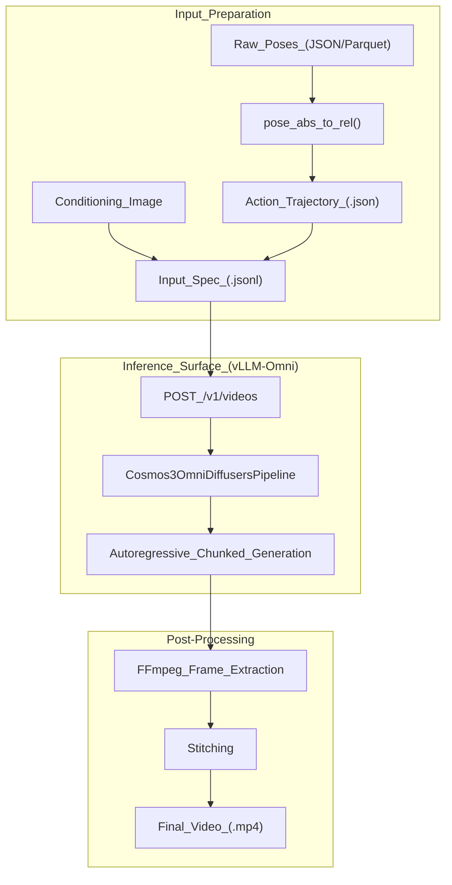
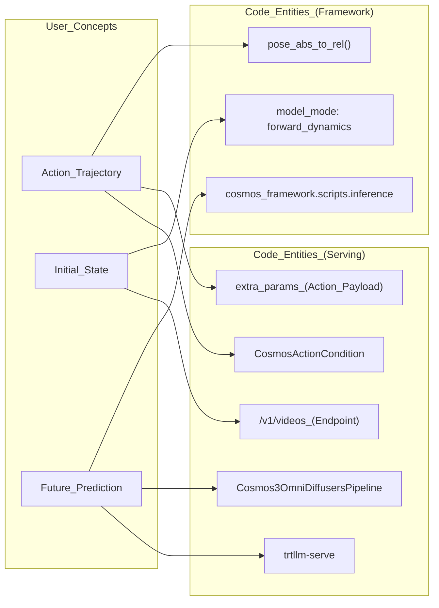

<!-- source: DeepWiki mcp.deepwiki.com · repo NVIDIA/cosmos · page 5.1 Forward Dynamics · fetched 2026-10-26 -->

# Forward Dynamics

Relevant source files

The following files were used as context for generating this wiki page:

- [LICENSE](LICENSE)
- [RELEASE.md](RELEASE.md)
- [cookbooks/cosmos3/cosmos3-model-architecture.png](cookbooks/cosmos3/cosmos3-model-architecture.png)
- [cookbooks/cosmos3/generator/action/assets/actions/av_traj_forward.json](cookbooks/cosmos3/generator/action/assets/actions/av_traj_forward.json)
- [cookbooks/cosmos3/generator/action/assets/actions/av_traj_left.json](cookbooks/cosmos3/generator/action/assets/actions/av_traj_left.json)
- [cookbooks/cosmos3/generator/action/assets/actions/av_traj_right.json](cookbooks/cosmos3/generator/action/assets/actions/av_traj_right.json)
- [cookbooks/cosmos3/generator/action/assets/actions/umi.json](cookbooks/cosmos3/generator/action/assets/actions/umi.json)
- [cookbooks/cosmos3/generator/action/run_fd_with_cosmos_framework.ipynb](cookbooks/cosmos3/generator/action/run_fd_with_cosmos_framework.ipynb)
- [cookbooks/cosmos3/generator/action/run_fd_with_diffusers.ipynb](cookbooks/cosmos3/generator/action/run_fd_with_diffusers.ipynb)
- [cookbooks/cosmos3/generator/action/run_fd_with_sglang.ipynb](cookbooks/cosmos3/generator/action/run_fd_with_sglang.ipynb)
- [cookbooks/cosmos3/generator/action/run_fd_with_trt_llm.ipynb](cookbooks/cosmos3/generator/action/run_fd_with_trt_llm.ipynb)
- [cookbooks/cosmos3/generator/action/run_fd_with_vllm_omni.ipynb](cookbooks/cosmos3/generator/action/run_fd_with_vllm_omni.ipynb)
- [cookbooks/cosmos3/generator/action/run_id_with_trt_llm.ipynb](cookbooks/cosmos3/generator/action/run_id_with_trt_llm.ipynb)
- [cookbooks/cosmos3/generator/audiovisual/run_with_trt_llm.ipynb](cookbooks/cosmos3/generator/audiovisual/run_with_trt_llm.ipynb)
- [cookbooks/cosmos3/generator/transfer/assets/depth/prompt.json](cookbooks/cosmos3/generator/transfer/assets/depth/prompt.json)
- [cookbooks/cosmos3/generator/transfer/assets/edge/prompt.json](cookbooks/cosmos3/generator/transfer/assets/edge/prompt.json)
- [cookbooks/cosmos3/generator/transfer/assets/negative_prompt.json](cookbooks/cosmos3/generator/transfer/assets/negative_prompt.json)
- [cookbooks/cosmos3/generator/transfer/run_video_transfer_with_trt_llm.ipynb](cookbooks/cosmos3/generator/transfer/run_video_transfer_with_trt_llm.ipynb)

Forward Dynamics is a visual prediction task where the model generates future visual observations based on an initial conditioning image and a specific action trajectory [cookbooks/cosmos3/generator/action/run_fd_with_cosmos_framework.ipynb:25-25](). Within the Cosmos 3 ecosystem, actions are treated as a distinct modality whose tokens represent transitions between consecutive visual states [cookbooks/cosmos3/generator/action/run_fd_with_vllm_omni.ipynb:163-165]().

## Input Specification

Forward Dynamics inference is driven by a JSONL specification file. Each line in the file represents a single generation task, pairing a starting frame with a sequence of actions [cookbooks/cosmos3/generator/action/run_fd_with_vllm_omni.ipynb:163-163]().

### JSONL Schema Fields
| Field | Description |
| :--- | :--- |
| `model_mode` | Must be set to `forward_dynamics` [cookbooks/cosmos3/generator/action/run_fd_with_vllm_omni.ipynb:182-182](). |
| `vision_path` | Path to the initial conditioning image (start frame) [cookbooks/cosmos3/generator/action/run_fd_with_vllm_omni.ipynb:172-172](). |
| `action_path` | Path to a JSON file containing the action trajectory [cookbooks/cosmos3/generator/action/run_fd_with_vllm_omni.ipynb:177-177](). |
| `domain_name` | The embodiment domain (e.g., `av`, `droid`, `umi`, `human_hand_pose`) [cookbooks/cosmos3/generator/action/run_fd_with_vllm_omni.ipynb:178-178](). |
| `action_chunk_size` | The number of frames to generate in the sequence [cookbooks/cosmos3/generator/action/run_fd_with_vllm_omni.ipynb:176-176](). |
| `fps` | Frames per second for the output video [cookbooks/cosmos3/generator/action/run_fd_with_vllm_omni.ipynb:179-179]().

**Sources:** [cookbooks/cosmos3/generator/action/run_fd_with_vllm_omni.ipynb:174-187](), [cookbooks/cosmos3/generator/action/run_fd_with_cosmos_framework.ipynb:25-25]()

## Action Representations by Domain

Cosmos 3 utilizes a unified action interface where ego and end-effector poses are represented as pose deltas, typically using 3D translation and a 6D continuous rotation representation (rot6d) [cookbooks/cosmos3/generator/action/run_fd_with_vllm_omni.ipynb:126-134]().

### Embodiment Formats
*   **Autonomous Vehicle (AV):** 9D Ego pose. Actions are converted from absolute camera-to-world transformations (OpenCV convention, meters) into framewise relative transformations using `pose_abs_to_rel` [cookbooks/cosmos3/generator/action/run_fd_with_sglang.ipynb:163-174]().
*   **DROID Robotics:** 7D or 10D representation. The 10D version consists of a 9D end-effector pose plus a 1D gripper grasp state [cookbooks/cosmos3/generator/action/run_fd_with_cosmos_framework.ipynb:25-25]().
*   **UMI Robotics:** 10D representation (9D pose + 1D gripper width) [cookbooks/cosmos3/generator/action/assets/umi_lerobot_example/meta/info.json:17-40]().
*   **Human Hand Pose:** 57D representation capturing high-dimensional hand and finger keypoints [cookbooks/cosmos3/generator/action/run_fd_with_vllm_omni.ipynb:31-31]().

**Sources:** [cookbooks/cosmos3/generator/action/run_fd_with_vllm_omni.ipynb:126-134](), [cookbooks/cosmos3/generator/action/assets/umi_lerobot_example/meta/info.json:17-40](), [cookbooks/cosmos3/generator/action/run_fd_with_cosmos_framework.ipynb:25-25](), [cookbooks/cosmos3/generator/action/run_fd_with_sglang.ipynb:163-174]()

## Data Flow and Implementation

The Forward Dynamics workflow involves transforming raw pose data into the model's expected relative format, followed by autoregressive generation.

### Pose Transformation
For AV tasks, absolute poses ($T, 4, 4$ matrices) are processed via `pose_abs_to_rel` to create relative 9D deltas ($T-1, 9$). This includes translation scaling (default 1.35 for AV) and `rot6d` encoding [cookbooks/cosmos3/generator/action/run_fd_with_sglang.ipynb:163-174]().

### System Architecture: Request to Video
The following diagram illustrates the flow from a user-defined action trajectory to the final video output using the vLLM-Omni surface.

**Forward Dynamics Data Flow**

**Sources:** [cookbooks/cosmos3/generator/action/run_fd_with_vllm_omni.ipynb:25-31](), [cookbooks/cosmos3/generator/action/run_fd_with_vllm_omni.ipynb:126-134](), [cookbooks/cosmos3/generator/action/run_fd_with_vllm_omni.ipynb:54-60]()

## Execution Backends

### 1. Cosmos Framework (Native PyTorch)
Used for local development and research. It utilizes `torchrun` to execute the native inference entrypoint [cookbooks/cosmos3/generator/action/run_fd_with_cosmos_framework.ipynb:19-22]().

*   **Entrypoint:** `cosmos_framework.scripts.inference` [cookbooks/cosmos3/generator/action/run_fd_with_cosmos_framework.ipynb:22-22]()
*   **Distributed Support:** Supports `Cosmos3-Nano`, `Cosmos3-Edge`, and `Cosmos3-Super` models [cookbooks/cosmos3/generator/action/run_fd_with_cosmos_framework.ipynb:32-34]().

### 2. Diffusers
The `Cosmos3OmniPipeline` in Hugging Face Diffusers can perform action-conditioned forward dynamics. Guardrails are disabled by default but can be enabled via `COSMOS3_DIFFUSERS_GUARDRAILS=true` [cookbooks/cosmos3/generator/action/run_fd_with_diffusers.ipynb:23-24]().

*   **Pipeline Class:** `Cosmos3OmniPipeline` [cookbooks/cosmos3/generator/action/run_fd_with_diffusers.ipynb:19-20]()
*   **Action Input:** Each action is grouped into a `CosmosActionCondition` [cookbooks/cosmos3/generator/action/run_fd_with_diffusers.ipynb:20-21]().

### 3. vLLM-Omni and SGLang (Production Serving)
Provides an OpenAI-compatible API for Forward Dynamics. Requests are sent to the `/v1/videos` endpoint [cookbooks/cosmos3/generator/action/run_fd_with_vllm_omni.ipynb:28-28]().

*   **vLLM Model Class:** `Cosmos3OmniDiffusersPipeline` [cookbooks/cosmos3/generator/action/run_fd_with_vllm_omni.ipynb:57-57]()
*   **SGLang Model Class:** `Cosmos3-Nano` [cookbooks/cosmos3/generator/action/run_fd_with_sglang.ipynb:17-17]()
*   **Server Initialization:** Requires `--omni` and `--init-timeout 1800` for stable loading of action-capable models [cookbooks/cosmos3/generator/action/run_fd_with_vllm_omni.ipynb:56-60]().

### 4. TensorRT-LLM
TensorRT-LLM VisualGen serves Forward Dynamics requests via the `POST /v1/videos/sync` route. The response is an `application/octet-stream` containing named `video`, `action`, and `frame_rate` tensors in `safetensors` format [cookbooks/cosmos3/generator/action/run_fd_with_trt_llm.ipynb:89-91]().

*   **Endpoint:** `POST /v1/videos/sync` [cookbooks/cosmos3/generator/action/run_fd_with_trt_llm.ipynb:89-89]()
*   **Response Format:** `safetensors` with `video`, `action`, and `frame_rate` tensors [cookbooks/cosmos3/generator/action/run_fd_with_trt_llm.ipynb:90-91]()
*   **Server Configuration:** Requires `trtllm-serve` with `--visual_gen_args` pointing to a Cosmos3 configuration YAML (e.g., `cosmos3-nano-1gpu.yaml`) [cookbooks/cosmos3/generator/action/run_fd_with_trt_llm.ipynb:36-38]().

**Sources:** [cookbooks/cosmos3/generator/action/run_fd_with_vllm_omni.ipynb:54-60](), [cookbooks/cosmos3/generator/action/run_fd_with_sglang.ipynb:38-41](), [cookbooks/cosmos3/generator/action/run_fd_with_cosmos_framework.ipynb:19-22](), [cookbooks/cosmos3/generator/action/run_fd_with_diffusers.ipynb:19-24](), [cookbooks/cosmos3/generator/action/run_fd_with_trt_llm.ipynb:89-91](), [cookbooks/cosmos3/generator/action/run_fd_with_trt_llm.ipynb:36-38]()

### Logic Mapping: User Space to Code Space

This diagram maps high-level Forward Dynamics concepts to specific code entities.

**Entity Mapping**

**Sources:** [cookbooks/cosmos3/generator/action/run_fd_with_vllm_omni.ipynb:170-174](), [cookbooks/cosmos3/generator/action/run_fd_with_vllm_omni.ipynb:57-57](), [cookbooks/cosmos3/generator/action/run_fd_with_vllm_omni.ipynb:182-182](), [cookbooks/cosmos3/generator/action/run_fd_with_cosmos_framework.ipynb:22-22](), [cookbooks/cosmos3/generator/action/run_fd_with_diffusers.ipynb:20-21](), [cookbooks/cosmos3/generator/action/run_fd_with_trt_llm.ipynb:36-38]()

## Autoregressive Chunked Generation
For complex trajectories, the system performs autoregressive chunked generation. The model generates a segment of frames, and the final frame of that segment becomes the conditioning image for the subsequent action chunk. FFmpeg is utilized via `imageio-ffmpeg` to extract frames and stitch the final sequence into a continuous video [cookbooks/cosmos3/generator/action/run_fd_with_vllm_omni.ipynb:31-31]().

**Sources:** [cookbooks/cosmos3/generator/action/run_fd_with_vllm_omni.ipynb:31-31](), [cookbooks/cosmos3/generator/action/run_fd_with_sglang.ipynb:174-178]()

---

