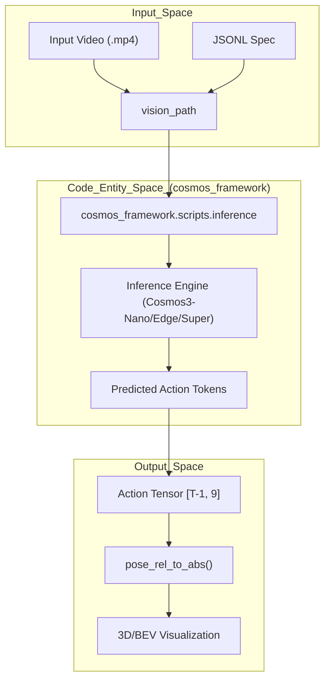
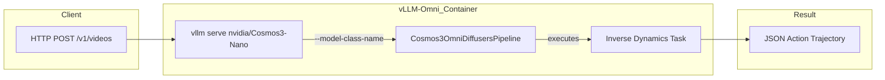
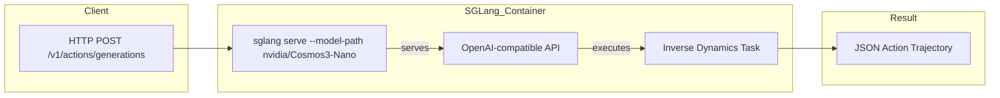

<!-- source: DeepWiki mcp.deepwiki.com · repo NVIDIA/cosmos · page 5.2 Inverse Dynamics · fetched 2026-10-26 -->

# Inverse Dynamics

<details>
<summary>Relevant source files</summary>

The following files were used as context for generating this wiki page:

- [cookbooks/cosmos3/generator/action/assets/umi_lerobot_example/meta/info.json](cookbooks/cosmos3/generator/action/assets/umi_lerobot_example/meta/info.json)
- [cookbooks/cosmos3/generator/action/run_id_with_cosmos_framework.ipynb](cookbooks/cosmos3/generator/action/run_id_with_cosmos_framework.ipynb)
- [cookbooks/cosmos3/generator/action/run_id_with_sglang.ipynb](cookbooks/cosmos3/generator/action/run_id_with_sglang.ipynb)
- [cookbooks/cosmos3/generator/action/run_id_with_vllm_omni.ipynb](cookbooks/cosmos3/generator/action/run_id_with_vllm_omni.ipynb)
- [cookbooks/cosmos3/generator/action/run_policy_with_sglang.ipynb](cookbooks/cosmos3/generator/action/run_policy_with_sglang.ipynb)
- [cookbooks/cosmos3/generator/action/run_policy_with_vllm_omni.ipynb](cookbooks/cosmos3/generator/action/run_policy_with_vllm_omni.ipynb)
- [cookbooks/cosmos3/generator/audiovisual/assets/videos/car_driving_plain.mp4](cookbooks/cosmos3/generator/audiovisual/assets/videos/car_driving_plain.mp4)
- [cookbooks/cosmos3/generator/audiovisual/run_with_sglang.ipynb](cookbooks/cosmos3/generator/audiovisual/run_with_sglang.ipynb)
- [cookbooks/cosmos3/reasoner/run_with_cosmos_framework.ipynb](cookbooks/cosmos3/reasoner/run_with_cosmos_framework.ipynb)

</details>


Inverse dynamics is the task of predicting the ego-motion action trajectory that produced a given input video. In the NVIDIA Cosmos 3 ecosystem, this is the functional reverse of Forward Dynamics. The model processes visual temporal transitions and maps them to a unified action representation, enabling applications in autonomous vehicle (AV) path planning and robotics state estimation.

## Overview and Implementation

The Inverse Dynamics workflow is supported by the native **Cosmos Framework** (PyTorch-based), **vLLM-Omni** (production serving), and **SGLang** backends. The model treats actions as a modality where tokens represent transitions between consecutive visual states.

### Action Representation
For autonomous vehicle (AV) embodiments, the model predicts a 9D ego-pose delta for each frame transition.

| Dimension | Component | Representation | Unit |
| :--- | :--- | :--- | :--- |
| 1-3 | Translation | 3D Vector $[x, y, z]$ | Meters |
| 4-9 | Rotation | 6D Continuous Rotation (rot6d) | Normalization-ready |

The output tensor for a video of length $T$ frames is shaped $[T-1, 9]$, representing the deltas between $T$ states.

### Data Flow: Video to Trajectory

The following diagram illustrates the transformation from input video frames to the final predicted action trajectory within the `cosmos_framework` ecosystem.

**Inverse Dynamics Data Pipeline**

Sources: [cookbooks/cosmos3/generator/action/run_id_with_cosmos_framework.ipynb:19-25](), [cookbooks/cosmos3/generator/action/run_id_with_cosmos_framework.ipynb:34-36]()

## Input Specification

Inverse dynamics inference is driven by a JSONL (JSON Lines) specification. Unlike forward dynamics, the `action_path` is omitted as it is the target output [cookbooks/cosmos3/generator/action/run_id_with_vllm_omni.ipynb:128-130]().

### JSONL Field Definitions
| Field | Description | Example |
| :--- | :--- | :--- |
| `vision_path` | Absolute path to the input video file. | `"/workspace/assets/videos/av_0.mp4"` |
| `model_mode` | Must be set to `inverse_dynamics`. | `"inverse_dynamics"` |
| `domain_name` | The embodiment domain (e.g., `av`). | `"av"` |
| `action_chunk_size` | Number of action steps to predict. | `60` |
| `view_point` | Camera perspective (typically `ego_view`). | `"ego_view"` |
| `fps` | Frame rate of the input video. | `10` |

Sources: [cookbooks/cosmos3/generator/action/run_id_with_vllm_omni.ipynb:162-171](), [cookbooks/cosmos3/generator/action/run_id_with_cosmos_framework.ipynb:25-25]()

## Execution Backends

### 1. Cosmos Framework (Native PyTorch)
Execution via the framework uses `torchrun` to call the `cosmos_framework.scripts.inference` entrypoint. This is the preferred method for local development and debugging [cookbooks/cosmos3/generator/action/run_id_with_cosmos_framework.ipynb:19-23]().

```bash
python -m cosmos_framework.scripts.inference \
  --checkpoint-path $COSMOS3_CHECKPOINT_PATH \
  --input-spec action_inverse_dynamics_av_custom.jsonl \
  --output-dir $COSMOS3_OUTPUT_ROOT \
  --model-mode inverse_dynamics
```
Sources: [cookbooks/cosmos3/generator/action/run_id_with_cosmos_framework.ipynb:19-25]()

### 2. vLLM-Omni (API-based)
The vLLM-Omni backend serves the model via an OpenAI-compatible video API. The request is a `POST` to the `/v1/videos` endpoint. The server is launched using the `Cosmos3OmniDiffusersPipeline` model class [cookbooks/cosmos3/generator/action/run_id_with_vllm_omni.ipynb:51-57]().

**vLLM-Omni Service Mapping**

Sources: [cookbooks/cosmos3/generator/action/run_id_with_vllm_omni.ipynb:45-57](), [cookbooks/cosmos3/generator/action/run_id_with_vllm_omni.ipynb:23-29]()

### 3. SGLang (API-based)
The SGLang backend also provides an OpenAI-compatible API for inverse dynamics inference. The request is a `POST` to the `/v1/actions/generations` endpoint. The SGLang server can be launched with `sglang serve` specifying the model path [cookbooks/cosmos3/generator/action/run_id_with_sglang.ipynb:55-57]().

**SGLang Service Mapping**

Sources: [cookbooks/cosmos3/generator/action/run_id_with_sglang.ipynb:18-21](), [cookbooks/cosmos3/generator/action/run_id_with_sglang.ipynb:55-57]()

## Coordinate Transformations and Visualization

### AV Pose Conventions
The model assumes specific coordinate conventions for Autonomous Vehicle (AV) data, often involving transformations from camera-to-world matrices (OpenCV convention) [cookbooks/cosmos3/generator/action/run_fd_with_vllm_omni.ipynb:165-172]():
*   **Y-up**: The Y-axis points vertically.
*   **+Z forward**: The positive Z-axis represents the forward direction of the vehicle.
*   **Unit**: Meters.

### Relative to Absolute Transformation
The model outputs **relative** poses (deltas between frames). To visualize a trajectory, these must be converted to **absolute** coordinates using `pose_rel_to_abs`. Conversely, for training or forward dynamics, absolute poses are converted to relative using `pose_abs_to_rel` [cookbooks/cosmos3/generator/action/run_fd_with_vllm_omni.ipynb:170-174]().

### Visualization Types
1.  **3D Trajectory**: Plotting the $[x, y, z]$ translation in 3D space to visualize elevation and turns [cookbooks/cosmos3/generator/action/run_id_with_cosmos_framework.ipynb:25-25]().
2.  **BEV (Bird's Eye View)**: Projecting the trajectory onto the $XZ$ plane to view the vehicle's path from above [cookbooks/cosmos3/generator/action/run_id_with_cosmos_framework.ipynb:25-25]().

Sources: [cookbooks/cosmos3/generator/action/run_id_with_cosmos_framework.ipynb:25-25](), [cookbooks/cosmos3/generator/action/run_fd_with_vllm_omni.ipynb:165-174]()

---

