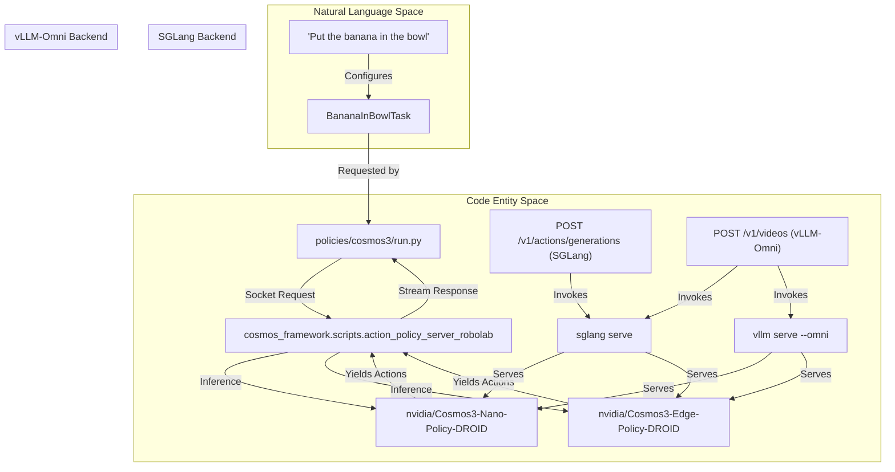

<!-- source: DeepWiki mcp.deepwiki.com · repo NVIDIA/cosmos · page 5.3 Policy Execution and RoboLab · fetched 2026-10-26 -->

# Policy Execution and RoboLab

<details>
<summary>Relevant source files</summary>

The following files were used as context for generating this wiki page:

- [cookbooks/cosmos3/generator/action/assets/videos/robolab_example_rollout.mp4](cookbooks/cosmos3/generator/action/assets/videos/robolab_example_rollout.mp4)
- [cookbooks/cosmos3/generator/action/run_id_with_sglang.ipynb](cookbooks/cosmos3/generator/action/run_id_with_sglang.ipynb)
- [cookbooks/cosmos3/generator/action/run_id_with_vllm_omni.ipynb](cookbooks/cosmos3/generator/action/run_id_with_vllm_omni.ipynb)
- [cookbooks/cosmos3/generator/action/run_policy_with_cosmos_framework.md](cookbooks/cosmos3/generator/action/run_policy_with_cosmos_framework.md)
- [cookbooks/cosmos3/generator/action/run_policy_with_sglang.ipynb](cookbooks/cosmos3/generator/action/run_policy_with_sglang.ipynb)
- [cookbooks/cosmos3/generator/action/run_policy_with_vllm_omni.ipynb](cookbooks/cosmos3/generator/action/run_policy_with_vllm_omni.ipynb)
- [cookbooks/cosmos3/generator/audiovisual/assets/videos/car_driving_plain.mp4](cookbooks/cosmos3/generator/audiovisual/assets/videos/car_driving_plain.mp4)
- [cookbooks/cosmos3/generator/audiovisual/run_with_sglang.ipynb](cookbooks/cosmos3/generator/audiovisual/run_with_sglang.ipynb)

</details>


This page documents the Policy execution workflow, the integration with the RoboLab simulation environment, the specialized `Cosmos3-Nano-Policy-DROID` and `Cosmos3-Edge-Policy-DROID` models, and the underlying action trajectory assets used for robotic and autonomous vehicle tasks.

## Policy Execution Workflow

The Policy task involves predicting both future visual observations and action trajectories from a starting image, a natural language task instruction, and the current robot state. This is implemented using a server-client architecture where a policy **Server** streams actions to a **Client** driving a simulated or real robot [cookbooks/cosmos3/generator/action/run_policy_with_cosmos_framework.md:7-7]().

### Policy Models
NVIDIA Cosmos 3 provides two post-trained policy models for the DROID embodiment:
1.  **Cosmos3-Nano-Policy-DROID**: Optimized for high-performance server-side inference [cookbooks/cosmos3/generator/action/run_policy_with_cosmos_framework.md:4-4]().
2.  **Cosmos3-Edge-Policy-DROID**: Optimized for edge deployment (e.g., Jetson AGX Orin/Thor), requiring specific prompt formatting (`--format-prompt-as-json True`) and guidance interval configuration (`--guidance-interval 960 1001`) [cookbooks/cosmos3/generator/action/run_policy_with_cosmos_framework.md:70-77]().

### RoboLab Integration
Cosmos 3 integrates with [RoboLab](https://github.com/NVlabs/RoboLab), a simulation benchmark for task-generalist policies [cookbooks/cosmos3/generator/action/run_policy_with_cosmos_framework.md:7-7]().

1.  **Policy Server**: Runs the model using the `cosmos_framework.scripts.action_policy_server_robolab` module [cookbooks/cosmos3/generator/action/run_policy_with_cosmos_framework.md:66-66](). The server requires specific `uv` groups (`cu130-torch213-train` and `policy-server`) to manage dependencies [cookbooks/cosmos3/generator/action/run_policy_with_cosmos_framework.md:48-54]().
2.  **Simulation Client**: The RoboLab environment acts as the client. Execution is triggered via `policies/cosmos3/run.py`, specifying tasks such as `BananaInBowlTask` [cookbooks/cosmos3/generator/action/run_policy_with_cosmos_framework.md:103-105](). The client can run in headless mode and evaluate across multiple sub-environments in parallel [cookbooks/cosmos3/generator/action/run_policy_with_cosmos_framework.md:110-112]().
3.  **SGLang Serving**: Policies can also be served via SGLang using the `lmsysorg/sglang:dev` container, exposing an OpenAI-compatible `/v1/actions/generations` endpoint for policy actions and `/v1/videos` for rollout videos [cookbooks/cosmos3/generator/action/run_policy_with_sglang.ipynb:21-24](). The SGLang server is launched with `--model-path nvidia/Cosmos3-Nano-Policy-DROID` or `nvidia/Cosmos3-Edge-Policy-DROID` [cookbooks/cosmos3/generator/action/run_policy_with_sglang.ipynb:63-64]().
4.  **vLLM-Omni Serving**: Policy models can be served via vLLM-Omni using the `vllm/vllm-omni:cosmos3` container. This exposes the asynchronous `/v1/videos` API for one-shot policy rollout generation, returning a rollout video and an action chunk [cookbooks/cosmos3/generator/action/run_policy_with_vllm_omni.ipynb:26-28](). The server is launched with `--model-class-name Cosmos3OmniDiffusersPipeline` and `--model-path nvidia/Cosmos3-Nano-Policy-DROID` or `nvidia/Cosmos3-Edge-Policy-DROID` [cookbooks/cosmos3/generator/action/run_policy_with_vllm_omni.ipynb:61-62]().

**Sources:** [cookbooks/cosmos3/generator/action/run_policy_with_cosmos_framework.md](), [cookbooks/cosmos3/generator/action/run_policy_with_sglang.ipynb](), [cookbooks/cosmos3/generator/action/run_policy_with_vllm_omni.ipynb]()

## Action Definition and Representations

Cosmos 3 treats actions as a unified modality. Poses are typically represented as **9D pose deltas** (3D translation and 6D continuous rotation), with robotics embodiments adding a 1D gripper dimension or 8D joint positions.

### Action Dimensionality by Embodiment
| Embodiment | Representation | Dimensionality | Primary Assets |
| :--- | :--- | :--- | :--- |
| **Autonomous Vehicle (AV)** | Ego pose (3D Trans + 6D Rot) | 9D | `av_traj_forward.json` |
| **DROID (End-Effector)** | EE Pose (9D) + Gripper (1D) | 10D | `droid_lerobot_example/` |
| **DROID (Joint)** | Joint Positions | 8D | `action_policy_droid_nano.toml` |
| **UMI** | EE Pose (9D) + Gripper (1D) | 10D | `umi.json` |
| **Bridge/Fractal** | Relative Pose + Gripper | 10D | Domain-specific JSON |
| **Human Hand Pose** | Hand Keypoints | 57D | Egocentric hand datasets |

**Sources:** [cookbooks/cosmos3/generator/action/run_id_with_sglang.ipynb:161-171](), [cookbooks/cosmos3/generator/action/assets/actions/av_traj_forward.json](), [cookbooks/cosmos3/generator/action/assets/actions/umi.json](), [cookbooks/cosmos3/generator/action/run_policy_with_sglang.ipynb:102-106]()

## Action Trajectory Assets

The repository includes sample JSON files representing action trajectories used to condition Forward Dynamics generation.

### AV Trajectories (9D)
AV actions use a 9D format consisting of translation and rotation components [cookbooks/cosmos3/generator/action/assets/actions/av_traj_forward.json:1-1]().
*   `av_traj_forward.json`: Constant forward ego-motion [cookbooks/cosmos3/generator/action/assets/actions/av_traj_forward.json:1-1]().
*   `av_traj_left.json`: Left-hand turn trajectory.
*   `av_traj_right.json`: Right-hand turn trajectory [cookbooks/cosmos3/generator/action/assets/actions/av_traj_right.json:1-1]().

### Robotics Trajectories
*   **UMI**: Uses 10D format (9D pose + 1D gripper) [cookbooks/cosmos3/generator/action/assets/actions/umi.json:1-1]().
*   **DROID**: Stored in LeRobot format using Parquet for state and multi-view MP4 for vision [cookbooks/cosmos3/generator/action/run_policy_with_sglang.ipynb:25-25]().

**Sources:** [cookbooks/cosmos3/generator/action/assets/actions/av_traj_forward.json](), [cookbooks/cosmos3/generator/action/assets/actions/umi.json](), [cookbooks/cosmos3/generator/action/assets/actions/av_traj_right.json]()

## DROID LeRobot Dataset Structure

The `assets/droid_lerobot_example` directory provides a template for multi-view robot data following the LeRobot specification.

### Multi-View Vision Ingestion
The DROID policy model uses a concatenated multi-view frame for the visual conditioning input [cookbooks/cosmos3/generator/action/run_policy_with_sglang.ipynb:156-156](). The example script extracts the first frame from three cameras and tiles them into a single 640x540 image [cookbooks/cosmos3/generator/action/run_policy_with_sglang.ipynb:157-167]():
*   **Wrist View**: `observation/wrist_image_left` (Top half) [cookbooks/cosmos3/generator/action/run_policy_with_sglang.ipynb:161-165]().
*   **Exterior 1**: `observation/exterior_image_1_left` (Bottom left) [cookbooks/cosmos3/generator/action/run_policy_with_sglang.ipynb:162-166]().
*   **Exterior 2**: `observation/exterior_image_2_left` (Bottom right) [cookbooks/cosmos3/generator/action/run_policy_with_sglang.ipynb:163-167]().

**Sources:** [cookbooks/cosmos3/generator/action/run_policy_with_sglang.ipynb]()

## System Mapping Diagrams

**Policy Execution: Natural Language to Code Entity Space**


**Data Flow: DROID Multi-View to SGLang Policy Server**
```mermaid
graph LR
    subgraph "Storage (droid_lerobot_example)"
        WRIST["wrist_image_left/file-000.mp4"]
        EXT1["exterior_image_1_left/file-000.mp4"]
        EXT2["exterior_image_2_left/file-000.mp4"]
    end

    subgraph "Notebook Logic (run_policy_with_sglang.ipynb)"
        EXTR["extract_first_frame(video_path, out_path)"]
        TILE["PIL.Image.Image.paste()"]
        REQ_POLICY["POST /v1/actions/generations"]
        REQ_ROLLOUT["POST /v1/videos"]
    end

    subgraph "SGLang Server"
        SGLANG_SERVE["sglang serve --model-path ...Policy-DROID"]
    end

    WRIST -->|Frame 0| EXTR
    EXT1 -->|Frame 0| EXTR
    EXT2 -->|Frame 0| EXTR
    EXTR -->|Extracted Frames| TILE
    TILE -->|640x540 Multi-view Image| REQ_POLICY
    REQ_POLICY -->|Policy Inference Request| SGLANG_SERVE
    SGLANG_SERVE -->|Action Vector (JSON)| REQ_ROLLOUT
    REQ_ROLLOUT -->|Rollout Video Request| SGLANG_SERVE
    SGLANG_SERVE -->|Generated Rollout Video| CLIENT_APP[Client Application]
```

**Sources:** [cookbooks/cosmos3/generator/action/run_policy_with_cosmos_framework.md](), [cookbooks/cosmos3/generator/action/run_policy_with_sglang.ipynb](), [cookbooks/cosmos3/generator/action/run_policy_with_vllm_omni.ipynb]()

---

