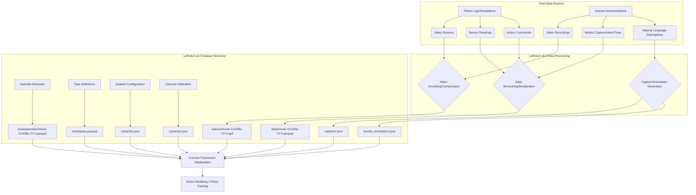

<!-- source: DeepWiki mcp.deepwiki.com · repo NVIDIA/cosmos · page 5.4 Action Datasets and Asset Formats · fetched 2026-10-26 -->

# 5.4. Action Datasets and Asset Formats

<details>
<summary>Relevant source files</summary>

The following files were used as context for generating this wiki page:

- [cookbooks/cosmos3/generator/action/assets/agibotworld_beta_lerobot_example/data/chunk-000/file-000.parquet](cookbooks/cosmos3/generator/action/assets/agibotworld_beta_lerobot_example/data/chunk-000/file-000.parquet)
- [cookbooks/cosmos3/generator/action/assets/agibotworld_beta_lerobot_example/meta/episodes/chunk-000/file-000.parquet](cookbooks/cosmos3/generator/action/assets/agibotworld_beta_lerobot_example/meta/episodes/chunk-000/file-000.parquet)
- [cookbooks/cosmos3/generator/action/assets/agibotworld_beta_lerobot_example/meta/info.json](cookbooks/cosmos3/generator/action/assets/agibotworld_beta_lerobot_example/meta/info.json)
- [cookbooks/cosmos3/generator/action/assets/agibotworld_beta_lerobot_example/meta/tasks.parquet](cookbooks/cosmos3/generator/action/assets/agibotworld_beta_lerobot_example/meta/tasks.parquet)
- [cookbooks/cosmos3/generator/action/assets/agibotworld_beta_lerobot_example/videos/observation.images.hand_right/chunk-000/file-000.mp4](cookbooks/cosmos3/generator/action/assets/agibotworld_beta_lerobot_example/videos/observation.images.hand_right/chunk-000/file-000.mp4)
- [cookbooks/cosmos3/generator/action/assets/agibotworld_beta_lerobot_example/videos/observation.images.head/chunk-000/file-000.mp4](cookbooks/cosmos3/generator/action/assets/agibotworld_beta_lerobot_example/videos/observation.images.head/chunk-000/file-000.mp4)
- [cookbooks/cosmos3/generator/action/assets/bridge_lerobot_example/data/chunk-000/file-000.parquet](cookbooks/cosmos3/generator/action/assets/bridge_lerobot_example/data/chunk-000/file-000.parquet)
- [cookbooks/cosmos3/generator/action/assets/bridge_lerobot_example/meta/episodes/chunk-000/file-000.parquet](cookbooks/cosmos3/generator/action/assets/bridge_lerobot_example/meta/episodes/chunk-000/file-000.parquet)
- [cookbooks/cosmos3/generator/action/assets/bridge_lerobot_example/meta/info.json](cookbooks/cosmos3/generator/action/assets/bridge_lerobot_example/meta/info.json)
- [cookbooks/cosmos3/generator/action/assets/bridge_lerobot_example/meta/tasks.parquet](cookbooks/cosmos3/generator/action/assets/bridge_lerobot_example/meta/tasks.parquet)
- [cookbooks/cosmos3/generator/action/assets/droid_lerobot_example/data/chunk-000/file-000.parquet](cookbooks/cosmos3/generator/action/assets/droid_lerobot_example/data/chunk-000/file-000.parquet)
- [cookbooks/cosmos3/generator/action/assets/droid_lerobot_example/meta/episodes/chunk-000/file-000.parquet](cookbooks/cosmos3/generator/action/assets/droid_lerobot_example/meta/episodes/chunk-000/file-000.parquet)
- [cookbooks/cosmos3/generator/action/assets/droid_lerobot_example/meta/info.json](cookbooks/cosmos3/generator/action/assets/droid_lerobot_example/meta/info.json)
- [cookbooks/cosmos3/generator/action/assets/droid_lerobot_example/meta/tasks.parquet](cookbooks/cosmos3/generator/action/assets/droid_lerobot_example/meta/tasks.parquet)
- [cookbooks/cosmos3/generator/action/assets/egocentric_hand_action_example/cameras/ESCALE_000374.json](cookbooks/cosmos3/generator/action/assets/egocentric_hand_action_example/cameras/ESCALE_000374.json)
- [cookbooks/cosmos3/generator/action/assets/egocentric_hand_action_example/captions/ESCALE_000374.json](cookbooks/cosmos3/generator/action/assets/egocentric_hand_action_example/captions/ESCALE_000374.json)
- [cookbooks/cosmos3/generator/action/assets/egocentric_hand_action_example/human_annotation/ESCALE_000374.json](cookbooks/cosmos3/generator/action/assets/egocentric_hand_action_example/human_annotation/ESCALE_000374.json)
- [cookbooks/cosmos3/generator/action/assets/egocentric_hand_action_example/videos/ESCALE_000374.mp4](cookbooks/cosmos3/generator/action/assets/egocentric_hand_action_example/videos/ESCALE_000374.mp4)
- [cookbooks/cosmos3/generator/action/assets/fractal_lerobot_example/data/chunk-000/file-000.parquet](cookbooks/cosmos3/generator/action/assets/fractal_lerobot_example/data/chunk-000/file-000.parquet)
- [cookbooks/cosmos3/generator/action/assets/fractal_lerobot_example/meta/episodes/chunk-000/file-000.parquet](cookbooks/cosmos3/generator/action/assets/fractal_lerobot_example/meta/episodes/chunk-000/file-000.parquet)
- [cookbooks/cosmos3/generator/action/assets/fractal_lerobot_example/meta/info.json](cookbooks/cosmos3/generator/action/assets/fractal_lerobot_example/meta/info.json)
- [cookbooks/cosmos3/generator/action/assets/fractal_lerobot_example/meta/stats.json](cookbooks/cosmos3/generator/action/assets/fractal_lerobot_example/meta/stats.json)
- [cookbooks/cosmos3/generator/action/assets/fractal_lerobot_example/videos/observation.images.image/chunk-000/file-000.mp4](cookbooks/cosmos3/generator/action/assets/fractal_lerobot_example/videos/observation.images.image/chunk-000/file-000.mp4)
- [cookbooks/cosmos3/generator/action/assets/human_hand_pose_lerobot_example/data/chunk-000/file-000.parquet](cookbooks/cosmos3/generator/action/assets/human_hand_pose_lerobot_example/data/chunk-000/file-000.parquet)
- [cookbooks/cosmos3/generator/action/assets/human_hand_pose_lerobot_example/meta/episodes/chunk-000/file-000.parquet](cookbooks/cosmos3/generator/action/assets/human_hand_pose_lerobot_example/meta/episodes/chunk-000/file-000.parquet)
- [cookbooks/cosmos3/generator/action/assets/human_hand_pose_lerobot_example/meta/info.json](cookbooks/cosmos3/generator/action/assets/human_hand_pose_lerobot_example/meta/info.json)
- [cookbooks/cosmos3/generator/action/assets/human_hand_pose_lerobot_example/meta/subtasks.parquet](cookbooks/cosmos3/generator/action/assets/human_hand_pose_lerobot_example/meta/subtasks.parquet)
- [cookbooks/cosmos3/generator/action/assets/human_hand_pose_lerobot_example/meta/tasks.parquet](cookbooks/cosmos3/generator/action/assets/human_hand_pose_lerobot_example/meta/tasks.parquet)
- [cookbooks/cosmos3/generator/action/assets/human_hand_pose_lerobot_example/videos/observation.images.main/chunk-000/file-000.mp4](cookbooks/cosmos3/generator/action/assets/human_hand_pose_lerobot_example/videos/observation.images.main/chunk-000/file-000.mp4)
- [cookbooks/cosmos3/generator/action/assets/robomind_lerobot_example/franka/data/chunk-000/file-000.parquet](cookbooks/cosmos3/generator/action/assets/robomind_lerobot_example/franka/data/chunk-000/file-000.parquet)
- [cookbooks/cosmos3/generator/action/assets/robomind_lerobot_example/franka/meta/episodes/chunk-000/file-000.parquet](cookbooks/cosmos3/generator/action/assets/robomind_lerobot_example/franka/meta/episodes/chunk-000/file-000.parquet)
- [cookbooks/cosmos3/generator/action/assets/robomind_lerobot_example/franka/meta/info.json](cookbooks/cosmos3/generator/action/assets/robomind_lerobot_example/franka/meta/info.json)
- [cookbooks/cosmos3/generator/action/assets/robomind_lerobot_example/franka/meta/stats.json](cookbooks/cosmos3/generator/action/assets/robomind_lerobot_example/franka/meta/stats.json)
- [cookbooks/cosmos3/generator/action/assets/robomind_lerobot_example/franka/meta/tasks.parquet](cookbooks/cosmos3/generator/action/assets/robomind_lerobot_example/franka/meta/tasks.parquet)

</details>


This page details the LeRobot v3.0 example datasets bundled within the NVIDIA Cosmos repository. It covers the directory structure, the schema of `meta/info.json` and `meta/tasks.parquet` files, the format of Parquet data files, and the structure of multi-view MP4 video assets. Additionally, it describes the JSON trajectory and reference image/prompt assets used for action modeling.

## LeRobot v3.0 Dataset Structure

The action datasets in the repository adhere to the LeRobot v3.0 format, which organizes robotic and human demonstration data in a standardized way. This format facilitates consistent data loading and processing across different robotics tasks and embodiments.

### Directory Layout

A typical LeRobot v3.0 dataset follows a hierarchical directory structure:

```
<dataset_root>/
├── data/
│   └── chunk-XXX/
│       └── file-YYY.parquet
├── meta/
│   ├── info.json
│   ├── episodes/
│   │   └── chunk-XXX/
│   │       └── file-YYY.parquet
│   ├── tasks.parquet
│   └── stats.json (optional)
└── videos/
    └── <camera_name>/
        └── chunk-XXX/
            └── file-YYY.mp4
```

- **`data/chunk-XXX/file-YYY.parquet`**: These files contain the core time-series data, including observations (e.g., robot joint states, gripper positions, hand poses) and actions. Each `file-YYY.parquet` represents a segment of data, and `chunk-XXX` directories group these files.
  - Example: `cookbooks/cosmos3/generator/action/assets/droid_lerobot_example/data/chunk-000/file-000.parquet`()
  - Example: `cookbooks/cosmos3/generator/action/assets/human_hand_pose_lerobot_example/data/chunk-000/file-000.parquet`()

- **`meta/info.json`**: This file provides high-level metadata about the entire dataset. It includes information such as the codebase version, robot type, total number of episodes and frames, FPS, data paths, and a detailed schema of all features.
  - Example: `cookbooks/cosmos3/generator/action/assets/droid_lerobot_example/meta/info.json`()
  - Example: `cookbooks/cosmos3/generator/action/assets/human_hand_pose_lerobot_example/meta/info.json`()

- **`meta/episodes/chunk-XXX/file-YYY.parquet`**: These files contain metadata specific to each episode, such as episode index, task information, and pointers to the corresponding data and video chunks.
  - Example: `cookbooks/cosmos3/generator/action/assets/droid_lerobot_example/meta/episodes/chunk-000/file-000.parquet`()
  - Example: `cookbooks/cosmos3/generator/action/assets/human_hand_pose_lerobot_example/meta/episodes/chunk-000/file-000.parquet`()

- **`meta/tasks.parquet`**: This file maps task indices to human-readable task descriptions.
  - Example: `cookbooks/cosmos3/generator/action/assets/droid_lerobot_example/meta/tasks.parquet`()
  - Example: `cookbooks/cosmos3/generator/action/assets/human_hand_pose_lerobot_example/meta/tasks.parquet`()

- **`meta/subtasks.parquet`**: (Specific to some datasets like human hand pose) This file maps subtask indices to human-readable subtask descriptions.
  - Example: `cookbooks/cosmos3/generator/action/assets/human_hand_pose_lerobot_example/meta/subtasks.parquet`()

- **`videos/<camera_name>/chunk-XXX/file-YYY.mp4`**: These directories store multi-view video observations from different cameras. Each video file corresponds to a segment of an episode.
  - Example: `cookbooks/cosmos3/generator/action/assets/human_hand_pose_lerobot_example/videos/observation.images.main/chunk-000/file-000.mp4`()

### `meta/info.json` Feature Schemas

The `meta/info.json` file is crucial for understanding the data contained within a dataset. The `"features"` key defines the schema for all observations and actions. Each feature entry specifies its `dtype`, `shape`, and optionally `names` for individual dimensions or `video_info` for video streams.

For example, in the DROID dataset:
- `observation.state.cartesian_position` has `dtype: "float32"` and `shape: [6]` [cookbooks/cosmos3/generator/action/assets/droid_lerobot_example/meta/info.json:17-23]().
- `action.joint_position` has `dtype: "float32"` and `shape: [7]` [cookbooks/cosmos3/generator/action/assets/droid_lerobot_example/meta/info.json:45-51]().
- `observation.image.wrist_image_left` has `dtype: "video"`, `shape: [360, 640, 3]`, and detailed `info` about video properties like `video.height`, `video.width`, `video.codec`, and `video.fps` [cookbooks/cosmos3/generator/action/assets/droid_lerobot_example/meta/info.json:52-68]().

For the human hand pose dataset:
- `observation.state.hand_left_cam` has `dtype: "float32"` and `shape: [63]`, with `names` specifying the 3D coordinates for various hand joints [cookbooks/cosmos3/generator/action/assets/human_hand_pose_lerobot_example/meta/info.json:75-144]().
- `observation.state.hand_left_cam_rotation` has `dtype: "float32"` and `shape: [84]`, with `names` specifying quaternion rotations for hand joints [cookbooks/cosmos3/generator/action/assets/human_hand_pose_lerobot_example/meta/info.json:217-282]().

This detailed schema allows for programmatic understanding and loading of the dataset contents.

### Parquet Data Files

The `data/` and `meta/episodes/` directories contain data stored in Apache Parquet format. Parquet is a columnar storage format optimized for analytical queries and efficient data compression. Each `.parquet` file typically stores a table-like structure where columns correspond to features defined in `info.json` and rows correspond to time steps or episodes.

The content of these files is binary and not directly human-readable, but tools like `pyarrow` can be used to inspect their schema and data.

### Multi-view MP4s

Video observations are stored as MP4 files, often in multiple views (e.g., `wrist_image_left`, `exterior_image_1_left`, `exterior_image_2_left` for DROID, or `main` for human hand pose). These videos are typically encoded with codecs like `av1` or `h264` and contain information about resolution, frame rate, and pixel format within their `video_info` in `info.json`.
- Example: `cookbooks/cosmos3/generator/action/assets/droid_lerobot_example/meta/info.json:62-63`() specifies `video.codec: "av1"` and `video.pix_fmt: "yuv420p"`.
- Example: `cookbooks/cosmos3/generator/action/assets/human_hand_pose_lerobot_example/meta/info.json:27-28`() specifies `video.codec: "h264"` and `video.pix_fmt: "yuv420p"`.

## Example Datasets

The repository includes several example datasets covering various robotic and human action scenarios:

- **DROID**: Robotic manipulation data, often featuring a Panda robot.
  - Example path: `cookbooks/cosmos3/generator/action/assets/droid_lerobot_example/`
- **UMI**: (Not explicitly shown in provided files, but part of LeRobot v3.0 ecosystem)
- **Bridge**: Robotic manipulation data, likely from the Bridge dataset.
  - Example path: `cookbooks/cosmos3/generator/action/assets/bridge_lerobot_example/`
- **Fractal**: Robotic manipulation data, potentially from a simulated environment.
  - Example path: `cookbooks/cosmos3/generator/action/assets/fractal_lerobot_example/`
- **AgiBotWorld**: Robotic data from the AgiBotWorld simulation.
  - Example path: `cookbooks/cosmos3/generator/action/assets/agibotworld_beta_lerobot_example/`
- **RoboMIND (franka/franka_dual/ur)**: Robotic data from RoboMIND, featuring Franka Emika Panda and Universal Robots (UR) arms.
  - Example path: `cookbooks/cosmos3/generator/action/assets/robomind_lerobot_example/franka/`
- **Human Hand Pose**: Egocentric human hand pose data.
  - Example path: `cookbooks/cosmos3/generator/action/assets/human_hand_pose_lerobot_example/`
- **Egocentric Hand Action**: Egocentric video and associated action data, often with natural language descriptions.
  - Example path: `cookbooks/cosmos3/generator/action/assets/egocentric_hand_action_example/`

### Egocentric Hand Action Assets

The egocentric hand action examples include additional assets beyond the standard LeRobot v3.0 format:

- **`captions/<episode_id>.json`**: These JSON files contain natural language descriptions of the actions performed in an episode, often at different levels of detail (e.g., "long", "medium", "short").
  - Example: `cookbooks/cosmos3/generator/action/assets/egocentric_hand_action_example/captions/ESCALE_000374.json`()
  ```json
  {
    "vlm_pipeline": {
      "long": "Right hand reaches into the gray wire cutlery basket, grasps a green-handled dinner knife, and lifts it straight up from the tray.",
      "medium": "Grab dinner knife from cutlery basket with right hand.",
      "short": "Retrieve  the dinner knife from the cutlery basket"
    }
  }
  ```
- **`cameras/<episode_id>.json`**: These JSON files store camera pose information, typically `pose_world2cam` (world to camera transformation) for each frame.
  - Example: `cookbooks/cosmos3/generator/action/assets/egocentric_hand_action_example/cameras/ESCALE_000374.json`()
- **`human_annotation/<episode_id>.json`**: These JSON files contain human annotations, which might include bounding boxes, keypoints, or other labels relevant to the actions.
  - Example: `cookbooks/cosmos3/generator/action/assets/egocentric_hand_action_example/human_annotation/ESCALE_000374.json` (not shown in full, but indicated by file path)

## Data Flow and Processing

The following diagram illustrates the general data flow for these action datasets:

### Diagram: LeRobot v3.0 Dataset Data Flow

Sources:
- `cookbooks/cosmos3/generator/action/assets/droid_lerobot_example/data/chunk-000/file-000.parquet`()
- `cookbooks/cosmos3/generator/action/assets/droid_lerobot_example/meta/episodes/chunk-000/file-000.parquet`()
- `cookbooks/cosmos3/generator/action/assets/droid_lerobot_example/meta/tasks.parquet`()
- `cookbooks/cosmos3/generator/action/assets/droid_lerobot_example/meta/info.json`()
- `cookbooks/cosmos3/generator/action/assets/human_hand_pose_lerobot_example/data/chunk-000/file-000.parquet`()
- `cookbooks/cosmos3/generator/action/assets/human_hand_pose_lerobot_example/meta/tasks.parquet`()
- `cookbooks/cosmos3/generator/action/assets/human_hand_pose_lerobot_example/meta/episodes/chunk-000/file-000.parquet`()
- `cookbooks/cosmos3/generator/action/assets/human_hand_pose_lerobot_example/videos/observation.images.main/chunk-000/file-000.mp4`()
- `cookbooks/cosmos3/generator/action/assets/human_hand_pose_lerobot_example/meta/subtasks.parquet`()
- `cookbooks/cosmos3/generator/action/assets/human_hand_pose_lerobot_example/meta/info.json`()
- `cookbooks/cosmos3/generator/action/assets/egocentric_hand_action_example/captions/ESCALE_000374.json`()
- `cookbooks/cosmos3/generator/action/assets/egocentric_hand_action_example/cameras/ESCALE_000374.json`()
- `cookbooks/cosmos3/generator/action/assets/egocentric_hand_action_example/human_annotation/ESCALE_000374.json`()

## Action JSON Trajectory and Reference Assets

Beyond the LeRobot v3.0 datasets, action modeling often involves specific JSON trajectory files and reference image/prompt assets for defining tasks or conditioning models. While the exact schema for these JSON trajectories can vary based on the specific action representation (e.g., 9D pose delta, rot6d, 57D hand pose), they generally encode a sequence of actions over time.

Reference image and prompt assets are used to provide context or instructions to the action model. For example, a reference image might show the desired end-state of a manipulation task, and a prompt might describe the action to be performed. These assets are typically consumed by the `Policy Execution` or `Forward Dynamics` components of the action modeling pipeline.

### Diagram: Action Modeling Asset Usage
```mermaid
graph TD
    A[User Input: Task Description] --> B{Natural Language Prompt}
    C[User Input: Initial State] --> D{Reference Image}
    E[User Input: Desired Action Sequence] --> F{Action JSON Trajectory}

    B --> G(Cosmos3 Action Model)
    D --> G
    F --> G

    G --> H[Predicted Action Sequence]
    G --> I[Predicted Future Frames]
    G --> J[Robot Control Signals]

    subgraph "Action JSON Trajectory (Example Fields)"
        F_sub[Frame 0: {"joint_pos": [...], "gripper_cmd": ...}]
        F_sub --> F_sub2[Frame 1: {"joint_pos": [...], "gripper_cmd": ...}]
        F_sub2 --> F_subN[... Frame N ...]
    end

    subgraph "Reference Image/Prompt Assets"
        D_sub[Image File: "start_scene.png"]
        B_sub[Text File: "pick up the red block"]
    end
```
Sources:
- `5.3. Policy Execution and RoboLab` (conceptual)
- `5.1. Forward Dynamics` (conceptual)
- `5.2. Inverse Dynamics` (conceptual)

---

