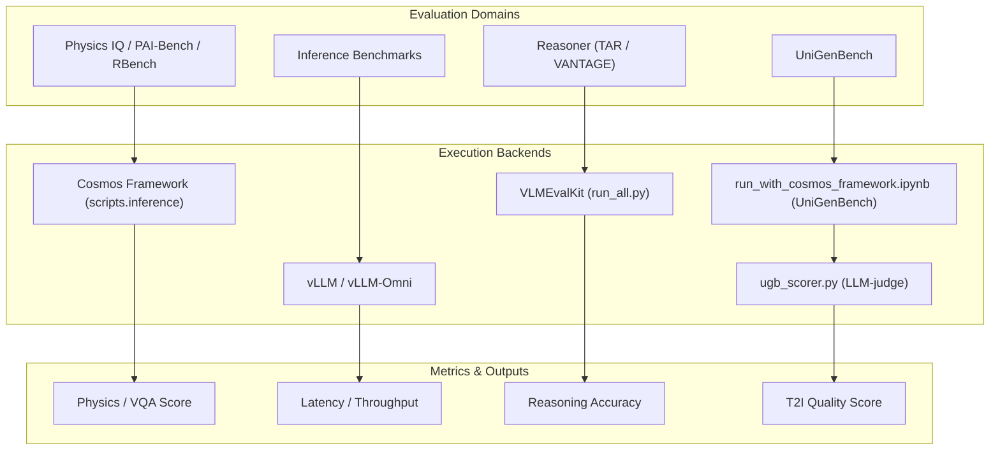
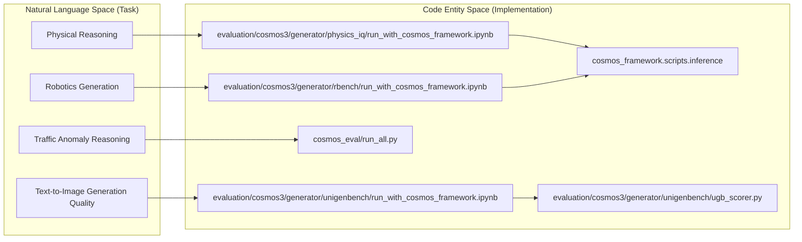

<!-- source: DeepWiki mcp.deepwiki.com · repo NVIDIA/cosmos · page 6 Evaluation · fetched 2026-10-26 -->

# Evaluation

Relevant source files

The following files were used as context for generating this wiki page:

- [evaluation/cosmos3/generator/paibench_g/README.md](evaluation/cosmos3/generator/paibench_g/README.md)
- [evaluation/cosmos3/generator/paibench_g/run_with_cosmos_framework.ipynb](evaluation/cosmos3/generator/paibench_g/run_with_cosmos_framework.ipynb)
- [evaluation/cosmos3/generator/physics_iq/README.md](evaluation/cosmos3/generator/physics_iq/README.md)
- [evaluation/cosmos3/generator/physics_iq/assets/i2v_prompts.json](evaluation/cosmos3/generator/physics_iq/assets/i2v_prompts.json)
- [evaluation/cosmos3/generator/physics_iq/assets/v2v_prompts.json](evaluation/cosmos3/generator/physics_iq/assets/v2v_prompts.json)
- [evaluation/cosmos3/generator/physics_iq/run_with_cosmos_framework.ipynb](evaluation/cosmos3/generator/physics_iq/run_with_cosmos_framework.ipynb)
- [evaluation/cosmos3/generator/rbench/README.md](evaluation/cosmos3/generator/rbench/README.md)
- [evaluation/cosmos3/generator/rbench/run_with_cosmos_framework.ipynb](evaluation/cosmos3/generator/rbench/run_with_cosmos_framework.ipynb)

This page provides an overview of the evaluation framework for NVIDIA Cosmos 3 models. The evaluation suite is divided into three primary domains: **Physical Reasoning**, which assesses the model's understanding of world physics through benchmarks like Physics IQ, PAI-Bench, and RBench; **Vision-Language Reasoning**, focusing on temporal and traffic anomaly understanding; and **Inference Performance**, which measures computational efficiency across various hardware and software backends.

For detailed walkthroughs and data tables, see the following child pages:
*   [Physics IQ Benchmark](#6.1) — Detailed physics reasoning suite for Cosmos3-Super.
*   [PAI-Bench and RBench Evaluations](#6.2) — Physical AI and robotics video-generation benchmarks.
*   [Reasoner Evaluation: TAR and VANTAGE Benchmarks](#6.3) — VLMEvalKit-based reasoning benchmarks.
*   [UniGenBench Text-to-Image Evaluation](#6.4) — Text-to-image generation evaluation.
*   [Inference Benchmarks](#6.5) — Latency and throughput metrics across GPUs and engines.

---

## Physical AI and Robotics Benchmarks

Cosmos 3 is evaluated on its ability to generate physically plausible videos and understand robotic scenes. These benchmarks use the native `cosmos_framework.scripts.inference` entrypoint to generate clips from structured prompts and conditioning images [evaluation/cosmos3/generator/rbench/run_with_cosmos_framework.ipynb:15-16]().

### Physics IQ
**Physics IQ** tests adherence to physical laws—such as gravity, object permanence, and collision dynamics. It utilizes two distinct conditioning formats:
*   **Image-to-Video (I2V)**: Conditions on a single "switch-frame" (the moment before a physics event) and generates 121 frames [evaluation/cosmos3/generator/physics_iq/README.md:12-13]().
*   **Video-to-Video (V2V)**: Conditions on a 3-second clip (72 frames padded to 73) to maintain temporal momentum, generating 193 frames total [evaluation/cosmos3/generator/physics_iq/README.md:14-16]().

### PAI-Bench and RBench
These benchmarks evaluate the **Cosmos3-Super** and **Cosmos3-Nano** models across diverse Physical AI domains:
*   **PAI-Bench (Physical AI Bench)**: 1044 samples covering AV driving, robotics, industry, physics, human, and common sense. It includes both T2V and I2V tasks [evaluation/cosmos3/generator/paibench_g/README.md:12-20]().
*   **RBench**: 650 robotics-specific cases across 9 categories including `humanoid`, `quad`, and `long-horizon_planning` [evaluation/cosmos3/generator/rbench/README.md:12-15]().

### Reference Performance (Cosmos3-Super)
| Benchmark | Task | Metric / Score |
| :--- | :--- | :---: |
| Physics IQ | I2V | 43.8 [evaluation/cosmos3/generator/physics_iq/README.md:28-28]() |
| Physics IQ | V2V | 59.7 [evaluation/cosmos3/generator/physics_iq/README.md:29-29]() |
| PAI-Bench-G | T2V Overall | 80.0% [evaluation/cosmos3/generator/paibench_g/run_with_cosmos_framework.ipynb:37-37]() |
| RBench | Overall | 58.1% [evaluation/cosmos3/generator/rbench/run_with_cosmos_framework.ipynb:40-40]() |

**Sources:**
* [evaluation/cosmos3/generator/physics_iq/README.md:1-36]()
* [evaluation/cosmos3/generator/paibench_g/README.md:1-61]()
* [evaluation/cosmos3/generator/rbench/README.md:1-92]()

---

## Reasoner Evaluation: TAR and VANTAGE

The Reasoner models are evaluated using an NVIDIA-customized version of **VLMEvalKit**. These benchmarks focus on high-level understanding of complex visual scenes.

*   **TAR (Traffic Anomaly Reasoning)**: Evaluates the model's ability to identify and reason about anomalies in traffic scenarios using the `AETCBench_all` dataset.
*   **VANTAGE**: Focuses on smart infrastructure and urban monitoring reasoning.

The evaluation infrastructure uses a `cosmos_eval/` reproduction kit that includes `run_all.py` for execution and `parse_score.py` for metric aggregation. For details, see [Reasoner Evaluation: TAR and VANTAGE Benchmarks](#6.3).

---

## UniGenBench Text-to-Image Evaluation

UniGenBench is used for evaluating text-to-image generation quality. This benchmark involves generating images from a set of prompts defined in `unigenbench_prompt.json`. The generation process leverages the `run_with_cosmos_framework.ipynb` pipeline and `utils.py` helpers. Scoring is performed by an LLM-judge, implemented in `ugb_scorer.py` with prompts from `unigenbench_scorer_prompt.md`. For details, see [UniGenBench Text-to-Image Evaluation](#6.4).

---

## Inference Performance Benchmarks

Inference benchmarks track the performance of Cosmos 3 models across integration paths including **Cosmos Framework (PyTorch)**, **vLLM/vLLM-Omni**, **Diffusers**, and **TensorRT-LLM**.

*   **Generator Benchmarks**: Measured by latency for `t2v`, `i2v`, and `t2i` across resolution tiers (256p, 480p, 720p). Benchmarks cover hardware from Jetson AGX Thor to H200 and B200 GPUs.
*   **Reasoner Benchmarks**: Focus on serving metrics via **vLLM**, including TTFT (Time to First Token), request latency, and throughput (tokens/sec) at concurrency levels up to 256.

For detailed performance tables, see [Inference Benchmarks](#6.5).

---

## Evaluation Workflow Architecture

The evaluation process bridges high-level task definitions to specific code entities and execution pipelines.

**Cosmos 3 Evaluation Flow**

**Evaluation Pipeline Mapping**

**Sources:**
* [evaluation/cosmos3/generator/physics_iq/run_with_cosmos_framework.ipynb:15-28]()
* [evaluation/cosmos3/generator/paibench_g/run_with_cosmos_framework.ipynb:11-29]()
* [evaluation/cosmos3/generator/rbench/run_with_cosmos_framework.ipynb:10-24]()

---

