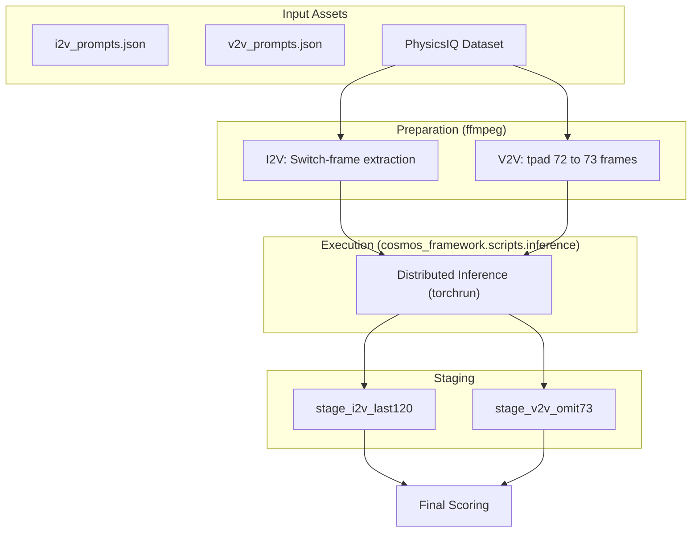
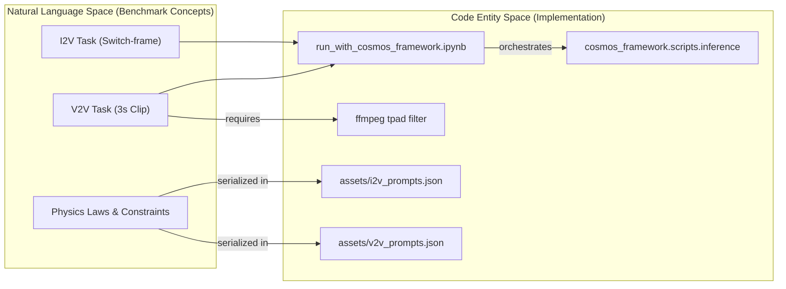

<!-- source: DeepWiki mcp.deepwiki.com · repo NVIDIA/cosmos · page 6.1 Physics IQ Benchmark · fetched 2026-10-26 -->

# Physics IQ Benchmark

Relevant source files

The following files were used as context for generating this wiki page:

- [evaluation/cosmos3/generator/physics_iq/README.md](evaluation/cosmos3/generator/physics_iq/README.md)
- [evaluation/cosmos3/generator/physics_iq/assets/i2v_prompts.json](evaluation/cosmos3/generator/physics_iq/assets/i2v_prompts.json)
- [evaluation/cosmos3/generator/physics_iq/assets/v2v_prompts.json](evaluation/cosmos3/generator/physics_iq/assets/v2v_prompts.json)
- [evaluation/cosmos3/generator/physics_iq/run_with_cosmos_framework.ipynb](evaluation/cosmos3/generator/physics_iq/run_with_cosmos_framework.ipynb)

The Physics IQ benchmark is a specialized evaluation suite designed to assess the physical reasoning capabilities of the **Cosmos3-Super** model during video generation. It measures the model's ability to adhere to fundamental physical laws—such as gravity, momentum conservation, and soft-body deformation—across two distinct task formats: Image-to-Video (I2V) and Video-to-Video (V2V) [evaluation/cosmos3/generator/physics_iq/README.md:1-16]().

### Benchmark Overview

Physics IQ evaluates whether a model can generate causally consistent sequences based on a "switch-frame"—the specific moment immediately preceding a physics event (e.g., the release of an object).

| Metric | Task Format | Conditioning | Generation Length | Scoring Range |
| :--- | :--- | :--- | :--- | :--- |
| **I2V** | Image-to-Video | 1 Switch-frame (JPG) | 121 frames (1 cond + 120 gen) | Last 120 frames |
| **V2V** | Video-to-Video | 3s Clip (73 frames) | 193 frames total | Frames 73 to 192 |

Reference scores for **Cosmos3-Super** using the native Cosmos Framework pipeline are **43.8** for I2V and **59.7** for V2V [evaluation/cosmos3/generator/physics_iq/README.md:24-29]().

Sources: [evaluation/cosmos3/generator/physics_iq/README.md:1-30](), [evaluation/cosmos3/generator/physics_iq/run_with_cosmos_framework.ipynb:10-35]()

---

### Data Flow and Pipeline

The reproduction pipeline is orchestrated via `run_with_cosmos_framework.ipynb`, which leverages the `cosmos_framework.scripts.inference` module [evaluation/cosmos3/generator/physics_iq/run_with_cosmos_framework.ipynb:15-21]().

#### Pipeline Stages
1.  **Download**: Retrieves the Physics IQ dataset (GCS-hosted) using `gcloud` or `gsutil` [evaluation/cosmos3/generator/physics_iq/run_with_cosmos_framework.ipynb:47-48]().
2.  **Prepare**:
    *   **I2V**: Uses the "switch-frame" as the conditioning image.
    *   **V2V**: Uses `ffmpeg` to process 72-frame conditioning clips. A specific `tpad` operation is applied to pad the 72 frames to 73 frames to meet the model's temporal requirements [evaluation/cosmos3/generator/physics_iq/README.md:14-16]().
3.  **Infer**: Executes distributed inference using `torchrun -m cosmos_framework.scripts.inference`.
4.  **Stage**:
    *   `stage_i2v_last120`: Extracts the generated 120 frames following the conditioning frame.
    *   `stage_v2v_omit73`: Removes the first 73 conditioning frames to isolate the 120 generated frames for evaluation.
5.  **Score**: Computes the final Physics IQ metric based on the staged outputs.

#### Physics IQ Pipeline Logic
**Figure 1: Physics IQ Evaluation Workflow**

Sources: [evaluation/cosmos3/generator/physics_iq/README.md:10-22](), [evaluation/cosmos3/generator/physics_iq/run_with_cosmos_framework.ipynb:15-28]()

---

### Structured Prompt Assets

The benchmark utilizes highly structured JSON assets that define the physical constraints and motion timelines for each case.

#### I2V Prompts (`i2v_prompts.json`)
These prompts provide a detailed natural language description of the scene and a **Strict Motion Timeline**. For example, in a ball-drop scenario, the prompt explicitly defines frame ranges for release, free-fall, impact, and settling [evaluation/cosmos3/generator/physics_iq/assets/i2v_prompts.json:4-4]().
*   **Physics Constraints**: Mandatory instructions (e.g., "gravity acts continuously downward", "must NOT teleport") [evaluation/cosmos3/generator/physics_iq/assets/i2v_prompts.json:4-4]().
*   **Negative Prompts**: Explicitly forbid physical hallucinations like "hovering ball" or "identity drift" [evaluation/cosmos3/generator/physics_iq/assets/i2v_prompts.json:5-5]().

#### V2V Prompts (`v2v_prompts.json`)
V2V prompts are structured as JSON objects containing:
*   `conditional_video`: Description of the 3-second prefix [evaluation/cosmos3/generator/physics_iq/assets/v2v_prompts.json:4-4]().
*   `applicable_physics_laws`: List of laws the model must respect (Gravity, Friction, Elasticity with damping) [evaluation/cosmos3/generator/physics_iq/assets/v2v_prompts.json:4-4]().
*   `predicted_timeline`: A list of objects mapping frame ranges (e.g., "74-83") to specific physical behaviors [evaluation/cosmos3/generator/physics_iq/assets/v2v_prompts.json:4-4]().

Sources: [evaluation/cosmos3/generator/physics_iq/assets/i2v_prompts.json:1-9](), [evaluation/cosmos3/generator/physics_iq/assets/v2v_prompts.json:1-9]()

---

### Implementation Details

The benchmark reproduction relies on the `cosmos_framework` environment. Key configuration variables include:

| Variable | Purpose |
| :--- | :--- |
| `COSMOS3_NUM_GPUS` | Number of GPUs for inference (Default: 4) [evaluation/cosmos3/generator/physics_iq/run_with_cosmos_framework.ipynb:68-68]() |
| `COSMOS3_UV_GROUP` | CUDA backend alignment (e.g., `cu130-train`) [evaluation/cosmos3/generator/physics_iq/run_with_cosmos_framework.ipynb:66-66]() |
| `PHYSICSIQ_ROOT` | Path to the downloaded benchmark dataset [evaluation/cosmos3/generator/physics_iq/run_with_cosmos_framework.ipynb:117-122]() |
| `PHYSICSIQ_OUTPUT_ROOT` | Path where generated videos and staged frames are stored [evaluation/cosmos3/generator/physics_iq/run_with_cosmos_framework.ipynb:125-127]() |

#### Mapping Benchmark Concepts to Code
The following diagram bridges the high-level benchmark tasks to the specific scripts and configurations used in the implementation.

**Figure 2: Natural Language Space to Code Entity Space Mapping**

#### Execution Configuration
The benchmark is designed to run on a 4-GPU Linux node. Large-scale runs (198 cases) produce approximately 16 GB of raw output per task at 720p resolution [evaluation/cosmos3/generator/physics_iq/run_with_cosmos_framework.ipynb:33-48]().

Sources: [evaluation/cosmos3/generator/physics_iq/README.md:31-36](), [evaluation/cosmos3/generator/physics_iq/run_with_cosmos_framework.ipynb:42-75](), [evaluation/cosmos3/generator/physics_iq/run_with_cosmos_framework.ipynb:109-150]()

---

