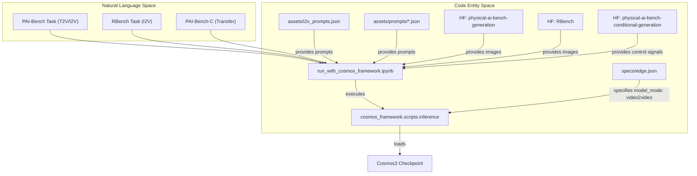
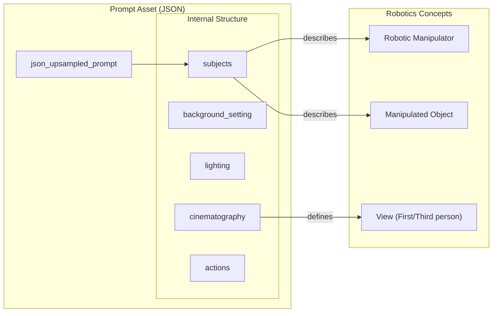

<!-- source: DeepWiki mcp.deepwiki.com · repo NVIDIA/cosmos · page 6.2 PAI-Bench and RBench Evaluations · fetched 2026-10-26 -->

# PAI-Bench and RBench Evaluations

Relevant source files

The following files were used as context for generating this wiki page:

- [evaluation/cosmos3/generator/paibench_c/.gitignore](evaluation/cosmos3/generator/paibench_c/.gitignore)
- [evaluation/cosmos3/generator/paibench_c/README.md](evaluation/cosmos3/generator/paibench_c/README.md)
- [evaluation/cosmos3/generator/paibench_c/assets/tasks.json](evaluation/cosmos3/generator/paibench_c/assets/tasks.json)
- [evaluation/cosmos3/generator/paibench_c/run_paibench_c.sh](evaluation/cosmos3/generator/paibench_c/run_paibench_c.sh)
- [evaluation/cosmos3/generator/paibench_c/specs/blur.json](evaluation/cosmos3/generator/paibench_c/specs/blur.json)
- [evaluation/cosmos3/generator/paibench_c/specs/depth.json](evaluation/cosmos3/generator/paibench_c/specs/depth.json)
- [evaluation/cosmos3/generator/paibench_c/specs/edge.json](evaluation/cosmos3/generator/paibench_c/specs/edge.json)
- [evaluation/cosmos3/generator/paibench_c/specs/seg.json](evaluation/cosmos3/generator/paibench_c/specs/seg.json)
- [evaluation/cosmos3/generator/paibench_g/README.md](evaluation/cosmos3/generator/paibench_g/README.md)
- [evaluation/cosmos3/generator/paibench_g/assets/i2v_prompts.json](evaluation/cosmos3/generator/paibench_g/assets/i2v_prompts.json)
- [evaluation/cosmos3/generator/paibench_g/assets/t2v_prompts.json](evaluation/cosmos3/generator/paibench_g/assets/t2v_prompts.json)
- [evaluation/cosmos3/generator/paibench_g/patches/physical-ai-bench-object-gather.patch](evaluation/cosmos3/generator/paibench_g/patches/physical-ai-bench-object-gather.patch)
- [evaluation/cosmos3/generator/paibench_g/patches/physical-ai-bench-vllm-dense-model.patch](evaluation/cosmos3/generator/paibench_g/patches/physical-ai-bench-vllm-dense-model.patch)
- [evaluation/cosmos3/generator/paibench_g/run_motion_smoothness_sharded.py](evaluation/cosmos3/generator/paibench_g/run_motion_smoothness_sharded.py)
- [evaluation/cosmos3/generator/paibench_g/run_with_cosmos_framework.ipynb](evaluation/cosmos3/generator/paibench_g/run_with_cosmos_framework.ipynb)
- [evaluation/cosmos3/generator/paibench_g/setup_paibench_scorer.sh](evaluation/cosmos3/generator/paibench_g/setup_paibench_scorer.sh)
- [evaluation/cosmos3/generator/rbench/README.md](evaluation/cosmos3/generator/rbench/README.md)
- [evaluation/cosmos3/generator/rbench/assets/prompts/common_manipulation_prompts.json](evaluation/cosmos3/generator/rbench/assets/prompts/common_manipulation_prompts.json)
- [evaluation/cosmos3/generator/rbench/assets/prompts/dual_arm_prompts.json](evaluation/cosmos3/generator/rbench/assets/prompts/dual_arm_prompts.json)
- [evaluation/cosmos3/generator/rbench/assets/prompts/humanoid_prompts.json](evaluation/cosmos3/generator/rbench/assets/prompts/humanoid_prompts.json)
- [evaluation/cosmos3/generator/rbench/assets/prompts/long-horizon_planning_prompts.json](evaluation/cosmos3/generator/rbench/assets/prompts/long-horizon_planning_prompts.json)
- [evaluation/cosmos3/generator/rbench/assets/prompts/multi-entity_collaboration_prompts.json](evaluation/cosmos3/generator/rbench/assets/prompts/multi-entity_collaboration_prompts.json)
- [evaluation/cosmos3/generator/rbench/assets/prompts/quad_prompts.json](evaluation/cosmos3/generator/rbench/assets/prompts/quad_prompts.json)
- [evaluation/cosmos3/generator/rbench/assets/prompts/single_arm_prompts.json](evaluation/cosmos3/generator/rbench/assets/prompts/single_arm_prompts.json)
- [evaluation/cosmos3/generator/rbench/assets/prompts/spatial_relationship_prompts.json](evaluation/cosmos3/generator/rbench/assets/prompts/spatial_relationship_prompts.json)
- [evaluation/cosmos3/generator/rbench/assets/prompts/visual_reasoning_prompts.json](evaluation/cosmos3/generator/rbench/assets/prompts/visual_reasoning_prompts.json)
- [evaluation/cosmos3/generator/rbench/patches/revidgen-configurable-openai-model.patch](evaluation/cosmos3/generator/rbench/patches/revidgen-configurable-openai-model.patch)
- [evaluation/cosmos3/generator/rbench/patches/revidgen-qalign-decode-once.patch](evaluation/cosmos3/generator/rbench/patches/revidgen-qalign-decode-once.patch)
- [evaluation/cosmos3/generator/rbench/run_with_cosmos_framework.ipynb](evaluation/cosmos3/generator/rbench/run_with_cosmos_framework.ipynb)
- [evaluation/cosmos3/generator/rbench/setup_rbench_embodiment_scorer.sh](evaluation/cosmos3/generator/rbench/setup_rbench_embodiment_scorer.sh)
- [evaluation/cosmos3/generator/rbench/setup_rbench_scorer.sh](evaluation/cosmos3/generator/rbench/setup_rbench_scorer.sh)

This page documents the reproduction of key Physical AI benchmarks for the Cosmos3 model family: **PAI-Bench-G** (Generator T2V/I2V), **PAI-Bench-C** (Controlled/Transfer Generation), and **RBench** (Robotics Bench). These evaluations leverage the native `cosmos_framework.scripts.inference` pipeline to assess the model's ability to generate physically plausible videos across diverse domains including autonomous driving, robotics, and common sense reasoning.

## Overview of Evaluation Suites

The evaluations are structured around high-resolution (720p) video generation using specific prompt assets, conditioning images, and spatial control signals.

| Feature | PAI-Bench-G | PAI-Bench-C | RBench |
| :--- | :--- | :--- | :--- |
| **Total Samples** | 1044 [evaluation/cosmos3/generator/paibench_g/README.md:19-19]() | 600 [evaluation/cosmos3/generator/paibench_c/README.md:11-12]() | 650 [evaluation/cosmos3/generator/rbench/README.md:12-12]() |
| **Primary Tasks** | T2V and I2V [evaluation/cosmos3/generator/paibench_g/README.md:16-20]() | V2V (Controlled) [evaluation/cosmos3/generator/paibench_c/README.md:11-12]() | I2V [evaluation/cosmos3/generator/rbench/README.md:12-12]() |
| **Domains** | AV, Robotics, Industry, Physics, Human, Common Sense [evaluation/cosmos3/generator/paibench_g/README.md:12-13]() | 600 Physical Tasks [evaluation/cosmos3/generator/paibench_c/README.md:11-12]() | 9 Robotics categories (e.g., Humanoid, Quad, Single/Dual Arm) [evaluation/cosmos3/generator/rbench/README.md:12-15]() |
| **Frames** | 189 [evaluation/cosmos3/generator/paibench_g/README.md:29-29]() | 121 [evaluation/cosmos3/generator/paibench_c/README.md:19-19]() | 121 (1 cond + 120 gen) [evaluation/cosmos3/generator/rbench/README.md:18-18]() |
| **Target Model** | Cosmos3-Nano/Super [evaluation/cosmos3/generator/paibench_g/README.md:7-10]() | Cosmos3-Nano/Super [evaluation/cosmos3/generator/paibench_c/README.md:7-7]() | Cosmos3-Nano/Super [evaluation/cosmos3/generator/rbench/README.md:7-10]() |

**Sources:** [evaluation/cosmos3/generator/paibench_g/README.md:1-61](), [evaluation/cosmos3/generator/paibench_c/README.md:1-135](), [evaluation/cosmos3/generator/rbench/README.md:1-92]()

---

## Data Flow and Execution Pipeline

Both benchmarks utilize a shared execution pattern where a Jupyter notebook or shell script prepares the environment and invokes the `cosmos_framework` inference script via `torchrun`.

### System to Code Mapping: Evaluation Orchestration
The following diagram illustrates how the evaluation scripts bridge the gap between high-level benchmark requirements and the framework's execution entities.

**Sources:** [evaluation/cosmos3/generator/paibench_g/run_with_cosmos_framework.ipynb:13-29](), [evaluation/cosmos3/generator/paibench_c/run_with_cosmos_framework.ipynb:12-27](), [evaluation/cosmos3/generator/rbench/run_with_cosmos_framework.ipynb:12-24]()

---

## PAI-Bench-G (Generation)

PAI-Bench-G evaluates the "Physical AI" capabilities of the model across 1044 samples. It focuses on six domains: AV driving, robotics, industry, physics, human, and common sense [evaluation/cosmos3/generator/paibench_g/README.md:12-13]().

### Prompt Asset Structure
The prompts for PAI-Bench-G are stored in JSON files, with separate files for I2V and T2V tasks. Each entry includes a `json_upsampled_prompt` and a `negative_prompt` [evaluation/cosmos3/generator/paibench_g/README.md:34-35]().
*   `assets/t2v_prompts.json` [evaluation/cosmos3/generator/paibench_g/README.md:34-34]()
*   `assets/i2v_prompts.json` [evaluation/cosmos3/generator/paibench_g/README.md:35-35]()

### Scoring Methodology
*   **Domain Score:** VQA / VLM-judge accuracy across physical-AI domains [evaluation/cosmos3/generator/paibench_g/run_with_cosmos_framework.ipynb:33-33]().
*   **Quality Score:** Mean of VBench quality dimensions [evaluation/cosmos3/generator/paibench_g/run_with_cosmos_framework.ipynb:33-33]().
*   **Motion Smoothness:** Official AMT-S metric run via `run_motion_smoothness_sharded.py` [evaluation/cosmos3/generator/paibench_g/README.md:33-33](). This script uses a sharded approach to distribute video processing across available GPUs [evaluation/cosmos3/generator/paibench_g/run_motion_smoothness_sharded.py:1-2]().

### Scorer Setup and Patches
The `setup_paibench_scorer.sh` script installs the isolated scoring environment [evaluation/cosmos3/generator/paibench_g/setup_paibench_scorer.sh:1-2](). It applies patches to the `physical-ai-bench` repository for compatibility and stability:
*   `physical-ai-bench-vllm-dense-model.patch`: Addresses vLLM compatibility issues with dense models [evaluation/cosmos3/generator/paibench_g/setup_paibench_scorer.sh:55-67]().
*   `physical-ai-bench-object-gather.patch`: Fixes potential multi-terabyte allocation issues during distributed object gathering by using PyTorch's object collective for metadata [evaluation/cosmos3/generator/paibench_g/setup_paibench_scorer.sh:70-84]().

**Sources:** [evaluation/cosmos3/generator/paibench_g/README.md:23-28](), [evaluation/cosmos3/generator/paibench_g/run_with_cosmos_framework.ipynb:31-39](), [evaluation/cosmos3/generator/paibench_g/setup_paibench_scorer.sh:1-84](), [evaluation/cosmos3/generator/paibench_g/run_motion_smoothness_sharded.py:1-2]()

---

## PAI-Bench-C (Conditional Generation)

PAI-Bench-C evaluates video-to-video transfer across 600 tasks using four control modalities [evaluation/cosmos3/generator/paibench_c/README.md:11-13]().

### Control Modalities and Metrics
| Modality | Control Signal | Primary Metric |
| :--- | :--- | :--- |
| **edge** | Canny edge map | Canny F1 [evaluation/cosmos3/generator/paibench_c/README.md:14-14]() |
| **blur** | Blurred reference | SSIM [evaluation/cosmos3/generator/paibench_c/README.md:15-15]() |
| **depth** | Depth map | scale-invariant RMSE (si-RMSE) [evaluation/cosmos3/generator/paibench_c/README.md:16-16]() |
| **seg** | Segmentation map | mIoU / Recall [evaluation/cosmos3/generator/paibench_c/README.md:17-17]() |

### Implementation Details
The evaluation uses the `video2video` mode in the Cosmos Framework [evaluation/cosmos3/generator/paibench_c/specs/edge.json:2-2]().
*   **Control Guidance:** Typically set between 1.5 and 2.0 [evaluation/cosmos3/generator/paibench_c/README.md:97-97]().
*   **Inference Pipeline:** `run_paibench_c.sh` automates the environment setup, generation, and scoring [evaluation/cosmos3/generator/paibench_c/run_paibench_c.sh:5-10]().
*   **Control Specifications:** Each control modality has a dedicated JSON specification file, e.g., `specs/edge.json` [evaluation/cosmos3/generator/paibench_c/specs/edge.json:1-21](), `specs/blur.json` [evaluation/cosmos3/generator/paibench_c/specs/blur.json:1-21](), `specs/depth.json` [evaluation/cosmos3/generator/paibench_c/specs/depth.json:1-19](), `specs/seg.json` [evaluation/cosmos3/generator/paibench_c/specs/seg.json:1-19](). These files define parameters like `control_guidance` and specific control hints (e.g., `preset_edge_threshold` for edge control).

**Sources:** [evaluation/cosmos3/generator/paibench_c/README.md:14-19](), [evaluation/cosmos3/generator/paibench_c/specs/depth.json:1-19](), [evaluation/cosmos3/generator/paibench_c/run_paibench_c.sh:1-68](), [evaluation/cosmos3/generator/paibench_c/specs/edge.json:1-21](), [evaluation/cosmos3/generator/paibench_c/specs/blur.json:1-21](), [evaluation/cosmos3/generator/paibench_c/specs/seg.json:1-19]()

---

## RBench Evaluation

RBench is a specialized robotics benchmark consisting of 650 cases across nine categories including `common_manipulation`, `humanoid`, and `quad` [evaluation/cosmos3/generator/rbench/README.md:12-15]().

### Prompt Asset Structure
RBench prompts are stored in JSON files within `assets/prompts/` [evaluation/cosmos3/generator/rbench/README.md:27-28](). Each entry contains a `json_upsampled_prompt` and a `negative_prompt` [evaluation/cosmos3/generator/rbench/README.md:28-29](). The `json_upsampled_prompt` is a detailed JSON description that includes fields like `subjects`, `background_setting`, `lighting`, `cinematography`, and `actions`.

### Scoring Methodology
The official RBench overall score is an equal-weight mean of nine indicators:
1.  **Task Split (250 samples):** Five task-category scores based on normalized VLM scores `(raw_score - 1) / 4` [evaluation/cosmos3/generator/rbench/run_with_cosmos_framework.ipynb:28-34]().
2.  **Embodiment Split (400 samples):** Four embodiment indicators calculated as `TS = (TC + VQ) / 2`, where `TC` is Task Completion and `VQ` is Visual Quality [evaluation/cosmos3/generator/rbench/run_with_cosmos_framework.ipynb:28-34]().

### Scorer Setup and Patches
The `setup_rbench_scorer.sh` script sets up the VLM evaluation environment, supporting both GPT and local Qwen models [evaluation/cosmos3/generator/rbench/README.md:60-82]().
*   `revidgen-qalign-decode-once.patch`: This patch likely optimizes the Q-Align decoding process within the ReVidgen scorer.
*   `revidgen-configurable-openai-model.patch`: Allows configuration of the OpenAI model used for VLM scoring, enabling the use of custom or local OpenAI-compatible endpoints [evaluation/cosmos3/generator/rbench/README.md:60-73]().

The `setup_rbench_embodiment_scorer.sh` script prepares the environment for motion-metric evaluation, which is evaluator-independent [evaluation/cosmos3/generator/rbench/README.md:90-91]().

### Robotics Prompt Architecture
RBench prompts emphasize the interaction between the robotic manipulator and the environment.

**Sources:** [evaluation/cosmos3/generator/rbench/run_with_cosmos_framework.ipynb:26-34](), [evaluation/cosmos3/generator/rbench/README.md:27-31](), [evaluation/cosmos3/generator/rbench/setup_rbench_scorer.sh](), [evaluation/cosmos3/generator/rbench/setup_rbench_embodiment_scorer.sh]()

---

## Environment and Execution

### Requirements
*   **Hardware:** 4 to 8-GPU Linux node (configurable via `COSMOS3_NUM_GPUS`) [evaluation/cosmos3/generator/paibench_g/README.md:58-58](), [evaluation/cosmos3/generator/paibench_c/README.md:61-61]().
*   **Software:** `uv >= 0.11.3`, `git-lfs` [evaluation/cosmos3/generator/paibench_g/README.md:59-60]().
*   **System Libraries:** Headless servers require `libxcb1`, `libgl1`, and `libglib2.0-0` [evaluation/cosmos3/generator/paibench_g/run_with_cosmos_framework.ipynb:48-51]().

### Key Functions and Classes
*   `cosmos_framework.scripts.inference`: The primary entry point for all generation tasks [evaluation/cosmos3/generator/rbench/run_with_cosmos_framework.ipynb:15-16]().

**Sources:** [evaluation/cosmos3/generator/paibench_g/run_with_cosmos_framework.ipynb:40-51]()

---

