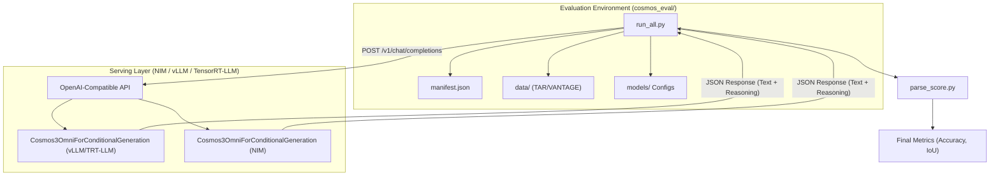
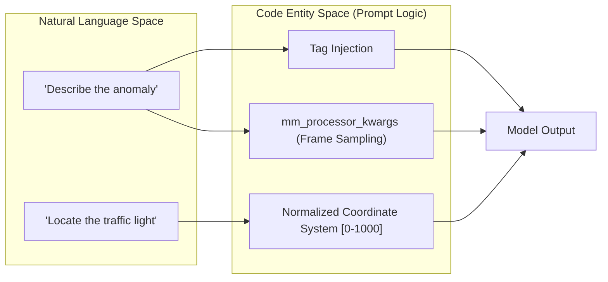

<!-- source: DeepWiki mcp.deepwiki.com · repo NVIDIA/cosmos · page 6.3 Reasoner Evaluation: TAR and VANTAGE Benchmarks · fetched 2026-10-26 -->

# Reasoner Evaluation: TAR and VANTAGE Benchmarks

<details>
<summary>Relevant source files</summary>

The following files were used as context for generating this wiki page:

- [cookbooks/cosmos3/reasoner/README.md](cookbooks/cosmos3/reasoner/README.md)
- [cookbooks/cosmos3/reasoner/run_with_tensorrt_llm.ipynb](cookbooks/cosmos3/reasoner/run_with_tensorrt_llm.ipynb)
- [cookbooks/cosmos3/reasoner/run_with_transformers.ipynb](cookbooks/cosmos3/reasoner/run_with_transformers.ipynb)
- [cookbooks/cosmos3/reasoner/run_with_vllm.ipynb](cookbooks/cosmos3/reasoner/run_with_vllm.ipynb)
- [evaluation/cosmos3/generator/paibench_g/README.md](evaluation/cosmos3/generator/paibench_g/README.md)
- [evaluation/cosmos3/generator/paibench_g/run_with_cosmos_framework.ipynb](evaluation/cosmos3/generator/paibench_g/run_with_cosmos_framework.ipynb)
- [evaluation/cosmos3/generator/rbench/README.md](evaluation/cosmos3/generator/rbench/README.md)
- [evaluation/cosmos3/generator/rbench/run_with_cosmos_framework.ipynb](evaluation/cosmos3/generator/rbench/run_with_cosmos_framework.ipynb)

</details>


This page documents the evaluation suite for the NVIDIA Cosmos 3 Reasoner models. Evaluation is performed using a customized version of **VLMEvalKit**, focusing on two primary domains: traffic anomaly reasoning (TAR) and smart infrastructure monitoring (VANTAGE).

The evaluation suite is contained within the `cosmos_eval/` directory and is designed to interface with Reasoner models deployed as OpenAI-compatible endpoints (via vLLM or NIM).

## Evaluation Infrastructure

The reproduction kit follows a structured layout to manage datasets, model configurations, and scoring logic.

### Directory Structure
- `data/`: Contains benchmark datasets (TAR/AETCBench and VANTAGE).
- `models/`: Configuration files for target Reasoner models.
- `manifest.json`: Defines the mapping between models and evaluation parameters.
- `run_all.py`: The main entry point for executing the evaluation suite.
- `parse_score.py`: Extracts and formats metrics from model outputs.

### Data Flow and Execution
The evaluation process follows a standardized pipeline:
1. **Deployment**: The Reasoner model is served via an OpenAI-compatible API (e.g., vLLM or NVIDIA NIM).
2. **Request Generation**: `run_all.py` iterates through the dataset, formatting prompts and media (images/videos) into API requests.
3. **Inference**: The model generates responses, including Chain-of-Thought reasoning if requested via `<think>` tags.
4. **Scoring**: `parse_score.py` processes the raw text outputs to calculate benchmark-specific metrics.

Sources: [cookbooks/cosmos3/reasoner/README.md:146-170](), [cookbooks/cosmos3/reasoner/reasoner_prompt_guide.md:41-58]()

## TAR (Traffic Anomaly Reasoning)

The TAR benchmark (often referred to in the codebase as `AETCBench_all`) evaluates the model's ability to identify, localize, and explain anomalous events in traffic surveillance footage.

### Key Capabilities Evaluated
- **Anomaly Detection**: Identifying if an accident or traffic violation has occurred.
- **Temporal Localization**: Determining the start and end timestamps of the event.
- **Causal Reasoning**: Explaining *why* an event is considered an anomaly based on traffic rules and physics.

### Implementation Details
The Reasoner is prompted to provide structured JSON outputs for temporal segments.

| Metric | Description |
| :--- | :--- |
| **Detection Accuracy** | Success rate in identifying the presence of an anomaly. |
| **Temporal IoU** | Intersection over Union of the predicted vs. ground truth time windows. |
| **Reasoning Quality** | Evaluated via LLM-as-a-judge or keyword matching in the `<think>` block. |

Sources: [cookbooks/cosmos3/reasoner/reasoner_prompt_guide.md:149-211]()

## VANTAGE Benchmark

VANTAGE focuses on smart infrastructure and urban monitoring. It tests the model's spatial awareness and object-level reasoning in complex environments.

### Grounding and Pointing
VANTAGE utilizes the Reasoner's 2D grounding capabilities. Coordinates are normalized to a `0-1000` scale, where `[0, 0]` is the top-left corner.

- **Bounding Boxes**: Represented as `[x1, y1, x2, y2]`.
- **Point Queries**: Represented as `{"point_2d": [x, y]}`.

### Evaluation Tasks
1. **Object Counting**: Enumerating specific infrastructure elements (e.g., traffic lights, pedestrians).
2. **Spatial Relationship Reasoning**: Describing the relative positions of objects using normalized coordinates.
3. **Action Recognition**: Identifying specific behaviors in infrastructure-mounted camera feeds.

Sources: [cookbooks/cosmos3/reasoner/reasoner_prompt_guide.md:77-100]()

## Running Evaluations

### 1. Deploy the Reasoner
The Reasoner must be accessible via an API. Using NVIDIA NIM is the recommended path for evaluation due to its pre-optimized kernels.

```bash
# Example: Launching Cosmos3-Nano-Reasoner NIM
docker run -d --rm --name nvidia-cosmos3-reasoner \
  --runtime=nvidia --gpus all \
  -e NGC_API_KEY="$NGC_API_KEY" \
  -e NIM_MODEL_SIZE="nano" \
  -p 8000:8000 \
  nvcr.io/nim/nvidia/cosmos3-reasoner:1.7.0
```

Alternatively, the Reasoner can be deployed using vLLM or TensorRT-LLM.

**vLLM Deployment Example (Cosmos3-Super)**
```bash
# From cookbooks/cosmos3/reasoner/run_with_vllm.ipynb:118-122
docker run -d --name "cosmos3-reasoner-vllm" \
  --runtime nvidia --gpus all \
  -e HF_HOME=/root/.cache/huggingface \
  -v "$HOME/.cache/huggingface:/root/.cache/huggingface" \
  -v "$COSMOS_ROOT:$COSMOS_ROOT" \
  -p 8001:8000 --ipc=host \
  vllm/vllm-openai:cosmos3 \
  nvidia/Cosmos3-Super \
    --tensor-parallel-size 4 \
    --mm-encoder-tp-mode data \
    --async-scheduling \
    --allowed-local-media-path "$COSMOS3_MEDIA_ROOT" \
    --port 8000
```

**TensorRT-LLM Deployment Example (Cosmos3-Nano)**
```bash
# From cookbooks/cosmos3/reasoner/run_with_tensorrt_llm.ipynb:147-170
docker run -d --name "cosmos3-reasoner-trtllm" \
  --runtime nvidia --gpus '"device=0"' \
  --ulimit memlock=-1 --ulimit stack=67108864 \
  -e HF_HOME=/root/.cache/huggingface \
  -e HF_TOKEN \
  -v "$HOME/.cache/huggingface:/root/.cache/huggingface" \
  -v "$COSMOS_ROOT:$COSMOS_ROOT" \
  -p 8001:8000 --ipc=host \
  "$COSMOS3_TRTLLM_IMAGE" \
  bash -lc 'python -m pip install --no-cache-dir opencv-python-headless && \
    exec trtllm-serve nvidia/Cosmos3-Nano \
      --host 0.0.0.0 --port 8000 \
      --max_num_tokens 32768'
```

### 2. Configure the Evaluation Kit
Update the `manifest.json` in the evaluation directory to point to the local endpoint.

### 3. Execute Benchmarks
Run the evaluation script targeting the desired benchmark.

```bash
python run_all.py --models cosmos3-nano-reasoner --datasets AETCBench_all VANTAGE
```

Sources: [cookbooks/cosmos3/reasoner/README.md:146-170](), [cookbooks/cosmos3/reasoner/run_with_vllm.ipynb:118-122](), [cookbooks/cosmos3/reasoner/run_with_tensorrt_llm.ipynb:147-170]()

## System Architecture for Evaluation

The following diagram illustrates the interaction between the evaluation suite and the model serving layer.

### Evaluation Data Flow

Sources: [cookbooks/cosmos3/reasoner/README.md:17-31](), [cookbooks/cosmos3/reasoner/run_with_vllm.ipynb:130-139](), [cookbooks/cosmos3/reasoner/run_with_tensorrt_llm.ipynb:130-139]()

### Reasoner Task Processing Logic
This diagram maps the natural language tasks to the internal prompt structures used during evaluation.


Sources: [cookbooks/cosmos3/reasoner/reasoner_prompt_guide.md:29-33](), [cookbooks/cosmos3/reasoner/reasoner_prompt_guide.md:41-54](), [cookbooks/cosmos3/reasoner/reasoner_prompt_guide.md:77-82]()

## Dataset Availability Status
- **TAR / AETCBench**: Available via the NVIDIA Cosmos evaluation portal.
- **VANTAGE**: Infrastructure-specific subsets are released alongside the Reasoner model weights.
- **Internal Assets**: Reference images (e.g., `robot_153.jpg`) and videos for smoke testing are provided in the `cookbooks/cosmos3/reasoner/assets/` directory.

Sources: [cookbooks/cosmos3/reasoner/README.md:106-107](), [cookbooks/cosmos3/reasoner/README.md:4-5]()

---

