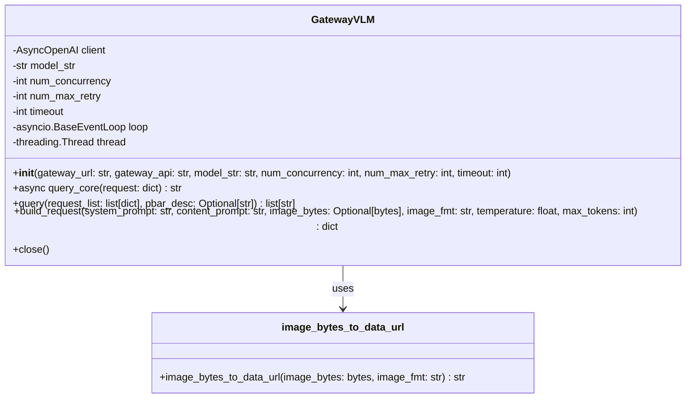

<!-- source: DeepWiki mcp.deepwiki.com · repo NVIDIA/cosmos · page 6.4 UniGenBench Text-to-Image Evaluation · fetched 2026-10-26 -->

# UniGenBench Text-to-Image Evaluation

<details>
<summary>Relevant source files</summary>

The following files were used as context for generating this wiki page:

- [evaluation/cosmos3/generator/unigenbench/assets/unigenbench_prompt.json](evaluation/cosmos3/generator/unigenbench/assets/unigenbench_prompt.json)
- [evaluation/cosmos3/generator/unigenbench/assets/unigenbench_scorer_prompt.md](evaluation/cosmos3/generator/unigenbench/assets/unigenbench_scorer_prompt.md)
- [evaluation/cosmos3/generator/unigenbench/run_with_cosmos_framework.ipynb](evaluation/cosmos3/generator/unigenbench/run_with_cosmos_framework.ipynb)
- [evaluation/cosmos3/generator/unigenbench/ugb_scorer.py](evaluation/cosmos3/generator/unigenbench/ugb_scorer.py)
- [evaluation/cosmos3/generator/unigenbench/utils.py](evaluation/cosmos3/generator/unigenbench/utils.py)

</details>


This page details the UniGenBench text-to-image evaluation workflow within the NVIDIA Cosmos framework. UniGenBench is a Text-to-Image (T2I) benchmark designed to assess the capabilities of image generation models. Each test case includes a text prompt and multiple evaluation criteria (testpoints). The model generates an image, which is then evaluated against these testpoints by an LLM-judge.

The workflow covers:
*   **Prompt Assets**: The structure of `unigenbench_prompt.json` [evaluation/cosmos3/generator/unigenbench/assets/unigenbench_prompt.json:1-145289]() which defines the benchmark cases.
*   **Generation Pipeline**: The `run_with_cosmos_framework.ipynb` [evaluation/cosmos3/generator/unigenbench/run_with_cosmos_framework.ipynb:1-591]() notebook, which orchestrates image generation using the Cosmos Framework.
*   **Helper Utilities**: The `utils.py` [evaluation/cosmos3/generator/unigenbench/utils.py:1-141]() module, providing functionalities like VLM gateway interaction.
*   **LLM-Judge Scorer**: The `ugb_scorer.py` [evaluation/cosmos3/generator/unigenbench/ugb_scorer.py:1-480]() script, which uses an LLM (guided by `unigenbench_scorer_prompt.md` [evaluation/cosmos3/generator/unigenbench/assets/unigenbench_scorer_prompt.md:1-85]()) to evaluate generated images.

## UniGenBench Prompt Assets

The UniGenBench evaluation uses a structured JSON file, `unigenbench_prompt.json` [evaluation/cosmos3/generator/unigenbench/assets/unigenbench_prompt.json:1-145289](), to define its benchmark cases. This file contains a list of benchmark entries, each specifying a prompt and detailed evaluation criteria.

Each entry in the `benchmark` array [evaluation/cosmos3/generator/unigenbench/assets/unigenbench_prompt.json:3-145289]() typically includes:
*   `id`: A unique identifier for the benchmark case (e.g., "orig0") [evaluation/cosmos3/generator/unigenbench/assets/unigenbench_prompt.json:4-4]().
*   `prompt`: The primary text prompt used for image generation [evaluation/cosmos3/generator/unigenbench/assets/unigenbench_prompt.json:5-5]().
*   `sub_dims`: A dictionary containing various sub-dimensions for evaluation [evaluation/cosmos3/generator/unigenbench/assets/unigenbench_prompt.json:6-28]():
    *   `Primary Categories`: Broad categories like "Creative Divergence" [evaluation/cosmos3/generator/unigenbench/assets/unigenbench_prompt.json:7-7]().
    *   `Secondary Categories`: More specific categories such as "Imaginative Thinking" [evaluation/cosmos3/generator/unigenbench/assets/unigenbench_prompt.json:8-8]().
    *   `Subjects`: The main subjects in the prompt (e.g., "Animal") [evaluation/cosmos3/generator/unigenbench/assets/unigenbench_prompt.json:9-9]().
    *   `Sentence Structure`: Describes the linguistic structure of the prompt (e.g., "Descriptive") [evaluation/cosmos3/generator/unigenbench/assets/unigenbench_prompt.json:10-10]().
    *   `Testpoints`: A list of specific criteria to evaluate the generated image against (e.g., "Style", "World Knowledge", "Attribute - Quantity") [evaluation/cosmos3/generator/unigenbench/assets/unigenbench_prompt.json:11-18]().
    *   `Testpoint Description`: Corresponding descriptions for each testpoint, extracted from the main prompt [evaluation/cosmos3/generator/unigenbench/assets/unigenbench_prompt.json:20-28]().
*   `upsampled_prompt`: A highly detailed breakdown of the prompt, providing granular information about subjects, background, lighting, aesthetics, cinematography, and style [evaluation/cosmos3/generator/unigenbench/assets/unigenbench_prompt.json:30-87](). This section helps in generating more precise images and provides richer context for evaluation.

Sources:
*   [evaluation/cosmos3/generator/unigenbench/assets/unigenbench_prompt.json:1-145289]()

## Generation Pipeline: `run_with_cosmos_framework.ipynb`

The `run_with_cosmos_framework.ipynb` [evaluation/cosmos3/generator/unigenbench/run_with_cosmos_framework.ipynb:1-591]() notebook is the primary entry point for generating images for the UniGenBench evaluation using the Cosmos Framework. It orchestrates the entire generation process, from environment setup to image output.

### Prerequisites

Before running the notebook, ensure the following:
*   A Linux machine with NVIDIA GPU access (default recipe uses 4 GPUs) [evaluation/cosmos3/generator/unigenbench/run_with_cosmos_framework.ipynb:25-25]().
*   Model access on Hugging Face, either by running `uvx hf@latest auth login` or setting the `HF_TOKEN` environment variable [evaluation/cosmos3/generator/unigenbench/run_with_cosmos_framework.ipynb:26-26]().
*   `uv >= 0.11.3` installed [evaluation/cosmos3/generator/unigenbench/run_with_cosmos_framework.ipynb:27-27]().
*   For headless servers, install system graphics libraries like `libxcb1`, `libgl1`, `libglib2.0-0` to avoid `libxcb.so.1` errors [evaluation/cosmos3/generator/unigenbench/run_with_cosmos_framework.ipynb:29-32]().

### Configuration and Environment Variables

The notebook allows configuration through environment variables, which can be overridden before launching. Key variables include:
*   `COSMOS3_REPO`: Path to the `cosmos-framework` repository [evaluation/cosmos3/generator/unigenbench/run_with_cosmos_framework.ipynb:86-86]().
*   `COSMOS3_UV_GROUP`: Specifies the `uv` environment group (e.g., `cu130-train` or `cu128-train`) [evaluation/cosmos3/generator/unigenbench/run_with_cosmos_framework.ipynb:87-87]().
*   `UV_PROJECT_ENVIRONMENT`: Path to the `uv` virtual environment [evaluation/cosmos3/generator/unigenbench/run_with_cosmos_framework.ipynb:88-88]().
*   `COSMOS3_NUM_GPUS`: Number of GPUs to use (default: 4) [evaluation/cosmos3/generator/unigenbench/run_with_cosmos_framework.ipynb:89-89]().
*   `HF_HOME`: Path to the Hugging Face cache directory [evaluation/cosmos3/generator/unigenbench/run_with_cosmos_framework.ipynb:90-90]().
*   `CUDA_VISIBLE_DEVICES`: Specifies which CUDA devices to use (e.g., `0,1,2,3`) [evaluation/cosmos3/generator/unigenbench/run_with_cosmos_framework.ipynb:91-91]().
*   `UNIGENBENCH_OUTPUT_ROOT`: Root directory for UniGenBench outputs [evaluation/cosmos3/generator/unigenbench/run_with_cosmos_framework.ipynb:92-92]().

The notebook defines helper functions like `find_repo_root` [evaluation/cosmos3/generator/unigenbench/run_with_cosmos_framework.ipynb:111-115]() to locate the repository root and `free_local_port` [evaluation/cosmos3/generator/unigenbench/run_with_cosmos_framework.ipynb:118-121]() to find an available port for distributed training.

### Generation Process

The core of the generation process involves:
1.  **Loading Prompts**: The notebook loads the UniGenBench prompts from `unigenbench_prompt.json` [evaluation/cosmos3/generator/unigenbench/run_with_cosmos_framework.ipynb:160-162]().
2.  **Preparing Payloads**: For each prompt, a payload is constructed for the `cosmos_framework.scripts.inference` [evaluation/cosmos3/generator/unigenbench/run_with_cosmos_framework.ipynb:16-17]() script. This payload includes the text prompt and other generation parameters.
3.  **Running Inference**: The `cosmos_framework.scripts.inference` [evaluation/cosmos3/generator/unigenbench/run_with_cosmos_framework.ipynb:16-17]() script is invoked, typically using `torchrun` for distributed execution, to generate images based on the prepared payloads.
4.  **Saving Outputs**: The generated images are saved to a designated output directory, typically `UNIGENBENCH_IMAGE` [evaluation/cosmos3/generator/unigenbench/run_with_cosmos_framework.ipynb:165-166]().

Sources:
*   [evaluation/cosmos3/generator/unigenbench/run_with_cosmos_framework.ipynb:1-591]()

## Helper Utilities: `utils.py`

The `utils.py` [evaluation/cosmos3/generator/unigenbench/utils.py:1-141]() module provides essential helper functions, particularly for interacting with a Vision-Language Model (VLM) gateway for scoring.

### `image_bytes_to_data_url`

The `image_bytes_to_data_url` function [evaluation/cosmos3/generator/unigenbench/utils.py:27-36]() converts raw image bytes into a data URL string. This is crucial for embedding images directly into API requests, especially for VLM APIs that accept image data in this format. It supports various image formats like JPG, PNG, WebP, and GIF.

### `GatewayVLM` Class

The `GatewayVLM` class [evaluation/cosmos3/generator/unigenbench/utils.py:39-141]() facilitates asynchronous communication with an OpenAI-compatible VLM gateway. It manages concurrent requests and retries, making it robust for evaluation workflows.

**Constructor (`__init__`)**:
*   `gateway_url`: The base URL of the VLM gateway [evaluation/cosmos3/generator/unigenbench/utils.py:43-43]().
*   `gateway_api`: The API key for authentication [evaluation/cosmos3/generator/unigenbench/utils.py:44-44]().
*   `model_str`: The identifier for the VLM model to use (e.g., `.../gemini-3.1-pro-preview`) [evaluation/cosmos3/generator/unigenbench/utils.py:45-45]().
*   `num_concurrency`: The maximum number of concurrent VLM requests [evaluation/cosmos3/generator/unigenbench/utils.py:46-46]().
*   `num_max_retry`: The number of times to retry a failed request [evaluation/cosmos3/generator/unigenbench/utils.py:47-47]().
*   `timeout`: The timeout for each VLM request in seconds [evaluation/cosmos3/generator/unigenbench/utils.py:48-48]().
*   It initializes an `AsyncOpenAI` client [evaluation/cosmos3/generator/unigenbench/utils.py:49-49]() and sets up an asynchronous event loop in a separate thread [evaluation/cosmos3/generator/unigenbench/utils.py:54-56]() to handle concurrent requests efficiently.

**`query_core` Method**:
*   This asynchronous method [evaluation/cosmos3/generator/unigenbench/utils.py:58-84]() sends a single chat completion request to the VLM.
*   It includes retry logic for handling timeouts and other exceptions [evaluation/cosmos3/generator/unigenbench/utils.py:59-83]().
*   It streams the response from the VLM and concatenates the chunks to form the complete result [evaluation/cosmos3/generator/unigenbench/utils.py:63-68]().

**`query` Method**:
*   This method [evaluation/cosmos3/generator/unigenbench/utils.py:86-103]() takes a list of VLM requests and processes them concurrently using a semaphore to limit the number of parallel requests [evaluation/cosmos3/generator/unigenbench/utils.py:90-90]().
*   It uses `tqdm` for progress tracking [evaluation/cosmos3/generator/unigenbench/utils.py:87-87]().
*   It runs the asynchronous `coroutine_gather` [evaluation/cosmos3/generator/unigenbench/utils.py:89-98]() in the dedicated event loop thread.

**`build_request` Method**:
*   Constructs an OpenAI-compatible chat completion request dictionary [evaluation/cosmos3/generator/unigenbench/utils.py:105-137]().
*   It takes `system_prompt`, `content_prompt`, optional `image_bytes`, `image_fmt`, `temperature`, and `max_tokens` as input [evaluation/cosmos3/generator/unigenbench/utils.py:106-113]().
*   If `image_bytes` are provided, it converts them to a data URL using `image_bytes_to_data_url` [evaluation/cosmos3/generator/unigenbench/utils.py:132-133]() and includes them in the `content` of the user message [evaluation/cosmos3/generator/unigenbench/utils.py:136-136]().

**`close` Method**:
*   Gracefully stops the asynchronous event loop and joins the thread [evaluation/cosmos3/generator/unigenbench/utils.py:139-141]().


**Diagram: `GatewayVLM` Class and `image_bytes_to_data_url` Function**

Sources:
*   [evaluation/cosmos3/generator/unigenbench/utils.py:1-141]()

## LLM-Judge Scorer: `ugb_scorer.py`

The `ugb_scorer.py` [evaluation/cosmos3/generator/unigenbench/ugb_scorer.py:1-480]() script implements the LLM-judge scoring mechanism for UniGenBench. It leverages the `GatewayVLM` from `utils.py` [evaluation/cosmos3/generator/unigenbench/ugb_scorer.py:31-31]() to interact with a VLM for evaluating generated images against specific testpoints.

### System Prompt (`unigenbench_scorer_prompt.md`)

The LLM-judge's behavior is guided by the `unigenbench_scorer_prompt.md` [evaluation/cosmos3/generator/unigenbench/assets/unigenbench_scorer_prompt.md:1-85]() file, which serves as the system prompt. This prompt instructs the VLM on its role as a "precise and objective English-language image evaluator" [evaluation/cosmos3/generator/unigenbench/assets/unigenbench_scorer_prompt.md:3-3]().

Key instructions in the system prompt include:
*   **Inputs**: The VLM will receive a `prompt`, a `generated image`, and a list of `testpoints` with general definitions and per-prompt descriptions [evaluation/cosmos3/generator/unigenbench/assets/unigenbench_scorer_prompt.md:7-9]().
*   **Procedure**: For each testpoint, the VLM must:
    1.  **Analyze**: Strictly analyze the image based on the testpoint, describing observations and how they satisfy or don't satisfy the criterion [evaluation/cosmos3/generator/unigenbench/assets/unigenbench_scorer_prompt.md:19-23]().
    2.  **Decide a verdict**: Assign a boolean verdict (`true` or `false`) [evaluation/cosmos3/generator/unigenbench/assets/unigenbench_scorer_prompt.md:27-32](). If in doubt, the verdict should be `false` [evaluation/cosmos3/generator/unigenbench/assets/unigenbench_scorer_prompt.md:33-33]().
*   **Constraints**: The VLM must only describe directly visible content, focus on visually verifiable details, omit uncertain elements, and avoid interpreting abstract entities or emotions [evaluation/cosmos3/generator/unigenbench/assets/unigenbench_scorer_prompt.md:39-43]().
*   **Output Format**: The output must be a YAML list, wrapped in a fenced code block (` ```yaml `), with one item per testpoint. Each item must contain `testpoint`, `analysis`, and `verdict` fields [evaluation/cosmos3/generator/unigenbench/assets/unigenbench_scorer_prompt.md:48-60](). Strict rules are provided for field types and escaping [evaluation/cosmos3/generator/unigenbench/assets/unigenbench_scorer_prompt.md:66-71]().

### `ugb_scorer.py` Implementation Details

The `ugb_scorer.py` script [evaluation/cosmos3/generator/unigenbench/ugb_scorer.py:1-480]() performs the following steps:

1.  **Load System Prompt**: It loads the `SYSTEM_PROMPT` from `unigenbench_scorer_prompt.md` [evaluation/cosmos3/generator/unigenbench/ugb_scorer.py:69-70]().
2.  **Define User Prompt Template**: The `USER_PROMPT` template [evaluation/cosmos3/generator/unigenbench/ugb_scorer.py:72-81]() is constructed to include the original prompt, testpoints, their explanations, and an output template for the VLM.
3.  **`EXPLANATION_DICT`**: This dictionary [evaluation/cosmos3/generator/unigenbench/ugb_scorer.py:33-61]() provides general definitions for various testpoint categories, which are incorporated into the user prompt to help the VLM understand the criteria.
4.  **YAML Parsing Helpers**:
    *   `strip_yaml_fence` [evaluation/cosmos3/generator/unigenbench/ugb_scorer.py:98-109](): Extracts the YAML content from the VLM's response, handling fenced code blocks.
    *   `load_yaml_list` [evaluation/cosmos3/generator/unigenbench/ugb_scorer.py:112-119](): Safely loads the YAML string into a Python list.
    *   `coerce_verdict` [evaluation/cosmos3/generator/unigenbench/ugb_scorer.py:122-138](): Converts various representations of boolean verdicts (e.g., "true", "1", `True`) into a standard boolean.
    *   `normalize_item_keys` [evaluation/cosmos3/generator/unigenbench/ugb_scorer.py:140-142](): Normalizes keys in the YAML output to lowercase for consistent processing.
5.  **`build_output_template`**: Generates the expected YAML output structure for the VLM, ensuring it adheres to the specified format [evaluation/cosmos3/generator/unigenbench/ugb_scorer.py:144-150]().
6.  **`build_request`**: This function [evaluation/cosmos3/generator/unigenbench/ugb_scorer.py:153-179]() prepares the VLM request by combining the system prompt, user prompt (with prompt details, testpoints, and explanations), and the generated image (as a data URL). It checks if all testpoints are defined in `EXPLANATION_DICT` [evaluation/cosmos3/generator/unigenbench/ugb_scorer.py:158-161]().
7.  **Scoring Logic**: The main scoring loop (not fully shown in the provided snippet but implied by the `build_request` and `GatewayVLM` usage) would:
    *   Iterate through each generated image and its corresponding prompt and testpoints.
    *   Call `build_request` to create a VLM query.
    *   Send the query to the `GatewayVLM`.
    *   Parse the VLM's YAML response using the helper functions.
    *   Aggregate the verdicts for each testpoint.
    *   Compute overall scores and generate reports.

```mermaid
graph TD
    A[unigenbench_prompt.json] --> B{Image Generation Pipeline};
    B --> C[Generated Image];
    B --> D[Prompt Details & Testpoints];
    D --> E[ugb_scorer.py];
    C --> E;
    subgraph LLM-Judge Scorer
        E --> F[GatewayVLM (utils.py)];
        F -- "System Prompt" --> G[unigenbench_scorer_prompt.md];
        F -- "User Prompt (with Image)" --> H[VLM API];
        H -- "YAML Response" --> F;
        F --> I[Parse & Coerce Verdicts];
    end
    I --> J[Evaluation Results];

    style A fill:#ace,stroke:#333,stroke-width:2px
    style B fill:#ace,stroke:#333,stroke-width:2px
    style C fill:#ace,stroke:#333,stroke-width:2px
    style D fill:#ace,stroke:#333,stroke-width:2px
    style E fill:#ace,stroke:#333,stroke-width:2px
    style F fill:#ace,stroke:#333,stroke-width:2px
    style G fill:#ace,stroke:#333,stroke-width:2px
    style H fill:#ace,stroke:#333,stroke-width:2px
    style I fill:#ace,stroke:#333,stroke-width:2px
    style J fill:#ace,stroke:#333,stroke-width:2px
```
**Diagram: UniGenBench Text-to-Image Evaluation Workflow**

Sources:
*   [evaluation/cosmos3/generator/unigenbench/assets/unigenbench_scorer_prompt.md:1-85]()
*   [evaluation/cosmos3/generator/unigenbench/ugb_scorer.py:1-480]()
*   [evaluation/cosmos3/generator/unigenbench/utils.py:31-31]()

---

