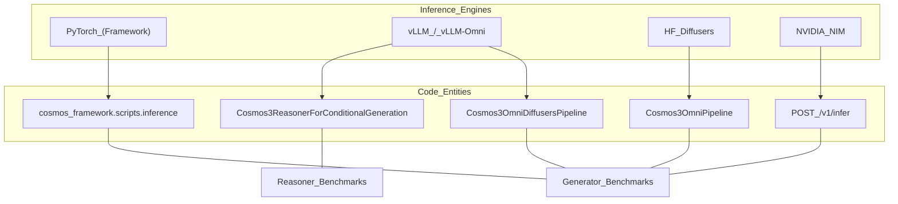
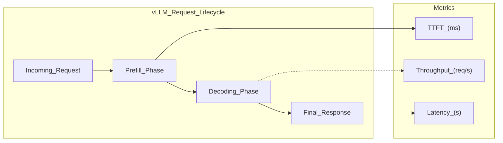

<!-- source: DeepWiki mcp.deepwiki.com · repo NVIDIA/cosmos · page 6.5 Inference Benchmarks · fetched 2026-10-26 -->

# Inference Benchmarks

Relevant source files

The following files were used as context for generating this wiki page:

- [cookbooks/cosmos3/generator/audiovisual/run_with_nim.ipynb](cookbooks/cosmos3/generator/audiovisual/run_with_nim.ipynb)
- [inference_benchmarks.md](inference_benchmarks.md)

This page presents inference performance metrics for the NVIDIA Cosmos 3 model family, covering both the **Generator** and **Reasoner** runtime surfaces. Benchmarks are provided across a variety of NVIDIA GPU architectures, including Blackwell (B200, B300, RTX PRO 6000), Hopper (H100, H200, H100 NVL, H200 NVL), H20, and the Jetson AGX Thor edge platform.

The performance data covers five primary integration paths:
1.  **Cosmos Framework**: Native PyTorch reference implementation using `cosmos_framework.scripts.inference` [inference_benchmarks.md:3]().
2.  **vLLM / vLLM-Omni**: High-throughput production serving engines for Reasoning and Generation [inference_benchmarks.md:3]().
3.  **Diffusers**: Hugging Face integration via `Cosmos3OmniPipeline` [inference_benchmarks.md:94]().
4.  **NIM**: Prebuilt containers (e.g., `nvcr.io/nim/nvidia/cosmos3-generator:1.0.0`) offering optimized FP8/BF16 inference [cookbooks/cosmos3/generator/audiovisual/run_with_nim.ipynb:21, 69]().
5.  **TensorRT-LLM**: High-performance backend used for optimized visual generation.

### System Performance Overview

The following diagram illustrates the relationship between the benchmarked system components and the underlying codebase entities.

**Inference Engine to Code Mapping**

**Sources:** [inference_benchmarks.md:3-5](), [inference_benchmarks.md:94-95](), [cookbooks/cosmos3/generator/audiovisual/run_with_nim.ipynb:24]()

---

## 6.5.1. Generator Benchmarks

The Generator benchmarks measure the latency of the diffusion-based path for creating visual content. Metrics are provided for three core tasks: **Text-to-Video (t2v)**, **Image-to-Video (i2v)**, and **Text-to-Image (t2i)** [inference_benchmarks.md:92]().

### Benchmark Methodology
*   **Precision**: BF16 for PyTorch/vLLM and FP8 for NIM [inference_benchmarks.md:92-94]().
*   **Batch Size**: 1 [inference_benchmarks.md:92]().
*   **Video Profile**: Standard profile of 189 frames at 24 FPS (Nano/Super) or 121 frames (Edge) [inference_benchmarks.md:46, 92]().
*   **Resolution Tiers**: 256p (320x192), 480p (832x480), and 720p (1280x720) [inference_benchmarks.md:94]().
*   **Parallelism**: Benchmarks include single-GPU execution and Tensor Parallel (TP) configurations (4× and 8× GPU) [inference_benchmarks.md:98]().

### Performance Highlights
Performance varies by engine and hardware. For **Cosmos3-Edge** at 480p, the **B200 SXM** achieves a t2v latency of **7.09s** via vLLM-Omni [inference_benchmarks.md:52](). For **Cosmos3-Nano** at 720p, the **H200 NVL** achieves a t2v latency of **39.17s** at TP8 using vLLM-Omni [inference_benchmarks.md:113](). NIM profiles often show further improvements due to FP8 quantization, reaching **68.50s** for Nano 720p t2v on **RTX PRO 6000 Blackwell** at TP8 [inference_benchmarks.md:103]().

For detailed latency tables across all GPU types and resolution tiers for Cosmos3-Nano, Cosmos3-Super, and Cosmos3-Edge, see [Generator Benchmarks](#6.5.1).

**Sources:** [inference_benchmarks.md:42-64](), [inference_benchmarks.md:90-119]()

---

## 6.5.2. Reasoner Benchmarks

The Reasoner benchmarks focus on serving metrics for Vision-Language Model (VLM) tasks, such as video captioning and physical reasoning. These benchmarks evaluate the **Cosmos3-Nano**, **Cosmos3-Super**, and **Cosmos3-Edge** models.

### Benchmark Methodology
The Reasoner is evaluated using the **AIPerf** methodology to simulate production workloads [inference_benchmarks.md:3]().
*   **Workload Dimensions**: Performance is measured across varying input/output token counts and video frame rates.
*   **Concurrency**: Metrics are collected at multiple concurrency levels (e.g., 1, 64, 128, 256 requests).
*   **Key Metrics**:
    *   **TTFT**: Time to First Token.
    *   **Request Latency**: Total time to complete a request.
    *   **Throughput**: Measured in requests per second and output tokens per second.
*   **Edge Metrics**: For Jetson AGX Thor, benchmarks focus on prefill and decode throughput (tokens/sec) [inference_benchmarks.md:62]().

### Code-to-Metric Association

**Sources:** [inference_benchmarks.md:3](), [inference_benchmarks.md:20-40]()

For detailed serving performance tables across hardware like H100 NVL, H200, B200, and Jetson platforms, see [Reasoner Benchmarks](#6.5.2).

**Sources:** [inference_benchmarks.md:3](), [inference_benchmarks.md:20-40]()

---

