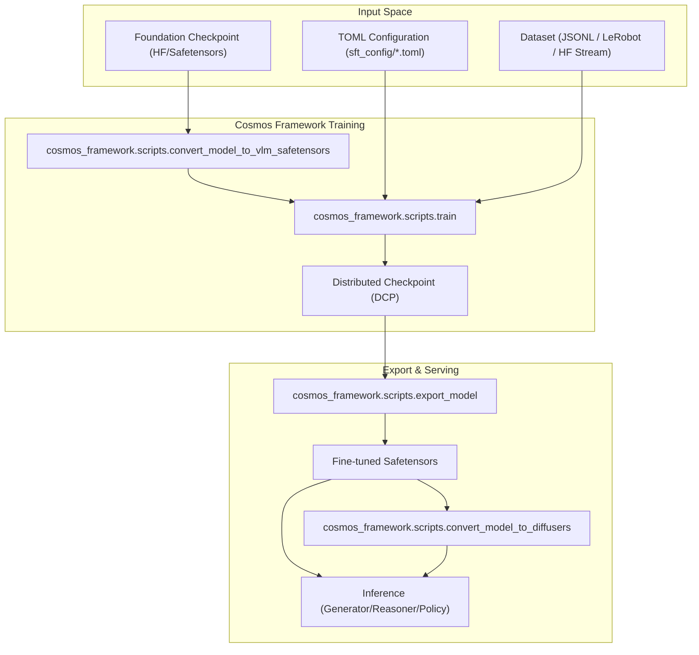
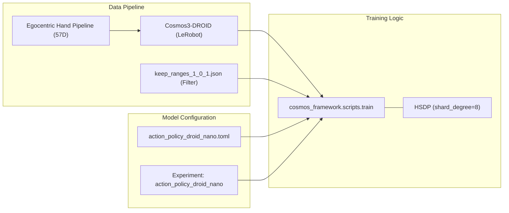

<!-- source: DeepWiki mcp.deepwiki.com · repo NVIDIA/cosmos · page 7 Fine-Tuning and Distillation · fetched 2026-10-26 -->

# Fine-Tuning and Distillation

Relevant source files

The following files were used as context for generating this wiki page:

- [CONTRIBUTING.md](CONTRIBUTING.md)
- [cookbooks/cosmos3/generator/action/finetune/README.md](cookbooks/cosmos3/generator/action/finetune/README.md)
- [cookbooks/cosmos3/generator/audiovisual/finetune/README.md](cookbooks/cosmos3/generator/audiovisual/finetune/README.md)

This section provides an overview of the Supervised Fine-Tuning (SFT) and Distillation capabilities for NVIDIA Cosmos 3 models. These recipes enable users to adapt foundation models for specific domains, ranging from high-fidelity audiovisual generation to complex physical reasoning and robotic action policies.

The fine-tuning workflow is unified under the `cosmos_framework.scripts.train` entrypoint, leveraging Distributed Checkpoint (DCP) formats for efficient multi-GPU training and subsequent export to standard formats like Safetensors or Diffusers.

### Fine-Tuning Overview

Cosmos 3 supports fine-tuning across three primary tiers (Nano, Super, Edge) and several specialized domains:

| Domain | Model Surface | Tier Support | Recipe Examples |
| :--- | :--- | :--- | :--- |
| **Audiovisual** | Generator | Nano, Super, Edge | Full SFT (Nano/Edge), LoRA SFT (Super) |
| **Reasoning** | Reasoner | Nano, Super, Edge | Alignment (LLaVA-OV), Physical Plausibility (VideoPhy-2) |
| **Action Policy** | Generator | Nano | Robotic Policy (DROID, LIBERO, RoboCasa) |
| **Action FD** | Generator | Nano | Forward Dynamics (DROID Post-training) |

### System Architecture: Fine-Tuning Workflow

The following diagram illustrates the relationship between the core training script, configuration files, and the lifecycle of model weights from foundation checkpoints to fine-tuned artifacts.

**Fine-Tuning Code Entity Mapping**

Sources: [cookbooks/cosmos3/generator/audiovisual/finetune/README.md:76-95](), [cookbooks/cosmos3/reasoner/finetune/launch_sft_videophy2_nano.sh:22-33]()

---

### 7.1 Generator Audiovisual Fine-Tuning
The Generator SFT recipes allow for the adaptation of Cosmos3 models to custom video-caption datasets. While Cosmos3-Nano and the 2B dense Cosmos3-Edge support full-parameter fine-tuning, Cosmos3-Super utilizes Parameter-Efficient Fine-Tuning (PEFT) via LoRA to manage memory constraints.

*   **Entrypoints**: `launch_sft_vision_nano.sh`, `launch_sft_vision_super.sh`, and `launch_sft_vision_edge.sh` [cookbooks/cosmos3/generator/audiovisual/finetune/README.md:6-9]().
*   **Checkpoint Preparation**: Requires converting base models to DCP format and acquiring the Wan2.2 VAE tokenizer (`Wan2.2_VAE.pth`) [cookbooks/cosmos3/generator/audiovisual/finetune/README.md:23-24]().
*   **Dataset**: Example uses `BridgeData2-Subset-Synthetic-Captions` with structured JSON captions (`caption_json`) [cookbooks/cosmos3/generator/audiovisual/finetune/README.md:7]().

For details, see [Generator Audiovisual Fine-Tuning](#7.1).

Sources: [cookbooks/cosmos3/generator/audiovisual/finetune/README.md:1-11](), [cookbooks/cosmos3/generator/audiovisual/finetune/README.md:21-31]()

---

### 7.2 Generator Distillation
This domain covers Direct Model Distillation (DMD2) smoke-run recipes for Cosmos3-Super. It focuses on distilling the high-quality teacher models (Text2Image and Image2Video) into efficient 4-step student models.

*   **Entrypoints**: `launch_distillation_t2i.sh` and `launch_distillation_i2v.sh`.
*   **Topology**: Optimized for multi-node GB200 clusters using `NNODES` and `NPROC_PER_NODE` variables.

For details, see [Generator Distillation](#7.2).

---

### 7.3 Reasoner Fine-Tuning
Reasoner fine-tuning focuses on general multimodal alignment and specialized physical reasoning. These recipes bootstrap from the Reasoner foundation, often involving a merge step of the language model onto the visual tower.

*   **Alignment SFT**: Uses `LLaVA-OneVision` via `launch_sft_llava_ov.sh` to improve instruction-following.
*   **Physical-Plausibility SFT**: Uses `VideoPhy-2` to specialize the model in scoring physical realism.
*   **Checkpoint Merging**: Uses `cosmos_framework.scripts.convert_model_to_vlm_safetensors` to prepare the backbone.
*   **Task Type**: Configured as `[job].task = "vlm"` in the TOML (e.g., `videophy2_sft_nano.toml`).

For details, see [Reasoner Fine-Tuning](#7.3).

Sources: [cookbooks/cosmos3/reasoner/finetune/README.md:5-12](), [cookbooks/cosmos3/reasoner/finetune/toml/sft_config/videophy2_sft_nano.toml:16-22](), [cookbooks/cosmos3/reasoner/finetune/launch_sft_videophy2_super.sh:30-32]()

---

### 7.4 Action Policy and Forward-Dynamics Fine-Tuning
Action Policy SFT transforms the Cosmos3-Nano Generator into a specialized robotic policy or a Forward Dynamics (FD) model.

**Action SFT Component Mapping**

*   **Policy SFT**: Reproduces `Cosmos3-Nano-Policy-DROID` using `joint_pos` 8D actions and proprioceptive state [cookbooks/cosmos3/generator/action/finetune/README.md:5](). Also supports LIBERO-10/All benchmarks with `rot6d` 10D actions [cookbooks/cosmos3/generator/action/finetune/README.md:18-22]() and RoboCasa with 15-D actions for mobile bases [cookbooks/cosmos3/generator/action/finetune/README.md:23-36]().
*   **Action FD**: Post-training recipe for Forward Dynamics on the DROID dataset.
*   **Egocentric Data**: A specialized pipeline for processing 57D hand action data, including camera intrinsics and 3D hand keypoints.

For details, see [Action Policy and Forward-Dynamics Fine-Tuning](#7.4).

Sources: [cookbooks/cosmos3/generator/action/finetune/README.md:1-26](), [cookbooks/cosmos3/generator/action/finetune/README.md:76-88](), [cookbooks/cosmos3/generator/action/assets/egocentric_hand_action_example/human_annotation/ESCALE_000374.json:1]()

---

