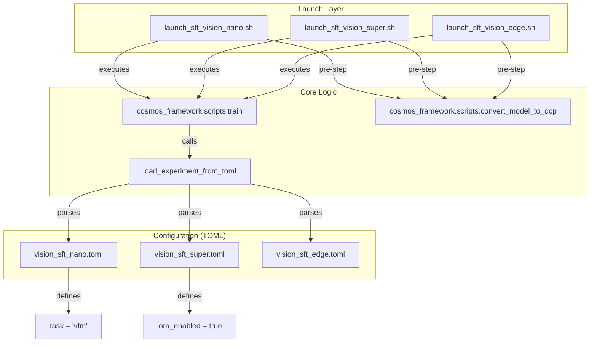
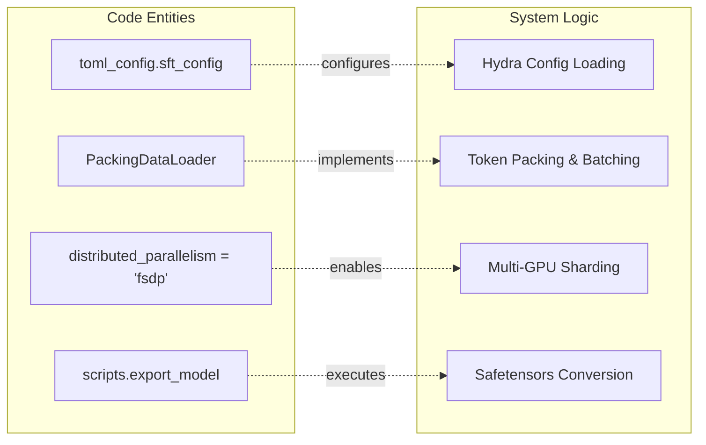

<!-- source: DeepWiki mcp.deepwiki.com · repo NVIDIA/cosmos · page 7.1 Generator Audiovisual Fine-Tuning · fetched 2026-10-26 -->

# Generator Audiovisual Fine-Tuning

<details>
<summary>Relevant source files</summary>

The following files were used as context for generating this wiki page:

- [CONTRIBUTING.md](CONTRIBUTING.md)
- [cookbooks/cosmos3/generator/action/finetune/README.md](cookbooks/cosmos3/generator/action/finetune/README.md)
- [cookbooks/cosmos3/generator/audiovisual/finetune/README.md](cookbooks/cosmos3/generator/audiovisual/finetune/README.md)
- [cookbooks/cosmos3/generator/audiovisual/finetune/launch_sft_vision_edge.sh](cookbooks/cosmos3/generator/audiovisual/finetune/launch_sft_vision_edge.sh)
- [cookbooks/cosmos3/generator/audiovisual/finetune/launch_sft_vision_nano.sh](cookbooks/cosmos3/generator/audiovisual/finetune/launch_sft_vision_nano.sh)
- [cookbooks/cosmos3/generator/audiovisual/finetune/launch_sft_vision_super.sh](cookbooks/cosmos3/generator/audiovisual/finetune/launch_sft_vision_super.sh)
- [cookbooks/cosmos3/generator/audiovisual/finetune/toml/sft_config/vision_sft_edge.toml](cookbooks/cosmos3/generator/audiovisual/finetune/toml/sft_config/vision_sft_edge.toml)
- [cookbooks/cosmos3/generator/audiovisual/finetune/toml/sft_config/vision_sft_nano.toml](cookbooks/cosmos3/generator/audiovisual/finetune/toml/sft_config/vision_sft_nano.toml)
- [cookbooks/cosmos3/generator/audiovisual/finetune/toml/sft_config/vision_sft_super.toml](cookbooks/cosmos3/generator/audiovisual/finetune/toml/sft_config/vision_sft_super.toml)
- [cookbooks/cosmos3/reasoner/finetune/README.md](cookbooks/cosmos3/reasoner/finetune/README.md)
- [cookbooks/cosmos3/reasoner/finetune/launch_sft_llava_ov.sh](cookbooks/cosmos3/reasoner/finetune/launch_sft_llava_ov.sh)

</details>


Supervised Fine-Tuning (SFT) allows for adapting NVIDIA Cosmos 3 models to specific audiovisual domains or styles. The codebase provides three primary recipes: a full fine-tune for the **Cosmos3-Nano** (16B) and **Cosmos3-Edge** (4B) models, and a Parameter-Efficient Fine-Tuning (PEFT) approach using Low-Rank Adaptation (LoRA) for the **Cosmos3-Super** (64B) model [cookbooks/cosmos3/generator/audiovisual/finetune/README.md:1-11]().

## Fine-Tuning Workflows

The fine-tuning process is orchestrated via `cosmos_framework.scripts.train` [cookbooks/cosmos3/generator/audiovisual/finetune/README.md:14-14](). All recipes train on structured-JSON captions (`caption_json`), ensuring that the model's training objective remains aligned with its native inference prompt format [cookbooks/cosmos3/generator/audiovisual/finetune/README.md:10-10]().

### Recipe Comparison

| Feature | Cosmos3-Nano (Full SFT) | Cosmos3-Super (LoRA SFT) | Cosmos3-Edge (Full SFT) |
| :--- | :--- | :--- | :--- |
| **Entrypoint** | `launch_sft_vision_nano.sh` | `launch_sft_vision_super.sh` | `launch_sft_vision_edge.sh` |
| **Backbone** | 16B MoT | 64B MoT | 4B Dense (Nemotron) |
| **Training Mode** | Full parameter SFT | LoRA (Rank 16, Alpha 32) | Full parameter SFT |
| **Parallelism** | FSDP (Data Parallel) | FSDP + Context Parallel (CP=2) | FSDP (Data Parallel) |
| **EMA** | Enabled (Rate 0.1) | Disabled | Enabled |
| **Hardware** | 8×H100 | 8×H100 (requires memory tweaks) | 8×H100 or 4×GB200 |

Sources: [cookbooks/cosmos3/generator/audiovisual/finetune/README.md:5-11](), [cookbooks/cosmos3/generator/audiovisual/finetune/toml/sft_config/vision_sft_nano.toml:16-32](), [cookbooks/cosmos3/generator/audiovisual/finetune/toml/sft_config/vision_sft_super.toml:16-34](), [cookbooks/cosmos3/generator/audiovisual/finetune/launch_sft_vision_edge.sh:5-7]()

## Data Preparation and Tokenization

Fine-tuning requires three main components: the video-caption dataset, the base model weights, and the external VAE tokenizer.

1.  **Dataset**: The recipes default to the `nvidia/BridgeData2-Subset-Synthetic-Captions` dataset, which is license-gated on Hugging Face [cookbooks/cosmos3/generator/audiovisual/finetune/launch_sft_vision_nano.sh:19-22]().
2.  **VAE Tokenizer**: Cosmos 3 uses the **Wan2.2 VAE** for vision encoding/decoding. The launcher scripts automatically download `Wan2.2_VAE.pth` from `Wan-AI/Wan2.2-TI2V-5B` [cookbooks/cosmos3/generator/audiovisual/finetune/launch_sft_vision_nano.sh:25-27]().
3.  **Checkpoint Conversion**: Base models must be converted to the Distributed Checkpoint (DCP) format using `cosmos_framework.scripts.convert_model_to_dcp` before training [cookbooks/cosmos3/generator/audiovisual/finetune/launch_sft_vision_nano.sh:30-32]().

### Data Flow for SFT

The following diagram illustrates the relationship between the launch scripts, the training script, and the configuration files.

**SFT Execution Flow**

Sources: [cookbooks/cosmos3/generator/audiovisual/finetune/launch_sft_vision_nano.sh:34-40](), [cookbooks/cosmos3/generator/audiovisual/finetune/toml/sft_config/vision_sft_nano.toml:5-9](), [cookbooks/cosmos3/generator/audiovisual/finetune/toml/sft_config/vision_sft_super.toml:5-19](), [cookbooks/cosmos3/generator/audiovisual/finetune/launch_sft_vision_edge.sh:31-35]()

## Configuration and Training

Training is configured via TOML files which define the model architecture, optimizer settings, and data loading parameters.

### Cosmos3-Nano (Full SFT)
The Nano recipe performs full fine-tuning on specific modules: `moe_gen`, `time_embedder`, `vae2llm`, and `llm2vae` [cookbooks/cosmos3/generator/audiovisual/finetune/toml/sft_config/vision_sft_nano.toml:47-52](). It uses a learning rate of `1.0e-4`, which was found to converge faster than lower rates for the full fine-tune [cookbooks/cosmos3/generator/audiovisual/finetune/toml/sft_config/vision_sft_nano.toml:53-53]().

### Cosmos3-Super (LoRA SFT)
The Super recipe targets the `q_proj_moe_gen`, `k_proj_moe_gen`, `v_proj_moe_gen`, and `o_proj_moe_gen` modules for LoRA adaptation [cookbooks/cosmos3/generator/audiovisual/finetune/toml/sft_config/vision_sft_super.toml:22-22](). Due to the model size, it requires:
*   **Context Parallelism**: `context_parallel_shard_degree = 2` [cookbooks/cosmos3/generator/audiovisual/finetune/toml/sft_config/vision_sft_super.toml:33-33]().
*   **Memory Management**: Setting `PYTORCH_ALLOC_CONF="expandable_segments:True"` and clearing `LD_LIBRARY_PATH` to prevent OOM during 32B backbone training [cookbooks/cosmos3/generator/audiovisual/finetune/launch_sft_vision_super.sh:36-37]().

### Cosmos3-Edge (Full SFT)
The Edge recipe is a full fine-tune of the compact 2B dense Nemotron backbone. It uses the same dataset and dataflow as the Nano recipe, with similar full-SFT knobs (EMA on, `moe_gen` optimizer allowlist, `lr=1e-4`). It also includes `k_norm_und_for_gen` in the optimizer's `keys_to_select` to train the understanding-tower K-norm with the generation pathway [cookbooks/cosmos3/generator/audiovisual/finetune/toml/sft_config/vision_sft_edge.toml:55-61](). Being a 2B model, it can fit on a 4-GPU node [cookbooks/cosmos3/generator/audiovisual/finetune/README.md:11]().

### Shared Training Parameters
Both recipes utilize the `PackingDataLoader` to maximize GPU throughput by packing samples into a `max_sequence_length` of 45,056 tokens [cookbooks/cosmos3/generator/audiovisual/finetune/toml/sft_config/vision_sft_nano.toml:86-86](). Captions are capped at 2,048 tokens to accommodate the structured JSON format [cookbooks/cosmos3/generator/audiovisual/finetune/toml/sft_config/vision_sft_nano.toml:89-89]().

**Entity Mapping: Code to Logic**

Sources: [cookbooks/cosmos3/generator/audiovisual/finetune/toml/sft_config/vision_sft_nano.toml:5-6](), [cookbooks/cosmos3/generator/audiovisual/finetune/toml/sft_config/vision_sft_nano.toml:65-66](), [cookbooks/cosmos3/generator/audiovisual/finetune/README.md:46-47]()

## Exporting and Converting Checkpoints

Once training is complete, the resulting DCP checkpoint must be exported for inference or converted for use with the Diffusers library.

### Export to Safetensors
The `cosmos_framework.scripts.export_model` utility converts a DCP checkpoint into a Hugging Face `safetensors` directory [cookbooks/cosmos3/generator/audiovisual/finetune/README.md:46-50]().

```bash
RUN_DIR=outputs/train/<project>/<group>/<name>
CKPT=$RUN_DIR/checkpoints/$(cat "$RUN_DIR/checkpoints/latest_checkpoint.txt")
python -m cosmos_framework.scripts.export_model \
    --checkpoint-path "$CKPT" --config-file "$RUN_DIR/config.yaml" -o "$RUN_DIR/model"
```

### Convert to Diffusers
After exporting to safetensors, the model can be converted into a Diffusers pipeline using `cosmos_framework.scripts.convert_model_to_diffusers` [cookbooks/cosmos3/generator/audiovisual/finetune/README.md:60-61]().

```bash
python -m cosmos_framework.scripts.convert_model_to_diffusers \
    --checkpoint-path "$RUN_DIR/model" -o "$RUN_DIR/diffusers"
```
Sources: [cookbooks/cosmos3/generator/audiovisual/finetune/README.md:44-64]()

## Execution Requirements

*   **GPU Count**: The default scripts are configured for 8 GPUs (`torchrun --nproc_per_node=8`). For 4-GPU nodes (e.g., GB200), this must be adjusted in the launch scripts [cookbooks/cosmos3/generator/audiovisual/finetune/README.md:32-35]().
*   **Environment**: NVIDIA recommends the `nvcr.io/nvidia/pytorch:25.09-py3` container (CUDA 13) [cookbooks/cosmos3/generator/audiovisual/finetune/README.md:16-16]().
*   **Authentication**: Users must authenticate with Hugging Face (`uvx hf@latest auth login`) to download gated datasets and VAE weights [cookbooks/cosmos3/generator/audiovisual/finetune/README.md:18-18]().

Sources: [cookbooks/cosmos3/generator/audiovisual/finetune/README.md:13-19](), [cookbooks/cosmos3/generator/audiovisual/finetune/launch_sft_vision_nano.sh:44-45]()

---

