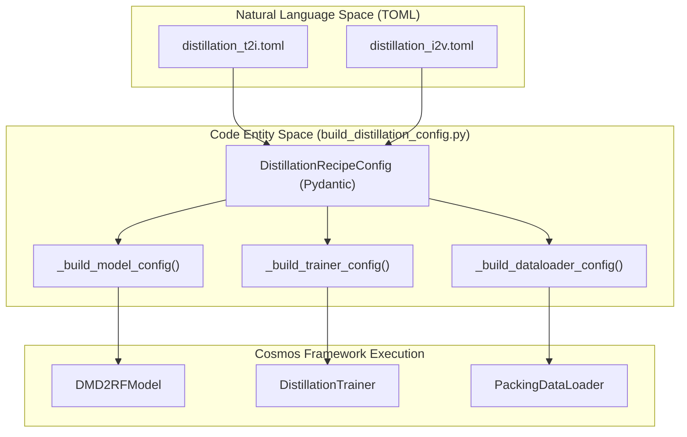
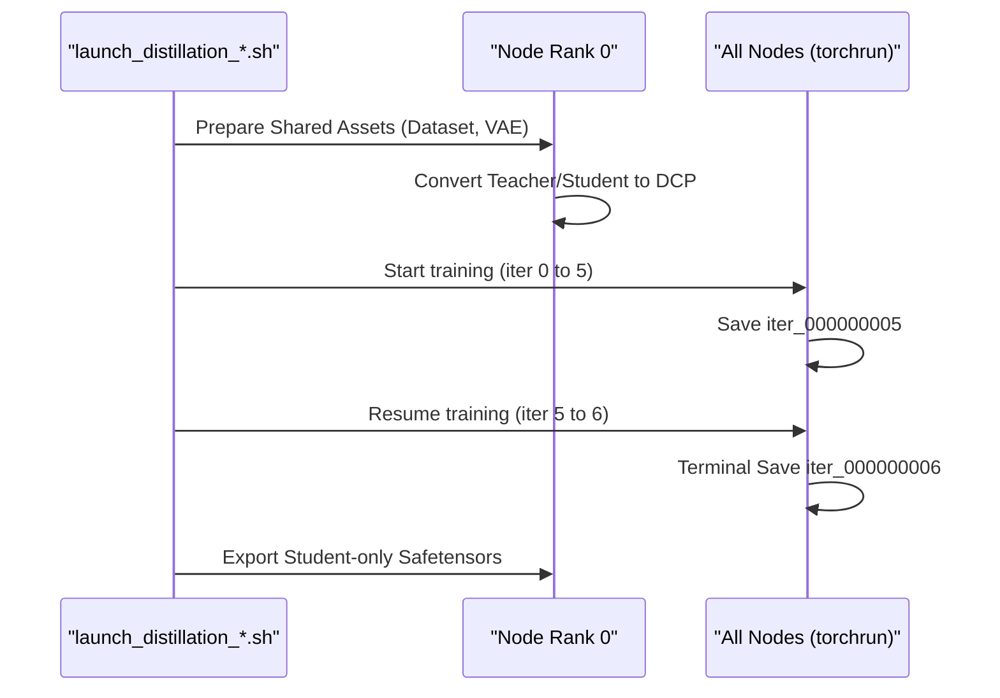

<!-- source: DeepWiki mcp.deepwiki.com · repo NVIDIA/cosmos · page 7.2 Generator Distillation · fetched 2026-10-26 -->

# Generator Distillation

Relevant source files

The following files were used as context for generating this wiki page:

- [cookbooks/cosmos3/generator/audiovisual/distill/README.md](cookbooks/cosmos3/generator/audiovisual/distill/README.md)
- [cookbooks/cosmos3/generator/audiovisual/distill/build_distillation_config.py](cookbooks/cosmos3/generator/audiovisual/distill/build_distillation_config.py)
- [cookbooks/cosmos3/generator/audiovisual/distill/common.sh](cookbooks/cosmos3/generator/audiovisual/distill/common.sh)
- [cookbooks/cosmos3/generator/audiovisual/distill/launch_distillation_i2v.sh](cookbooks/cosmos3/generator/audiovisual/distill/launch_distillation_i2v.sh)
- [cookbooks/cosmos3/generator/audiovisual/distill/launch_distillation_t2i.sh](cookbooks/cosmos3/generator/audiovisual/distill/launch_distillation_t2i.sh)
- [cookbooks/cosmos3/generator/audiovisual/distill/toml/distillation_i2v.toml](cookbooks/cosmos3/generator/audiovisual/distill/toml/distillation_i2v.toml)
- [cookbooks/cosmos3/generator/audiovisual/distill/toml/distillation_t2i.toml](cookbooks/cosmos3/generator/audiovisual/distill/toml/distillation_t2i.toml)

The Generator Distillation page documents the Direct Model Distillation 2 (DMD2) recipes for Cosmos3-Super models. These recipes enable distilling the high-step iterative diffusion process of the Super models into efficient 4-step models using the Cosmos Framework.

## Overview

Cosmos 3 supports short DMD2 distillation smoke-run recipes designed to validate the training pipeline for Text-to-Image (T2I) and Image-to-Video (I2V) generation [cookbooks/cosmos3/generator/audiovisual/distill/README.md:6-13](). These recipes use the `DMD2RFModel` architecture to train a student model and a fake-score network initialized from a teacher model [cookbooks/cosmos3/generator/audiovisual/distill/README.md:24-25]().

### Supported Model Pairs
The distillation process targets the following teacher-student pairs:

| Mode | Teacher Model | Initial Student Model | Data Configuration |
| :--- | :--- | :--- | :--- |
| **T2I** | `nvidia/Cosmos3-Super-Text2Image` | `nvidia/Cosmos3-Super-Text2Image-4Step` | One 768-class frame per BridgeData2 video, no visual conditioning |
| **I2V** | `nvidia/Cosmos3-Super-Image2Video` | `nvidia/Cosmos3-Super-Image2Video-4Step` | 61 frames at 480p, first-frame conditioning |

Sources: [cookbooks/cosmos3/generator/audiovisual/distill/README.md:17-20]()

## Training Entrypoints and Launchers

Distillation is orchestrated through two primary shell scripts which source common logic from `common.sh` and utilize `build_distillation_config.py` for configuration generation [cookbooks/cosmos3/generator/audiovisual/distill/launch_distillation_t2i.sh:16-17](), [cookbooks/cosmos3/generator/audiovisual/distill/launch_distillation_i2v.sh:16-17]().

### Launch Scripts
*   **`launch_distillation_t2i.sh`**: Entrypoint for Text-to-Image distillation [cookbooks/cosmos3/generator/audiovisual/distill/launch_distillation_t2i.sh:9-14]().
*   **`launch_distillation_i2v.sh`**: Entrypoint for Image-to-Video distillation [cookbooks/cosmos3/generator/audiovisual/distill/launch_distillation_i2v.sh:9-14]().

### Multi-Node Topology
The canonical profile for these recipes requires **8 GB200 nodes** with 4 GPUs per node (32 GPUs total) [cookbooks/cosmos3/generator/audiovisual/distill/README.md:33-36](). Users must configure the following environment variables on every node:

| Variable | Description |
| :--- | :--- |
| `DISTILL_ROOT` | Shared writable directory for checkpoints and data |
| `NNODES` | Number of nodes (default: 8) |
| `NPROC_PER_NODE` | GPUs per node (default: 4) |
| `NODE_RANK` | Unique integer (0-7) |
| `MASTER_ADDR` | Hostname/IP of node rank 0 |
| `MASTER_PORT` | One free TCP port, identical on every node |

Sources: [cookbooks/cosmos3/generator/audiovisual/distill/README.md:48-57]()

## Configuration and Data Flow

The distillation pipeline bridges high-level TOML configurations to the `cosmos_framework` execution logic via a Python helper script.

### `build_distillation_config.py`
This script performs strict validation of the TOML recipes using Pydantic models [cookbooks/cosmos3/generator/audiovisual/distill/build_distillation_config.py:61-185](). It constructs the complex framework objects required for training, including:
*   `DMD2RFModel`: The core distillation model architecture [cookbooks/cosmos3/generator/audiovisual/distill/build_distillation_config.py:40]().
*   `DistillationTrainer`: The specialized trainer for DMD2 [cookbooks/cosmos3/generator/audiovisual/distill/build_distillation_config.py:44]().
*   `DistributedCheckpointer`: Manages Distributed Checkpoint (DCP) lifecycle [cookbooks/cosmos3/generator/audiovisual/distill/build_distillation_config.py:20]().

### Data Flow Diagram: Config to Execution
This diagram illustrates how natural language configuration in TOML is transformed into code entities for the training loop.

Sources: [cookbooks/cosmos3/generator/audiovisual/distill/build_distillation_config.py:186-250](), [cookbooks/cosmos3/generator/audiovisual/distill/README.md:94-100]()

## Distillation Implementation Details

The distillation process utilizes a 4-step fixed-step sampler schedule defined in the TOML configs [cookbooks/cosmos3/generator/audiovisual/distill/build_distillation_config.py:81-88]().

### Key Training Components
1.  **Model Architecture**: The student model is a `DMD2RFModel` initialized with `SUPER_MODEL_CONFIG` [cookbooks/cosmos3/generator/audiovisual/distill/build_distillation_config.py:192-198]().
2.  **Optimizer**: Uses a `LazyDict` to manage separate optimizer settings for the `net` (student) and `fake_score` network [cookbooks/cosmos3/generator/audiovisual/distill/build_distillation_config.py:125-132]().
3.  **Losses**: Implements Video-level Score Distillation (VSD) and fake-score loss with configurable reduction methods [cookbooks/cosmos3/generator/audiovisual/distill/build_distillation_config.py:107-108]().
4.  **Data**: Loads the `BridgeData2-Subset-Synthetic-Captions` dataset through `get_sft_dataset` and `PackingDataLoader` [cookbooks/cosmos3/generator/audiovisual/distill/build_distillation_config.py:30-34]().

### Distillation Workflow Logic
The following diagram details the sequence of operations performed by the launchers.

Sources: [cookbooks/cosmos3/generator/audiovisual/distill/README.md:143-160]()

### Tokenizer Configuration
The distillation recipe uses the `Wan2pt2VAEConfig` for tokenization [cookbooks/cosmos3/generator/audiovisual/distill/build_distillation_config.py:22](). The VAE path is dynamically resolved via the environment variable `WAN_VAE_PATH`, and frame chunking is adjusted based on resolution (e.g., 24 frames for 480p) [cookbooks/cosmos3/generator/audiovisual/distill/build_distillation_config.py:216-222]().

### Parallelism Strategy
The recipe defaults to a 32-GPU parallelism shape:
*   **Data Parallel Shard Degree**: 32 [cookbooks/cosmos3/generator/audiovisual/distill/README.md:70]().
*   **Context Parallel Shard Degree**: 1 [cookbooks/cosmos3/generator/audiovisual/distill/build_distillation_config.py:78]().

For a 16-GPU setup, the `data_parallel_shard_degree` must be adjusted to 16 in the TOML configuration [cookbooks/cosmos3/generator/audiovisual/distill/README.md:80-81]().

Sources: [cookbooks/cosmos3/generator/audiovisual/distill/README.md:68-81](), [cookbooks/cosmos3/generator/audiovisual/distill/build_distillation_config.py:206-211]()

---

