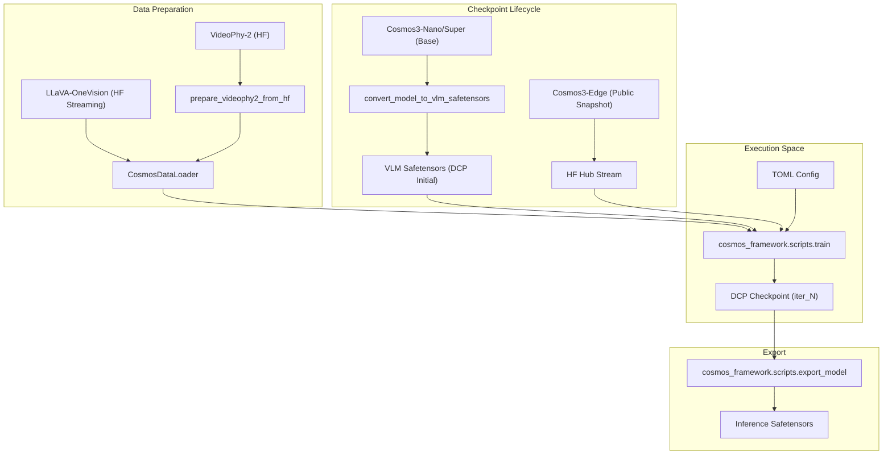
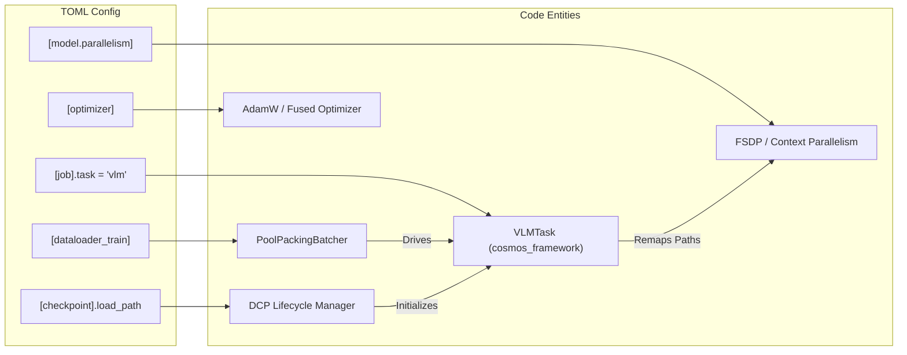

<!-- source: DeepWiki mcp.deepwiki.com · repo NVIDIA/cosmos · page 7.3 Reasoner Fine-Tuning · fetched 2026-10-26 -->

# Reasoner Fine-Tuning

Relevant source files

The following files were used as context for generating this wiki page:

- [cookbooks/cosmos3/generator/action/finetune/README_egocentric_hand_action.md](cookbooks/cosmos3/generator/action/finetune/README_egocentric_hand_action.md)
- [cookbooks/cosmos3/generator/action/finetune/data_processing_for_egocentric_hand_action.py](cookbooks/cosmos3/generator/action/finetune/data_processing_for_egocentric_hand_action.py)
- [cookbooks/cosmos3/generator/audiovisual/finetune/launch_sft_vision_nano.sh](cookbooks/cosmos3/generator/audiovisual/finetune/launch_sft_vision_nano.sh)
- [cookbooks/cosmos3/generator/audiovisual/finetune/launch_sft_vision_super.sh](cookbooks/cosmos3/generator/audiovisual/finetune/launch_sft_vision_super.sh)
- [cookbooks/cosmos3/generator/audiovisual/finetune/toml/sft_config/vision_sft_nano.toml](cookbooks/cosmos3/generator/audiovisual/finetune/toml/sft_config/vision_sft_nano.toml)
- [cookbooks/cosmos3/generator/audiovisual/finetune/toml/sft_config/vision_sft_super.toml](cookbooks/cosmos3/generator/audiovisual/finetune/toml/sft_config/vision_sft_super.toml)
- [cookbooks/cosmos3/reasoner/finetune/README.md](cookbooks/cosmos3/reasoner/finetune/README.md)
- [cookbooks/cosmos3/reasoner/finetune/launch_sft_llava_ov.sh](cookbooks/cosmos3/reasoner/finetune/launch_sft_llava_ov.sh)
- [cookbooks/cosmos3/reasoner/finetune/launch_sft_videophy2_edge.sh](cookbooks/cosmos3/reasoner/finetune/launch_sft_videophy2_edge.sh)
- [cookbooks/cosmos3/reasoner/finetune/launch_sft_videophy2_nano.sh](cookbooks/cosmos3/reasoner/finetune/launch_sft_videophy2_nano.sh)
- [cookbooks/cosmos3/reasoner/finetune/launch_sft_videophy2_super.sh](cookbooks/cosmos3/reasoner/finetune/launch_sft_videophy2_super.sh)
- [cookbooks/cosmos3/reasoner/finetune/toml/sft_config/llava_ov.toml](cookbooks/cosmos3/reasoner/finetune/toml/sft_config/llava_ov.toml)
- [cookbooks/cosmos3/reasoner/finetune/toml/sft_config/videophy2_sft_edge.toml](cookbooks/cosmos3/reasoner/finetune/toml/sft_config/videophy2_sft_edge.toml)
- [cookbooks/cosmos3/reasoner/finetune/toml/sft_config/videophy2_sft_nano.toml](cookbooks/cosmos3/reasoner/finetune/toml/sft_config/videophy2_sft_nano.toml)
- [cookbooks/cosmos3/reasoner/finetune/toml/sft_config/videophy2_sft_super.toml](cookbooks/cosmos3/reasoner/finetune/toml/sft_config/videophy2_sft_super.toml)
- [evaluation/cosmos3/generator/paibench_c/run_with_cosmos_framework.ipynb](evaluation/cosmos3/generator/paibench_c/run_with_cosmos_framework.ipynb)

The Cosmos 3 Reasoner supports Supervised Fine-Tuning (SFT) across three model tiers: **Nano** (8B), **Super** (32B), and **Edge** (2B). These recipes utilize the `cosmos_framework.scripts.train` entrypoint, leveraging Fully Sharded Data Parallel (FSDP), context parallelism, and Distributed Checkpoint (DCP) for efficient multi-GPU training.

## Overview of SFT Recipes

Fine-tuning is categorized into general vision-language alignment and physical-plausibility reasoning. All reasoner recipes utilize the `vlm` task type within the Cosmos Framework.

| Recipe | Entrypoint Script | Tier | Dataset | Notes |
| :--- | :--- | :--- | :--- | :--- |
| **Alignment SFT** | `launch_sft_llava_ov.sh` | Nano | LLaVA-OneVision | Streams from HF; Cosmos3-Nano Reasoner checkpoint auto-prepared |
| **Physical Plausibility** | `launch_sft_videophy2_nano.sh` | Nano | VideoPhy-2 | 1–5 plausibility scoring; dataset + checkpoint auto-prepared |
| **Physical Plausibility** | `launch_sft_videophy2_super.sh` | Super | VideoPhy-2 | Cosmos3-Super tier — Qwen3-VL-32B full fine-tune; dataset + checkpoint auto-prepared |
| **Physical Plausibility** | `launch_sft_videophy2_edge.sh` | Edge | VideoPhy-2 | Cosmos3-Edge tier — Nemotron-2B-Dense-VL (SigLIP2 tower, frozen); dataset auto-prepared; reasoner weights load directly from the (ungated) `nvidia/Cosmos3-Edge` snapshot |

Sources: [cookbooks/cosmos3/reasoner/finetune/README.md:5-10]()

## Training Lifecycle and Data Flow

The training process involves a multi-stage lifecycle: environment preparation, model conversion to VLM-compatible safetensors, the `torchrun` execution, and final export to inference-ready formats.

### System Architecture: SFT Data Flow
The following diagram illustrates the transition from raw dataset assets to the final inference-ready Reasoner model.

"Reasoner SFT Data Flow"

Sources: [cookbooks/cosmos3/reasoner/finetune/launch_sft_llava_ov.sh:17-27](), [cookbooks/cosmos3/reasoner/finetune/launch_sft_videophy2_super.sh:23-40](), [cookbooks/cosmos3/reasoner/finetune/README.md:12-33]()

## Implementation Details by Tier

### 1. Cosmos3-Nano Reasoner
The Nano tier recipes bootstrap from a converted Cosmos3-Nano Reasoner checkpoint.
*   **Alignment (LLaVA-OV)**: Streams data directly from HuggingFace using the `llava_ov.toml` config [cookbooks/cosmos3/reasoner/finetune/launch_sft_llava_ov.sh:8-9]().
*   **Physical Plausibility (VideoPhy-2)**: Requires local materialization via `cosmos_framework.scripts.reasoner.prepare_videophy2_from_hf` [cookbooks/cosmos3/reasoner/finetune/toml/sft_config/videophy2_sft_nano.toml:8-9]().

### 2. Cosmos3-Super Reasoner
The Super tier (32B) requires specific memory optimizations to fit on H100/GB200 nodes.
*   **Backbone**: Qwen3-VL-32B-Instruct [cookbooks/cosmos3/reasoner/finetune/toml/sft_config/videophy2_sft_super.toml:38]().
*   **Parallelism**: Uses FSDP full-sharding (`data_parallel_shard_degree = -1`) and supports Context Parallelism (`context_parallel_shard_degree = 2`) if OOM occurs [cookbooks/cosmos3/reasoner/finetune/toml/sft_config/videophy2_sft_super.toml:46-48]().
*   **Memory Tweak**: Uses `PYTORCH_ALLOC_CONF="expandable_segments:True"` to manage the 32B backbone memory footprint [cookbooks/cosmos3/generator/audiovisual/finetune/launch_sft_vision_super.sh:36]().

### 3. Cosmos3-Edge Reasoner
The Edge tier (2B) is optimized for efficiency and can run on 4-GPU nodes.
*   **Backbone**: Nemotron-2B-Dense-VL with a SigLIP2 visual tower [cookbooks/cosmos3/reasoner/finetune/README.md:10-12]().
*   **Loading**: Unlike Nano/Super, Edge loads weights directly from the `nvidia/Cosmos3-Edge` HuggingFace snapshot at startup without a manual conversion step [cookbooks/cosmos3/reasoner/finetune/README.md:12]().

## Code Entity Space: Training Configuration

The following diagram maps the TOML configuration fields to the internal logic of the `cosmos_framework.scripts.train` script.

"Config to Code Mapping"

Sources: [cookbooks/cosmos3/reasoner/finetune/toml/sft_config/videophy2_sft_nano.toml:16-94](), [cookbooks/cosmos3/reasoner/finetune/toml/sft_config/videophy2_sft_super.toml:45-103]()

## Checkpoint Lifecycle

The framework uses the Distributed Checkpoint (DCP) format for saving trainer state, optimizer states, and model weights.

1.  **Preparation**: For Nano and Super, the base weights are merged and converted using `cosmos_framework.scripts.convert_model_to_vlm_safetensors` [cookbooks/cosmos3/reasoner/finetune/launch_sft_videophy2_super.sh:30-32]().
2.  **Training**: `cosmos_framework.scripts.train` saves DCP shards into `checkpoints/iter_<N>/` [cookbooks/cosmos3/reasoner/finetune/README.md:44]().
3.  **Export**: To use the model for inference, the DCP checkpoint must be merged into a single safetensors file via `cosmos_framework.scripts.export_model` [cookbooks/cosmos3/reasoner/finetune/README.md:52-54]().

## Configuration Reference Table

| TOML Section | Key Field | Nano (VideoPhy2) | Super (VideoPhy2) | Edge (VideoPhy2) |
| :--- | :--- | :--- | :--- | :--- |
| `[model.backbone]` | `model_name` | `Qwen3-VL-8B-Instruct` | `Qwen3-VL-32B-Instruct` | `Nemotron-2B-Dense-VL` |
| `[model.parallelism]` | `data_parallel_shard_degree` | 8 | -1 (Full Shard) | 8 |
| `[model.parallelism]` | `context_parallel_shard_degree` | 1 | 1 (or 2 if OOM) | 1 |
| `[trainer]` | `distributed_parallelism` | `fsdp` | `fsdp` | `fsdp` |
| `[dataloader_train]` | `max_sequence_length` | 16,000 | 16,000 | 16,000 |

Sources: [cookbooks/cosmos3/reasoner/finetune/toml/sft_config/videophy2_sft_nano.toml:28-94](), [cookbooks/cosmos3/reasoner/finetune/toml/sft_config/videophy2_sft_super.toml:37-103](), [cookbooks/cosmos3/reasoner/finetune/toml/sft_config/videophy2_sft_edge.toml:37-103]()

---

