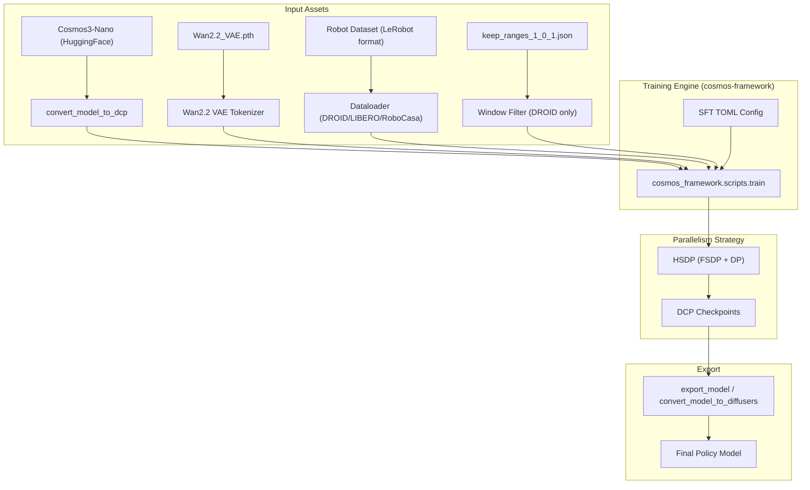
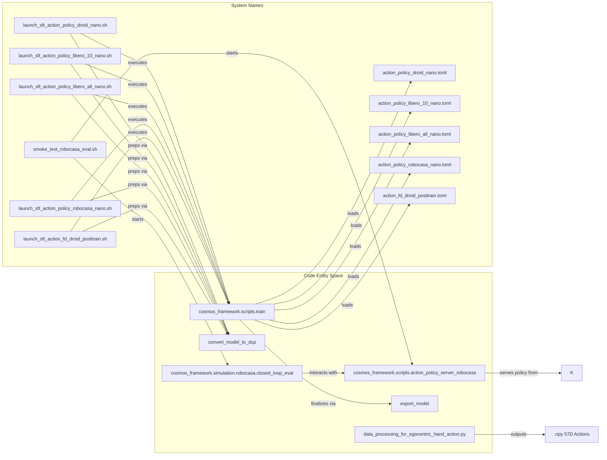

<!-- source: DeepWiki mcp.deepwiki.com · repo NVIDIA/cosmos · page 7.4 Action Policy and Forward-Dynamics Fine-Tuning · fetched 2026-10-26 -->

# Action Policy and Forward-Dynamics Fine-Tuning

<details>
<summary>Relevant source files</summary>

The following files were used as context for generating this wiki page:

- [CONTRIBUTING.md](CONTRIBUTING.md)
- [cookbooks/cosmos3/generator/action/finetune/README.md](cookbooks/cosmos3/generator/action/finetune/README.md)
- [cookbooks/cosmos3/generator/action/finetune/README_egocentric_hand_action.md](cookbooks/cosmos3/generator/action/finetune/README_egocentric_hand_action.md)
- [cookbooks/cosmos3/generator/action/finetune/action_fd_droid_posttrain.md](cookbooks/cosmos3/generator/action/finetune/action_fd_droid_posttrain.md)
- [cookbooks/cosmos3/generator/action/finetune/data_processing_for_egocentric_hand_action.py](cookbooks/cosmos3/generator/action/finetune/data_processing_for_egocentric_hand_action.py)
- [cookbooks/cosmos3/generator/action/finetune/launch_sft_action_fd_droid_posttrain.sh](cookbooks/cosmos3/generator/action/finetune/launch_sft_action_fd_droid_posttrain.sh)
- [cookbooks/cosmos3/generator/action/finetune/launch_sft_action_policy_droid_nano.sh](cookbooks/cosmos3/generator/action/finetune/launch_sft_action_policy_droid_nano.sh)
- [cookbooks/cosmos3/generator/action/finetune/launch_sft_action_policy_libero_10_nano.sh](cookbooks/cosmos3/generator/action/finetune/launch_sft_action_policy_libero_10_nano.sh)
- [cookbooks/cosmos3/generator/action/finetune/launch_sft_action_policy_libero_all_nano.sh](cookbooks/cosmos3/generator/action/finetune/launch_sft_action_policy_libero_all_nano.sh)
- [cookbooks/cosmos3/generator/action/finetune/launch_sft_action_policy_robocasa_nano.sh](cookbooks/cosmos3/generator/action/finetune/launch_sft_action_policy_robocasa_nano.sh)
- [cookbooks/cosmos3/generator/action/finetune/smoke_test_robocasa_eval.sh](cookbooks/cosmos3/generator/action/finetune/smoke_test_robocasa_eval.sh)
- [cookbooks/cosmos3/generator/action/finetune/toml/sft_config/action_fd_droid_posttrain.toml](cookbooks/cosmos3/generator/action/finetune/toml/sft_config/action_fd_droid_posttrain.toml)
- [cookbooks/cosmos3/generator/action/finetune/toml/sft_config/action_policy_droid_nano.toml](cookbooks/cosmos3/generator/action/finetune/toml/sft_config/action_policy_droid_nano.toml)
- [cookbooks/cosmos3/generator/action/finetune/toml/sft_config/action_policy_libero_10_nano.toml](cookbooks/cosmos3/generator/action/finetune/toml/sft_config/action_policy_libero_10_nano.toml)
- [cookbooks/cosmos3/generator/action/finetune/toml/sft_config/action_policy_libero_all_nano.toml](cookbooks/cosmos3/generator/action/finetune/toml/sft_config/action_policy_libero_all_nano.toml)
- [cookbooks/cosmos3/generator/action/finetune/toml/sft_config/action_policy_robocasa_nano.toml](cookbooks/cosmos3/generator/action/finetune/toml/sft_config/action_policy_robocasa_nano.toml)
- [cookbooks/cosmos3/generator/audiovisual/finetune/README.md](cookbooks/cosmos3/generator/audiovisual/finetune/README.md)
- [cookbooks/cosmos3/reasoner/finetune/launch_sft_videophy2_nano.sh](cookbooks/cosmos3/reasoner/finetune/launch_sft_videophy2_nano.sh)
- [cookbooks/cosmos3/reasoner/finetune/toml/sft_config/llava_ov.toml](cookbooks/cosmos3/reasoner/finetune/toml/sft_config/llava_ov.toml)
- [cookbooks/cosmos3/reasoner/finetune/toml/sft_config/videophy2_sft_nano.toml](cookbooks/cosmos3/reasoner/finetune/toml/sft_config/videophy2_sft_nano.toml)
- [evaluation/cosmos3/generator/paibench_c/run_with_cosmos_framework.ipynb](evaluation/cosmos3/generator/paibench_c/run_with_cosmos_framework.ipynb)

</details>


This page documents the Supervised Fine-Tuning (SFT) recipes for adapting **Cosmos3-Nano** into specialized robot action policies and forward dynamics models. These recipes leverage the `cosmos-framework` training pipeline to train models capable of predicting robot actions (Policy) or future visual states (Forward Dynamics) based on proprioceptive feedback, task instructions, and visual observations.

## Overview

The action fine-tuning workflow covers three primary areas:
1.  **Robot Action Policies**: Training the model to output control signals (e.g., DROID, LIBERO, RoboCasa) [cookbooks/cosmos3/generator/action/finetune/README.md:3-7]().
2.  **Forward Dynamics (FD)**: Training the model to predict future video frames conditioned on an action sequence [cookbooks/cosmos3/generator/action/finetune/action_fd_droid_posttrain.md:170-171]().
3.  **Egocentric Hand Action**: A specialized data pipeline for 57D human hand-pose representations [cookbooks/cosmos3/generator/action/finetune/README_egocentric_hand_action.md:3-6]().

### Technical Specification Matrix

| Task Type | Experiment | Action Space | Dataset |
| :--- | :--- | :--- | :--- |
| **Policy-DROID** | `action_policy_droid_nano` | 8-D `joint_pos` | Cosmos3-DROID (Success split) [cookbooks/cosmos3/generator/action/finetune/README.md:10-10]() |
| **Policy-LIBERO-10** | `action_policy_libero_nano` | 10-D `rot6d` (Relative) | LIBERO_LeRobot_v3 (libero_10) [cookbooks/cosmos3/generator/action/finetune/README.md:11-11]() |
| **Policy-LIBERO-All** | `action_policy_libero_all_nano` | 10-D `rot6d` (Relative) | LIBERO_LeRobot_v3 (All 4 suites) [cookbooks/cosmos3/generator/action/finetune/README.md:12-12]() |
| **Policy-RoboCasa** | `action_policy_robocasa_nano` | 15-D `base_motion` (Raw) | RoboCasa (target/pretrain splits) [cookbooks/cosmos3/generator/action/finetune/README.md:14-14]() |
| **Forward Dynamics** | `action_fd_droid_posttrain` | 10-D `ee_pose` | Cosmos3-DROID (Success + Failure) [cookbooks/cosmos3/generator/action/finetune/action_fd_droid_posttrain.md:15-17]() |
| **Hand Action** | N/A (Data Processing) | 57-D (Camera/Wrist/Finger) | Egocentric Hand-Pose Annotations [cookbooks/cosmos3/generator/action/finetune/README_egocentric_hand_action.md:3-6]() |

Sources: [cookbooks/cosmos3/generator/action/finetune/README.md:1-20](), [cookbooks/cosmos3/generator/action/finetune/action_fd_droid_posttrain.md:8-19]()

## System Architecture and Data Flow

The fine-tuning process integrates external assets—including the **Wan2.2 VAE tokenizer** and **DCP checkpoints**—into the `cosmos_framework.scripts.train` entrypoint.

### Action Policy Training Pipeline

Sources: [cookbooks/cosmos3/generator/action/finetune/README.md:52-64](), [cookbooks/cosmos3/generator/action/finetune/action_fd_droid_posttrain.md:79-101](), [cookbooks/cosmos3/generator/action/finetune/launch_sft_action_fd_droid_posttrain.sh:116-121]()

## Implementation Details

### Distributed Training and Parallelism
Training uses **Hybrid Sharded Data Parallelism (HSDP)**, combining FSDP sharding within a node and data replication across nodes.
*   **Sharding**: `data_parallel_shard_degree = 8` shards the model across GPUs in a node [cookbooks/cosmos3/generator/action/finetune/toml/sft_config/action_fd_droid_posttrain.toml:29-29]().
*   **Replication**: `data_parallel_replicate_degree` is set to the number of nodes (e.g., 32 for a 256-GPU run) [cookbooks/cosmos3/generator/action/finetune/README.md:14-14](), [cookbooks/cosmos3/generator/action/finetune/action_fd_droid_posttrain.md:149-150](). For RoboCasa, `data_parallel_replicate_degree = 2` for 16 ranks (4 nodes x 4 GPUs) [cookbooks/cosmos3/generator/action/finetune/toml/sft_config/action_policy_robocasa_nano.toml:37-37]().
*   **Activation Checkpointing**: `mode = "selective"` or `"full"` is used to manage memory [cookbooks/cosmos3/generator/action/finetune/toml/sft_config/action_fd_droid_posttrain.toml:32-33]().

### Configuration Mapping

Sources: [cookbooks/cosmos3/generator/action/finetune/launch_sft_action_policy_droid_nano.sh:52-64](), [cookbooks/cosmos3/generator/action/finetune/launch_sft_action_fd_droid_posttrain.sh:116-121](), [cookbooks/cosmos3/generator/action/finetune/data_processing_for_egocentric_hand_action.py:4-21](), [cookbooks/cosmos3/generator/action/finetune/smoke_test_robocasa_eval.sh:53-56](), [cookbooks/cosmos3/generator/action/finetune/smoke_test_robocasa_eval.sh:101-108]()

## Specialized Recipes

### RoboCasa Policy Fine-Tuning
The RoboCasa recipe trains a mobile-base manipulation policy.
*   **Action Contract**: 15-D `[base_motion(4), control_mode(1), eef_pos(3), eef_rot6d(6), gripper(1)]` with `base_encoding="raw"` [cookbooks/cosmos3/generator/action/finetune/README.md:29-30]().
*   **Observation**: `agentview_left` and `eye_in_hand` concatenated, plus end-effector proprioception (`use_state=True`) [cookbooks/cosmos3/generator/action/finetune/README.md:32-34]().
*   **Closed-Loop Evaluation**: The `smoke_test_robocasa_eval.sh` script demonstrates the decoupled policy server (`cosmos_framework.scripts.action_policy_server_robocasa`) and evaluator (`cosmos_framework.simulation.robocasa.closed_loop_eval`) architecture [cookbooks/cosmos3/generator/action/finetune/smoke_test_robocasa_eval.sh:53-56](), [cookbooks/cosmos3/generator/action/finetune/smoke_test_robocasa_eval.sh:101-108](). This smoke test verifies the action contract between the server and evaluator [cookbooks/cosmos3/generator/action/finetune/smoke_test_robocasa_eval.sh:85-95]().

### Forward Dynamics (FD) Post-Training
Unlike policy training, FD models are trained to predict video from an initial frame and an action sequence.
*   **Action Space**: 10-D `ee_pose` (End-Effector Pose: `[pos_delta, rot6d_delta, gripper]`) [cookbooks/cosmos3/generator/action/finetune/action_fd_droid_posttrain.md:17-17]().
*   **Dataset**: Uses the `DROIDMergedLeRobotDataset` which includes both success and failure trajectories [cookbooks/cosmos3/generator/action/finetune/action_fd_droid_posttrain.md:14-15]().
*   **Task Mode**: `forward_dynamics` [cookbooks/cosmos3/generator/action/finetune/action_fd_droid_posttrain.md:16-16]().

### Egocentric Hand Action Pipeline
A standalone script `data_processing_for_egocentric_hand_action.py` converts human hand-pose annotations into a raw 57D format [cookbooks/cosmos3/generator/action/finetune/data_processing_for_egocentric_hand_action.py:4-6]().

**57D Representation Layout:**
`[camera(9), right_wrist(9), right_fingertips(15), left_wrist(9), left_fingertips(15)]` [cookbooks/cosmos3/generator/action/finetune/README_egocentric_hand_action.md:91-93]().
*   **Pose Blocks (9D)**: `[translation(3), rot6d(6)]` [cookbooks/cosmos3/generator/action/finetune/README_egocentric_hand_action.md:95-95]().
*   **Fingertip Blocks (15D)**: 5 fingertips × 3D (XYZ) in the wrist-local frame [cookbooks/cosmos3/generator/action/finetune/README_egocentric_hand_action.md:99-100]().

The pipeline handles:
1.  **Coordinate Inversion**: Inverting `world2cam` to `cam2world` [cookbooks/cosmos3/generator/action/finetune/README_egocentric_hand_action.md:108-109]().
2.  **Wrist Alignment**: Applying a `WRIST_FRAME_ALIGN` matrix to ensure consistent orientation (+X thumb-to-pinky, +Y outward palm, +Z wrist-to-fingertips) [cookbooks/cosmos3/generator/action/finetune/data_processing_for_egocentric_hand_action.py:64-74]().
3.  **Normalization**: Supports `quantile_rot`, `meanstd`, and `minmax` via `ActionProcessor` [cookbooks/cosmos3/generator/action/finetune/README_egocentric_hand_action.md:135-148]().

Sources: [cookbooks/cosmos3/generator/action/finetune/action_fd_droid_posttrain.md:1-173](), [cookbooks/cosmos3/generator/action/finetune/README_egocentric_hand_action.md:1-122](), [cookbooks/cosmos3/generator/action/finetune/data_processing_for_egocentric_hand_action.py:1-160]()

## Training and Export Workflow

### 1. Preparation
Users must stage the dataset and acquire the Wan2.2 VAE weights [cookbooks/cosmos3/generator/action/finetune/README.md:33-36](). The base model is converted to DCP:
```bash
python -m cosmos_framework.scripts.convert_model_to_dcp \
  -o checkpoints/Cosmos3-Nano \
  --checkpoint-path Cosmos3-Nano
```
Sources: [cookbooks/cosmos3/generator/action/finetune/action_fd_droid_posttrain.md:89-91]()

### 2. Execution
Launchers like `launch_sft_action_policy_droid_nano.sh` handle the `torchrun` invocation. For DROID, a `keep_ranges_1_0_1.json` window filter is applied to the dataloader to select high-quality segments [cookbooks/cosmos3/generator/action/finetune/README.md:14-14](). For RoboCasa, the `TASK_SET` environment variable selects the specific task split (e.g., `target_atomic`, `pretrain_atomic`, `pretrain_all`) [cookbooks/cosmos3/generator/action/finetune/launch_sft_action_policy_robocasa_nano.sh:40-45]().

### 3. Checkpoint Export
After training, DCP checkpoints are converted to `safetensors` for deployment using `cosmos_framework.scripts.export_model` [cookbooks/cosmos3/generator/audiovisual/finetune/README.md:78-83](). These `safetensors` can then be converted to a Diffusers pipeline using `cosmos_framework.scripts.convert_model_to_diffusers` [cookbooks/cosmos3/generator/audiovisual/finetune/README.md:91-94]().

Sources: [cookbooks/cosmos3/generator/action/finetune/README.md:52-84](), [cookbooks/cosmos3/generator/action/finetune/action_fd_droid_posttrain.md:152-164](), [cookbooks/cosmos3/generator/audiovisual/finetune/README.md:78-94]()

---

