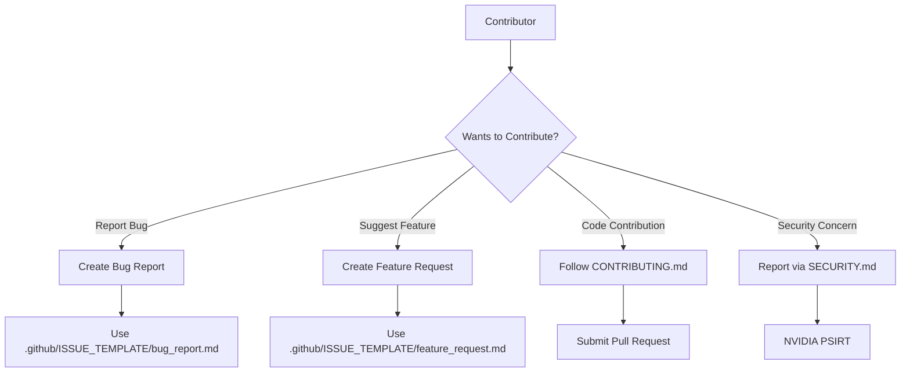

<!-- source: DeepWiki mcp.deepwiki.com · repo NVIDIA/cosmos · page 9 Repository Operations and Contributing · fetched 2026-10-26 -->

# Repository Operations and Contributing

<details>
<summary>Relevant source files</summary>

The following files were used as context for generating this wiki page:

- [.github/ISSUE_TEMPLATE/bug_report.md](.github/ISSUE_TEMPLATE/bug_report.md)
- [.github/ISSUE_TEMPLATE/feature_request.md](.github/ISSUE_TEMPLATE/feature_request.md)
- [.github/workflows/validate-notebooks.yml](.github/workflows/validate-notebooks.yml)
- [SECURITY.md](SECURITY.md)

</details>


This page provides a high-level overview of the NVIDIA Cosmos repository's operational aspects and guidelines for contributing. It covers the automated checks for notebooks, how to report issues and suggest features, the security vulnerability disclosure process, licensing, release information, and conventions for managing generated files. For detailed information on each topic, please refer to the linked child pages.

## Repository Governance Overview

The NVIDIA Cosmos repository employs several mechanisms to ensure code quality, maintainability, and a clear contribution path. These include automated GitHub Actions workflows for continuous integration, standardized issue templates for bug reports and feature requests, a defined security vulnerability reporting process, and clear guidelines for community contributions.

### GitHub Actions for Notebook Validation

The repository utilizes a GitHub Actions workflow, `validate-notebooks.yml`, to automatically lint and validate all Jupyter notebooks (`.ipynb` files) within the codebase. This ensures that cookbook and evaluation notebooks adhere to structural and basic code quality standards.

**Diagram: Notebook Validation Workflow**
```mermaid
graph TD
    A[Push or Pull Request to .ipynb files] --> B{GitHub Action Triggered};
    B --> C[Checkout Repository];
    C --> D[Set up Python 3.12];
    D --> E[Install nbformat and ruff];
    E --> F[Parse Tracked Notebooks (JSON Validity)];
    F -- "If Invalid JSON" --> G[Fail Workflow];
    F -- "If Valid JSON" --> H[Validate Notebook Schemas (nbformat)];
    H -- "If Invalid Schema" --> G;
    H -- "If Valid Schema" --> I[Lint Notebook Code (ruff E9,F63,F7,F82)];
    I -- "If Linting Errors" --> G;
    I -- "If No Errors" --> J[Workflow Success];
```
Sources: [.github/workflows/validate-notebooks.yml:1-101]()

This workflow performs several checks:
1.  **JSON Validity**: It first verifies that each `.ipynb` file is valid JSON [.github/workflows/validate-notebooks.yml:37-49]().
2.  **Notebook Schema Validation**: It then uses `nbformat` to validate the notebook structure against the Jupyter notebook schema [.github/workflows/validate-notebooks.yml:51-94]().
3.  **Code Linting**: Finally, it uses `ruff` to lint the Python code within the notebooks, specifically checking for syntax errors and runtime-invalid constructs [.github/workflows/validate-notebooks.yml:96-101]().

For a detailed explanation of this workflow and the `.gitignore` patterns that manage generated files, see [CI: Notebook Validation](#9.1).

### Contributing Guidelines and Issue Management

To streamline contributions and issue reporting, the repository provides clear guidelines and templates. These resources help contributors understand the expected format for bug reports and feature requests, ensuring that necessary information is provided for efficient processing.

**Diagram: Contribution and Issue Flow**

Sources: [.github/ISSUE_TEMPLATE/bug_report.md:1-64](), [.github/ISSUE_TEMPLATE/feature_request.md:1-29](), [SECURITY.md:1-19]()

*   **Bug Reports**: The `bug_report.md` template guides users to provide a clear description, reproduction steps, expected vs. actual behavior, outputs (error/stack trace, logs), and system information [.github/ISSUE_TEMPLATE/bug_report.md:1-64]().
*   **Feature Requests**: The `feature_request.md` template prompts for the problem/use case, proposed feature, and affected areas of the codebase [.github/ISSUE_TEMPLATE/feature_request.md:1-29]().
*   **Security Vulnerabilities**: The `SECURITY.md` file outlines the process for reporting security vulnerabilities directly to NVIDIA PSIRT via a web form or encrypted email [SECURITY.md:1-19]().

For comprehensive details on contributing, security policies, licensing, and release notes, refer to [Contributing, Security, and Licensing](#9.2).

---

