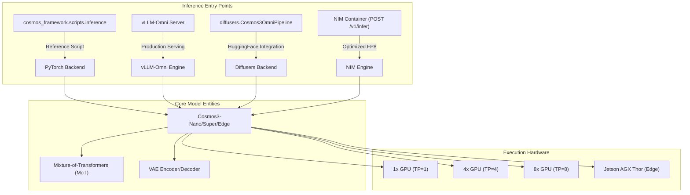
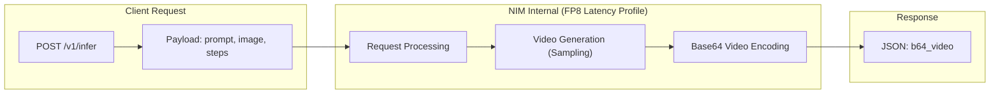
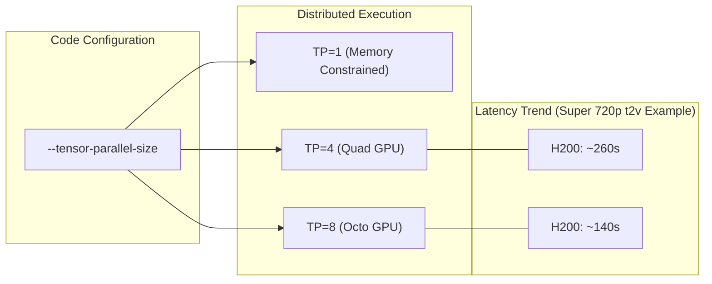

<!-- source: DeepWiki mcp.deepwiki.com · repo NVIDIA/cosmos · extra page Generator Benchmarks · fetched 2026-10-26 -->

# Generator Benchmarks

Relevant source files

The following files were used as context for generating this wiki page:

- [cookbooks/cosmos3/generator/audiovisual/run_with_nim.ipynb](cookbooks/cosmos3/generator/audiovisual/run_with_nim.ipynb)
- [inference_benchmarks.md](inference_benchmarks.md)

This page provides detailed latency benchmarks for the Cosmos 3 Generator across multiple hardware configurations, resolutions, and inference engines. The benchmarks cover the primary vision-generation modes: **Text-to-Video (t2v)**, **Image-to-Video (i2v)**, and **Text-to-Image (t2i)**.

## Benchmark Methodology

Performance is measured using standardized parameters to ensure consistency across engines. All benchmarks utilize **BF16 precision** and a **batch size of 1** [inference_benchmarks.md:92-92]().

### Workload Profiles
*   **Video Generation**: Standardized to **189 frames at 24 FPS** unless resolution tiers or hardware limits impose constraints [inference_benchmarks.md:92-92]().
*   **Image Generation**: Measured as a single-frame diffusion process.
*   **Resolution Tiers**:
    *   **256p**: 320 × 192 [inference_benchmarks.md:94-94]()
    *   **480p**: 832 × 480 [inference_benchmarks.md:94-94]()
    *   **720p**: 1280 × 720 [inference_benchmarks.md:94-94]()

### Inference Engines and Precision Modes
1.  **PyTorch**: Reports average generation (sampling) time from the native reference inference script, utilizing CUDA Graphs where supported [inference_benchmarks.md:94-94]().
2.  **vLLM-Omni**: Reports total pipeline time using the optimized vLLM-Omni server implementation [inference_benchmarks.md:94-94]().
3.  **Diffusers**: Reports end-to-end generation time via the Hugging Face `Cosmos3OmniPipeline` [inference_benchmarks.md:94-94]().
4.  **NIM**: Reports end-to-end request latency using **FP8 precision** and `NIM_PERF_PROFILE=latency`. This includes request processing, video generation, output encoding (`b64_video`), and returning the response [inference_benchmarks.md:94-94](), [cookbooks/cosmos3/generator/audiovisual/run_with_nim.ipynb:119-122]().

## System Architecture and Data Flow

The following diagrams bridge the benchmark categories to the specific code entities and execution paths.

### Generator Inference Stack

Sources: [inference_benchmarks.md:3-5](), [inference_benchmarks.md:94-94](), [cookbooks/cosmos3/generator/audiovisual/run_with_nim.ipynb:24-25]()

### NIM Data Flow for Benchmarking

Sources: [inference_benchmarks.md:94-94](), [cookbooks/cosmos3/generator/audiovisual/run_with_nim.ipynb:119-134]()

## Cosmos3-Nano Generator Benchmarks

Cosmos3-Nano benchmarks use BF16 (except NIM which uses FP8). Latency values are in **seconds**.

### Text-to-Video (t2v)
| GPU | Engine | 256p/1 | 256p/4 | 256p/8 | 480p/1 | 480p/4 | 480p/8 | 720p/1 | 720p/4 | 720p/8 |
|---|---|---:|---:|---:|---:|---:|---:|---:|---:|---:|
| **RTX PRO 6000 Blackwell** | PyTorch | 13.95 | | 4.90 | 180.81 | | | 786.37 | 225.45 | 127.57 |
| | vLLM-Omni | 10.65 | 5.06 | 3.78 | 105.61 | 35.93 | 23.76 | 369.67 | 114.30 | 68.66 |
| | Diffusers | 11.20 | | | 112.00 | | | 392.00 | | |
| | NIM | 7.93 | 4.69 | 4.00 | 82.69 | 33.57 | 24.49 | 318.69 | 107.83 | 68.50 |
| **H20** | PyTorch | 30.57 | | | 257.51 | | | 931.39 | 268.88 | 157.71 |
| | vLLM-Omni | 28.58 | 10.20 | 7.70 | 256.97 | 77.42 | 47.53 | 929.81 | 260.75 | 148.46 |
| | Diffusers | 30.20 | | | 258.00 | | | 926.00 | | |
| | NIM | 17.81 | 7.84 | 6.14 | 192.07 | 62.80 | 41.67 | 771.37 | 223.24 | 132.68 |
| **H100 NVL** | PyTorch | 10.03 | 4.27 | 3.95 | 84.12 | 29.18 | 21.46 | 297.27 | 94.15 | 61.63 |
| | vLLM-Omni | 9.25 | 3.68 | 3.15 | 80.75 | 27.48 | 18.77 | 311.13 | 88.25(*) | 54.01(*) |
| | Diffusers | 11.00 | | | 90.00 | | | 324.20 | | |
| | NIM | 7.09 | 3.77 | 3.65 | 68.01 | 25.67 | 20.51 | 267.73 | 86.18 | 57.38 |
| **H200 NVL** | PyTorch | 8.17 | | | 69.79 | | | 244.39 | 77.35 | 45.70 |
| | vLLM-Omni | 7.44 | 3.27 | 2.33 | 64.58 | 21.31 | 12.92 | 240.05 | 69.63 | 39.17 |
| | Diffusers | 9.00 | | | 74.00 | | | 276.20 | | |
| | NIM | 5.87 | 3.38 | 3.00 | 57.10 | 21.74 | 15.04 | 229.63 | 71.32 | 43.34 |
| **H100 80GB HBM3** | PyTorch | 7.61 | 3.50 | 3.17 | 59.83 | 21.23 | 14.37 | 207.78 | 66.94 | 41.81 |
| | vLLM-Omni | 6.97 | 3.45 | 3.49 | 58.17 | 19.95 | 13.46 | 202.29 | 62.82 | 37.80 |
| | Diffusers | 9.00 | | | 68.00 | | | 240.00 | | |
| | NIM | 5.72 | 3.36 | 3.12 | 51.73 | 20.26 | 14.82 | 199.46 | 65.32 | 41.66 |
| **H200 141GB HBM3** | PyTorch | 7.53 | 3.34 | 3.19 | 60.18 | 20.84 | 13.97 | 214.28 | 67.48 | 41.26 |
| | vLLM-Omni | 6.79 | 3.25 | 3.42 | 58.14 | 19.77 | 12.97 | 208.36 | 63.27 | 37.49 |
| | Diffusers | 9.00 | | | 67.00 | | | 239.60 | | |

Sources: [inference_benchmarks.md:100-122]()

## Cosmos3-Super Generator Benchmarks

Cosmos3-Super targets high-fidelity generation. Due to its significant parameter count, it utilizes multi-GPU configurations via Tensor Parallelism (TP).

### Performance Scaling with Tensor Parallelism

Sources: [inference_benchmarks.md:130-130](), [inference_benchmarks.md:154-155]()

## Cosmos3-Edge Generator Benchmarks

Cosmos3-Edge is evaluated on integrated computing platforms and standard GPUs. Benchmarks use **480p resolution** and generate **121 frames** [inference_benchmarks.md:46-46]().

### Edge Latency (480p, 121 Frames)
| GPU or Platform | Image-to-Video (vLLM-Omni) | Image-to-Video (PyTorch) |
|---|---:|---:|
| **B200 SXM 192 GB** | 7.09 | 7.45 |
| **B300** | 8.74 | 6.84 |
| **H200 SXM 141 GB** | 13.13 | 12.31 |
| **H200 NVL** | 14.15 | 14.07 |
| **H100 SXM 80 GB** | 13.33 | 12.68 |
| **H100 NVL 96 GB** | 17.33 | 16.42 |
| **H20 SXM 96 GB** | 53.94 | 52.83 |
| **RTX PRO 6000 Blackwell Server Edition** | | 21.92 |
| **DGX Station** | 7.13 | 6.31 |
| **DGX Spark** | 89.41 | 103.36 |
| **Jetson AGX Thor T5000, 128 GB, MAXN** | | |
| **Jetson T3000, 32 GB, 1100 MHz** | | |

*Note: Jetson AGX Thor measurements use eager-mode execution.*

Sources: [inference_benchmarks.md:46-46](), [inference_benchmarks.md:50-63](), [inference_benchmarks.md:70-81]()

## Key Implementation Details

### Tensor Parallelism (TP)
*   **Scaling**: Transitioning from 1× to 4× GPUs typically results in a ~3x speedup for high-resolution video generation [inference_benchmarks.md:108-109]().
*   **Super Model Requirements**: TP is mandatory for the Super model at high resolutions to fit the Mixture-of-Transformers (MoT) parameters into HBM.

### Engine Comparison
*   **NIM (FP8)**: Consistently provides the lowest end-to-end latency due to FP8 quantization and optimized request handling [inference_benchmarks.md:103-119]().
*   **vLLM-Omni**: Highly optimized for 720p workloads, often outperforming the reference PyTorch script at scale [inference_benchmarks.md:113-117]().

Sources: [inference_benchmarks.md:94-94](), [inference_benchmarks.md:100-126]()

---

