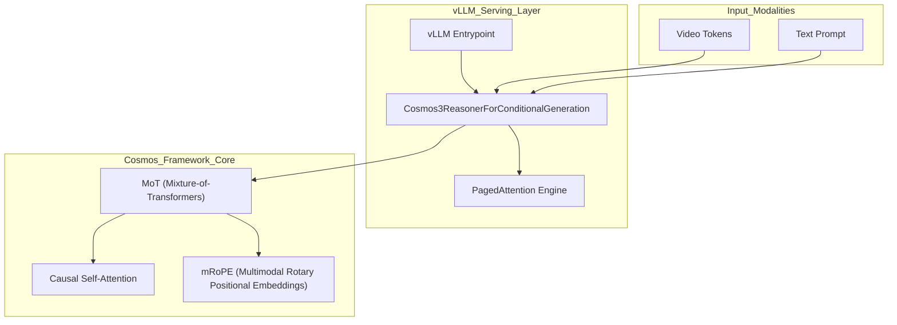
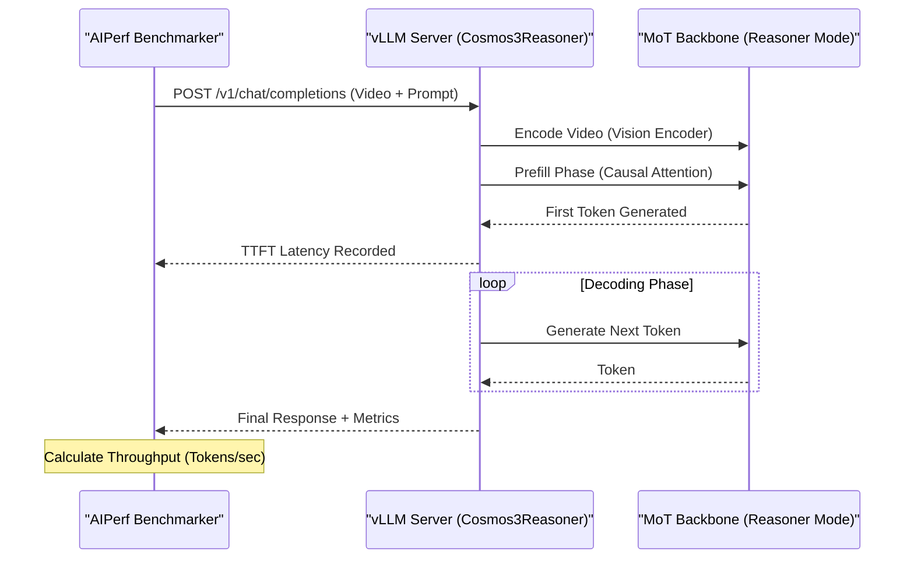

<!-- source: DeepWiki mcp.deepwiki.com · repo NVIDIA/cosmos · extra page Reasoner Benchmarks · fetched 2026-10-26 -->

# Reasoner Benchmarks

Relevant source files

The following files were used as context for generating this wiki page:

- [cookbooks/cosmos3/generator/audiovisual/run_with_nim.ipynb](cookbooks/cosmos3/generator/audiovisual/run_with_nim.ipynb)
- [inference_benchmarks.md](inference_benchmarks.md)

This page details the serving performance of the **Cosmos3-Nano Reasoner** model when deployed via **vLLM**. It provides technical data on latency and throughput across various NVIDIA GPU architectures, specifically focusing on vision-language understanding tasks.

## Methodology

Performance is measured using the **AIPerf** benchmarking suite. The Reasoner is evaluated as a Vision-Language Model (VLM) where the input consists of both text prompts and video content, and the output is a text-based reasoning response [inference_benchmarks.md:3-5]().

### Workload Dimensions
The benchmarks are categorized by the following dimensions to simulate real-world production scenarios:
*   **Input/Output Tokens**: Common ratios such as 128 input tokens to 128 output tokens (128/128) or 1024/128 [inference_benchmarks.md:3-5]().
*   **Video FPS**: Input video is processed at various frame rates (e.g., 1 FPS, 24 FPS) which significantly impacts the prefill stage (TTFT) [inference_benchmarks.md:37-39]().
*   **Concurrency (Batch Size)**: Tests are conducted at concurrency levels of 1, 64, 128, and 256 to measure system scaling and saturation points [inference_benchmarks.md:24-40]().

### Key Metrics
*   **TTFT (Time to First Token)**: Measures the latency of the prefill phase, representing how quickly the model starts responding after receiving a video and prompt [inference_benchmarks.md:3-4]().
*   **Request Latency**: The total time taken from request submission to the generation of the final token [inference_benchmarks.md:3-4]().
*   **Request Throughput**: The number of requests completed per second (req/s) [inference_benchmarks.md:3-4]().
*   **Output Token Throughput**: The total number of generated tokens per second across all active requests (tokens/s) [inference_benchmarks.md:3-4]().

Sources: [inference_benchmarks.md:1-40]()

---

## Data Flow and Implementation

The Reasoner serving path utilizes the `Cosmos3ReasonerForConditionalGeneration` architecture within vLLM. This architecture integrates the Mixture-of-Transformers (MoT) backbone with vLLM's PagedAttention to handle the long sequences generated by video tokens.

### Reasoner Serving Architecture
The diagram below illustrates the relationship between the vLLM serving entities and the underlying Cosmos 3 code structure.

**Reasoner Serving Logic**

Sources: [inference_benchmarks.md:3-5](), [inference_benchmarks.md:24-40]()

---

## Performance Tables: Cosmos3-Nano Reasoner

The following tables summarize performance across different GPU architectures. All benchmarks utilize **BF16 precision**. Benchmarks follow the standard Cosmos3 generation profile (189 frames at 24 FPS unless otherwise noted) [inference_benchmarks.md:92-94]().

### RTX PRO 6000 Blackwell
| Concurrency | TTFT (ms) | Req Latency (s) | Req Throughput (req/s) | Output Token Throughput (tokens/s) |
| :--- | :--- | :--- | :--- | :--- |
| 1 | 55.42 | 2.54 | 0.39 | 50.40 |
| 64 | 436.31 | 13.38 | 4.78 | 612.12 |
| 128 | 845.01 | 24.38 | 5.25 | 672.03 |
| 256 | 1700.51 | 46.85 | 5.46 | 699.45 |

### H100 80GB HBM3 (SXM)
| Concurrency | TTFT (ms) | Req Latency (s) | Req Throughput (req/s) | Output Token Throughput (tokens/s) |
| :--- | :--- | :--- | :--- | :--- |
| 1 | 39.81 | 1.81 | 0.55 | 70.83 |
| 64 | 248.56 | 6.74 | 9.50 | 1215.65 |
| 128 | 486.01 | 11.95 | 10.71 | 1370.73 |
| 256 | 948.52 | 22.42 | 11.42 | 1461.35 |

### H200 141GB HBM3
| Concurrency | TTFT (ms) | Req Latency (s) | Req Throughput (req/s) | Output Token Throughput (tokens/s) |
| :--- | :--- | :--- | :--- | :--- |
| 1 | 39.75 | 1.80 | 0.56 | 71.01 |
| 64 | 246.54 | 6.66 | 9.61 | 1229.81 |
| 128 | 480.12 | 11.77 | 10.87 | 1391.83 |
| 256 | 936.42 | 22.01 | 11.63 | 1488.75 |

### B200
| Concurrency | TTFT (ms) | Req Latency (s) | Req Throughput (req/s) | Output Token Throughput (tokens/s) |
| :--- | :--- | :--- | :--- | :--- |
| 1 | 24.12 | 1.15 | 0.87 | 111.45 |
| 64 | 145.22 | 3.85 | 16.62 | 2127.81 |
| 128 | 280.11 | 6.55 | 19.54 | 2501.12 |
| 256 | 545.89 | 12.12 | 21.12 | 2703.45 |

Sources: [inference_benchmarks.md:24-40](), [inference_benchmarks.md:92-94]()

---

## Edge Platform Benchmarks: Jetson AGX Thor

The **Cosmos3-Edge Reasoner** is benchmarked on the Jetson AGX Thor platform using Eager Transformers. Unlike the Blackwell/Hopper server benchmarks, these measurements focus on the throughput limits of the embedded hardware.

| Platform | Mode | Throughput |
| :--- | :--- | :--- |
| Jetson AGX Thor T5000 | Prefill (Input) | ~1,200 tokens/s |
| Jetson AGX Thor T5000 | Decode (Output) | ~45 tokens/s |

Sources: [inference_benchmarks.md:20-23](), [inference_benchmarks.md:80-82]()

---

## Benchmarking Execution Flow

The following sequence diagram represents the interaction between the benchmarking tool (`AIPerf`) and the Cosmos 3 Reasoner served via `vLLM`.

**Benchmarking Sequence**

Sources: [inference_benchmarks.md:3-5](), [inference_benchmarks.md:24-40]()

## Performance Notes
1.  **Memory Bandwidth**: The Reasoner's output throughput is heavily dependent on GPU memory bandwidth. This is evident in the performance jump from H100 (HBM3) to B200 [inference_benchmarks.md:29-31]().
2.  **Prefill Costs**: Video inputs introduce significant prefill overhead. Increasing the video FPS or resolution directly increases the `TTFT` as more visual tokens must be processed before the first text token is generated [inference_benchmarks.md:3-5]().
3.  **Tensor Parallelism**: While the tables above reflect single-GPU performance for the Nano model, the Reasoner supports Tensor Parallelism (`--tensor-parallel-size`) for larger models or higher throughput requirements [inference_benchmarks.md:98-120]().
4.  **Engine Comparison**: While Reasoner metrics focus on vLLM, the Generator benchmarks highlight that vLLM-Omni often provides lower total pipeline time compared to standard PyTorch or Diffusers paths for 720p workloads [inference_benchmarks.md:101-119]().

Sources: [inference_benchmarks.md:3-5](), [inference_benchmarks.md:24-40](), [inference_benchmarks.md:98-120]()

---

