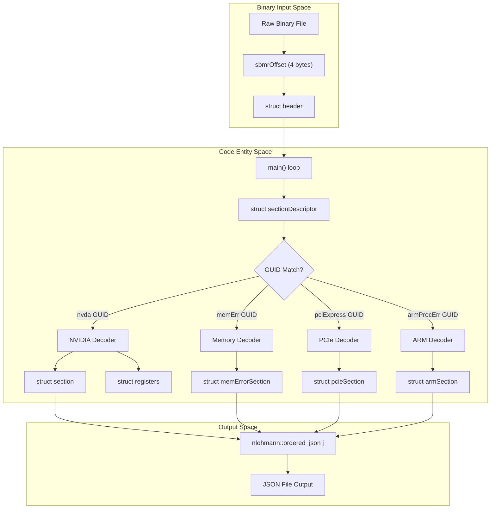
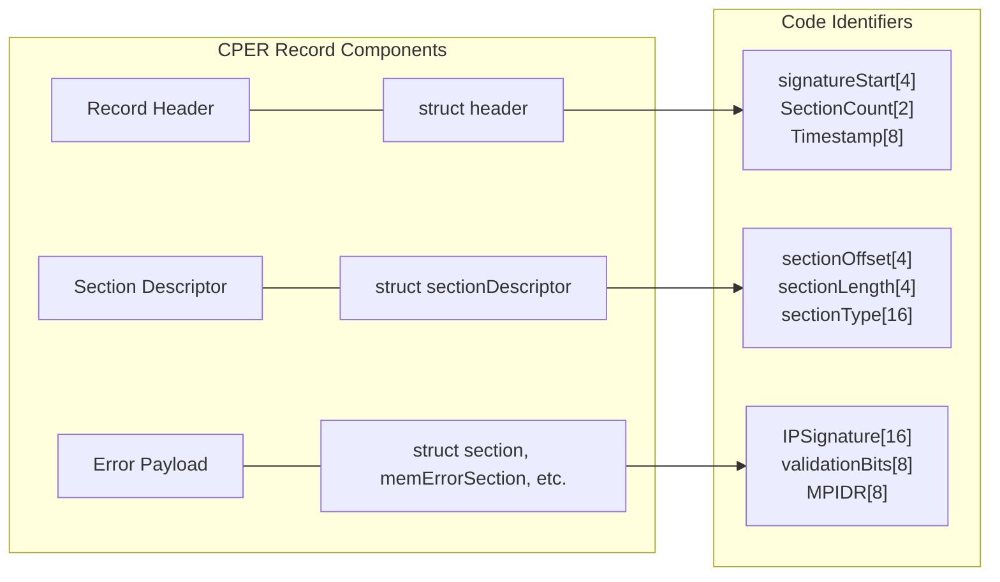

<!-- source: DeepWiki mcp.deepwiki.com · repo NVIDIA/cper-decoder · page 1 Overview · fetched 2026-10-26 -->

# Overview

Relevant source files

The following files were used as context for generating this wiki page:

- [LICENSE](LICENSE)
- [README.md](README.md)
- [cper.h](cper.h)
- [main.cpp](main.cpp)

The `cper-decoder` project provides a command-line utility, `cperparse`, designed to decode binary Common Platform Error Record (CPER) data into human-readable JSON format. CPER is a standardized format defined by the UEFI specification for describing hardware error telemetry across different platform architectures.

This tool is specifically tailored to handle standard CPER sections (such as ARM Processor, Memory, and PCIe errors) as well as NVIDIA-specific error extensions. By converting opaque binary blobs into structured JSON, it enables easier integration with logging systems and Redfish-compliant telemetry services.

### Core Objectives
*   **Binary Ingestion**: Parse raw CPER logs, including those with custom preambles like `sbmrOffset` [cper.h:29-29]().
*   **Standard Compliance**: Implement structures for UEFI Appendix N compliance, including the `header` [cper.h:52-73]() and `sectionDescriptor` [cper.h:77-89]().
*   **Extensibility**: Support vendor-specific sections, such as the NVIDIA `section` [cper.h:93-103]() containing dynamic register-data pairs.
*   **Interoperability**: Output data in a structured `nlohmann::ordered_json` format [main.cpp:30-30]() for downstream consumption.

For a guide on building the project and running the decoder, see [Getting Started](#1.1).

---

### System Architecture

The decoder operates as a linear pipeline that transforms a binary buffer into a JSON object. It uses a dispatch mechanism based on Section Type GUIDs to determine how to decode specific regions of the record.

#### Logical Flow to Code Entity Mapping
The following diagram illustrates how the conceptual stages of decoding map to specific data structures and constants in the source code.

**CPER Decoding Pipeline**

**Sources:** [cper.h:29-47](), [cper.h:52-182](), [main.cpp:37-37]()

---

### Data Translation and Helper Utilities

Because CPER data is packed and often stored in little-endian format, the project relies on a suite of conversion utilities in `main.cpp`. These functions bridge the gap between raw `unsigned char` arrays and high-level string or integer representations.

| Function | Purpose | Implementation Detail |
| :--- | :--- | :--- |
| `convertToHex` | General hex conversion | Uses `std::stringstream` with `std::hex` [main.cpp:164-172]() |
| `convertToHexLittleEndian` | Endian-aware hex | Iterates backwards through input buffer [main.cpp:186-194]() |
| `charToIntLittleEndian` | Byte to Integer | Performs bit-shifting (`<< 8`) to reconstruct values [main.cpp:206-222]() |
| `guidDecode` | GUID Formatting | Reorders bytes into standard `8-4-4-4-12` hyphenated format [main.cpp:233-261]() |
| `timestampDecode` | CPER Timestamp | Extracts year, month, day, and time from fixed offsets [main.cpp:131-152]() |

For a full map of the repository's files and their roles, see [Project Structure](#1.2).

---

### Structural Components

The project is organized around the physical layout of a CPER record. The code uses `#pragma pack(1)` to ensure that C++ structures map exactly to the binary wire-format without compiler-inserted padding.

**Natural Language to Code Association**

**Sources:** [cper.h:51-52](), [cper.h:76-77](), [cper.h:92-93](), [cper.h:114-115](), [cper.h:141-142](), [cper.h:169-170]()

### Build and Tooling Overview
The project uses the **Meson Build System** and manages external dependencies like `nlohmann_json` and `CLI11` via Meson wraps. This ensures a consistent environment across different development platforms.

*   **Compiler Requirements**: C++17 or later.
*   **Dependencies**: `nlohmann_json` (≥ 3.11.2) and `CLI11`.
*   **Formatting**: Strictly follows a `.clang-format` specification based on the LLVM style.

For details on the build configuration and dependencies, see the [Build System and Tooling](#4) section in the documentation.

---

