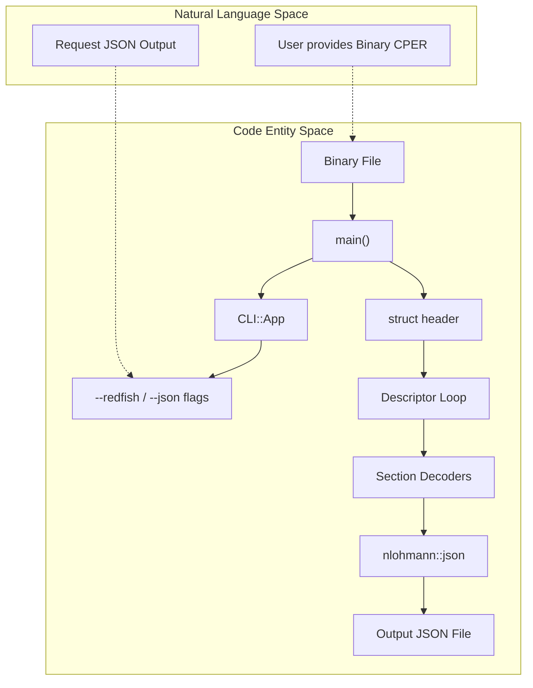
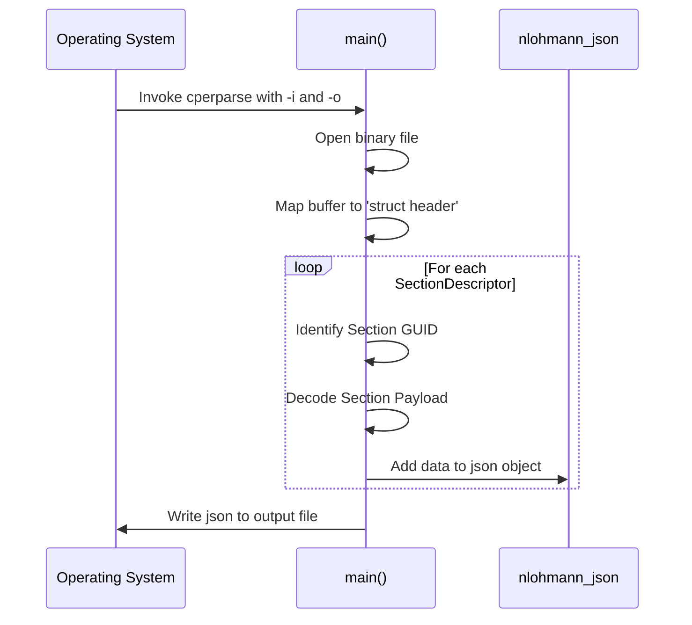

<!-- source: DeepWiki mcp.deepwiki.com · repo NVIDIA/cper-decoder · page 1.1 Getting Started · fetched 2026-10-26 -->

# Getting Started

<details>
<summary>Relevant source files</summary>

The following files were used as context for generating this wiki page:

- [.gitignore](.gitignore)
- [meson.build](meson.build)
- [subprojects/CLI11.wrap](subprojects/CLI11.wrap)
- [subprojects/nlohmann_json.wrap](subprojects/nlohmann_json.wrap)

</details>


The `cper-decoder` project provides a command-line utility, `cperparse`, designed to decode binary Common Platform Error Record (CPER) blobs into human-readable JSON. This tool is essential for analyzing hardware error logs generated by firmware in compliance with the UEFI specification and NVIDIA-specific error extensions.

### Prerequisites

The project uses the **Meson** build system and relies on external dependencies managed via Meson wraps. Ensure the following are installed on your system:
*   **C++ Compiler**: Supporting C++11 or higher.
*   **Meson**: Build system runner.
*   **Ninja**: Backend build tool.
*   **Dependencies**:
    *   `nlohmann_json`: Handled via `subprojects/nlohmann_json.wrap` [subprojects/nlohmann_json.wrap:1-10]().
    *   `CLI11`: Handled via `subprojects/CLI11.wrap` [subprojects/CLI11.wrap:1-6]().

---

### Building the Project

The build process is standardized using Meson. The `meson.build` file defines the project and its dependencies [meson.build:1-4]().

1.  **Initialize the build directory**:
    ```bash
    meson setup build
    ```
    This command downloads the required wraps for `nlohmann_json` [subprojects/nlohmann_json.wrap:4-6]() and `CLI11` [subprojects/CLI11.wrap:2-3]().

2.  **Compile the executable**:
    ```bash
    meson compile -C build
    ```
    The resulting binary, `cperparse`, will be located in the `build/` directory.

**Sources:**
* [meson.build:1-4]()
* [subprojects/nlohmann_json.wrap:1-10]()
* [subprojects/CLI11.wrap:1-7]()

---

### CLI Usage and Flags

The `cperparse` utility uses the `CLI11` library to manage command-line arguments. It requires an input binary file and an output destination for the JSON data.

#### Syntax
```bash
./cperparse [OPTIONS]
```

#### Options
| Flag | Description |
| :--- | :--- |
| `-i,--input` | **Required**. Path to the binary CPER blob file. |
| `-o,--output` | **Required**. Path where the decoded JSON file will be saved. |
| `--redfish` | Optional. If set, the output follows a schema compatible with Redfish error logging (specifically impacting the `Header` structure). |
| `--json` | Optional. Ensures the output is formatted as a JSON object. |

**Sources:**
* [meson.build:3-4]()
* [subprojects/CLI11.wrap:1-6]()

---

### Data Flow Architecture

The following diagram illustrates the transition from the "Natural Language Space" (User Requirements) to the "Code Entity Space" (Implementation) during a typical execution.

**CPER Parsing Pipeline**


**Sources:**
* [meson.build:1-4]()
* [subprojects/nlohmann_json.wrap:1-10]()

---

### Worked Example: Decoding a CPER Blob

To decode a raw CPER binary (e.g., `error_log.bin`) into a JSON file (`decoded.json`), follow these steps:

#### 1. Prepare the Binary
Ensure you have a CPER blob. This blob typically starts with a `struct header` containing the "CPER" signature [cper.h:34-40]().

#### 2. Execute the Decoder
Run the binary with the desired flags. In this example, we use the `--redfish` flag to ensure the output matches Redfish-specific formatting requirements.

```bash
./build/cperparse -i error_log.bin -o decoded.json --redfish --json
```

#### 3. Implementation Logic
When executed, the program performs the following steps:
1.  **Ingestion**: The file is read into memory.
2.  **Header Validation**: The code maps the start of the buffer to a `header` struct and validates the `SignatureEnd` [cper.h:40-40]().
3.  **Section Iteration**: It iterates through the number of sections defined in `SectionCount` [cper.h:42-42]().
4.  **JSON Construction**: For each section, it identifies the `sectionType` GUID [cper.h:61-61]() and uses `nlohmann::json` to build the tree.

**Execution Flow Diagram**


**Sources:**
* [meson.build:1-4]()
* [subprojects/nlohmann_json.wrap:1-10]()
* [subprojects/CLI11.wrap:1-6]()

---

