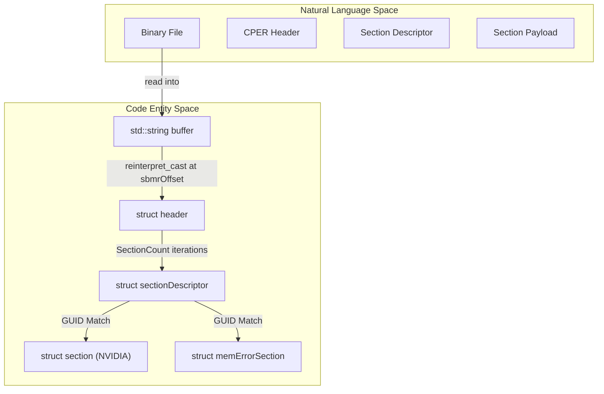
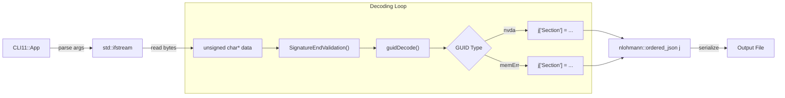

<!-- source: DeepWiki mcp.deepwiki.com · repo NVIDIA/cper-decoder · page 1.2 Project Structure · fetched 2026-10-26 -->

# Project Structure

Relevant source files

The following files were used as context for generating this wiki page:

- [.beautysh-ignore](.beautysh-ignore)
- [.black-ignore](.black-ignore)
- [.clang-format](.clang-format)
- [.eslintignore](.eslintignore)
- [.flake8-ignore](.flake8-ignore)
- [.isort-ignore](.isort-ignore)
- [.markdownlint-ignore](.markdownlint-ignore)
- [.prettierignore](.prettierignore)
- [.shellcheck-ignore](.shellcheck-ignore)
- [cper.h](cper.h)
- [main.cpp](main.cpp)
- [meson.build](meson.build)

This page provides a comprehensive map of the `cper-decoder` repository. The project is a C++ tool designed to parse UEFI Common Platform Error Record (CPER) binary data into structured JSON format. It utilizes a single-pass parsing approach with fixed-width structures to map binary blobs directly to C++ objects.

## Core Source Files

The logic of the decoder is contained within two primary files: a header defining the CPER structures and a source file implementing the parsing logic and CLI orchestration.

### `cper.h`
This header serves as the data contract for the project. It defines the memory layout of CPER records according to the UEFI specification. All structures use `#pragma pack(1)` to ensure the compiler does not add padding, allowing for direct `reinterpret_cast` from binary buffers.

*   **Constants**: Defines magic numbers like `sbmrOffset` (4 bytes) [cper.h:29](), `headerSize` (128 bytes) [cper.h:30](), and GUID strings for dispatching [cper.h:40-47]().
*   **struct `header`**: Maps the 128-byte UEFI Record Header [cper.h:52-73]().
*   **struct `sectionDescriptor`**: Maps the 72-byte descriptor that links the header to specific payloads [cper.h:77-89]().
*   **Section Payloads**: Defines structures for `memErrorSection` [cper.h:115-138](), `pcieSection` [cper.h:142-166](), `armSection` [cper.h:170-182](), and the NVIDIA-specific `section` [cper.h:93-103]().

### `main.cpp`
The entry point and implementation file. It handles file I/O, command-line arguments via `CLI11`, and the transformation of binary data into JSON via `nlohmann::json`.

*   **Helper Functions**: A suite of utilities for data conversion, such as `convertToHex` [main.cpp:164-172](), `guidDecode` [main.cpp:233-252](), and `timestampDecode` [main.cpp:131-152]().
*   **Parsing Logic**: Contains the main loop that iterates through section descriptors and dispatches to specific decoding logic based on the `sectionType` GUID.

**Sources:** [cper.h:1-183](), [main.cpp:1-252]()

## Build and Dependency Management

The project uses the Meson Build system. Dependencies are managed through Meson's wrap system, ensuring that specific versions of external libraries are available during the build process.

| File | Role | Key Entities |
| :--- | :--- | :--- |
| `meson.build` | Main build script | `executable('cperparse', ...)` [meson.build:4]() |
| `subprojects/` | Directory for wrap files | `nlohmann_json`, `CLI11` |

**Sources:** [meson.build:1-5]()

## Tooling and Linting Configurations

The repository includes a comprehensive set of "ignore" files. Since the project is primarily C++, these files are used to prevent various linters (intended for other languages) from processing the source tree in multi-language environments or CI pipelines.

*   **`.clang-format`**: Defines the C++ code style, basing it on the LLVM style with a 4-space indent [`.clang-format:3-86`]() and custom `BraceWrapping` rules [`.clang-format:26-44`]().
*   **Linter Ignores**: Global ignore patterns (`*`) are applied to tools like `.black-ignore` [`.black-ignore:1`](), `.flake8-ignore` [`.flake8-ignore:1`](), and `.eslintignore` [`.eslintignore:1`]() to ensure they do not interfere with the C++ codebase.

**Sources:** [`.clang-format:1-135`](), [`.black-ignore:1`](), [`.flake8-ignore:1`]()

## Logic and Data Flow Diagrams

The following diagrams illustrate how the code entities interact to transform a raw binary file into a JSON structure.

### CPER Binary to Object Mapping
This diagram shows how the raw buffer is interpreted by the structures defined in `cper.h`.

**Sources:** [cper.h:29-31](), [cper.h:52-138](), [main.cpp:18-31]()

### Execution Pipeline
This diagram maps the high-level parsing stages to the specific functions and variables in `main.cpp`.

**Sources:** [main.cpp:52-62](), [main.cpp:233-252](), [cper.h:40-47](), [main.cpp:30-37]()

---

