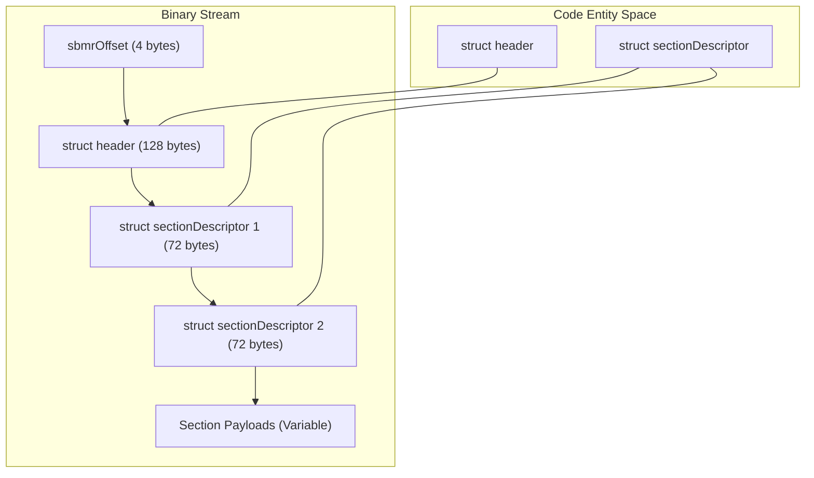
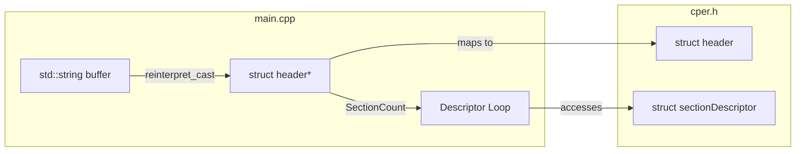

<!-- source: DeepWiki mcp.deepwiki.com · repo NVIDIA/cper-decoder · page 2 CPER Format Reference · fetched 2026-10-26 -->

# CPER Format Reference

Relevant source files

The following files were used as context for generating this wiki page:

- [cper.h](cper.h)
- [main.cpp](main.cpp)

This page provides a high-level overview of the UEFI Common Platform Error Record (CPER) binary format as implemented in the `cper-decoder` project. The implementation follows the UEFI Specification (Appendix N) to parse hardware error logs into a structured JSON format.

## Overview of the Three-Layer Layout

The CPER format is organized into a hierarchical structure consisting of a single global header, followed by one or more section descriptors, which in turn point to specific error payloads. The `cper-decoder` utilizes C-style structures with `#pragma pack(1)` to map directly onto these binary blobs.

### CPER Binary Structure
The diagram below illustrates how the parser views the binary data layout.

**CPER Data Layout Overview**

Sources: [cper.h:29-31](), [cper.h:52-73](), [cper.h:77-89]()

---

## Record Header and Section Descriptors

The first layer of a CPER record is the **Record Header**, which contains metadata about the entire error report, such as the total number of sections and the platform ID. Immediately following the header is an array of **Section Descriptors**. Each descriptor acts as a pointer and metadata provider for a specific error payload, defining its offset in the file, its length, and its type via a Unique Identifier (GUID).

In this implementation, the parser accounts for a 4-byte preamble (`sbmrOffset`) before the standard 128-byte header begins.

For detailed field definitions and navigation logic, see **[Record Header and Section Descriptors](#2.1)**.

**Header to Descriptor Mapping**

Sources: [main.cpp:4530-4540](), [cper.h:52-89]()

---

## Error Section Payloads

The final layer contains the actual error data. The `cper-decoder` supports four specific section types, identified by their GUIDs. When the parser iterates through the section descriptors, it uses the `sectionType` field to determine which payload structure to apply to the data at `sectionOffset`.

The supported payload structures include:
*   **NVIDIA Section**: Custom NVIDIA error data including IP signatures and dynamic register-data pairs.
*   **Memory Error**: Standard UEFI General Memory error details (Node, Card, Module, Bank, etc.).
*   **PCIe Error**: Port type, Version, Vendor/Device IDs, and AER information.
*   **ARM Processor**: MPIDR, MIDR, and processor state information.

For details on the internal fields of these payloads and the GUID-based dispatch logic, see **[Error Section Payloads](#2.2)**.

### Supported Section Types
| Section Type | GUID Constant (cper.h) | Structure Name |
| :--- | :--- | :--- |
| NVIDIA | `nvda` | `struct section` |
| General Memory | `memErr` | `struct memErrorSection` |
| PCI Express | `pciExpress` | `struct pcieSection` |
| ARM Processor | `armProcErr` | `struct armSection` |

Sources: [cper.h:40-47](), [cper.h:93-182]()

---

