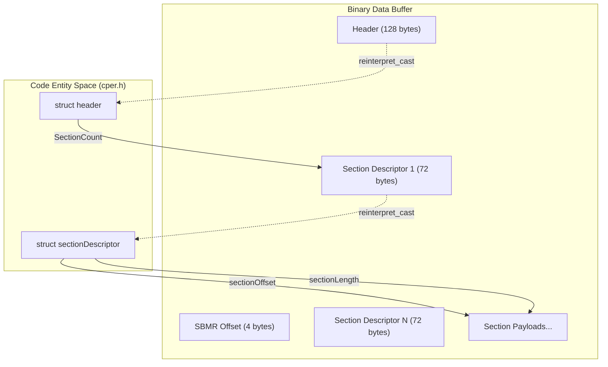
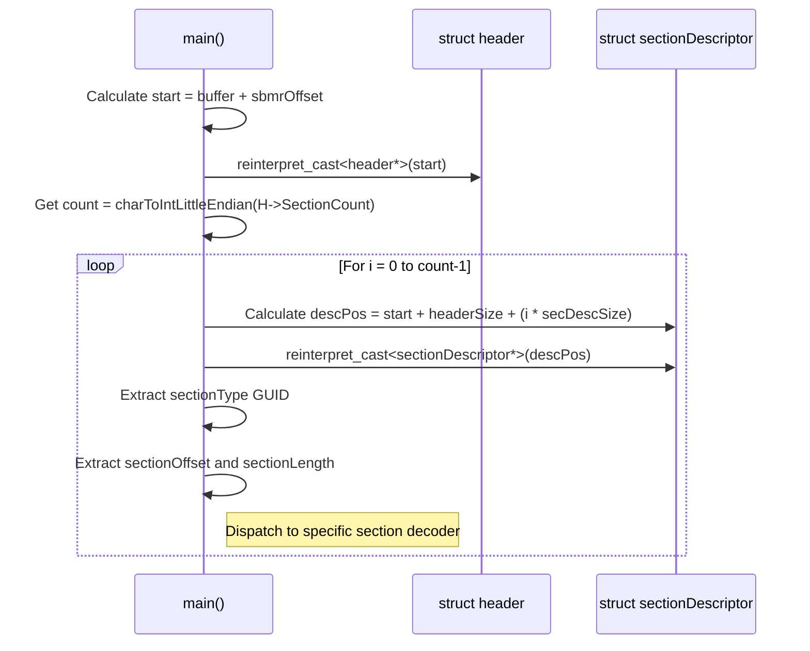

<!-- source: DeepWiki mcp.deepwiki.com · repo NVIDIA/cper-decoder · page 2.1 Record Header and Section Descriptors · fetched 2026-10-26 -->

# Record Header and Section Descriptors

Relevant source files

The following files were used as context for generating this wiki page:

- [cper.h](cper.h)
- [main.cpp](main.cpp)

This page provides a detailed technical reference for the top-level structures used in the Common Platform Error Record (CPER) format as implemented in the `cper-decoder`. The parser relies on these structures to navigate the binary blob, starting from a fixed-size header and moving through a variable number of section descriptors to locate error payloads.

## CPER Structure Overview

The CPER record is organized into three distinct layers. The decoder begins by identifying the `header`, followed by an array of `sectionDescriptor` objects. These descriptors act as a directory, providing the offset and length for the actual error payloads (e.g., Memory, PCIe, or NVIDIA-specific errors).

### Memory Layout and Alignment
The decoder uses `#pragma pack(1)` for all CPER structures in `cper.h` to ensure that the compiler does not insert padding between members. This is critical because the structures must map exactly to the UEFI-defined binary specification for CPER records [cper.h:51-51](), [cper.h:76-76]().

### SBMR Preamble
In many implementations, including the one handled by this decoder, there is a 4-byte preamble before the actual CPER header. This is defined as `sbmrOffset` [cper.h:29-29](). The parser accounts for this offset when calculating the starting memory address of the record header.

### Structural Mapping
The following diagram illustrates how the `main()` function maps raw binary data to the C++ structures defined in `cper.h`.

**CPER Header and Descriptor Mapping**

Sources: [cper.h:29-31](), [cper.h:52-73](), [cper.h:77-89]()

---

## The Record Header (`struct header`)

The `header` structure is the entry point for any CPER record. It is exactly 128 bytes long [cper.h:30-30]().

### Key Fields
| Field | Size | Description |
| :--- | :--- | :--- |
| `signatureStart` | 4 bytes | Identifies the start of the record (typically "CPER") [cper.h:57-57](). |
| `SignatureEnd` | 4 bytes | Validated against `0xFFFFFFFF` to ensure header integrity [cper.h:59-59](). |
| `SectionCount` | 2 bytes | Determines how many `sectionDescriptor` entries follow the header [cper.h:60-60](). |
| `Timestamp` | 8 bytes | Records the time of the error; decoded via `timestampDecode` [cper.h:64-64](). |
| `PlatformID` | 16 bytes | GUID identifying the platform that generated the record [cper.h:65-65](). |

### Header Validation
The `SignatureEnd` field is validated using the `SignatureEndValidation` function. This function checks if each byte matches the `signatureEndMarker` (value 255/0xFF) [main.cpp:52-62]().

Sources: [cper.h:52-73](), [main.cpp:52-62](), [cper.h:32-33]()

---

## Section Descriptors (`struct sectionDescriptor`)

Following the header is an array of section descriptors. Each `sectionDescriptor` is 72 bytes [cper.h:31-31](). These structures contain the metadata required to find and interpret the subsequent error data.

### Field Definitions
*   **`sectionOffset`**: The byte offset from the start of the CPER record (including the header) to the beginning of the section payload [cper.h:79-79]().
*   **`sectionLength`**: The size of the payload in bytes [cper.h:80-80]().
*   **`sectionType`**: A 16-byte GUID that determines the payload format (e.g., NVIDIA, ARM, Memory) [cper.h:85-85]().
*   **`sectionSeverity`**: Indicates the severity of the error described in this specific section [cper.h:87-87]().
*   **`fruText`**: A 20-byte string providing a human-readable identifier for the Field Replaceable Unit (FRU) [cper.h:88-88]().

Sources: [cper.h:77-89](), [cper.h:31-31]()

---

## Navigation Logic

The parser navigates the record by first calculating the position of the first descriptor and then iterating based on the `SectionCount` found in the header.

**Parser Navigation Flow**

### Implementation Details
1.  **Pointer Arithmetic**: The parser uses the constant `headerSize` (128) to skip the header and reach the first descriptor [cper.h:30-30]().
2.  **Endianness**: Because CPER is a little-endian format, fields like `SectionCount`, `sectionOffset`, and `sectionLength` are processed using `charToIntLittleEndian` to ensure correct integer conversion on the host system [main.cpp:206-222]().
3.  **GUID Dispatch**: The `sectionType` field is converted to a string and compared against known GUIDs (e.g., `nvda`, `memErr`, `pciExpress`, `armProcErr`) to determine which payload structure to apply [cper.h:40-47]().

Sources: [main.cpp:206-222](), [cper.h:29-31](), [cper.h:40-47]()

---

