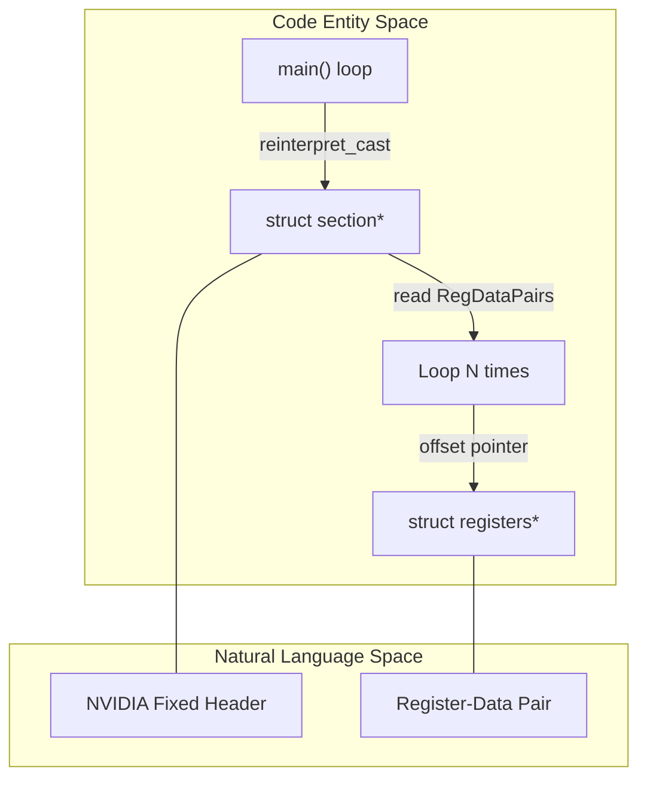
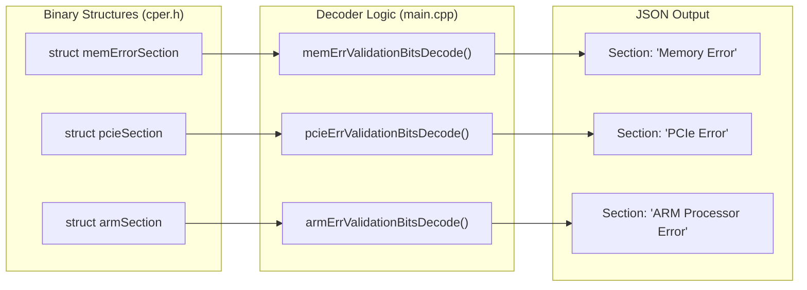

<!-- source: DeepWiki mcp.deepwiki.com · repo NVIDIA/cper-decoder · page 2.2 Error Section Payloads · fetched 2026-10-26 -->

# Error Section Payloads

Relevant source files

The following files were used as context for generating this wiki page:

- [cper.h](cper.h)
- [main.cpp](main.cpp)

This page provides a detailed technical reference for the four concrete error-section structures defined in the `cper-decoder` project. These structures represent the actual error data payloads that follow the CPER Section Descriptors. The decoder uses the `sectionType` GUID from the descriptor to determine which structure to overlay onto the raw binary data.

## Overview of Payload Selection

The CPER format uses a GUID-based dispatch mechanism. When the parser iterates through section descriptors, it compares the `sectionType` field against a set of known GUIDs to select the appropriate CPER structure for decoding.

### Supported Section GUIDs

| Section Type | GUID String (Memory Order) | Code Identifier | Structure |
| :--- | :--- | :--- | :--- |
| **NVIDIA CPER** | `f244526d1227ec11bea7cb3fdb95c786` | `nvda` | `struct section` |
| **General Memory** | `1411bca5646fde4eb8633e83ed7c83b1` | `memErr` | `struct memErrorSection` |
| **PCI Express** | `54e995d9c1bb0f43ad91b44dcb3c6f35` | `pciExpress` | `struct pcieSection` |
| **ARM Processor** | `163d9ee111bce4119caac2051d5d46b0` | `armProcErr` | `struct armSection` |

**Sources:** [cper.h:40-47](), [main.cpp:520-560]()

## NVIDIA CPER Section

The NVIDIA-specific section is unique because it contains a fixed header followed by a dynamic number of register-data pairs.

### Structure: `struct section`
This structure defines the common fields for an NVIDIA error record.

| Field | Type | Description |
| :--- | :--- | :--- |
| `IPSignature` | `unsigned char[16]` | Identifies the hardware IP block reporting the error. |
| `ErrorType` | `unsigned char[2]` | Categorization of the specific error. |
| `ErrorInstance` | `unsigned char[2]` | Instance ID of the IP block. |
| `Severity` | `unsigned char[1]` | Error severity level. |
| `SocketNumber` | `unsigned char[1]` | Physical socket where the error occurred. |
| `RegDataPairs` | `unsigned char[1]` | **The number of register-value pairs following the header.** |
| `InstanceBase` | `unsigned char[8]` | Base address for the IP instance. |

**Sources:** [cper.h:93-103]()

### Dynamic Tail: `struct registers`
Immediately following `struct section`, the decoder reads `RegDataPairs` instances of the `registers` structure.

| Field | Type | Description |
| :--- | :--- | :--- |
| `address` | `unsigned char[8]` | The 64-bit register address. |
| `value` | `unsigned char[8]` | The 64-bit value contained in the register. |

**Sources:** [cper.h:107-111]()

### Data Flow: NVIDIA Section Parsing
The following diagram illustrates how the `main()` loop handles the dynamic tail of the NVIDIA section.

**NVIDIA Section Decoding Logic**

**Sources:** [main.cpp:520-552](), [cper.h:93-111]()

---

## General Memory Error Section

The `struct memErrorSection` follows the UEFI specification for platform memory errors. It uses a `validationBits` mask to indicate which subsequent fields contain valid data.

### Structure: `struct memErrorSection`

| Field | Type | Description |
| :--- | :--- | :--- |
| `validationBits` | `unsigned char[8]` | Bitmask indicating valid fields (Node, Card, Module, etc.). |
| `errorStatus` | `unsigned char[8]` | Error status bits (Type, Granularity, Operation). |
| `physicalAddress` | `unsigned char[8]` | The physical address where the error occurred. |
| `node` | `unsigned char[2]` | Identifies the memory node. |
| `card` | `unsigned char[2]` | Identifies the memory card. |
| `memErrType` | `unsigned char[1]` | Type of error (e.g., Single-bit ECC, Multi-bit ECC). |

**Sources:** [cper.h:115-138]()

---

## PCI Express Error Section

The `pcieSection` captures errors originating from PCIe devices, including AER (Advanced Error Reporting) information.

### Structure: `struct pcieSection`

| Field | Type | Description |
| :--- | :--- | :--- |
| `validationBits` | `unsigned char[8]` | Bitmask for valid fields. |
| `portType` | `unsigned char[4]` | Type of PCIe port (Root Port, Downstream, etc.). |
| `vendorID` / `deviceID` | `unsigned char[2]` | Standard PCI identification. |
| `capabilityStructure` | `unsigned char[60]` | The PCI Express Capability structure from configuration space. |
| `aerInfo` | `unsigned char[96]` | Advanced Error Reporting registers. |

**Sources:** [cper.h:142-166]()

---

## ARM Processor Error Section

The `armSection` describes errors related to ARM-based processors, including affinity levels and execution state.

### Structure: `struct armSection`

| Field | Type | Description |
| :--- | :--- | :--- |
| `validationBits` | `unsigned char[4]` | Bitmask for valid fields. |
| `MPIDR` | `unsigned char[8]` | Multiprocessor Affinity Register value. |
| `MIDR` | `unsigned char[8]` | Main ID Register value. |
| `runningState` | `unsigned char[4]` | Bit 0: Processor running; Bits 1-31: Reserved. |
| `psciState` | `unsigned char[4]` | Power State Coordination Interface state. |

**Sources:** [cper.h:170-182]()

---

## Implementation Mapping

The decoder maps these raw structures into JSON objects using specific decoding functions for bitmasks and enumerations.

**Entity Mapping: CPER Binary to JSON**

### Common Pattern: Validation Bits
Across all non-NVIDIA sections, the decoder checks a `validationBits` field before adding a key to the JSON output. For example, in `memErrorSection`, if bit 0 is not set, the `ErrorStatus` field is omitted from the final report.

**Sources:** [main.cpp:635-645](), [main.cpp:783-793](), [main.cpp:943-953]()

---

