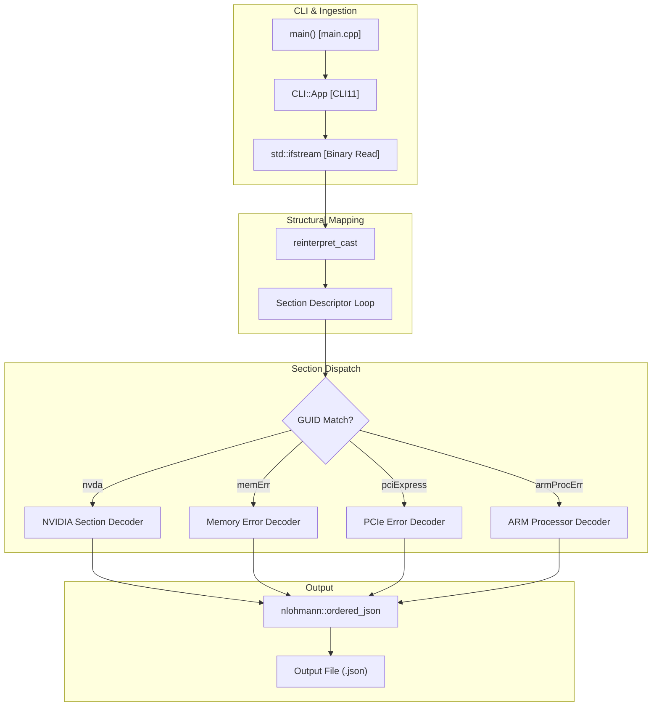

<!-- source: DeepWiki mcp.deepwiki.com · repo NVIDIA/cper-decoder · page 3 Decoder Implementation · fetched 2026-10-26 -->

# Decoder Implementation

Relevant source files

The following files were used as context for generating this wiki page:

- [cper.h](cper.h)
- [main.cpp](main.cpp)

The `cper-decoder` implementation centers around `main.cpp`, which orchestrates the transformation of binary Common Platform Error Record (CPER) data into a structured JSON document. The process involves sequential binary parsing, GUID-based dispatching to specialized section decoders, and data normalization using a suite of helper utilities.

### Parsing Pipeline Overview

The decoder follows a linear pipeline that begins with CLI interaction and ends with a serialized JSON file. The `main()` function serves as the entry point, utilizing `CLI11` for argument parsing and `nlohmann::json` for document construction [main.cpp:20-30]().

The following diagram illustrates the high-level flow from raw input to the final JSON output:

**CPER Processing Pipeline**

**Sources:** [main.cpp:18-37](), [cper.h:40-47]()

---

### Key Components

The implementation is divided into four primary functional areas, each detailed in its respective child page:

#### 1. Parsing Pipeline and main() Orchestration
The `main()` function manages the lifecycle of the decoding process. It handles the `sbmrOffset` (4-byte preamble) [cper.h:29]() before mapping the binary buffer to the `struct header` [cper.h:52-73](). It iterates through the number of sections defined in `header.SectionCount` [cper.h:60](), using `sectionDescriptor` offsets to locate payloads.
*   For details, see [Parsing Pipeline and main() Orchestration](#3.1).

#### 2. Helper Utilities and Data Conversion
Because CPER data is stored in a packed binary format, often in little-endian, `main.cpp` provides specialized conversion functions. These include `convertToHexLittleEndian` for ID fields [main.cpp:186-194](), `timestampDecode` for UEFI-formatted time [main.cpp:131-152](), and `guidDecode` for hyphenating 128-bit identifiers [main.cpp:233-261]().
*   For details, see [Helper Utilities and Data Conversion](#3.2).

#### 3. Section-Specific Decoders
The parser identifies sections by comparing the `sectionType` GUID in the `sectionDescriptor` [cper.h:85]() against known constants like `nvda` or `memErr` [cper.h:40-47](). Each section type has a dedicated logic block in `main()` that maps the raw bytes to specific structures (e.g., `struct memErrorSection` [cper.h:115-138]()) and decodes internal bitmasks.
*   For details, see [Section-Specific Decoders](#3.3).

#### 4. JSON Output Schema
The final output is an `nlohmann::ordered_json` object [main.cpp:30](). The schema mirrors the CPER hierarchy: a top-level `Header` object followed by a `Sections` array. Each entry in the array contains both the `SectionDescriptor` metadata and the decoded `Section` payload.
*   For details, see [JSON Output Schema](#3.4).

---

### Data Structures and Code Entities

The decoder relies on `#pragma pack(1)` structures defined in `cper.h` to ensure the memory layout exactly matches the UEFI specification.

**Entity Mapping: Binary to JSON**
| Code Entity (Binary Structure) | Role | JSON Target Key |
| :--- | :--- | :--- |
| `struct header` [cper.h:52]() | Record metadata (Timestamp, ID) | `"Header"` |
| `struct sectionDescriptor` [cper.h:77]() | Metadata for individual sections | `"SectionDescriptor"` |
| `struct section` [cper.h:93]() | NVIDIA-specific error data | `"Section"` |
| `struct registers` [cper.h:107]() | NVIDIA Register/Value pairs | `"Registers"` |
| `struct memErrorSection` [cper.h:115]() | DRAM/Memory error details | `"Section"` |

**Sources:** [cper.h:51-182](), [main.cpp:30-37]()

---

