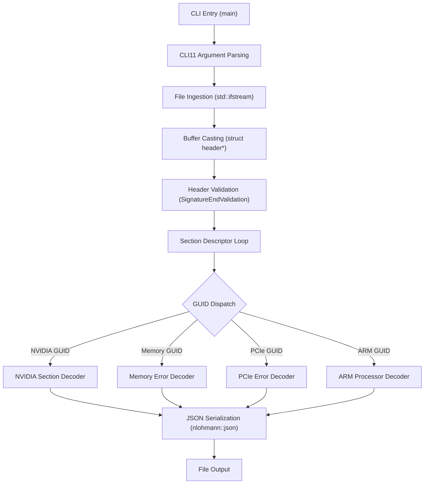
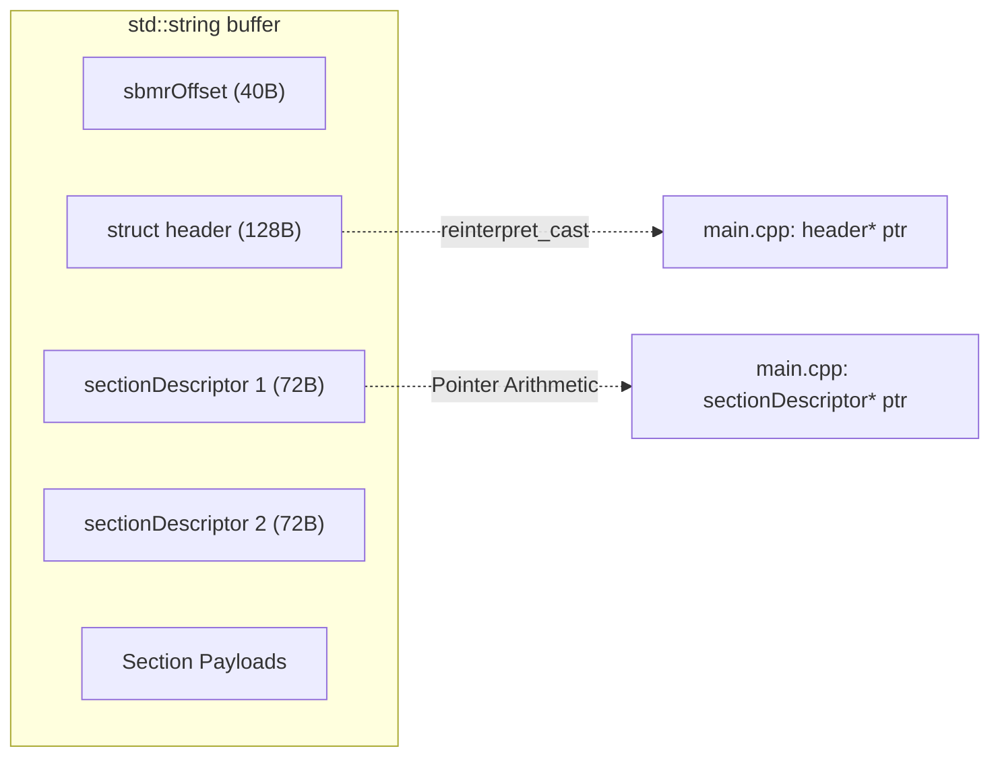

<!-- source: DeepWiki mcp.deepwiki.com · repo NVIDIA/cper-decoder · page 3.1 Parsing Pipeline and main() Orchestration · fetched 2026-10-26 -->

# Parsing Pipeline and main() Orchestration

Relevant source files

The following files were used as context for generating this wiki page:

- [main.cpp](main.cpp)
- [meson.build](meson.build)

This page provides a technical walkthrough of the `main()` function in the `cper-decoder` project. It describes the lifecycle of a CPER (Common Platform Error Record) binary as it is ingested, parsed, and transformed into a structured JSON document.

## Overview of the Orchestration Logic

The `cperparse` utility follows a linear pipeline: CLI argument processing, file ingestion, header validation, section iteration, and GUID-based dispatching to specific decoders. The final result is serialized using the `nlohmann::json` library.

### System Orchestration Flow
The following diagram illustrates the relationship between the high-level parsing phases and the specific code entities responsible for them.

**Diagram: CPER Parsing Pipeline**

Sources: [main.cpp:52-62](), [main.cpp:278-290](), [main.cpp:322-333](), [main.cpp:430-460]()

---

## CLI Argument Parsing and Ingestion

The `main()` function utilizes the `CLI11` library to manage command-line interfaces. The parser defines mandatory and optional flags for the input binary and the output JSON destination.

- **Input File**: Handled via `app.add_option("-i,--input", ...)` [main.cpp:283-284]().
- **Output File**: Handled via `app.add_option("-o,--output", ...)` [main.cpp:286-287]().
- **Redfish Mode**: An optional flag `-r,--redfish` is available for Redfish-compliant formatting [main.cpp:289-290]().

Once arguments are parsed, the binary file is read into a `std::string` buffer using an `std::ifstream` with the `std::ios::binary` flag [main.cpp:302-309]().

Sources: [main.cpp:278-295](), [main.cpp:302-309]()

---

## Data Structure Mapping

The decoder relies on `reinterpret_cast` to map the raw buffer to C-style structures defined in `cper.h`.

1.  **Preamble Handling**: The parser checks for an optional `sbmrOffset` (typically 40 bytes) before the actual CPER header [main.cpp:314-315]().
2.  **Header Mapping**: The buffer at the calculated offset is cast to `struct header*` [main.cpp:322-323]().
3.  **Section Descriptors**: The location of the first section descriptor is calculated by adding the size of the header to the base pointer [main.cpp:425-426]().

**Diagram: Memory Layout Mapping**

Sources: [main.cpp:322-323](), [main.cpp:425-428](), [cper.h:35-71]()

---

## The Parsing Loop and Dispatch

The core of the orchestration is a `for` loop that iterates based on the `SectionCount` field found in the CPER header [main.cpp:430-431]().

### GUID-Based Dispatching
For each section, the `SectionType` (a GUID) is extracted and decoded into a string format via `guidDecode` [main.cpp:441-443](). The parser then uses a series of `if-else` blocks to dispatch the raw payload to the appropriate decoder logic:

| GUID (Decoded) | Target Section Type | Implementation Reference |
| :--- | :--- | :--- |
| `5b01851b-17c3-424b-871c-439589f81647` | NVIDIA Error | [main.cpp:457-458]() |
| `a5bc1114-6f64-4dfb-8f11-9740c431000f` | Memory Error | [main.cpp:525-526]() |
| `d995e954-df1a-4303-9c2b-b305e946f93e` | PCIe Error | [main.cpp:588-589]() |
| `e19e3d16-bc1d-4c49-aa7c-871919901e57` | ARM Processor Error | [main.cpp:644-645]() |

Sources: [main.cpp:430-431](), [main.cpp:441-443](), [main.cpp:457-645]()

---

## PHASE1 Macro and Output Verbosity

The codebase contains a preprocessor definition `#define PHASE1` [main.cpp:31](). This macro significantly impacts the JSON output schema:

- **Enabled**: When `PHASE1` is defined, the header parsing logic omits several fields (such as `PartitionID` and `ResourceId`) to produce a more concise output [main.cpp:335-420]().
- **Disabled**: If undefined, the full suite of UEFI-defined header fields is serialized into the JSON `Header` object.

The current implementation has `PHASE1` hardcoded at the top of `main.cpp`.

Sources: [main.cpp:31](), [main.cpp:335-420]()

---

## Final Serialization

After all sections are processed, the `nlohmann::ordered_json` object `j` [main.cpp:37]() contains the full tree of decoded data. The orchestration concludes by:
1.  Opening the output file stream [main.cpp:712-713]().
2.  Serializing the JSON with an indentation of 4 spaces for readability [main.cpp:714]().
3.  Closing the stream [main.cpp:715]().

Sources: [main.cpp:37](), [main.cpp:712-715]()

---

