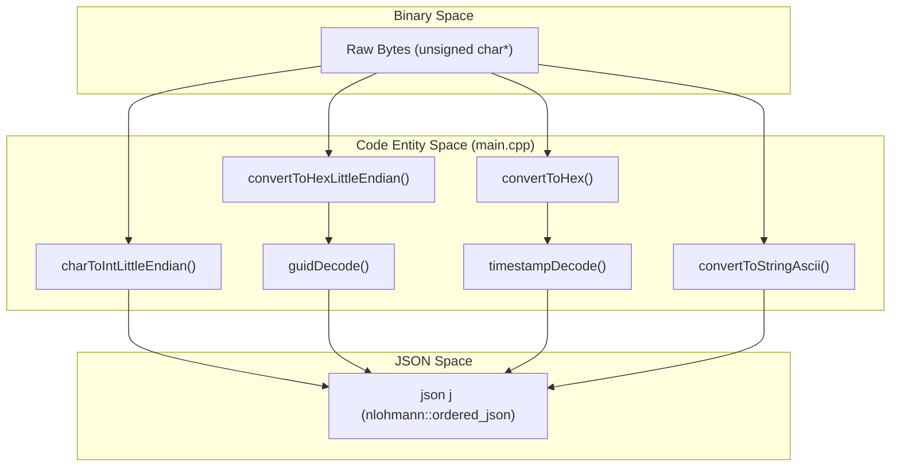
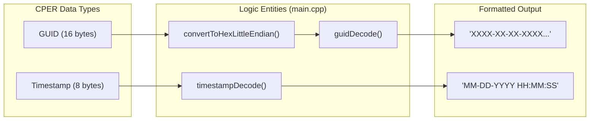

<!-- source: DeepWiki mcp.deepwiki.com · repo NVIDIA/cper-decoder · page 3.2 Helper Utilities and Data Conversion · fetched 2026-10-26 -->

# Helper Utilities and Data Conversion

Relevant source files

The following files were used as context for generating this wiki page:

- [main.cpp](main.cpp)

This page provides a technical reference for the utility functions defined in `main.cpp`. These functions form the foundational layer of the `cper-decoder`, responsible for transforming raw binary data (typically `const unsigned char*`) into human-readable strings, integers, formatted GUIDs, and timestamps for the final JSON output.

## Overview of Data Transformation

The decoder operates by reading a binary blob into a buffer and then traversing it using specific CPER structures. Because the CPER format uses Little-Endian byte ordering for many fields and specific formatting for GUIDs and Timestamps, these helper utilities are required to ensure data integrity during the conversion from "Binary Space" to "JSON Space."

### Data Flow Diagram: Binary to JSON Conversion

This diagram illustrates how raw bytes from the CPER record are processed by specific utilities before being assigned to the `nlohmann::ordered_json` object `j`.

"Data Flow from Binary to Code Entities"

Sources: [main.cpp:30-37](), [main.cpp:39-252]()

---

## Integer and Hexadecimal Conversion

The following utilities handle basic numeric and string representations, with specific logic for endianness.

### Hexadecimal Utilities
*   **`convertToHex`**: Converts a byte array into a standard hexadecimal string by iterating forward through the buffer [main.cpp:164-172]().
*   **`convertToHexLittleEndian`**: Converts a byte array into a hexadecimal string by iterating **backwards** from `size - 1` to `0`. This effectively reverses the byte order to represent the value in a human-readable Big-Endian format from a Little-Endian source [main.cpp:186-194]().

### Integer Utilities
*   **`charToIntLittleEndian`**: Converts a byte array into a `long int`. It iterates backwards through the input, shifting the result left by 8 bits at each step to reconstruct the integer value from Little-Endian bytes [main.cpp:206-222]().
*   **`stringToInt`**: A basic utility that converts a numeric string into an integer by iterating through characters and multiplying the result by 10 [main.cpp:111-120]().

### Summary Table: Numeric Helpers

| Function | Input Type | Logic | Use Case |
| :--- | :--- | :--- | :--- |
| `convertToHex` | `const unsigned char*` | Forward iteration | General byte-to-hex conversion |
| `convertToHexLittleEndian` | `const unsigned char*` | Reverse iteration | Little-Endian fields (e.g., GUID segments) |
| `charToIntLittleEndian` | `const unsigned char*` | Bitwise shift (`<< 8`) | Converting raw bytes to numeric values |
| `stringToInt` | `const string&` | Character accumulation | String-to-numeric conversion |

Sources: [main.cpp:111-120](), [main.cpp:164-172](), [main.cpp:186-194](), [main.cpp:206-222]()

---

## Specialized CPER Formatters

CPER records contain specific data types like GUIDs and Timestamps that require complex reformatting to meet UEFI specifications.

### GUID Decoding (`guidDecode`)
The `guidDecode` function transforms a raw hexadecimal string into the standard hyphenated GUID format (e.g., `XXXXXXXX-XXXX-XXXX-XXXX-XXXXXXXXXXXX`). It performs specific index-based reordering to account for the Little-Endian storage of the first three components of a GUID [main.cpp:233-252]().

### Timestamp Decoding (`timestampDecode`)
The `timestampDecode` function parses the 8-byte CPER timestamp. It first converts the bytes to hex using `convertToHex` and then uses `substr` to extract time components. The current implementation produces a string in the format `MM-DD-YYYY HH:MM:SS` [main.cpp:131-152]().

"CPER Format to Code Logic Mapping"

Sources: [main.cpp:131-152](), [main.cpp:233-252]()

---

## String and Validation Utilities

### ASCII and String Conversion
*   **`convertToString`**: A direct conversion from a character buffer to a `std::string` using a range constructor [main.cpp:74-78]().
*   **`convertToStringAscii`**: Similar to `convertToString`, but it checks for null terminators (`0x00`) and stops conversion at the first null byte encountered, ensuring clean string output for fixed-width character arrays [main.cpp:90-100]().

### Signature Validation
*   **`SignatureEndValidation`**: Validates the `SignatureEnd` field of the CPER Header. It checks if the 4-byte input matches the `signatureEndMarker` (defined as `0xFFFFFFFF` in `cper.h`). If any byte does not match, it returns `false` [main.cpp:52-62]().

### Address Representation
*   **`addressRepresentation`**: Takes a 64-bit address (as a `long int`) and converts it into a 16-character padded hexadecimal string prefixed with `0x`. This is used for memory and PCIe address fields [main.cpp:273-282]().

Sources: [main.cpp:52-62](), [main.cpp:74-78](), [main.cpp:90-100](), [main.cpp:273-282]()

---

