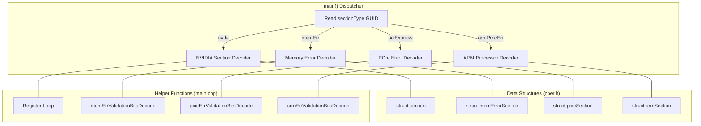
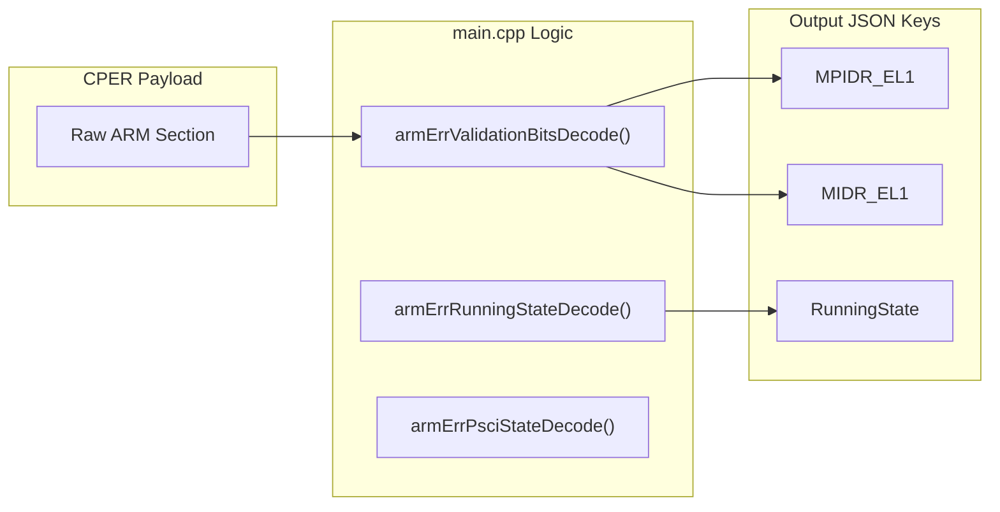

<!-- source: DeepWiki mcp.deepwiki.com · repo NVIDIA/cper-decoder · page 3.3 Section-Specific Decoders · fetched 2026-10-26 -->

# Section-Specific Decoders

Relevant source files

The following files were used as context for generating this wiki page:

- [cper.h](cper.h)
- [main.cpp](main.cpp)

This page provides a technical deep dive into the four specialized decoder paths within `cper-decoder`. Each decoder is responsible for translating a specific GUID-identified CPER section payload into a structured JSON representation.

## Overview

The `main()` function iterates through section descriptors and dispatches the raw binary payload to specific logic based on the `sectionType` GUID [main.cpp:456-550](). The decoders utilize a common "Validation Bits" pattern to determine which fields in the fixed-size structures contain valid data.

### Section Dispatch Logic

The following diagram illustrates how the `main()` function maps CPER Section GUIDs to their respective decoding logic and C structures.

**CPER Section Dispatch Flow**

**Sources:** [main.cpp:456-550](), [cper.h:40-47](), [cper.h:93-182]()

---

## 1. NVIDIA Section Decoder

The NVIDIA-specific section is used for proprietary IP error reporting. It features a fixed header followed by a dynamic number of register-data pairs.

### Implementation Details
- **Fixed Fields:** Decodes `IPSignature` (GUID), `ErrorInstance`, `SocketNumber`, and `InstanceBase` [main.cpp:465-481]().
- **Dynamic Tail:** The field `RegDataPairs` [cper.h:100]() indicates how many `struct registers` follow the main `struct section`.
- **Register Loop:** The decoder calculates the remaining section length and iterates through `struct registers` (8-byte address, 8-byte value) until the end of the section [main.cpp:484-500]().

**Sources:** [main.cpp:456-503](), [cper.h:93-111]()

---

## 2. Memory Error Decoder

The Memory Error decoder handles standard UEFI General Memory Error sections.

### Validation and Status
- **Validation Bits:** `memErrValidationBitsDecode` [main.cpp:1158-1215]() parses the 64-bit mask to identify valid fields like `PhysicalAddress`, `Node`, `Card`, `Module`, etc.
- **Error Status:** `memErrErrorStatusTypeDecode` [main.cpp:1217-1249]() breaks down the `errorStatus` field into `ErrorType` (e.g., Multi-bit ECC, Parity) and bitmask flags like `AddressError` or `DataError`.

### Memory Type Mapping
The decoder uses a `std::map` to translate the `memErrType` byte into human-readable strings (e.g., `0x01` -> "DRAM", `0x02` -> "Storage Class Memory") [main.cpp:1251-1277]().

**Sources:** [main.cpp:505-519](), [main.cpp:1158-1277](), [cper.h:115-138]()

---

## 3. PCIe Error Decoder

The PCIe decoder processes errors related to PCI Express root ports, bridges, and endpoints.

### Field Decoding
- **Port Type:** `pcieErrPortTypeDecode` [main.cpp:1425-1447]() maps the `portType` field to strings such as "PCI Express End Point" or "Root Port".
- **Validation:** `pcieErrValidationBitsDecode` [main.cpp:1385-1423]() checks for the presence of Serial Numbers, Bridge Control registers, and Capability structures.
- **Hardware Info:** Captures `VendorID`, `DeviceID`, and `ClassCode` to identify the failing hardware [main.cpp:1493-1505]().

### Advanced Error Reporting (AER)
The decoder extracts the `capabilityStructure` and `aerInfo` blocks as raw hex strings if the corresponding validation bits are set [main.cpp:1533-1542]().

**Sources:** [main.cpp:521-534](), [main.cpp:1385-1544](), [cper.h:142-166]()

---

## 4. ARM Processor Decoder

The ARM Processor decoder handles errors specific to ARMv8 and later architectures.

### Key Architectural Fields
- **MPIDR & MIDR:** Decodes the Multiprocessor Affinity Register and Main ID Register [main.cpp:1645-1648]().
- **Running State:** A bitmask indicating if the processor was in a specific EL (Exception Level) or if the state is unreliable [main.cpp:1652-1662]().
- **PSCI State:** Decodes the Power State Coordination Interface state [main.cpp:1664-1667]().

### Logic Mapping
The following diagram maps the ARM-specific code entities to the system concepts they represent.

**ARM Decoder Entity Mapping**

**Sources:** [main.cpp:536-549](), [main.cpp:1546-1668](), [cper.h:170-182]()

---

## Common Validation Pattern

All section decoders follow a strict validation pattern to ensure only populated data is exported to JSON.

1. **Reinterpret Cast:** The raw buffer is cast to the section-specific struct (e.g., `struct memErrorSection*`) [main.cpp:507]().
2. **Validation Bit Check:** A dedicated function (e.g., `memErrValidationBitsDecode`) iterates through the `validationBits` field [main.cpp:1158]().
3. **Conditional JSON Assignment:** Fields are only added to the `nlohmann::ordered_json` object if their corresponding bit is high [main.cpp:1286-1380]().

| Section Type | Validation Function | Bitmask Size |
| :--- | :--- | :--- |
| NVIDIA | N/A (Fixed + Loop) | N/A |
| Memory | `memErrValidationBitsDecode` | 64-bit |
| PCIe | `pcieErrValidationBitsDecode` | 64-bit |
| ARM | `armErrValidationBitsDecode` | 32-bit |

**Sources:** [main.cpp:1158](), [main.cpp:1385](), [main.cpp:1546]()

---

