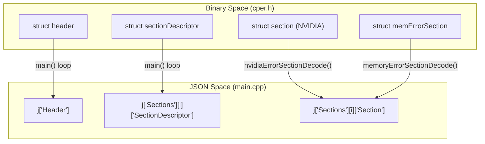
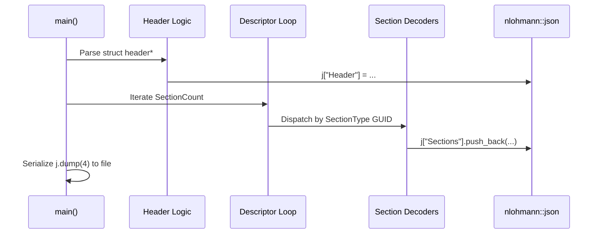

<!-- source: DeepWiki mcp.deepwiki.com · repo NVIDIA/cper-decoder · page 3.4 JSON Output Schema · fetched 2026-10-26 -->

# JSON Output Schema

<details>
<summary>Relevant source files</summary>

The following files were used as context for generating this wiki page:

- [main.cpp](main.cpp)
- [subprojects/nlohmann_json.wrap](subprojects/nlohmann_json.wrap)

</details>


The `cperparse` utility transforms binary Common Platform Error Record (CPER) data into a structured JSON document. This allows for programmatic analysis of hardware errors and integration with Redfish-compliant monitoring systems. The implementation relies on the `nlohmann::ordered_json` library to maintain field order during serialization [main.cpp:30]().

## Output Structure Overview

The generated JSON document consists of two primary top-level keys: `Header` and `Sections`.

| Key | Type | Description |
| :--- | :--- | :--- |
| `Header` | Object | Contains metadata from the CPER Record Header (e.g., Record ID, Timestamp). |
| `Sections` | Array | A collection of objects, each representing a single CPER section (e.g., NVIDIA, Memory, PCIe, ARM). |

Sources: [main.cpp:37](), [main.cpp:737-738]()

### JSON Generation Data Flow

The following diagram illustrates how binary structures from `cper.h` are mapped to JSON keys in `main.cpp`.

**CPER to JSON Mapping Flow**

Sources: [main.cpp:737-830](), [main.cpp:520-563](), [main.cpp:565-645]()

---

## Top-Level Keys

### Header
The `Header` object captures the global state of the error record. In the current implementation, if the `PHASE1` macro is defined, several fields (like `SignatureStart` and `SignatureEnd`) are omitted to streamline the output for specific hardware monitoring requirements [main.cpp:31](), [main.cpp:743-762]().

**Annotated Header Snippet:**
```json
"Header": {
    "RecordID": "0000000000000001",
    "Timestamp": "Format: MM-DD-YYYY HH:MM:SS 05-22-2023 14:30:01",
    "PlatformID": "504c4154-464f-524d-4944-000000000000",
    "SectionCount": 1,
    "RecordSeverity": "Recoverable"
}
```
*   **RecordID**: 64-bit hex string converted via `convertToHexLittleEndian` [main.cpp:751]().
*   **Timestamp**: Decoded into a human-readable format by `timestampDecode` [main.cpp:131-152]().
*   **PlatformID**: 128-bit GUID string formatted by `guidDecode` [main.cpp:233-258]().

### Sections Array
Each entry in the `Sections` array represents a discrete error event. Every entry contains a `SectionDescriptor` (metadata about the section) and a `Section` (the actual error payload).

**Section Structure:**
```json
{
    "SectionDescriptor": {
        "SectionOffset": 128,
        "SectionLength": 72,
        "SectionType": "e4214e45-6622-4214-932c-39827c61079c",
        "SectionSeverity": "Fatal"
    },
    "Section": { ... payload ... }
}
```
Sources: [main.cpp:783-800]()

---

## Section Payload Schemas

The content of the `Section` key varies based on the `SectionType` GUID.

### 1. NVIDIA Error Section
Produced by `nvidiaErrorSectionDecode` [main.cpp:520](). This section includes hardware-specific identifiers and a dynamic list of register-value pairs.

| Key | Description |
| :--- | :--- |
| `IPSignature` | 32-bit hex signature of the IP block [main.cpp:527](). |
| `InstanceBase` | 64-bit base address for the instance [main.cpp:531](). |
| `Registers` | An object where keys are hex addresses and values are hex register data [main.cpp:552-560](). |

**Example:**
```json
"Section": {
    "IPSignature": "abcd1234",
    "ErrorInstance": 0,
    "SocketNumber": 1,
    "InstanceBase": "00000000fee00000",
    "Registers": {
        "00000000fee00010": "00000000deadbeef",
        "00000000fee00018": "00000000cafebabe"
    }
}
```

### 2. Memory Error Section
Produced by `memoryErrorSectionDecode` [main.cpp:565](). It translates bitmask fields into descriptive JSON keys.

*   **ValidationBits**: Indicates which fields in the section are valid [main.cpp:573]().
*   **ErrorStatus**: Decoded via `memErrErrorStatusTypeDecode` into sub-fields like `ErrorType`, `AddressSignal`, and `DataSignal` [main.cpp:613-630]().

**Example:**
```json
"Section": {
    "ValidationBits": "0000000000000007",
    "ErrorStatus": {
        "ErrorType": "Internal",
        "AddressSignal": "1",
        "DataSignal": "0"
    },
    "PhysicalAddress": "0000000123456000",
    "MemoryErrorType": "Multi-bit ECC"
}
```

### 3. PCIe Error Section
Produced by `pcieErrorSectionDecode` [main.cpp:647](). This section maps the `pcieSection` struct [cper.h:182-203]().

*   **PortType**: Decoded from a numeric value to a string (e.g., "Root Port", "Upstream Switch Port") [main.cpp:661]().
*   **DeviceID**: Contains `VendorID`, `DeviceID`, `ClassCode`, and `FunctionNumber` [main.cpp:672-680]().

### 4. ARM Processor Error Section
Produced by `armErrorSectionDecode` [main.cpp:702]().

*   **MPIDR**: Multiprocessor Affinity Register value [main.cpp:714]().
*   **RunningState**: Boolean string indicating if the processor was running [main.cpp:717]().
*   **PSCIState**: Power State Coordination Interface state [main.cpp:719]().

---

## Implementation Details

The `main()` function orchestrates the JSON construction by iterating through section descriptors and appending to the global `nlohmann::json j` object.

**System Orchestration Diagram**


Sources: [main.cpp:737-832](), [main.cpp:846-850]()

---

