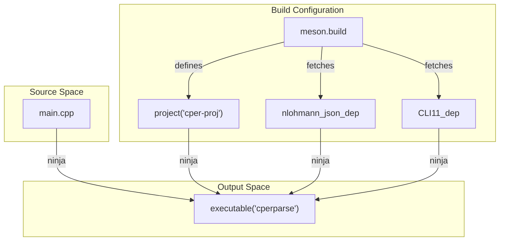
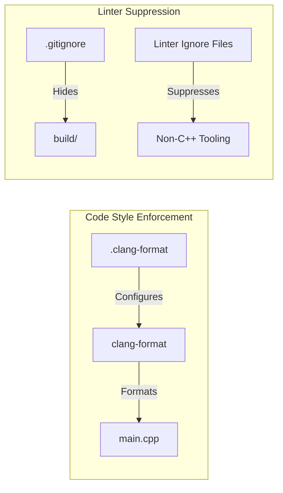

<!-- source: DeepWiki mcp.deepwiki.com · repo NVIDIA/cper-decoder · page 4 Build System and Tooling · fetched 2026-10-26 -->

# Build System and Tooling

Relevant source files

The following files were used as context for generating this wiki page:

- [.clang-format](.clang-format)
- [.gitignore](.gitignore)
- [meson.build](meson.build)

This section provides a high-level overview of the `cper-decoder` build infrastructure and the developer tooling used to maintain code quality. The project utilizes the Meson build system to manage C++ compilation and external dependencies, while employing a suite of linters and formatters to ensure consistency across the codebase.

## Build System Overview

The `cper-decoder` project is managed via the **Meson Build System**, which generates instructions for the **Ninja** backend. The configuration is centralized in the `meson.build` file at the project root.

### Core Configuration
The build is defined as a C++ project named `cper-proj` [meson.build:1](). It is configured by default to build libraries as static [meson.build:1](), ensuring that the resulting `cperparse` executable is portable and contains its necessary logic within the binary.

### Build Artifacts and Directories
When building the project, several directories and files are generated that are excluded from version control to keep the repository clean:
*   **`build/`**: The recommended directory for all compilation artifacts [.gitignore:30]().
*   **`subprojects/`**: Contains the Meson wrap files and downloaded source code for external dependencies [.gitignore:7-8]().
*   **`meson-logs/` & `meson-private/`**: Internal Meson metadata [.gitignore:11-12]().
*   **`build.ninja`**: The generated build manifest used by the Ninja executor [.gitignore:21]().

### Dependency Resolution
The project relies on two primary external libraries:
1.  **nlohmann_json**: Used for JSON construction and serialization [meson.build:2]().
2.  **CLI11**: Used for command-line argument parsing [meson.build:3]().

The following diagram illustrates the relationship between the build configuration and the resulting executable:

**Build System Entity Map**

For details on dependency versions and the wrap system, see [Meson Build Configuration and Dependencies](#4.1).

**Sources:**
* [meson.build:1-5]()
* [.gitignore:1-30]()

---

## Tooling and Code Quality

To maintain a consistent style and prevent common errors, the project includes configurations for various linters and formatters.

### C++ Formatting
The C++ source code is governed by a `.clang-format` configuration based on the **LLVM** style [.clang-format:2-3](). Key constraints include:
*   **Indentation**: 4-space indents without tabs [.clang-format:86, 132-133]().
*   **Column Limit**: 80 characters per line [.clang-format:52]().
*   **Brace Wrapping**: Custom wrapping rules for classes, functions, and control statements [.clang-format:26-47]().

### Multi-Language Linter Suppression
While the core logic is C++, the repository contains various ignore files to prevent external linters (like those used in CI environments) from flagging non-C++ files or temporary scripts. These include:
*   `.black-ignore`, `.flake8-ignore`, and `.isort-ignore` for Python.
*   `.eslintignore` and `.prettierignore` for web/data formats.
*   `.markdownlint-ignore` and `.shellcheck-ignore` for documentation and scripts.

**Tooling Integration Map**

For details on specific formatting rules and the full list of ignored tools, see [Code Style and Linter Configuration](#4.2).

**Sources:**
* [.clang-format:1-135]()
* [Project Structure Description (from TOC reference)]()

---

## Child Pages
*   [Meson Build Configuration and Dependencies](#4.1)
*   [Code Style and Linter Configuration](#4.2)

---

