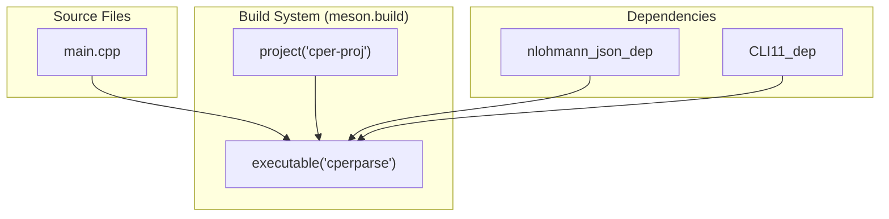
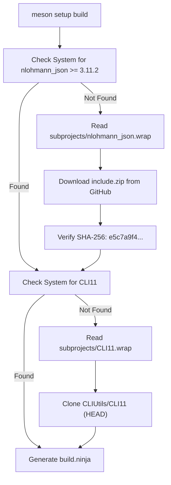

<!-- source: DeepWiki mcp.deepwiki.com · repo NVIDIA/cper-decoder · page 4.1 Meson Build Configuration and Dependencies · fetched 2026-10-26 -->

# Meson Build Configuration and Dependencies

Relevant source files

The following files were used as context for generating this wiki page:

- [.gitignore](.gitignore)
- [meson.build](meson.build)
- [subprojects/CLI11.wrap](subprojects/CLI11.wrap)
- [subprojects/nlohmann_json.wrap](subprojects/nlohmann_json.wrap)

This page details the build system configuration for the `cper-decoder` project. The project utilizes the Meson Build system to manage C++ compilation, dependency resolution, and executable generation.

## Project Definition and Build Options

The project is defined in the root `meson.build` file as `cper-proj` [meson.build:1-1](). It is configured to use the C++ toolchain and defaults to building libraries as static entities via the `default_library=static` option [meson.build:1-1]().

### Build Target: cperparse
The primary output of the build system is the `cperparse` executable. This target is compiled from the `main.cpp` source file and links against two primary external dependencies: `nlohmann_json` and `CLI11` [meson.build:4-4]().

**Target Relationship Diagram**

**Sources:** [meson.build:1-4]()

---

## Dependency Management

The `cper-decoder` relies on two external libraries to handle JSON serialization and Command Line Interface (CLI) parsing. Meson manages these through the `dependency()` function, which first attempts to find the libraries on the system and falls back to the Meson Wrap system if they are missing.

### 1. nlohmann_json
This header-only library is used for generating the JSON output of the CPER decoder.
*   **Version Requirement:** Must be at least `3.11.2` [meson.build:2-2]().
*   **Include Type:** Forced to `system` to suppress warnings from the external headers [meson.build:2-2]().
*   **Provision:** If not found on the host, it is fetched via `subprojects/nlohmann_json.wrap` [subprojects/nlohmann_json.wrap:1-10]().

### 2. CLI11
This library is used for parsing command-line arguments (such as `--redfish` or `--json`).
*   **Provision:** Managed via `subprojects/CLI11.wrap` [subprojects/CLI11.wrap:1-6]().
*   **Mapping:** The build system maps the internal dependency name `CLI11_dep` to the external `CLI11` provider [subprojects/CLI11.wrap:6-6]().

**Dependency Resolution Logic**

**Sources:** [meson.build:2-3](), [subprojects/nlohmann_json.wrap:1-10](), [subprojects/CLI11.wrap:1-6]()

---

## Meson Wrap Lifecycle

The project uses `.wrap` files in the `subprojects/` directory to ensure reproducible builds across different environments. Meson handles the lifecycle of these dependencies automatically during the setup phase.

### Wrap File Specifications

| Feature | nlohmann_json | CLI11 |
| :--- | :--- | :--- |
| **Method** | `wrap-file` (HTTP Archive) | `wrap-git` (Git Clone) |
| **Source URL** | `https://github.com/nlohmann/json/releases/download/v3.11.2/include.zip` | `https://github.com/CLIUtils/CLI11` |
| **Verification** | SHA-256 Hash [subprojects/nlohmann_json.wrap:6-6]() | Revision (HEAD) [subprojects/CLI11.wrap:3-3]() |
| **Dependency Name** | `nlohmann_json_dep` [subprojects/nlohmann_json.wrap:10-10]() | `CLI11_dep` [subprojects/CLI11.wrap:6-6]() |

### File System Impacts
When dependencies are fetched, they are stored in the `subprojects/` directory. The `.gitignore` file is configured to ignore the downloaded source code while preserving the `.wrap` definition files:
*   **Ignored:** `/subprojects/*` [/.gitignore:7-7]()
*   **Preserved:** `!/subprojects/*.wrap` [/.gitignore:8-8]()

**Sources:** [subprojects/nlohmann_json.wrap:1-10](), [subprojects/CLI11.wrap:1-6](), [/.gitignore:7-8]()

---

## Build Artifacts and Cleaning

The build process generates several metadata files and directories that are excluded from version control:
*   **`build/`**: The standard directory for compilation artifacts [/.gitignore:30-30]().
*   **`meson-logs/` & `meson-private/`**: Internal Meson state and log files [/.gitignore:11-12]().
*   **`build.ninja`**: The backend build instructions generated by Meson for the Ninja build tool [/.gitignore:21-21]().
*   **`compile_commands.json`**: A compilation database used by Language Servers (LSP) for code intelligence [/.gitignore:26-26]().

**Sources:** [/.gitignore:10-30]()

---

