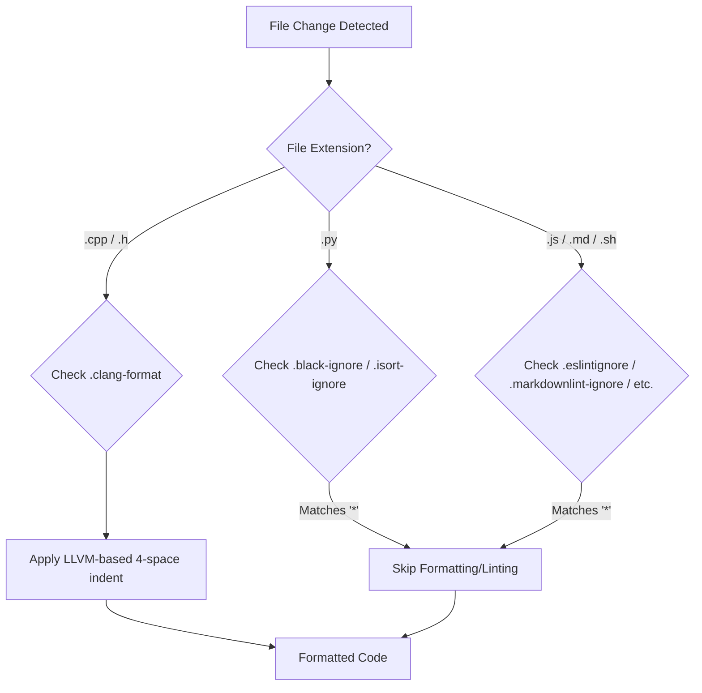

<!-- source: DeepWiki mcp.deepwiki.com · repo NVIDIA/cper-decoder · page 4.2 Code Style and Linter Configuration · fetched 2026-10-26 -->

# Code Style and Linter Configuration

<details>
<summary>Relevant source files</summary>

The following files were used as context for generating this wiki page:

- [.beautysh-ignore](.beautysh-ignore)
- [.black-ignore](.black-ignore)
- [.clang-format](.clang-format)
- [.eslintignore](.eslintignore)
- [.flake8-ignore](.flake8-ignore)
- [.isort-ignore](.isort-ignore)
- [.markdownlint-ignore](.markdownlint-ignore)
- [.prettierignore](.prettierignore)
- [.shellcheck-ignore](.shellcheck-ignore)

</details>


This page documents the formatting standards and linter configurations used in the `cper-decoder` project. The project enforces a strict C++ style via Clang-Format and utilizes a series of global ignore files to suppress non-C++ linters, ensuring that the development environment remains focused on the primary C++ codebase.

## C++ Formatting Standards

The C++ code style is defined in the `.clang-format` file and is based on the **LLVM** style with several project-specific overrides.

### Core Layout Rules
The project enforces a standard 4-space indentation and an 80-column line limit to ensure readability across different terminal sizes and editors.

| Property | Setting | Configuration Key |
| :--- | :--- | :--- |
| **Indentation Width** | 4 spaces | `IndentWidth: 4` |
| **Tab Usage** | Never (Spaces only) | `UseTab: Never` |
| **Column Limit** | 80 characters | `ColumnLimit: 80` |
| **Pointer Alignment** | Left (e.g., `void* ptr`) | `PointerAlignment: Left` |
| **Standard** | Latest (C++20/C++23) | `Standard: Latest` |

**Sources:** [ .clang-format:3-133 ]()

### Brace Wrapping and Control Statements
The project uses a **Custom** brace breaking strategy. Braces are generally wrapped onto new lines after most constructs (classes, functions, structs, namespaces) to provide clear visual separation between headers and bodies.

*   **Brace Wrapping Details:** Braces are wrapped after `class`, `struct`, `enum`, `function`, and `namespace` [ .clang-format:28-36 ]().
*   **Control Statements:** Braces wrap after control statements like `if` or `for` [ .clang-format:29 ](). However, short if-statements are never allowed on a single line [ .clang-format:17 ]().
*   **Empty Functions:** The formatter does not split empty functions, namespaces, or records into multiple lines [ .clang-format:42-44 ]().

**Sources:** [ .clang-format:26-47 ]()

### Include Management
The configuration automates the sorting and grouping of `#include` directives to maintain a consistent order. Includes are categorized by priority:

1.  **Priority -1:** `config.h` (always first) [ .clang-format:69-70 ]().
2.  **Priority 1-2:** Local headers (`.h`, `.hpp`) [ .clang-format:71-74 ]().
3.  **Priority 3-5:** System headers and standard libraries [ .clang-format:75-80 ]().
4.  **Priority 7:** Test frameworks (GTest/GMock) [ .clang-format:67-68 ]().

**Sources:** [ .clang-format:65-82 ](), [ .clang-format:114 ]()

## Linter Suppression Strategy

Because `cper-decoder` is a specialized C++ tool, it includes several configuration files that globally ignore other languages and file types. This prevents generic CI/CD linters or local IDE plugins from flagging non-issues in auxiliary files.

### Global Ignore Implementation
The project uses a "wildcard suppress" strategy. Most linter-ignore files contain a single `*` character, effectively telling the respective linter to ignore all files in the repository.

#### System Architecture: Linter Suppression
The following diagram illustrates how the ignore files act as a shield between the codebase and various language-specific formatting engines.

**Linter Suppression Mapping**
```mermaid
graph TD
    subgraph "Project Root"
        [".clang-format"]
    end

    subgraph "Suppression Files"
        B_IGN[".black-ignore"]
        I_IGN[".isort-ignore"]
        F_IGN[".flake8-ignore"]
        E_IGN[".eslintignore"]
        M_IGN[".markdownlint-ignore"]
        P_IGN[".prettierignore"]
        S_IGN[".shellcheck-ignore"]
        BE_IGN[".beautysh-ignore"]
    end

    subgraph "Formatting Engines"
        PY_F["Python Formatters (Black, Isort, Flake8)"]
        JS_F["JS Formatters (ESLint, Prettier)"]
        DOC_F["Documentation (Markdownlint)"]
        SH_F["Shell Formatters (ShellCheck, Beautysh)"]
    end

    B_IGN -.->|"Suppress All (*)"| PY_F
    I_IGN -.->|"Suppress All (*)"| PY_F
    F_IGN -.->|"Suppress All (*)"| PY_F
    E_IGN -.->|"Suppress All (*)"| JS_F
    P_IGN -.->|"Suppress All (*)"| JS_F
    M_IGN -.->|"Suppress All (*)"| DOC_F
    S_IGN -.->|"Suppress All (*)"| SH_F
    BE_IGN -.->|"Suppress All (*)"| SH_F

    [".clang-format"] ==>|"Applies To"| CPP_CODE["C++ Source (.cpp, .h)"]
```
**Sources:** [ .black-ignore:1 ](), [ .isort-ignore:1 ](), [ .flake8-ignore:1 ](), [ .eslintignore:1 ](), [ .markdownlint-ignore:1 ](), [ .prettierignore:1 ](), [ .shellcheck-ignore:1 ](), [ .beautysh-ignore:1 ]()

### Suppressed Tooling List
The following table lists the specific tools that are explicitly disabled for this project:

| Ignore File | Target Tool / Language | Content |
| :--- | :--- | :--- |
| `.black-ignore` | Python (Black Formatter) | `*` |
| `.isort-ignore` | Python (Import Sorting) | `*` |
| `.flake8-ignore` | Python (Flake8 Linting) | `*` |
| `.eslintignore` | JavaScript (ESLint) | `*` |
| `.prettierignore` | Multi-language (Prettier) | `*` |
| `.markdownlint-ignore` | Markdown (Markdownlint) | `*` |
| `.shellcheck-ignore` | Shell Scripts (ShellCheck) | `*` |
| `.beautysh-ignore` | Shell Scripts (Beautysh) | `*` |

**Sources:** [ .black-ignore:1 ](), [ .isort-ignore:1 ](), [ .flake8-ignore:1 ](), [ .eslintignore:1 ](), [ .markdownlint-ignore:1 ](), [ .prettierignore:1 ](), [ .shellcheck-ignore:1 ](), [ .beautysh-ignore:1 ]()

## Data Flow: Code Formatting

When a developer runs a formatter or a CI pipeline triggers, the following logic is applied to determine the final file state.

**Formatting Decision Logic**


**Sources:** [ .clang-format:2-133 ](), [ .black-ignore:1 ](), [ .eslintignore:1 ](), [ .shellcheck-ignore:1 ]()

---

