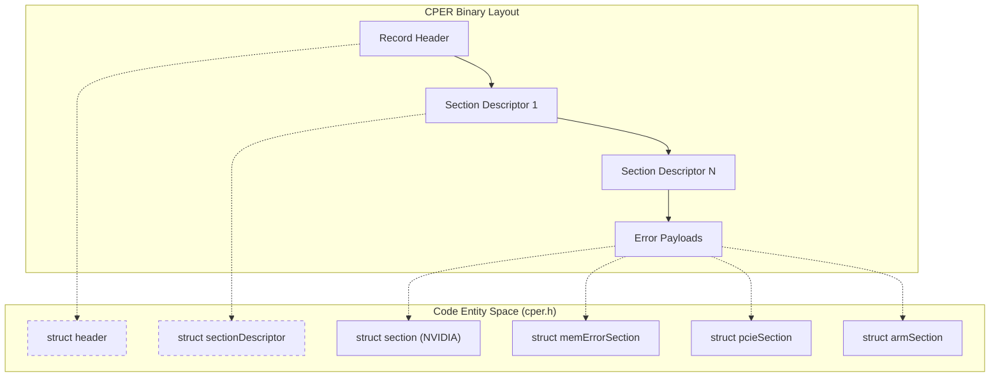

<!-- source: DeepWiki mcp.deepwiki.com · repo NVIDIA/cper-decoder · page 5 Glossary · fetched 2026-10-26 -->

# Glossary

<details>
<summary>Relevant source files</summary>

The following files were used as context for generating this wiki page:

- [.clang-format](.clang-format)
- [cper.h](cper.h)
- [main.cpp](main.cpp)
- [meson.build](meson.build)
- [subprojects/CLI11.wrap](subprojects/CLI11.wrap)
- [subprojects/nlohmann_json.wrap](subprojects/nlohmann_json.wrap)

</details>


This glossary defines technical terms, acronyms, and domain-specific concepts used within the `cper-decoder` codebase. It serves as a reference for onboarding engineers to understand the relationship between the UEFI CPER specification and the C++ implementation.

## Core CPER Domain Terms

| Term | Definition | Implementation Reference |
| :--- | :--- | :--- |
| **CPER** | Common Platform Error Record. A standard binary format defined by UEFI for reporting hardware errors. | [cper.h:52-73]() |
| **Section Descriptor** | A fixed-size structure following the header that describes the type, offset, and length of an error payload. | [cper.h:77-89]() |
| **GUID** | Globally Unique Identifier. Used in CPER to identify the specific type of error section (e.g., NVIDIA, ARM, PCIe). | [cper.h:40-47]() |
| **SBMR Offset** | A 4-byte preamble sometimes present before the CPER header in certain system implementations. | [cper.h:29-29]() |
| **Validation Bits** | A bitmask field present in most CPER structures indicating which subsequent fields contain valid data. | [cper.h:62-62](), [cper.h:117-117]() |

**Sources:** [cper.h:29-89](), [cper.h:117-117]()

---

## Codebase Entities and Data Structures

### Binary Representation Mapping
The decoder uses C-style structs with `#pragma pack(1)` to map directly onto the binary CPER blob.

**Natural Language to Code Entity Mapping (Data Structures)**

**Sources:** [cper.h:52-182]()

### NVIDIA Specific Terms
*   **IPSignature**: A 16-byte identifier for the NVIDIA IP block reporting the error [cper.h:95-95]().
*   **RegDataPairs**: A count of register/value pairs following the fixed NVIDIA section header [cper.h:100-100]().
*   **InstanceBase**: The base address of the hardware instance reporting the error [cper.h:102-102]().

**Sources:** [cper.h:93-103]()

---

## Processing and Transformation Logic

The decoder follows a linear pipeline: reading the file, iterating through descriptors, and dispatching to specific decoding logic based on GUIDs.

**Natural Language to Code Entity Mapping (Functions)**
```mermaid
graph LR
    subgraph "Input Processing"
        "CLI Input" --> main["main()"]
        main --> open["std::ifstream"]
    end

    subgraph "Data Conversion Logic"
        "Raw Bytes" --> hex["convertToHex()"]
        "Little Endian Bytes" --> le_int["charToIntLittleEndian()"]
        "GUID Bytes" --> g_dec["guidDecode()"]
    end

    subgraph "Section Dispatch"
        main -->|GUID Match| NV["NVIDIA Decoder Path"]
        main -->|GUID Match| MEM["Memory Decoder Path"]
    end

    hex -.-> [main.cpp:164-172]()
    le_int -.-> [main.cpp:206-222]()
    g_dec -.-> [main.cpp:233-252]()
```
**Sources:** [main.cpp:164-252]()

### Helper Functions Glossary

*   **`SignatureEndValidation`**: Checks if the `SignatureEnd` field in the header matches the `signatureEndMarker` (0xFFFFFFFF) [main.cpp:52-62]().
*   **`convertToHex`**: Converts a byte array into a standard hex string [main.cpp:164-172]().
*   **`convertToHexLittleEndian`**: Converts a byte array into a hex string, reversing the byte order for correct human-readable representation of little-endian values [main.cpp:186-194]().
*   **`charToIntLittleEndian`**: Converts a little-endian byte array into a `long int` [main.cpp:206-222]().
*   **`timestampDecode`**: Parses the 8-byte CPER timestamp into a formatted string (MM-DD-YYYY HH:MM:SS) [main.cpp:131-152]().
*   **`guidDecode`**: Reformats a 16-byte GUID string into the standard `8-4-4-4-12` hyphenated representation [main.cpp:233-252]().

**Sources:** [main.cpp:52-252]()

---

## Build and Dependency Concepts

*   **Meson**: The build system generator used to compile the project [meson.build:1-1]().
*   **Wrap File**: A Meson mechanism (`.wrap`) used to manage external dependencies like `nlohmann_json` and `CLI11` by downloading and verifying source archives [subprojects/nlohmann_json.wrap:1-7]().
*   **PHASE1**: A preprocessor macro used to toggle specific output behaviors in the JSON generation [main.cpp:31-31]().
*   **nlohmann/json**: The C++ library used for constructing and serializing the `ordered_json` output [main.cpp:30-30]().

**Sources:** [meson.build:1-4](), [subprojects/nlohmann_json.wrap:1-7](), [main.cpp:30-31]()