# Page: Overview

# Overview

<details>
<summary>Relevant source files</summary>

The following files were used as context for generating this wiki page:

- [LICENSE](LICENSE)
- [README.md](README.md)
- [cper.h](cper.h)
- [main.cpp](main.cpp)

</details>


The `cper-decoder` project provides a command-line utility, `cperparse`, designed to decode binary Common Platform Error Record (CPER) data into human-readable JSON format. CPER is a standardized format defined by the UEFI specification for describing hardware error telemetry across different platform architectures.

This tool is specifically tailored to handle standard CPER sections (such as ARM Processor, Memory, and PCIe errors) as well as NVIDIA-specific error extensions. By converting opaque binary blobs into structured JSON, it enables easier integration with logging systems and Redfish-compliant telemetry services.

### Core Objectives
*   **Binary Ingestion**: Parse raw CPER logs, including those with custom preambles like `sbmrOffset` [cper.h:29-29]().
*   **Standard Compliance**: Implement structures for UEFI Appendix N compliance, including the `header` [cper.h:52-73]() and `sectionDescriptor` [cper.h:77-89]().
*   **Extensibility**: Support vendor-specific sections, such as the NVIDIA `section` [cper.h:93-103]() containing dynamic register-data pairs.
*   **Interoperability**: Output data in a structured `nlohmann::ordered_json` format [main.cpp:30-30]() for downstream consumption.

For a guide on building the project and running the decoder, see [Getting Started](#1.1).

---

### System Architecture

The decoder operates as a linear pipeline that transforms a binary buffer into a JSON object. It uses a dispatch mechanism based on Section Type GUIDs to determine how to decode specific regions of the record.

#### Logical Flow to Code Entity Mapping
The following diagram illustrates how the conceptual stages of decoding map to specific data structures and constants in the source code.

**CPER Decoding Pipeline**
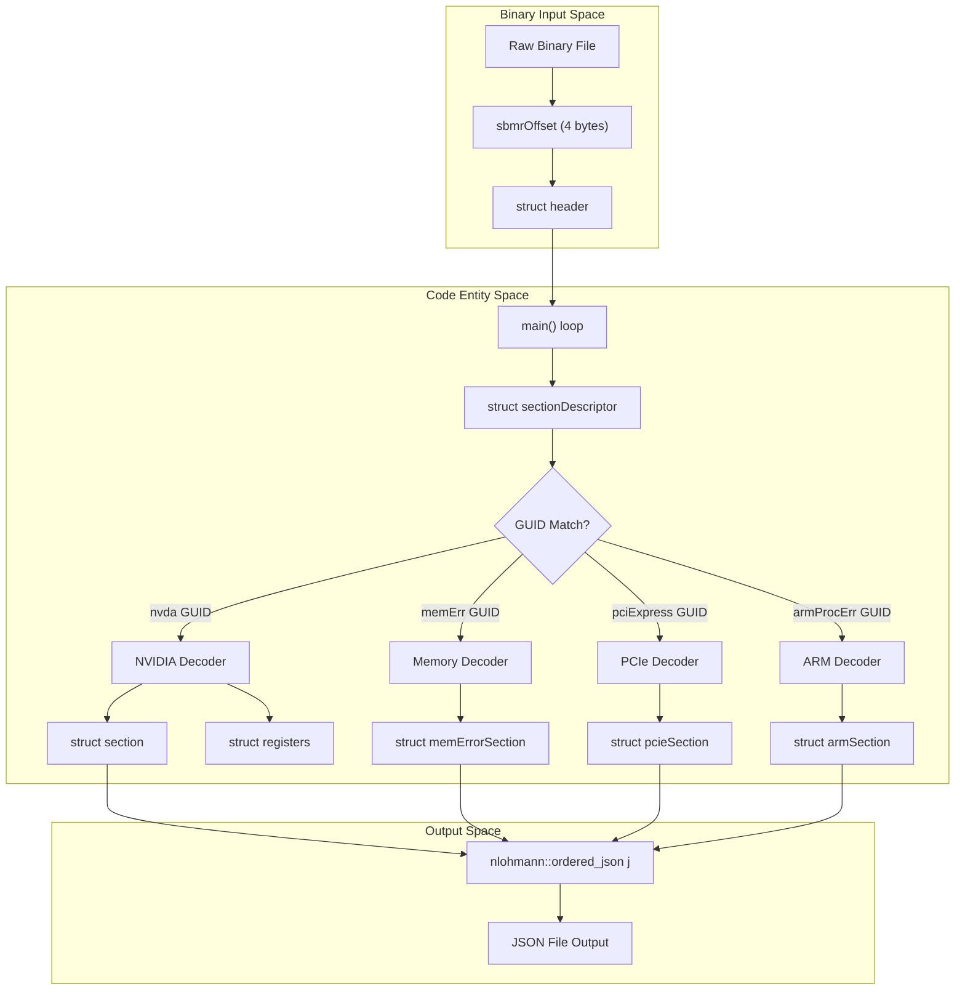
**Sources:** [cper.h:29-47](), [cper.h:52-182](), [main.cpp:37-37]()

---

### Data Translation and Helper Utilities

Because CPER data is packed and often stored in little-endian format, the project relies on a suite of conversion utilities in `main.cpp`. These functions bridge the gap between raw `unsigned char` arrays and high-level string or integer representations.

| Function | Purpose | Implementation Detail |
| :--- | :--- | :--- |
| `convertToHex` | General hex conversion | Uses `std::stringstream` with `std::hex` [main.cpp:164-172]() |
| `convertToHexLittleEndian` | Endian-aware hex | Iterates backwards through input buffer [main.cpp:186-194]() |
| `charToIntLittleEndian` | Byte to Integer | Performs bit-shifting (`<< 8`) to reconstruct values [main.cpp:206-222]() |
| `guidDecode` | GUID Formatting | Reorders bytes into standard `8-4-4-4-12` hyphenated format [main.cpp:233-261]() |
| `timestampDecode` | CPER Timestamp | Extracts year, month, day, and time from fixed offsets [main.cpp:131-152]() |

For a full map of the repository's files and their roles, see [Project Structure](#1.2).

---

### Structural Components

The project is organized around the physical layout of a CPER record. The code uses `#pragma pack(1)` to ensure that C++ structures map exactly to the binary wire-format without compiler-inserted padding.

**Natural Language to Code Association**
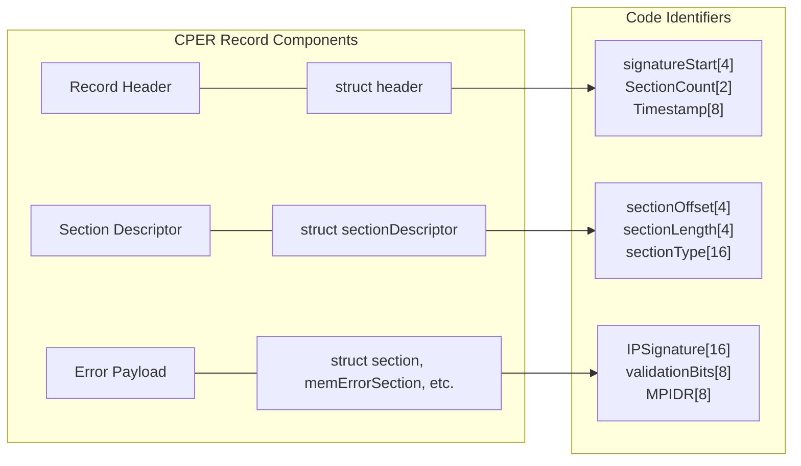
**Sources:** [cper.h:51-52](), [cper.h:76-77](), [cper.h:92-93](), [cper.h:114-115](), [cper.h:141-142](), [cper.h:169-170]()

### Build and Tooling Overview
The project uses the **Meson Build System** and manages external dependencies like `nlohmann_json` and `CLI11` via Meson wraps. This ensures a consistent environment across different development platforms.

*   **Compiler Requirements**: C++17 or later.
*   **Dependencies**: `nlohmann_json` (≥ 3.11.2) and `CLI11`.
*   **Formatting**: Strictly follows a `.clang-format` specification based on the LLVM style.

For details on the build configuration and dependencies, see the [Build System and Tooling](#4) section in the documentation.

---

# Page: Getting Started

# Getting Started

<details>
<summary>Relevant source files</summary>

The following files were used as context for generating this wiki page:

- [.gitignore](.gitignore)
- [meson.build](meson.build)
- [subprojects/CLI11.wrap](subprojects/CLI11.wrap)
- [subprojects/nlohmann_json.wrap](subprojects/nlohmann_json.wrap)

</details>


The `cper-decoder` project provides a command-line utility, `cperparse`, designed to decode binary Common Platform Error Record (CPER) blobs into human-readable JSON. This tool is essential for analyzing hardware error logs generated by firmware in compliance with the UEFI specification and NVIDIA-specific error extensions.

### Prerequisites

The project uses the **Meson** build system and relies on external dependencies managed via Meson wraps. Ensure the following are installed on your system:
*   **C++ Compiler**: Supporting C++11 or higher.
*   **Meson**: Build system runner.
*   **Ninja**: Backend build tool.
*   **Dependencies**:
    *   `nlohmann_json`: Handled via `subprojects/nlohmann_json.wrap` [subprojects/nlohmann_json.wrap:1-10]().
    *   `CLI11`: Handled via `subprojects/CLI11.wrap` [subprojects/CLI11.wrap:1-6]().

---

### Building the Project

The build process is standardized using Meson. The `meson.build` file defines the project and its dependencies [meson.build:1-4]().

1.  **Initialize the build directory**:
    ```bash
    meson setup build
    ```
    This command downloads the required wraps for `nlohmann_json` [subprojects/nlohmann_json.wrap:4-6]() and `CLI11` [subprojects/CLI11.wrap:2-3]().

2.  **Compile the executable**:
    ```bash
    meson compile -C build
    ```
    The resulting binary, `cperparse`, will be located in the `build/` directory.

**Sources:**
* [meson.build:1-4]()
* [subprojects/nlohmann_json.wrap:1-10]()
* [subprojects/CLI11.wrap:1-7]()

---

### CLI Usage and Flags

The `cperparse` utility uses the `CLI11` library to manage command-line arguments. It requires an input binary file and an output destination for the JSON data.

#### Syntax
```bash
./cperparse [OPTIONS]
```

#### Options
| Flag | Description |
| :--- | :--- |
| `-i,--input` | **Required**. Path to the binary CPER blob file. |
| `-o,--output` | **Required**. Path where the decoded JSON file will be saved. |
| `--redfish` | Optional. If set, the output follows a schema compatible with Redfish error logging (specifically impacting the `Header` structure). |
| `--json` | Optional. Ensures the output is formatted as a JSON object. |

**Sources:**
* [meson.build:3-4]()
* [subprojects/CLI11.wrap:1-6]()

---

### Data Flow Architecture

The following diagram illustrates the transition from the "Natural Language Space" (User Requirements) to the "Code Entity Space" (Implementation) during a typical execution.

**CPER Parsing Pipeline**
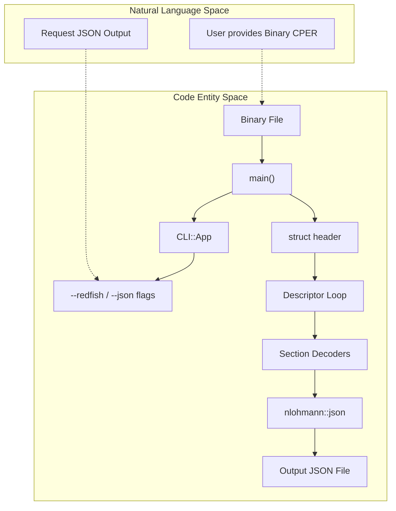

**Sources:**
* [meson.build:1-4]()
* [subprojects/nlohmann_json.wrap:1-10]()

---

### Worked Example: Decoding a CPER Blob

To decode a raw CPER binary (e.g., `error_log.bin`) into a JSON file (`decoded.json`), follow these steps:

#### 1. Prepare the Binary
Ensure you have a CPER blob. This blob typically starts with a `struct header` containing the "CPER" signature [cper.h:34-40]().

#### 2. Execute the Decoder
Run the binary with the desired flags. In this example, we use the `--redfish` flag to ensure the output matches Redfish-specific formatting requirements.

```bash
./build/cperparse -i error_log.bin -o decoded.json --redfish --json
```

#### 3. Implementation Logic
When executed, the program performs the following steps:
1.  **Ingestion**: The file is read into memory.
2.  **Header Validation**: The code maps the start of the buffer to a `header` struct and validates the `SignatureEnd` [cper.h:40-40]().
3.  **Section Iteration**: It iterates through the number of sections defined in `SectionCount` [cper.h:42-42]().
4.  **JSON Construction**: For each section, it identifies the `sectionType` GUID [cper.h:61-61]() and uses `nlohmann::json` to build the tree.

**Execution Flow Diagram**
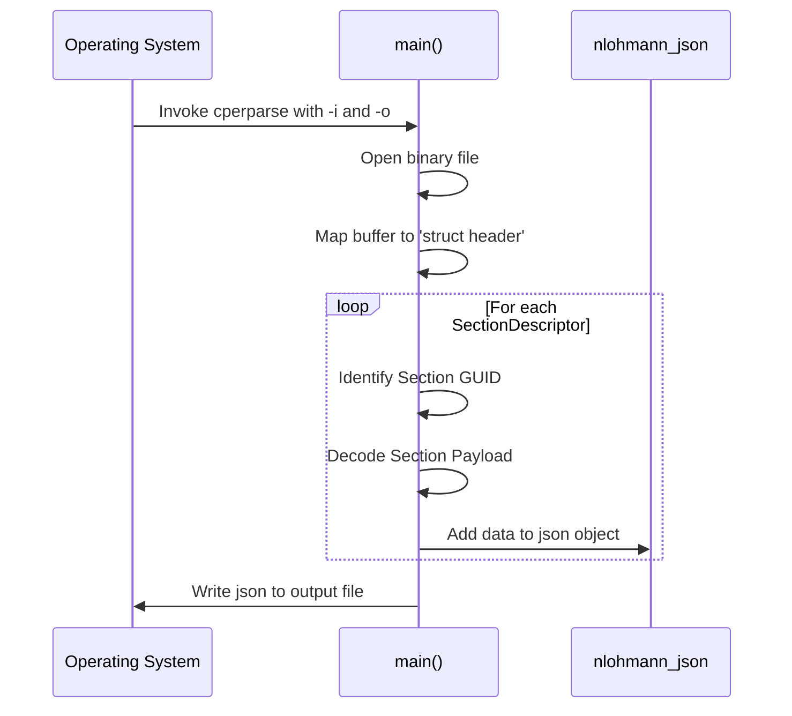

**Sources:**
* [meson.build:1-4]()
* [subprojects/nlohmann_json.wrap:1-10]()
* [subprojects/CLI11.wrap:1-6]()

---

# Page: Project Structure

# Project Structure

<details>
<summary>Relevant source files</summary>

The following files were used as context for generating this wiki page:

- [.beautysh-ignore](.beautysh-ignore)
- [.black-ignore](.black-ignore)
- [.clang-format](.clang-format)
- [.eslintignore](.eslintignore)
- [.flake8-ignore](.flake8-ignore)
- [.isort-ignore](.isort-ignore)
- [.markdownlint-ignore](.markdownlint-ignore)
- [.prettierignore](.prettierignore)
- [.shellcheck-ignore](.shellcheck-ignore)
- [cper.h](cper.h)
- [main.cpp](main.cpp)
- [meson.build](meson.build)

</details>


This page provides a comprehensive map of the `cper-decoder` repository. The project is a C++ tool designed to parse UEFI Common Platform Error Record (CPER) binary data into structured JSON format. It utilizes a single-pass parsing approach with fixed-width structures to map binary blobs directly to C++ objects.

## Core Source Files

The logic of the decoder is contained within two primary files: a header defining the CPER structures and a source file implementing the parsing logic and CLI orchestration.

### `cper.h`
This header serves as the data contract for the project. It defines the memory layout of CPER records according to the UEFI specification. All structures use `#pragma pack(1)` to ensure the compiler does not add padding, allowing for direct `reinterpret_cast` from binary buffers.

*   **Constants**: Defines magic numbers like `sbmrOffset` (4 bytes) [cper.h:29](), `headerSize` (128 bytes) [cper.h:30](), and GUID strings for dispatching [cper.h:40-47]().
*   **struct `header`**: Maps the 128-byte UEFI Record Header [cper.h:52-73]().
*   **struct `sectionDescriptor`**: Maps the 72-byte descriptor that links the header to specific payloads [cper.h:77-89]().
*   **Section Payloads**: Defines structures for `memErrorSection` [cper.h:115-138](), `pcieSection` [cper.h:142-166](), `armSection` [cper.h:170-182](), and the NVIDIA-specific `section` [cper.h:93-103]().

### `main.cpp`
The entry point and implementation file. It handles file I/O, command-line arguments via `CLI11`, and the transformation of binary data into JSON via `nlohmann::json`.

*   **Helper Functions**: A suite of utilities for data conversion, such as `convertToHex` [main.cpp:164-172](), `guidDecode` [main.cpp:233-252](), and `timestampDecode` [main.cpp:131-152]().
*   **Parsing Logic**: Contains the main loop that iterates through section descriptors and dispatches to specific decoding logic based on the `sectionType` GUID.

**Sources:** [cper.h:1-183](), [main.cpp:1-252]()

## Build and Dependency Management

The project uses the Meson Build system. Dependencies are managed through Meson's wrap system, ensuring that specific versions of external libraries are available during the build process.

| File | Role | Key Entities |
| :--- | :--- | :--- |
| `meson.build` | Main build script | `executable('cperparse', ...)` [meson.build:4]() |
| `subprojects/` | Directory for wrap files | `nlohmann_json`, `CLI11` |

**Sources:** [meson.build:1-5]()

## Tooling and Linting Configurations

The repository includes a comprehensive set of "ignore" files. Since the project is primarily C++, these files are used to prevent various linters (intended for other languages) from processing the source tree in multi-language environments or CI pipelines.

*   **`.clang-format`**: Defines the C++ code style, basing it on the LLVM style with a 4-space indent [`.clang-format:3-86`]() and custom `BraceWrapping` rules [`.clang-format:26-44`]().
*   **Linter Ignores**: Global ignore patterns (`*`) are applied to tools like `.black-ignore` [`.black-ignore:1`](), `.flake8-ignore` [`.flake8-ignore:1`](), and `.eslintignore` [`.eslintignore:1`]() to ensure they do not interfere with the C++ codebase.

**Sources:** [`.clang-format:1-135`](), [`.black-ignore:1`](), [`.flake8-ignore:1`]()

## Logic and Data Flow Diagrams

The following diagrams illustrate how the code entities interact to transform a raw binary file into a JSON structure.

### CPER Binary to Object Mapping
This diagram shows how the raw buffer is interpreted by the structures defined in `cper.h`.

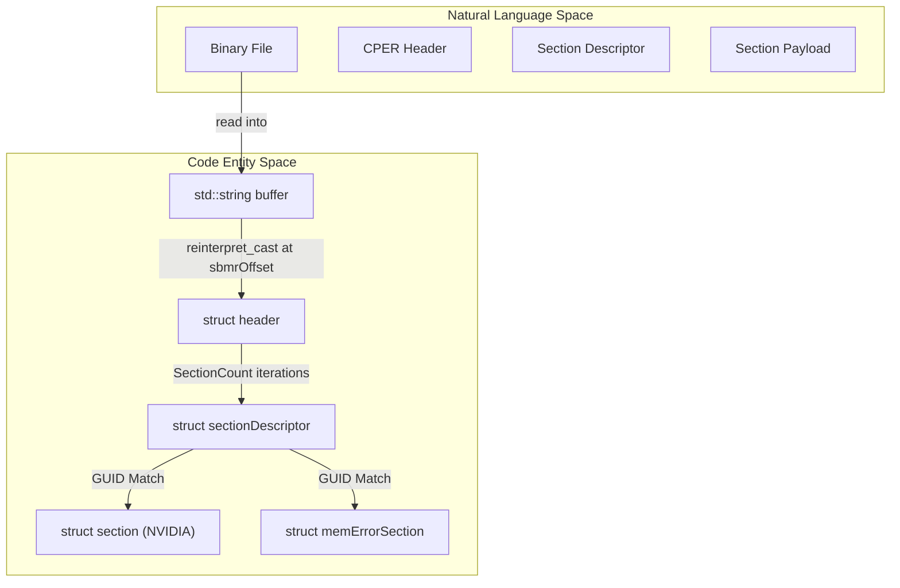
**Sources:** [cper.h:29-31](), [cper.h:52-138](), [main.cpp:18-31]()

### Execution Pipeline
This diagram maps the high-level parsing stages to the specific functions and variables in `main.cpp`.

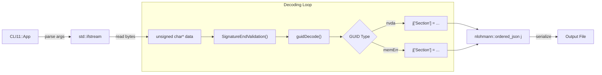
**Sources:** [main.cpp:52-62](), [main.cpp:233-252](), [cper.h:40-47](), [main.cpp:30-37]()

---

# Page: CPER Format Reference

# CPER Format Reference

<details>
<summary>Relevant source files</summary>

The following files were used as context for generating this wiki page:

- [cper.h](cper.h)
- [main.cpp](main.cpp)

</details>


This page provides a high-level overview of the UEFI Common Platform Error Record (CPER) binary format as implemented in the `cper-decoder` project. The implementation follows the UEFI Specification (Appendix N) to parse hardware error logs into a structured JSON format.

## Overview of the Three-Layer Layout

The CPER format is organized into a hierarchical structure consisting of a single global header, followed by one or more section descriptors, which in turn point to specific error payloads. The `cper-decoder` utilizes C-style structures with `#pragma pack(1)` to map directly onto these binary blobs.

### CPER Binary Structure
The diagram below illustrates how the parser views the binary data layout.

**CPER Data Layout Overview**
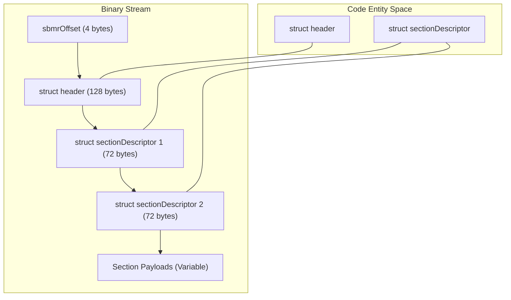
Sources: [cper.h:29-31](), [cper.h:52-73](), [cper.h:77-89]()

---

## Record Header and Section Descriptors

The first layer of a CPER record is the **Record Header**, which contains metadata about the entire error report, such as the total number of sections and the platform ID. Immediately following the header is an array of **Section Descriptors**. Each descriptor acts as a pointer and metadata provider for a specific error payload, defining its offset in the file, its length, and its type via a Unique Identifier (GUID).

In this implementation, the parser accounts for a 4-byte preamble (`sbmrOffset`) before the standard 128-byte header begins.

For detailed field definitions and navigation logic, see **[Record Header and Section Descriptors](#2.1)**.

**Header to Descriptor Mapping**
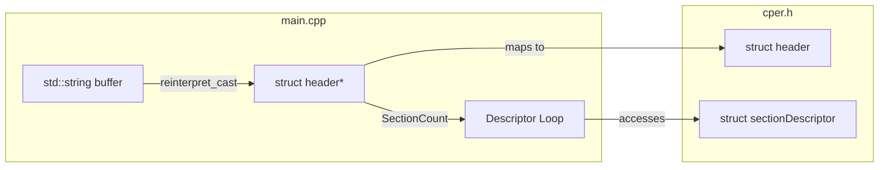
Sources: [main.cpp:4530-4540](), [cper.h:52-89]()

---

## Error Section Payloads

The final layer contains the actual error data. The `cper-decoder` supports four specific section types, identified by their GUIDs. When the parser iterates through the section descriptors, it uses the `sectionType` field to determine which payload structure to apply to the data at `sectionOffset`.

The supported payload structures include:
*   **NVIDIA Section**: Custom NVIDIA error data including IP signatures and dynamic register-data pairs.
*   **Memory Error**: Standard UEFI General Memory error details (Node, Card, Module, Bank, etc.).
*   **PCIe Error**: Port type, Version, Vendor/Device IDs, and AER information.
*   **ARM Processor**: MPIDR, MIDR, and processor state information.

For details on the internal fields of these payloads and the GUID-based dispatch logic, see **[Error Section Payloads](#2.2)**.

### Supported Section Types
| Section Type | GUID Constant (cper.h) | Structure Name |
| :--- | :--- | :--- |
| NVIDIA | `nvda` | `struct section` |
| General Memory | `memErr` | `struct memErrorSection` |
| PCI Express | `pciExpress` | `struct pcieSection` |
| ARM Processor | `armProcErr` | `struct armSection` |

Sources: [cper.h:40-47](), [cper.h:93-182]()

---

# Page: Record Header and Section Descriptors

# Record Header and Section Descriptors

<details>
<summary>Relevant source files</summary>

The following files were used as context for generating this wiki page:

- [cper.h](cper.h)
- [main.cpp](main.cpp)

</details>


This page provides a detailed technical reference for the top-level structures used in the Common Platform Error Record (CPER) format as implemented in the `cper-decoder`. The parser relies on these structures to navigate the binary blob, starting from a fixed-size header and moving through a variable number of section descriptors to locate error payloads.

## CPER Structure Overview

The CPER record is organized into three distinct layers. The decoder begins by identifying the `header`, followed by an array of `sectionDescriptor` objects. These descriptors act as a directory, providing the offset and length for the actual error payloads (e.g., Memory, PCIe, or NVIDIA-specific errors).

### Memory Layout and Alignment
The decoder uses `#pragma pack(1)` for all CPER structures in `cper.h` to ensure that the compiler does not insert padding between members. This is critical because the structures must map exactly to the UEFI-defined binary specification for CPER records [cper.h:51-51](), [cper.h:76-76]().

### SBMR Preamble
In many implementations, including the one handled by this decoder, there is a 4-byte preamble before the actual CPER header. This is defined as `sbmrOffset` [cper.h:29-29](). The parser accounts for this offset when calculating the starting memory address of the record header.

### Structural Mapping
The following diagram illustrates how the `main()` function maps raw binary data to the C++ structures defined in `cper.h`.

**CPER Header and Descriptor Mapping**
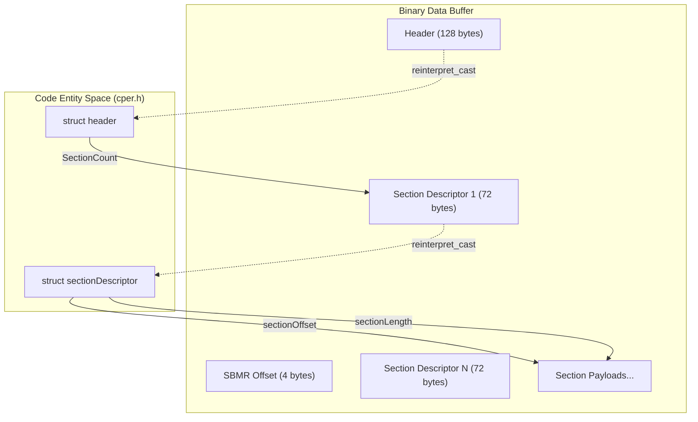
Sources: [cper.h:29-31](), [cper.h:52-73](), [cper.h:77-89]()

---

## The Record Header (`struct header`)

The `header` structure is the entry point for any CPER record. It is exactly 128 bytes long [cper.h:30-30]().

### Key Fields
| Field | Size | Description |
| :--- | :--- | :--- |
| `signatureStart` | 4 bytes | Identifies the start of the record (typically "CPER") [cper.h:57-57](). |
| `SignatureEnd` | 4 bytes | Validated against `0xFFFFFFFF` to ensure header integrity [cper.h:59-59](). |
| `SectionCount` | 2 bytes | Determines how many `sectionDescriptor` entries follow the header [cper.h:60-60](). |
| `Timestamp` | 8 bytes | Records the time of the error; decoded via `timestampDecode` [cper.h:64-64](). |
| `PlatformID` | 16 bytes | GUID identifying the platform that generated the record [cper.h:65-65](). |

### Header Validation
The `SignatureEnd` field is validated using the `SignatureEndValidation` function. This function checks if each byte matches the `signatureEndMarker` (value 255/0xFF) [main.cpp:52-62]().

Sources: [cper.h:52-73](), [main.cpp:52-62](), [cper.h:32-33]()

---

## Section Descriptors (`struct sectionDescriptor`)

Following the header is an array of section descriptors. Each `sectionDescriptor` is 72 bytes [cper.h:31-31](). These structures contain the metadata required to find and interpret the subsequent error data.

### Field Definitions
*   **`sectionOffset`**: The byte offset from the start of the CPER record (including the header) to the beginning of the section payload [cper.h:79-79]().
*   **`sectionLength`**: The size of the payload in bytes [cper.h:80-80]().
*   **`sectionType`**: A 16-byte GUID that determines the payload format (e.g., NVIDIA, ARM, Memory) [cper.h:85-85]().
*   **`sectionSeverity`**: Indicates the severity of the error described in this specific section [cper.h:87-87]().
*   **`fruText`**: A 20-byte string providing a human-readable identifier for the Field Replaceable Unit (FRU) [cper.h:88-88]().

Sources: [cper.h:77-89](), [cper.h:31-31]()

---

## Navigation Logic

The parser navigates the record by first calculating the position of the first descriptor and then iterating based on the `SectionCount` found in the header.

**Parser Navigation Flow**
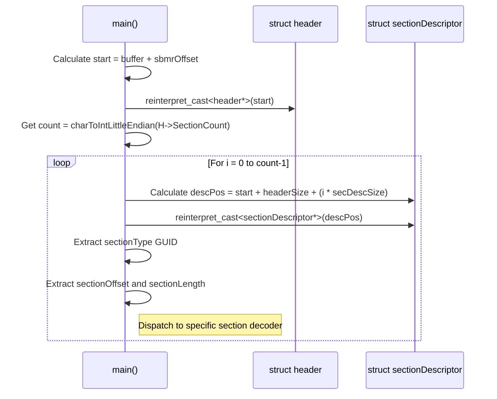

### Implementation Details
1.  **Pointer Arithmetic**: The parser uses the constant `headerSize` (128) to skip the header and reach the first descriptor [cper.h:30-30]().
2.  **Endianness**: Because CPER is a little-endian format, fields like `SectionCount`, `sectionOffset`, and `sectionLength` are processed using `charToIntLittleEndian` to ensure correct integer conversion on the host system [main.cpp:206-222]().
3.  **GUID Dispatch**: The `sectionType` field is converted to a string and compared against known GUIDs (e.g., `nvda`, `memErr`, `pciExpress`, `armProcErr`) to determine which payload structure to apply [cper.h:40-47]().

Sources: [main.cpp:206-222](), [cper.h:29-31](), [cper.h:40-47]()

---

# Page: Error Section Payloads

# Error Section Payloads

<details>
<summary>Relevant source files</summary>

The following files were used as context for generating this wiki page:

- [cper.h](cper.h)
- [main.cpp](main.cpp)

</details>


This page provides a detailed technical reference for the four concrete error-section structures defined in the `cper-decoder` project. These structures represent the actual error data payloads that follow the CPER Section Descriptors. The decoder uses the `sectionType` GUID from the descriptor to determine which structure to overlay onto the raw binary data.

## Overview of Payload Selection

The CPER format uses a GUID-based dispatch mechanism. When the parser iterates through section descriptors, it compares the `sectionType` field against a set of known GUIDs to select the appropriate CPER structure for decoding.

### Supported Section GUIDs

| Section Type | GUID String (Memory Order) | Code Identifier | Structure |
| :--- | :--- | :--- | :--- |
| **NVIDIA CPER** | `f244526d1227ec11bea7cb3fdb95c786` | `nvda` | `struct section` |
| **General Memory** | `1411bca5646fde4eb8633e83ed7c83b1` | `memErr` | `struct memErrorSection` |
| **PCI Express** | `54e995d9c1bb0f43ad91b44dcb3c6f35` | `pciExpress` | `struct pcieSection` |
| **ARM Processor** | `163d9ee111bce4119caac2051d5d46b0` | `armProcErr` | `struct armSection` |

**Sources:** [cper.h:40-47](), [main.cpp:520-560]()

## NVIDIA CPER Section

The NVIDIA-specific section is unique because it contains a fixed header followed by a dynamic number of register-data pairs.

### Structure: `struct section`
This structure defines the common fields for an NVIDIA error record.

| Field | Type | Description |
| :--- | :--- | :--- |
| `IPSignature` | `unsigned char[16]` | Identifies the hardware IP block reporting the error. |
| `ErrorType` | `unsigned char[2]` | Categorization of the specific error. |
| `ErrorInstance` | `unsigned char[2]` | Instance ID of the IP block. |
| `Severity` | `unsigned char[1]` | Error severity level. |
| `SocketNumber` | `unsigned char[1]` | Physical socket where the error occurred. |
| `RegDataPairs` | `unsigned char[1]` | **The number of register-value pairs following the header.** |
| `InstanceBase` | `unsigned char[8]` | Base address for the IP instance. |

**Sources:** [cper.h:93-103]()

### Dynamic Tail: `struct registers`
Immediately following `struct section`, the decoder reads `RegDataPairs` instances of the `registers` structure.

| Field | Type | Description |
| :--- | :--- | :--- |
| `address` | `unsigned char[8]` | The 64-bit register address. |
| `value` | `unsigned char[8]` | The 64-bit value contained in the register. |

**Sources:** [cper.h:107-111]()

### Data Flow: NVIDIA Section Parsing
The following diagram illustrates how the `main()` loop handles the dynamic tail of the NVIDIA section.

**NVIDIA Section Decoding Logic**
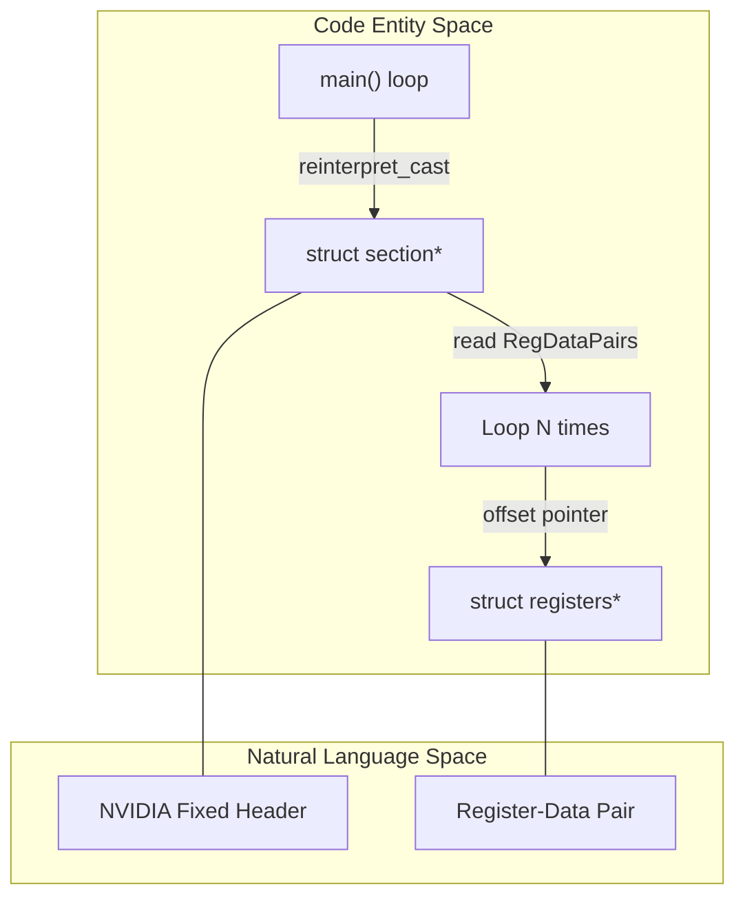
**Sources:** [main.cpp:520-552](), [cper.h:93-111]()

---

## General Memory Error Section

The `struct memErrorSection` follows the UEFI specification for platform memory errors. It uses a `validationBits` mask to indicate which subsequent fields contain valid data.

### Structure: `struct memErrorSection`

| Field | Type | Description |
| :--- | :--- | :--- |
| `validationBits` | `unsigned char[8]` | Bitmask indicating valid fields (Node, Card, Module, etc.). |
| `errorStatus` | `unsigned char[8]` | Error status bits (Type, Granularity, Operation). |
| `physicalAddress` | `unsigned char[8]` | The physical address where the error occurred. |
| `node` | `unsigned char[2]` | Identifies the memory node. |
| `card` | `unsigned char[2]` | Identifies the memory card. |
| `memErrType` | `unsigned char[1]` | Type of error (e.g., Single-bit ECC, Multi-bit ECC). |

**Sources:** [cper.h:115-138]()

---

## PCI Express Error Section

The `pcieSection` captures errors originating from PCIe devices, including AER (Advanced Error Reporting) information.

### Structure: `struct pcieSection`

| Field | Type | Description |
| :--- | :--- | :--- |
| `validationBits` | `unsigned char[8]` | Bitmask for valid fields. |
| `portType` | `unsigned char[4]` | Type of PCIe port (Root Port, Downstream, etc.). |
| `vendorID` / `deviceID` | `unsigned char[2]` | Standard PCI identification. |
| `capabilityStructure` | `unsigned char[60]` | The PCI Express Capability structure from configuration space. |
| `aerInfo` | `unsigned char[96]` | Advanced Error Reporting registers. |

**Sources:** [cper.h:142-166]()

---

## ARM Processor Error Section

The `armSection` describes errors related to ARM-based processors, including affinity levels and execution state.

### Structure: `struct armSection`

| Field | Type | Description |
| :--- | :--- | :--- |
| `validationBits` | `unsigned char[4]` | Bitmask for valid fields. |
| `MPIDR` | `unsigned char[8]` | Multiprocessor Affinity Register value. |
| `MIDR` | `unsigned char[8]` | Main ID Register value. |
| `runningState` | `unsigned char[4]` | Bit 0: Processor running; Bits 1-31: Reserved. |
| `psciState` | `unsigned char[4]` | Power State Coordination Interface state. |

**Sources:** [cper.h:170-182]()

---

## Implementation Mapping

The decoder maps these raw structures into JSON objects using specific decoding functions for bitmasks and enumerations.

**Entity Mapping: CPER Binary to JSON**
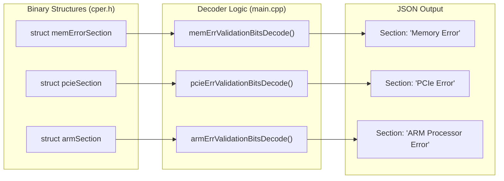

### Common Pattern: Validation Bits
Across all non-NVIDIA sections, the decoder checks a `validationBits` field before adding a key to the JSON output. For example, in `memErrorSection`, if bit 0 is not set, the `ErrorStatus` field is omitted from the final report.

**Sources:** [main.cpp:635-645](), [main.cpp:783-793](), [main.cpp:943-953]()

---

# Page: Decoder Implementation

# Decoder Implementation

<details>
<summary>Relevant source files</summary>

The following files were used as context for generating this wiki page:

- [cper.h](cper.h)
- [main.cpp](main.cpp)

</details>


The `cper-decoder` implementation centers around `main.cpp`, which orchestrates the transformation of binary Common Platform Error Record (CPER) data into a structured JSON document. The process involves sequential binary parsing, GUID-based dispatching to specialized section decoders, and data normalization using a suite of helper utilities.

### Parsing Pipeline Overview

The decoder follows a linear pipeline that begins with CLI interaction and ends with a serialized JSON file. The `main()` function serves as the entry point, utilizing `CLI11` for argument parsing and `nlohmann::json` for document construction [main.cpp:20-30]().

The following diagram illustrates the high-level flow from raw input to the final JSON output:

**CPER Processing Pipeline**
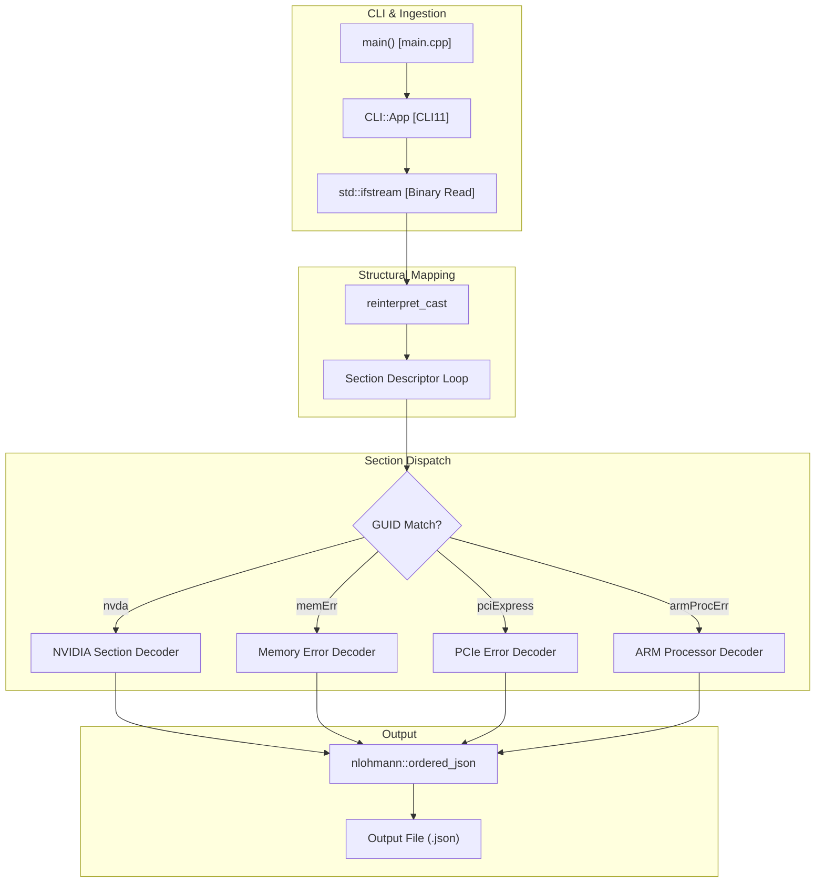
**Sources:** [main.cpp:18-37](), [cper.h:40-47]()

---

### Key Components

The implementation is divided into four primary functional areas, each detailed in its respective child page:

#### 1. Parsing Pipeline and main() Orchestration
The `main()` function manages the lifecycle of the decoding process. It handles the `sbmrOffset` (4-byte preamble) [cper.h:29]() before mapping the binary buffer to the `struct header` [cper.h:52-73](). It iterates through the number of sections defined in `header.SectionCount` [cper.h:60](), using `sectionDescriptor` offsets to locate payloads.
*   For details, see [Parsing Pipeline and main() Orchestration](#3.1).

#### 2. Helper Utilities and Data Conversion
Because CPER data is stored in a packed binary format, often in little-endian, `main.cpp` provides specialized conversion functions. These include `convertToHexLittleEndian` for ID fields [main.cpp:186-194](), `timestampDecode` for UEFI-formatted time [main.cpp:131-152](), and `guidDecode` for hyphenating 128-bit identifiers [main.cpp:233-261]().
*   For details, see [Helper Utilities and Data Conversion](#3.2).

#### 3. Section-Specific Decoders
The parser identifies sections by comparing the `sectionType` GUID in the `sectionDescriptor` [cper.h:85]() against known constants like `nvda` or `memErr` [cper.h:40-47](). Each section type has a dedicated logic block in `main()` that maps the raw bytes to specific structures (e.g., `struct memErrorSection` [cper.h:115-138]()) and decodes internal bitmasks.
*   For details, see [Section-Specific Decoders](#3.3).

#### 4. JSON Output Schema
The final output is an `nlohmann::ordered_json` object [main.cpp:30](). The schema mirrors the CPER hierarchy: a top-level `Header` object followed by a `Sections` array. Each entry in the array contains both the `SectionDescriptor` metadata and the decoded `Section` payload.
*   For details, see [JSON Output Schema](#3.4).

---

### Data Structures and Code Entities

The decoder relies on `#pragma pack(1)` structures defined in `cper.h` to ensure the memory layout exactly matches the UEFI specification.

**Entity Mapping: Binary to JSON**
| Code Entity (Binary Structure) | Role | JSON Target Key |
| :--- | :--- | :--- |
| `struct header` [cper.h:52]() | Record metadata (Timestamp, ID) | `"Header"` |
| `struct sectionDescriptor` [cper.h:77]() | Metadata for individual sections | `"SectionDescriptor"` |
| `struct section` [cper.h:93]() | NVIDIA-specific error data | `"Section"` |
| `struct registers` [cper.h:107]() | NVIDIA Register/Value pairs | `"Registers"` |
| `struct memErrorSection` [cper.h:115]() | DRAM/Memory error details | `"Section"` |

**Sources:** [cper.h:51-182](), [main.cpp:30-37]()

---

# Page: Parsing Pipeline and main() Orchestration

# Parsing Pipeline and main() Orchestration

<details>
<summary>Relevant source files</summary>

The following files were used as context for generating this wiki page:

- [main.cpp](main.cpp)
- [meson.build](meson.build)

</details>


This page provides a technical walkthrough of the `main()` function in the `cper-decoder` project. It describes the lifecycle of a CPER (Common Platform Error Record) binary as it is ingested, parsed, and transformed into a structured JSON document.

## Overview of the Orchestration Logic

The `cperparse` utility follows a linear pipeline: CLI argument processing, file ingestion, header validation, section iteration, and GUID-based dispatching to specific decoders. The final result is serialized using the `nlohmann::json` library.

### System Orchestration Flow
The following diagram illustrates the relationship between the high-level parsing phases and the specific code entities responsible for them.

**Diagram: CPER Parsing Pipeline**
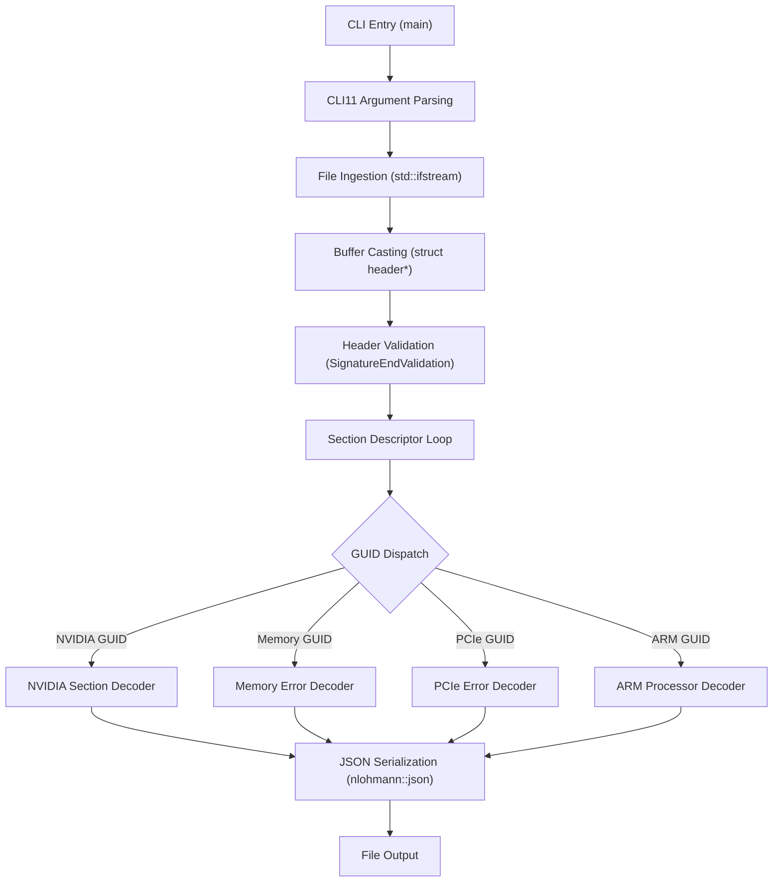
Sources: [main.cpp:52-62](), [main.cpp:278-290](), [main.cpp:322-333](), [main.cpp:430-460]()

---

## CLI Argument Parsing and Ingestion

The `main()` function utilizes the `CLI11` library to manage command-line interfaces. The parser defines mandatory and optional flags for the input binary and the output JSON destination.

- **Input File**: Handled via `app.add_option("-i,--input", ...)` [main.cpp:283-284]().
- **Output File**: Handled via `app.add_option("-o,--output", ...)` [main.cpp:286-287]().
- **Redfish Mode**: An optional flag `-r,--redfish` is available for Redfish-compliant formatting [main.cpp:289-290]().

Once arguments are parsed, the binary file is read into a `std::string` buffer using an `std::ifstream` with the `std::ios::binary` flag [main.cpp:302-309]().

Sources: [main.cpp:278-295](), [main.cpp:302-309]()

---

## Data Structure Mapping

The decoder relies on `reinterpret_cast` to map the raw buffer to C-style structures defined in `cper.h`.

1.  **Preamble Handling**: The parser checks for an optional `sbmrOffset` (typically 40 bytes) before the actual CPER header [main.cpp:314-315]().
2.  **Header Mapping**: The buffer at the calculated offset is cast to `struct header*` [main.cpp:322-323]().
3.  **Section Descriptors**: The location of the first section descriptor is calculated by adding the size of the header to the base pointer [main.cpp:425-426]().

**Diagram: Memory Layout Mapping**
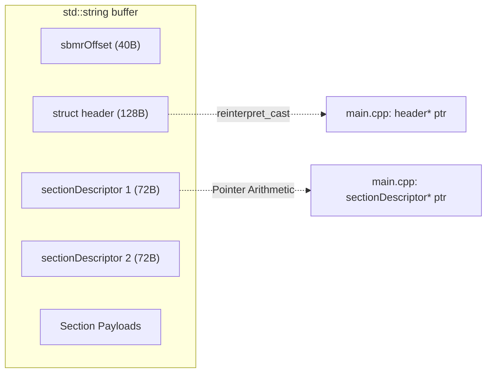
Sources: [main.cpp:322-323](), [main.cpp:425-428](), [cper.h:35-71]()

---

## The Parsing Loop and Dispatch

The core of the orchestration is a `for` loop that iterates based on the `SectionCount` field found in the CPER header [main.cpp:430-431]().

### GUID-Based Dispatching
For each section, the `SectionType` (a GUID) is extracted and decoded into a string format via `guidDecode` [main.cpp:441-443](). The parser then uses a series of `if-else` blocks to dispatch the raw payload to the appropriate decoder logic:

| GUID (Decoded) | Target Section Type | Implementation Reference |
| :--- | :--- | :--- |
| `5b01851b-17c3-424b-871c-439589f81647` | NVIDIA Error | [main.cpp:457-458]() |
| `a5bc1114-6f64-4dfb-8f11-9740c431000f` | Memory Error | [main.cpp:525-526]() |
| `d995e954-df1a-4303-9c2b-b305e946f93e` | PCIe Error | [main.cpp:588-589]() |
| `e19e3d16-bc1d-4c49-aa7c-871919901e57` | ARM Processor Error | [main.cpp:644-645]() |

Sources: [main.cpp:430-431](), [main.cpp:441-443](), [main.cpp:457-645]()

---

## PHASE1 Macro and Output Verbosity

The codebase contains a preprocessor definition `#define PHASE1` [main.cpp:31](). This macro significantly impacts the JSON output schema:

- **Enabled**: When `PHASE1` is defined, the header parsing logic omits several fields (such as `PartitionID` and `ResourceId`) to produce a more concise output [main.cpp:335-420]().
- **Disabled**: If undefined, the full suite of UEFI-defined header fields is serialized into the JSON `Header` object.

The current implementation has `PHASE1` hardcoded at the top of `main.cpp`.

Sources: [main.cpp:31](), [main.cpp:335-420]()

---

## Final Serialization

After all sections are processed, the `nlohmann::ordered_json` object `j` [main.cpp:37]() contains the full tree of decoded data. The orchestration concludes by:
1.  Opening the output file stream [main.cpp:712-713]().
2.  Serializing the JSON with an indentation of 4 spaces for readability [main.cpp:714]().
3.  Closing the stream [main.cpp:715]().

Sources: [main.cpp:37](), [main.cpp:712-715]()

---

# Page: Helper Utilities and Data Conversion

# Helper Utilities and Data Conversion

<details>
<summary>Relevant source files</summary>

The following files were used as context for generating this wiki page:

- [main.cpp](main.cpp)

</details>


This page provides a technical reference for the utility functions defined in `main.cpp`. These functions form the foundational layer of the `cper-decoder`, responsible for transforming raw binary data (typically `const unsigned char*`) into human-readable strings, integers, formatted GUIDs, and timestamps for the final JSON output.

## Overview of Data Transformation

The decoder operates by reading a binary blob into a buffer and then traversing it using specific CPER structures. Because the CPER format uses Little-Endian byte ordering for many fields and specific formatting for GUIDs and Timestamps, these helper utilities are required to ensure data integrity during the conversion from "Binary Space" to "JSON Space."

### Data Flow Diagram: Binary to JSON Conversion

This diagram illustrates how raw bytes from the CPER record are processed by specific utilities before being assigned to the `nlohmann::ordered_json` object `j`.

"Data Flow from Binary to Code Entities"
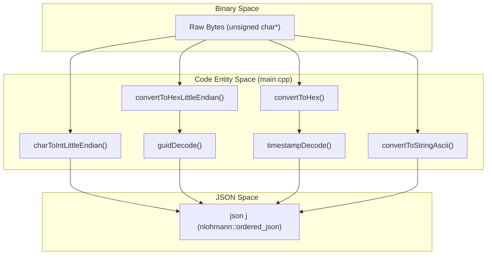
Sources: [main.cpp:30-37](), [main.cpp:39-252]()

---

## Integer and Hexadecimal Conversion

The following utilities handle basic numeric and string representations, with specific logic for endianness.

### Hexadecimal Utilities
*   **`convertToHex`**: Converts a byte array into a standard hexadecimal string by iterating forward through the buffer [main.cpp:164-172]().
*   **`convertToHexLittleEndian`**: Converts a byte array into a hexadecimal string by iterating **backwards** from `size - 1` to `0`. This effectively reverses the byte order to represent the value in a human-readable Big-Endian format from a Little-Endian source [main.cpp:186-194]().

### Integer Utilities
*   **`charToIntLittleEndian`**: Converts a byte array into a `long int`. It iterates backwards through the input, shifting the result left by 8 bits at each step to reconstruct the integer value from Little-Endian bytes [main.cpp:206-222]().
*   **`stringToInt`**: A basic utility that converts a numeric string into an integer by iterating through characters and multiplying the result by 10 [main.cpp:111-120]().

### Summary Table: Numeric Helpers

| Function | Input Type | Logic | Use Case |
| :--- | :--- | :--- | :--- |
| `convertToHex` | `const unsigned char*` | Forward iteration | General byte-to-hex conversion |
| `convertToHexLittleEndian` | `const unsigned char*` | Reverse iteration | Little-Endian fields (e.g., GUID segments) |
| `charToIntLittleEndian` | `const unsigned char*` | Bitwise shift (`<< 8`) | Converting raw bytes to numeric values |
| `stringToInt` | `const string&` | Character accumulation | String-to-numeric conversion |

Sources: [main.cpp:111-120](), [main.cpp:164-172](), [main.cpp:186-194](), [main.cpp:206-222]()

---

## Specialized CPER Formatters

CPER records contain specific data types like GUIDs and Timestamps that require complex reformatting to meet UEFI specifications.

### GUID Decoding (`guidDecode`)
The `guidDecode` function transforms a raw hexadecimal string into the standard hyphenated GUID format (e.g., `XXXXXXXX-XXXX-XXXX-XXXX-XXXXXXXXXXXX`). It performs specific index-based reordering to account for the Little-Endian storage of the first three components of a GUID [main.cpp:233-252]().

### Timestamp Decoding (`timestampDecode`)
The `timestampDecode` function parses the 8-byte CPER timestamp. It first converts the bytes to hex using `convertToHex` and then uses `substr` to extract time components. The current implementation produces a string in the format `MM-DD-YYYY HH:MM:SS` [main.cpp:131-152]().

"CPER Format to Code Logic Mapping"
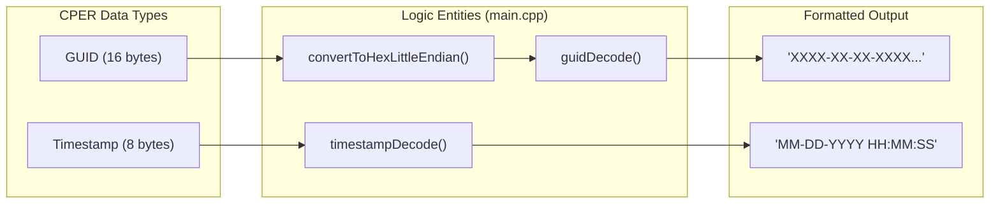
Sources: [main.cpp:131-152](), [main.cpp:233-252]()

---

## String and Validation Utilities

### ASCII and String Conversion
*   **`convertToString`**: A direct conversion from a character buffer to a `std::string` using a range constructor [main.cpp:74-78]().
*   **`convertToStringAscii`**: Similar to `convertToString`, but it checks for null terminators (`0x00`) and stops conversion at the first null byte encountered, ensuring clean string output for fixed-width character arrays [main.cpp:90-100]().

### Signature Validation
*   **`SignatureEndValidation`**: Validates the `SignatureEnd` field of the CPER Header. It checks if the 4-byte input matches the `signatureEndMarker` (defined as `0xFFFFFFFF` in `cper.h`). If any byte does not match, it returns `false` [main.cpp:52-62]().

### Address Representation
*   **`addressRepresentation`**: Takes a 64-bit address (as a `long int`) and converts it into a 16-character padded hexadecimal string prefixed with `0x`. This is used for memory and PCIe address fields [main.cpp:273-282]().

Sources: [main.cpp:52-62](), [main.cpp:74-78](), [main.cpp:90-100](), [main.cpp:273-282]()

---

# Page: Section-Specific Decoders

# Section-Specific Decoders

<details>
<summary>Relevant source files</summary>

The following files were used as context for generating this wiki page:

- [cper.h](cper.h)
- [main.cpp](main.cpp)

</details>


This page provides a technical deep dive into the four specialized decoder paths within `cper-decoder`. Each decoder is responsible for translating a specific GUID-identified CPER section payload into a structured JSON representation.

## Overview

The `main()` function iterates through section descriptors and dispatches the raw binary payload to specific logic based on the `sectionType` GUID [main.cpp:456-550](). The decoders utilize a common "Validation Bits" pattern to determine which fields in the fixed-size structures contain valid data.

### Section Dispatch Logic

The following diagram illustrates how the `main()` function maps CPER Section GUIDs to their respective decoding logic and C structures.

**CPER Section Dispatch Flow**
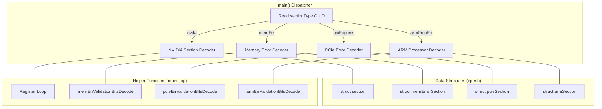
**Sources:** [main.cpp:456-550](), [cper.h:40-47](), [cper.h:93-182]()

---

## 1. NVIDIA Section Decoder

The NVIDIA-specific section is used for proprietary IP error reporting. It features a fixed header followed by a dynamic number of register-data pairs.

### Implementation Details
- **Fixed Fields:** Decodes `IPSignature` (GUID), `ErrorInstance`, `SocketNumber`, and `InstanceBase` [main.cpp:465-481]().
- **Dynamic Tail:** The field `RegDataPairs` [cper.h:100]() indicates how many `struct registers` follow the main `struct section`.
- **Register Loop:** The decoder calculates the remaining section length and iterates through `struct registers` (8-byte address, 8-byte value) until the end of the section [main.cpp:484-500]().

**Sources:** [main.cpp:456-503](), [cper.h:93-111]()

---

## 2. Memory Error Decoder

The Memory Error decoder handles standard UEFI General Memory Error sections.

### Validation and Status
- **Validation Bits:** `memErrValidationBitsDecode` [main.cpp:1158-1215]() parses the 64-bit mask to identify valid fields like `PhysicalAddress`, `Node`, `Card`, `Module`, etc.
- **Error Status:** `memErrErrorStatusTypeDecode` [main.cpp:1217-1249]() breaks down the `errorStatus` field into `ErrorType` (e.g., Multi-bit ECC, Parity) and bitmask flags like `AddressError` or `DataError`.

### Memory Type Mapping
The decoder uses a `std::map` to translate the `memErrType` byte into human-readable strings (e.g., `0x01` -> "DRAM", `0x02` -> "Storage Class Memory") [main.cpp:1251-1277]().

**Sources:** [main.cpp:505-519](), [main.cpp:1158-1277](), [cper.h:115-138]()

---

## 3. PCIe Error Decoder

The PCIe decoder processes errors related to PCI Express root ports, bridges, and endpoints.

### Field Decoding
- **Port Type:** `pcieErrPortTypeDecode` [main.cpp:1425-1447]() maps the `portType` field to strings such as "PCI Express End Point" or "Root Port".
- **Validation:** `pcieErrValidationBitsDecode` [main.cpp:1385-1423]() checks for the presence of Serial Numbers, Bridge Control registers, and Capability structures.
- **Hardware Info:** Captures `VendorID`, `DeviceID`, and `ClassCode` to identify the failing hardware [main.cpp:1493-1505]().

### Advanced Error Reporting (AER)
The decoder extracts the `capabilityStructure` and `aerInfo` blocks as raw hex strings if the corresponding validation bits are set [main.cpp:1533-1542]().

**Sources:** [main.cpp:521-534](), [main.cpp:1385-1544](), [cper.h:142-166]()

---

## 4. ARM Processor Decoder

The ARM Processor decoder handles errors specific to ARMv8 and later architectures.

### Key Architectural Fields
- **MPIDR & MIDR:** Decodes the Multiprocessor Affinity Register and Main ID Register [main.cpp:1645-1648]().
- **Running State:** A bitmask indicating if the processor was in a specific EL (Exception Level) or if the state is unreliable [main.cpp:1652-1662]().
- **PSCI State:** Decodes the Power State Coordination Interface state [main.cpp:1664-1667]().

### Logic Mapping
The following diagram maps the ARM-specific code entities to the system concepts they represent.

**ARM Decoder Entity Mapping**
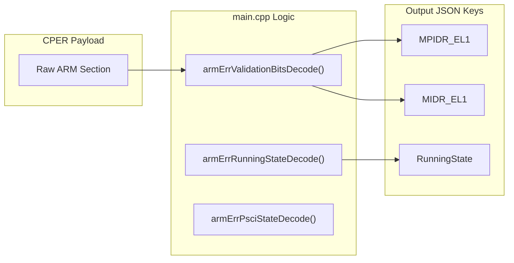
**Sources:** [main.cpp:536-549](), [main.cpp:1546-1668](), [cper.h:170-182]()

---

## Common Validation Pattern

All section decoders follow a strict validation pattern to ensure only populated data is exported to JSON.

1. **Reinterpret Cast:** The raw buffer is cast to the section-specific struct (e.g., `struct memErrorSection*`) [main.cpp:507]().
2. **Validation Bit Check:** A dedicated function (e.g., `memErrValidationBitsDecode`) iterates through the `validationBits` field [main.cpp:1158]().
3. **Conditional JSON Assignment:** Fields are only added to the `nlohmann::ordered_json` object if their corresponding bit is high [main.cpp:1286-1380]().

| Section Type | Validation Function | Bitmask Size |
| :--- | :--- | :--- |
| NVIDIA | N/A (Fixed + Loop) | N/A |
| Memory | `memErrValidationBitsDecode` | 64-bit |
| PCIe | `pcieErrValidationBitsDecode` | 64-bit |
| ARM | `armErrValidationBitsDecode` | 32-bit |

**Sources:** [main.cpp:1158](), [main.cpp:1385](), [main.cpp:1546]()

---

# Page: JSON Output Schema

# JSON Output Schema

<details>
<summary>Relevant source files</summary>

The following files were used as context for generating this wiki page:

- [main.cpp](main.cpp)
- [subprojects/nlohmann_json.wrap](subprojects/nlohmann_json.wrap)

</details>


The `cperparse` utility transforms binary Common Platform Error Record (CPER) data into a structured JSON document. This allows for programmatic analysis of hardware errors and integration with Redfish-compliant monitoring systems. The implementation relies on the `nlohmann::ordered_json` library to maintain field order during serialization [main.cpp:30]().

## Output Structure Overview

The generated JSON document consists of two primary top-level keys: `Header` and `Sections`.

| Key | Type | Description |
| :--- | :--- | :--- |
| `Header` | Object | Contains metadata from the CPER Record Header (e.g., Record ID, Timestamp). |
| `Sections` | Array | A collection of objects, each representing a single CPER section (e.g., NVIDIA, Memory, PCIe, ARM). |

Sources: [main.cpp:37](), [main.cpp:737-738]()

### JSON Generation Data Flow

The following diagram illustrates how binary structures from `cper.h` are mapped to JSON keys in `main.cpp`.

**CPER to JSON Mapping Flow**
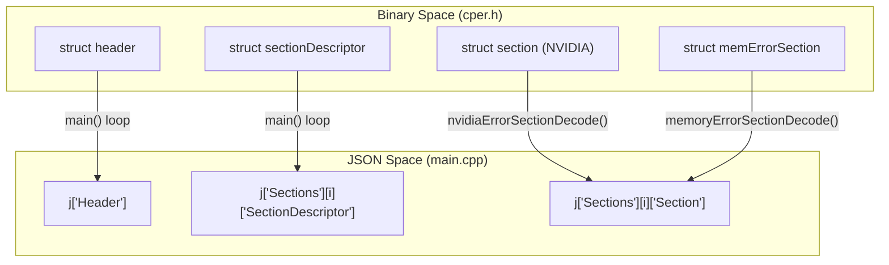
Sources: [main.cpp:737-830](), [main.cpp:520-563](), [main.cpp:565-645]()

---

## Top-Level Keys

### Header
The `Header` object captures the global state of the error record. In the current implementation, if the `PHASE1` macro is defined, several fields (like `SignatureStart` and `SignatureEnd`) are omitted to streamline the output for specific hardware monitoring requirements [main.cpp:31](), [main.cpp:743-762]().

**Annotated Header Snippet:**
```json
"Header": {
    "RecordID": "0000000000000001",
    "Timestamp": "Format: MM-DD-YYYY HH:MM:SS 05-22-2023 14:30:01",
    "PlatformID": "504c4154-464f-524d-4944-000000000000",
    "SectionCount": 1,
    "RecordSeverity": "Recoverable"
}
```
*   **RecordID**: 64-bit hex string converted via `convertToHexLittleEndian` [main.cpp:751]().
*   **Timestamp**: Decoded into a human-readable format by `timestampDecode` [main.cpp:131-152]().
*   **PlatformID**: 128-bit GUID string formatted by `guidDecode` [main.cpp:233-258]().

### Sections Array
Each entry in the `Sections` array represents a discrete error event. Every entry contains a `SectionDescriptor` (metadata about the section) and a `Section` (the actual error payload).

**Section Structure:**
```json
{
    "SectionDescriptor": {
        "SectionOffset": 128,
        "SectionLength": 72,
        "SectionType": "e4214e45-6622-4214-932c-39827c61079c",
        "SectionSeverity": "Fatal"
    },
    "Section": { ... payload ... }
}
```
Sources: [main.cpp:783-800]()

---

## Section Payload Schemas

The content of the `Section` key varies based on the `SectionType` GUID.

### 1. NVIDIA Error Section
Produced by `nvidiaErrorSectionDecode` [main.cpp:520](). This section includes hardware-specific identifiers and a dynamic list of register-value pairs.

| Key | Description |
| :--- | :--- |
| `IPSignature` | 32-bit hex signature of the IP block [main.cpp:527](). |
| `InstanceBase` | 64-bit base address for the instance [main.cpp:531](). |
| `Registers` | An object where keys are hex addresses and values are hex register data [main.cpp:552-560](). |

**Example:**
```json
"Section": {
    "IPSignature": "abcd1234",
    "ErrorInstance": 0,
    "SocketNumber": 1,
    "InstanceBase": "00000000fee00000",
    "Registers": {
        "00000000fee00010": "00000000deadbeef",
        "00000000fee00018": "00000000cafebabe"
    }
}
```

### 2. Memory Error Section
Produced by `memoryErrorSectionDecode` [main.cpp:565](). It translates bitmask fields into descriptive JSON keys.

*   **ValidationBits**: Indicates which fields in the section are valid [main.cpp:573]().
*   **ErrorStatus**: Decoded via `memErrErrorStatusTypeDecode` into sub-fields like `ErrorType`, `AddressSignal`, and `DataSignal` [main.cpp:613-630]().

**Example:**
```json
"Section": {
    "ValidationBits": "0000000000000007",
    "ErrorStatus": {
        "ErrorType": "Internal",
        "AddressSignal": "1",
        "DataSignal": "0"
    },
    "PhysicalAddress": "0000000123456000",
    "MemoryErrorType": "Multi-bit ECC"
}
```

### 3. PCIe Error Section
Produced by `pcieErrorSectionDecode` [main.cpp:647](). This section maps the `pcieSection` struct [cper.h:182-203]().

*   **PortType**: Decoded from a numeric value to a string (e.g., "Root Port", "Upstream Switch Port") [main.cpp:661]().
*   **DeviceID**: Contains `VendorID`, `DeviceID`, `ClassCode`, and `FunctionNumber` [main.cpp:672-680]().

### 4. ARM Processor Error Section
Produced by `armErrorSectionDecode` [main.cpp:702]().

*   **MPIDR**: Multiprocessor Affinity Register value [main.cpp:714]().
*   **RunningState**: Boolean string indicating if the processor was running [main.cpp:717]().
*   **PSCIState**: Power State Coordination Interface state [main.cpp:719]().

---

## Implementation Details

The `main()` function orchestrates the JSON construction by iterating through section descriptors and appending to the global `nlohmann::json j` object.

**System Orchestration Diagram**
```mermaid
sequenceDiagram
    participant M as main()
    participant H as Header Logic
    participant D as Descriptor Loop
    participant S as Section Decoders
    participant J as nlohmann::json

    M->>H: Parse struct header*
    H->>J: j["Header"] = ...
    M->>D: Iterate SectionCount
    D->>S: Dispatch by SectionType GUID
    S->>J: j["Sections"].push_back(...)
    M->>M: Serialize j.dump(4) to file
```

Sources: [main.cpp:737-832](), [main.cpp:846-850]()

---

# Page: Build System and Tooling

# Build System and Tooling

<details>
<summary>Relevant source files</summary>

The following files were used as context for generating this wiki page:

- [.clang-format](.clang-format)
- [.gitignore](.gitignore)
- [meson.build](meson.build)

</details>


This section provides a high-level overview of the `cper-decoder` build infrastructure and the developer tooling used to maintain code quality. The project utilizes the Meson build system to manage C++ compilation and external dependencies, while employing a suite of linters and formatters to ensure consistency across the codebase.

## Build System Overview

The `cper-decoder` project is managed via the **Meson Build System**, which generates instructions for the **Ninja** backend. The configuration is centralized in the `meson.build` file at the project root.

### Core Configuration
The build is defined as a C++ project named `cper-proj` [meson.build:1](). It is configured by default to build libraries as static [meson.build:1](), ensuring that the resulting `cperparse` executable is portable and contains its necessary logic within the binary.

### Build Artifacts and Directories
When building the project, several directories and files are generated that are excluded from version control to keep the repository clean:
*   **`build/`**: The recommended directory for all compilation artifacts [.gitignore:30]().
*   **`subprojects/`**: Contains the Meson wrap files and downloaded source code for external dependencies [.gitignore:7-8]().
*   **`meson-logs/` & `meson-private/`**: Internal Meson metadata [.gitignore:11-12]().
*   **`build.ninja`**: The generated build manifest used by the Ninja executor [.gitignore:21]().

### Dependency Resolution
The project relies on two primary external libraries:
1.  **nlohmann_json**: Used for JSON construction and serialization [meson.build:2]().
2.  **CLI11**: Used for command-line argument parsing [meson.build:3]().

The following diagram illustrates the relationship between the build configuration and the resulting executable:

**Build System Entity Map**
```mermaid
graph TD
    subgraph "Build Configuration"
        A["meson.build"] -- "defines" --> B["project('cper-proj')"]
        A -- "fetches" --> C["nlohmann_json_dep"]
        A -- "fetches" --> D["CLI11_dep"]
    end

    subgraph "Source Space"
        E["main.cpp"]
    end

    subgraph "Output Space"
        B & E & C & D -- "ninja" --> F["executable('cperparse')"]
    end
```

For details on dependency versions and the wrap system, see [Meson Build Configuration and Dependencies](#4.1).

**Sources:**
* [meson.build:1-5]()
* [.gitignore:1-30]()

---

## Tooling and Code Quality

To maintain a consistent style and prevent common errors, the project includes configurations for various linters and formatters.

### C++ Formatting
The C++ source code is governed by a `.clang-format` configuration based on the **LLVM** style [.clang-format:2-3](). Key constraints include:
*   **Indentation**: 4-space indents without tabs [.clang-format:86, 132-133]().
*   **Column Limit**: 80 characters per line [.clang-format:52]().
*   **Brace Wrapping**: Custom wrapping rules for classes, functions, and control statements [.clang-format:26-47]().

### Multi-Language Linter Suppression
While the core logic is C++, the repository contains various ignore files to prevent external linters (like those used in CI environments) from flagging non-C++ files or temporary scripts. These include:
*   `.black-ignore`, `.flake8-ignore`, and `.isort-ignore` for Python.
*   `.eslintignore` and `.prettierignore` for web/data formats.
*   `.markdownlint-ignore` and `.shellcheck-ignore` for documentation and scripts.

**Tooling Integration Map**
```mermaid
graph LR
    subgraph "Code Style Enforcement"
        CF[".clang-format"] -- "Configures" --> Clang["clang-format"]
        Clang -- "Formats" --> CPP["main.cpp"]
    end

    subgraph "Linter Suppression"
        GI[".gitignore"] -- "Hides" --> BU["build/"]
        LI["Linter Ignore Files"] -- "Suppresses" --> EXT["Non-C++ Tooling"]
    end
```

For details on specific formatting rules and the full list of ignored tools, see [Code Style and Linter Configuration](#4.2).

**Sources:**
* [.clang-format:1-135]()
* [Project Structure Description (from TOC reference)]()

---

## Child Pages
*   [Meson Build Configuration and Dependencies](#4.1)
*   [Code Style and Linter Configuration](#4.2)

---

# Page: Meson Build Configuration and Dependencies

# Meson Build Configuration and Dependencies

<details>
<summary>Relevant source files</summary>

The following files were used as context for generating this wiki page:

- [.gitignore](.gitignore)
- [meson.build](meson.build)
- [subprojects/CLI11.wrap](subprojects/CLI11.wrap)
- [subprojects/nlohmann_json.wrap](subprojects/nlohmann_json.wrap)

</details>


This page details the build system configuration for the `cper-decoder` project. The project utilizes the Meson Build system to manage C++ compilation, dependency resolution, and executable generation.

## Project Definition and Build Options

The project is defined in the root `meson.build` file as `cper-proj` [meson.build:1-1](). It is configured to use the C++ toolchain and defaults to building libraries as static entities via the `default_library=static` option [meson.build:1-1]().

### Build Target: cperparse
The primary output of the build system is the `cperparse` executable. This target is compiled from the `main.cpp` source file and links against two primary external dependencies: `nlohmann_json` and `CLI11` [meson.build:4-4]().

**Target Relationship Diagram**
```mermaid
graph TD
    subgraph "Build System (meson.build)"
        Project["project('cper-proj')"]
        Exec["executable('cperparse')"]
    end

    subgraph "Source Files"
        Main["main.cpp"]
    end

    subgraph "Dependencies"
        JSON["nlohmann_json_dep"]
        CLI["CLI11_dep"]
    end

    Project --> Exec
    Main --> Exec
    JSON --> Exec
    CLI --> Exec
```
**Sources:** [meson.build:1-4]()

---

## Dependency Management

The `cper-decoder` relies on two external libraries to handle JSON serialization and Command Line Interface (CLI) parsing. Meson manages these through the `dependency()` function, which first attempts to find the libraries on the system and falls back to the Meson Wrap system if they are missing.

### 1. nlohmann_json
This header-only library is used for generating the JSON output of the CPER decoder.
*   **Version Requirement:** Must be at least `3.11.2` [meson.build:2-2]().
*   **Include Type:** Forced to `system` to suppress warnings from the external headers [meson.build:2-2]().
*   **Provision:** If not found on the host, it is fetched via `subprojects/nlohmann_json.wrap` [subprojects/nlohmann_json.wrap:1-10]().

### 2. CLI11
This library is used for parsing command-line arguments (such as `--redfish` or `--json`).
*   **Provision:** Managed via `subprojects/CLI11.wrap` [subprojects/CLI11.wrap:1-6]().
*   **Mapping:** The build system maps the internal dependency name `CLI11_dep` to the external `CLI11` provider [subprojects/CLI11.wrap:6-6]().

**Dependency Resolution Logic**
```mermaid
flowchart TD
    Start["meson setup build"] --> CheckJSON["Check System for nlohmann_json >= 3.11.2"]
    CheckJSON -- "Not Found" --> WrapJSON["Read subprojects/nlohmann_json.wrap"]
    WrapJSON --> DownloadJSON["Download include.zip from GitHub"]
    DownloadJSON --> VerifyJSON["Verify SHA-256: e5c7a9f4..."]
    
    CheckJSON -- "Found" --> CheckCLI["Check System for CLI11"]
    VerifyJSON --> CheckCLI
    
    CheckCLI -- "Not Found" --> WrapCLI["Read subprojects/CLI11.wrap"]
    WrapCLI --> GitCLI["Clone CLIUtils/CLI11 (HEAD)"]
    
    CheckCLI -- "Found" --> Compile["Generate build.ninja"]
    GitCLI --> Compile
```
**Sources:** [meson.build:2-3](), [subprojects/nlohmann_json.wrap:1-10](), [subprojects/CLI11.wrap:1-6]()

---

## Meson Wrap Lifecycle

The project uses `.wrap` files in the `subprojects/` directory to ensure reproducible builds across different environments. Meson handles the lifecycle of these dependencies automatically during the setup phase.

### Wrap File Specifications

| Feature | nlohmann_json | CLI11 |
| :--- | :--- | :--- |
| **Method** | `wrap-file` (HTTP Archive) | `wrap-git` (Git Clone) |
| **Source URL** | `https://github.com/nlohmann/json/releases/download/v3.11.2/include.zip` | `https://github.com/CLIUtils/CLI11` |
| **Verification** | SHA-256 Hash [subprojects/nlohmann_json.wrap:6-6]() | Revision (HEAD) [subprojects/CLI11.wrap:3-3]() |
| **Dependency Name** | `nlohmann_json_dep` [subprojects/nlohmann_json.wrap:10-10]() | `CLI11_dep` [subprojects/CLI11.wrap:6-6]() |

### File System Impacts
When dependencies are fetched, they are stored in the `subprojects/` directory. The `.gitignore` file is configured to ignore the downloaded source code while preserving the `.wrap` definition files:
*   **Ignored:** `/subprojects/*` [/.gitignore:7-7]()
*   **Preserved:** `!/subprojects/*.wrap` [/.gitignore:8-8]()

**Sources:** [subprojects/nlohmann_json.wrap:1-10](), [subprojects/CLI11.wrap:1-6](), [/.gitignore:7-8]()

---

## Build Artifacts and Cleaning

The build process generates several metadata files and directories that are excluded from version control:
*   **`build/`**: The standard directory for compilation artifacts [/.gitignore:30-30]().
*   **`meson-logs/` & `meson-private/`**: Internal Meson state and log files [/.gitignore:11-12]().
*   **`build.ninja`**: The backend build instructions generated by Meson for the Ninja build tool [/.gitignore:21-21]().
*   **`compile_commands.json`**: A compilation database used by Language Servers (LSP) for code intelligence [/.gitignore:26-26]().

**Sources:** [/.gitignore:10-30]()

---

# Page: Code Style and Linter Configuration

# Code Style and Linter Configuration

<details>
<summary>Relevant source files</summary>

The following files were used as context for generating this wiki page:

- [.beautysh-ignore](.beautysh-ignore)
- [.black-ignore](.black-ignore)
- [.clang-format](.clang-format)
- [.eslintignore](.eslintignore)
- [.flake8-ignore](.flake8-ignore)
- [.isort-ignore](.isort-ignore)
- [.markdownlint-ignore](.markdownlint-ignore)
- [.prettierignore](.prettierignore)
- [.shellcheck-ignore](.shellcheck-ignore)

</details>


This page documents the formatting standards and linter configurations used in the `cper-decoder` project. The project enforces a strict C++ style via Clang-Format and utilizes a series of global ignore files to suppress non-C++ linters, ensuring that the development environment remains focused on the primary C++ codebase.

## C++ Formatting Standards

The C++ code style is defined in the `.clang-format` file and is based on the **LLVM** style with several project-specific overrides.

### Core Layout Rules
The project enforces a standard 4-space indentation and an 80-column line limit to ensure readability across different terminal sizes and editors.

| Property | Setting | Configuration Key |
| :--- | :--- | :--- |
| **Indentation Width** | 4 spaces | `IndentWidth: 4` |
| **Tab Usage** | Never (Spaces only) | `UseTab: Never` |
| **Column Limit** | 80 characters | `ColumnLimit: 80` |
| **Pointer Alignment** | Left (e.g., `void* ptr`) | `PointerAlignment: Left` |
| **Standard** | Latest (C++20/C++23) | `Standard: Latest` |

**Sources:** [ .clang-format:3-133 ]()

### Brace Wrapping and Control Statements
The project uses a **Custom** brace breaking strategy. Braces are generally wrapped onto new lines after most constructs (classes, functions, structs, namespaces) to provide clear visual separation between headers and bodies.

*   **Brace Wrapping Details:** Braces are wrapped after `class`, `struct`, `enum`, `function`, and `namespace` [ .clang-format:28-36 ]().
*   **Control Statements:** Braces wrap after control statements like `if` or `for` [ .clang-format:29 ](). However, short if-statements are never allowed on a single line [ .clang-format:17 ]().
*   **Empty Functions:** The formatter does not split empty functions, namespaces, or records into multiple lines [ .clang-format:42-44 ]().

**Sources:** [ .clang-format:26-47 ]()

### Include Management
The configuration automates the sorting and grouping of `#include` directives to maintain a consistent order. Includes are categorized by priority:

1.  **Priority -1:** `config.h` (always first) [ .clang-format:69-70 ]().
2.  **Priority 1-2:** Local headers (`.h`, `.hpp`) [ .clang-format:71-74 ]().
3.  **Priority 3-5:** System headers and standard libraries [ .clang-format:75-80 ]().
4.  **Priority 7:** Test frameworks (GTest/GMock) [ .clang-format:67-68 ]().

**Sources:** [ .clang-format:65-82 ](), [ .clang-format:114 ]()

## Linter Suppression Strategy

Because `cper-decoder` is a specialized C++ tool, it includes several configuration files that globally ignore other languages and file types. This prevents generic CI/CD linters or local IDE plugins from flagging non-issues in auxiliary files.

### Global Ignore Implementation
The project uses a "wildcard suppress" strategy. Most linter-ignore files contain a single `*` character, effectively telling the respective linter to ignore all files in the repository.

#### System Architecture: Linter Suppression
The following diagram illustrates how the ignore files act as a shield between the codebase and various language-specific formatting engines.

**Linter Suppression Mapping**
```mermaid
graph TD
    subgraph "Project Root"
        [".clang-format"]
    end

    subgraph "Suppression Files"
        B_IGN[".black-ignore"]
        I_IGN[".isort-ignore"]
        F_IGN[".flake8-ignore"]
        E_IGN[".eslintignore"]
        M_IGN[".markdownlint-ignore"]
        P_IGN[".prettierignore"]
        S_IGN[".shellcheck-ignore"]
        BE_IGN[".beautysh-ignore"]
    end

    subgraph "Formatting Engines"
        PY_F["Python Formatters (Black, Isort, Flake8)"]
        JS_F["JS Formatters (ESLint, Prettier)"]
        DOC_F["Documentation (Markdownlint)"]
        SH_F["Shell Formatters (ShellCheck, Beautysh)"]
    end

    B_IGN -.->|"Suppress All (*)"| PY_F
    I_IGN -.->|"Suppress All (*)"| PY_F
    F_IGN -.->|"Suppress All (*)"| PY_F
    E_IGN -.->|"Suppress All (*)"| JS_F
    P_IGN -.->|"Suppress All (*)"| JS_F
    M_IGN -.->|"Suppress All (*)"| DOC_F
    S_IGN -.->|"Suppress All (*)"| SH_F
    BE_IGN -.->|"Suppress All (*)"| SH_F

    [".clang-format"] ==>|"Applies To"| CPP_CODE["C++ Source (.cpp, .h)"]
```
**Sources:** [ .black-ignore:1 ](), [ .isort-ignore:1 ](), [ .flake8-ignore:1 ](), [ .eslintignore:1 ](), [ .markdownlint-ignore:1 ](), [ .prettierignore:1 ](), [ .shellcheck-ignore:1 ](), [ .beautysh-ignore:1 ]()

### Suppressed Tooling List
The following table lists the specific tools that are explicitly disabled for this project:

| Ignore File | Target Tool / Language | Content |
| :--- | :--- | :--- |
| `.black-ignore` | Python (Black Formatter) | `*` |
| `.isort-ignore` | Python (Import Sorting) | `*` |
| `.flake8-ignore` | Python (Flake8 Linting) | `*` |
| `.eslintignore` | JavaScript (ESLint) | `*` |
| `.prettierignore` | Multi-language (Prettier) | `*` |
| `.markdownlint-ignore` | Markdown (Markdownlint) | `*` |
| `.shellcheck-ignore` | Shell Scripts (ShellCheck) | `*` |
| `.beautysh-ignore` | Shell Scripts (Beautysh) | `*` |

**Sources:** [ .black-ignore:1 ](), [ .isort-ignore:1 ](), [ .flake8-ignore:1 ](), [ .eslintignore:1 ](), [ .markdownlint-ignore:1 ](), [ .prettierignore:1 ](), [ .shellcheck-ignore:1 ](), [ .beautysh-ignore:1 ]()

## Data Flow: Code Formatting

When a developer runs a formatter or a CI pipeline triggers, the following logic is applied to determine the final file state.

**Formatting Decision Logic**
```mermaid
flowchart TD
    START["File Change Detected"] --> EXT{"File Extension?"}
    
    EXT -- ".cpp / .h" --> CF_CHECK{"Check .clang-format"}
    CF_CHECK --> CF_APPLY["Apply LLVM-based 4-space indent"]
    CF_APPLY --> END["Formatted Code"]
    
    EXT -- ".py" --> PY_CHECK{"Check .black-ignore / .isort-ignore"}
    PY_CHECK -- "Matches '*'" --> IGNORE["Skip Formatting/Linting"]
    
    EXT -- ".js / .md / .sh" --> OTH_CHECK{"Check .eslintignore / .markdownlint-ignore / etc."}
    OTH_CHECK -- "Matches '*'" --> IGNORE
    
    IGNORE --> END
```

**Sources:** [ .clang-format:2-133 ](), [ .black-ignore:1 ](), [ .eslintignore:1 ](), [ .shellcheck-ignore:1 ]()

---

# Page: Glossary

# Glossary

<details>
<summary>Relevant source files</summary>

The following files were used as context for generating this wiki page:

- [.clang-format](.clang-format)
- [cper.h](cper.h)
- [main.cpp](main.cpp)
- [meson.build](meson.build)
- [subprojects/CLI11.wrap](subprojects/CLI11.wrap)
- [subprojects/nlohmann_json.wrap](subprojects/nlohmann_json.wrap)

</details>


This glossary defines technical terms, acronyms, and domain-specific concepts used within the `cper-decoder` codebase. It serves as a reference for onboarding engineers to understand the relationship between the UEFI CPER specification and the C++ implementation.

## Core CPER Domain Terms

| Term | Definition | Implementation Reference |
| :--- | :--- | :--- |
| **CPER** | Common Platform Error Record. A standard binary format defined by UEFI for reporting hardware errors. | [cper.h:52-73]() |
| **Section Descriptor** | A fixed-size structure following the header that describes the type, offset, and length of an error payload. | [cper.h:77-89]() |
| **GUID** | Globally Unique Identifier. Used in CPER to identify the specific type of error section (e.g., NVIDIA, ARM, PCIe). | [cper.h:40-47]() |
| **SBMR Offset** | A 4-byte preamble sometimes present before the CPER header in certain system implementations. | [cper.h:29-29]() |
| **Validation Bits** | A bitmask field present in most CPER structures indicating which subsequent fields contain valid data. | [cper.h:62-62](), [cper.h:117-117]() |

**Sources:** [cper.h:29-89](), [cper.h:117-117]()

---

## Codebase Entities and Data Structures

### Binary Representation Mapping
The decoder uses C-style structs with `#pragma pack(1)` to map directly onto the binary CPER blob.

**Natural Language to Code Entity Mapping (Data Structures)**
```mermaid
graph TD
    subgraph "CPER Binary Layout"
        A["Record Header"] --> B["Section Descriptor 1"]
        B --> C["Section Descriptor N"]
        C --> D["Error Payloads"]
    end

    subgraph "Code Entity Space (cper.h)"
        A -.-> struct_header["struct header"]
        B -.-> struct_sd["struct sectionDescriptor"]
        D -.-> struct_nv["struct section (NVIDIA)"]
        D -.-> struct_mem["struct memErrorSection"]
        D -.-> struct_pcie["struct pcieSection"]
        D -.-> struct_arm["struct armSection"]
    end

    style struct_header stroke-dasharray: 5 5
    style struct_sd stroke-dasharray: 5 5
```
**Sources:** [cper.h:52-182]()

### NVIDIA Specific Terms
*   **IPSignature**: A 16-byte identifier for the NVIDIA IP block reporting the error [cper.h:95-95]().
*   **RegDataPairs**: A count of register/value pairs following the fixed NVIDIA section header [cper.h:100-100]().
*   **InstanceBase**: The base address of the hardware instance reporting the error [cper.h:102-102]().

**Sources:** [cper.h:93-103]()

---

## Processing and Transformation Logic

The decoder follows a linear pipeline: reading the file, iterating through descriptors, and dispatching to specific decoding logic based on GUIDs.

**Natural Language to Code Entity Mapping (Functions)**
```mermaid
graph LR
    subgraph "Input Processing"
        "CLI Input" --> main["main()"]
        main --> open["std::ifstream"]
    end

    subgraph "Data Conversion Logic"
        "Raw Bytes" --> hex["convertToHex()"]
        "Little Endian Bytes" --> le_int["charToIntLittleEndian()"]
        "GUID Bytes" --> g_dec["guidDecode()"]
    end

    subgraph "Section Dispatch"
        main -->|GUID Match| NV["NVIDIA Decoder Path"]
        main -->|GUID Match| MEM["Memory Decoder Path"]
    end

    hex -.-> [main.cpp:164-172]()
    le_int -.-> [main.cpp:206-222]()
    g_dec -.-> [main.cpp:233-252]()
```
**Sources:** [main.cpp:164-252]()

### Helper Functions Glossary

*   **`SignatureEndValidation`**: Checks if the `SignatureEnd` field in the header matches the `signatureEndMarker` (0xFFFFFFFF) [main.cpp:52-62]().
*   **`convertToHex`**: Converts a byte array into a standard hex string [main.cpp:164-172]().
*   **`convertToHexLittleEndian`**: Converts a byte array into a hex string, reversing the byte order for correct human-readable representation of little-endian values [main.cpp:186-194]().
*   **`charToIntLittleEndian`**: Converts a little-endian byte array into a `long int` [main.cpp:206-222]().
*   **`timestampDecode`**: Parses the 8-byte CPER timestamp into a formatted string (MM-DD-YYYY HH:MM:SS) [main.cpp:131-152]().
*   **`guidDecode`**: Reformats a 16-byte GUID string into the standard `8-4-4-4-12` hyphenated representation [main.cpp:233-252]().

**Sources:** [main.cpp:52-252]()

---

## Build and Dependency Concepts

*   **Meson**: The build system generator used to compile the project [meson.build:1-1]().
*   **Wrap File**: A Meson mechanism (`.wrap`) used to manage external dependencies like `nlohmann_json` and `CLI11` by downloading and verifying source archives [subprojects/nlohmann_json.wrap:1-7]().
*   **PHASE1**: A preprocessor macro used to toggle specific output behaviors in the JSON generation [main.cpp:31-31]().
*   **nlohmann/json**: The C++ library used for constructing and serializing the `ordered_json` output [main.cpp:30-30]().

**Sources:** [meson.build:1-4](), [subprojects/nlohmann_json.wrap:1-7](), [main.cpp:30-31]()