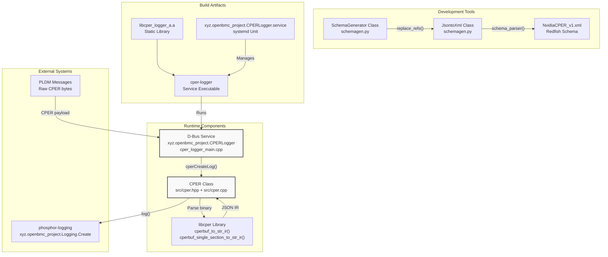

<!-- source: DeepWiki mcp.deepwiki.com · repo NVIDIA/cper-logger · page 1 Overview · fetched 2026-10-26 -->

# Overview

<details>
<summary>Relevant source files</summary>

The following files were used as context for generating this wiki page:

- [meson.build](meson.build)
- [schema-gen/NvidiaCPER_v1.xml](schema-gen/NvidiaCPER_v1.xml)
- [schema-gen/schemagen.py](schema-gen/schemagen.py)
- [src/cper.cpp](src/cper.cpp)
- [src/cper_logger_main.cpp](src/cper_logger_main.cpp)

</details>


## Purpose and Scope

The `cper-logger` repository implements a D-Bus service for OpenBMC that processes and logs Common Platform Error Records (CPER). CPER is a standardized error reporting format defined in the UEFI specification for platform hardware errors. This service receives raw CPER data (typically from PLDM messages), parses it using the `libcper` library, and forwards structured error information to the phosphor-logging subsystem for storage and retrieval.

This document provides a high-level overview of the system architecture and components. For detailed information about specific subsystems, see:
- CPER processing internals: [CPER Processing Library](#2.1)
- D-Bus service implementation: [CPER Logger Service](#2.2)
- Redfish schema generation: [Schema Generation Tools](#2.3)
- Build configuration: [Build System](#3)
- Testing: [Testing](#4)

**Sources:** [src/cper_logger_main.cpp:1-68](), [src/cper.cpp:1-405](), [README.md]()

---

## System Architecture



**System Architecture**: This diagram shows the three independent subsystems in the repository. The runtime components handle CPER data processing at runtime, development tools generate Redfish schemas from JSON specifications, and build artifacts package the service for deployment. The runtime path flows from PLDM input through parsing and logging, while the schema tooling operates offline to generate documentation.

**Sources:** [src/cper_logger_main.cpp:27-68](), [src/cper.cpp:55-66](), [schema-gen/schemagen.py:41-128](), [meson.build:107-127]()

---

## CPER Processing Data Flow

```mermaid
flowchart LR
    subgraph "Input Layer"
        PLDM_IN["PLDM Message<br/>std::vector&lt;unsigned char&gt;"]
        PLDM_HEADER["4-byte header<br/>type byte at [1]"]
    end
    
    subgraph "CPER Class Processing"
        CTOR["CPER::CPER()<br/>Constructor"]
        READ_PLDM["readPldmData()<br/>Extract type & data"]
        TYPE_CHECK{"type == 0?<br/>Full CPER vs Section"}
        FULL_PARSE["cperbuf_to_str_ir()<br/>libcper function"]
        SECTION_PARSE["cperbuf_single_section_to_str_ir()<br/>libcper function"]
        JSON_DATA["jsonData<br/>nlohmann::json member"]
        PREPARE["prepareToLog()<br/>properties& output"]
        PROPS_VEC["properties<br/>std::vector&lt;std::map&lt;...&gt;&gt;"]
    end
    
    subgraph "Output Layer"
        LOG_METHOD["log()<br/>D-Bus call per section"]
        BASE64["toBase64String()<br/>Encode diagnosticData"]
        SEVERITY["toDbusSeverity()<br/>Map CPER to D-Bus severity"]
        PHOSPHOR_CREATE["xyz.openbmc_project.Logging.Create<br/>async_method_call"]
    end
    
    PLDM_IN --> CTOR
    CTOR --> READ_PLDM
    READ_PLDM --> PLDM_HEADER
    PLDM_HEADER --> TYPE_CHECK
    TYPE_CHECK -->|"Type 0"| FULL_PARSE
    TYPE_CHECK -->|"Type 1"| SECTION_PARSE
    FULL_PARSE --> JSON_DATA
    SECTION_PARSE --> JSON_DATA
    JSON_DATA --> PREPARE
    PREPARE --> PROPS_VEC
    PROPS_VEC --> LOG_METHOD
    LOG_METHOD --> BASE64
    LOG_METHOD --> SEVERITY
    BASE64 --> PHOSPHOR_CREATE
    SEVERITY --> PHOSPHOR_CREATE
    
    style JSON_DATA fill:#f9f9f9,stroke:#333,stroke-width:2px
    style PROPS_VEC fill:#f9f9f9,stroke:#333,stroke-width:2px
```



**CPER Processing Data Flow**: This diagram traces the complete data transformation pipeline using actual function and class names from the codebase. The flow starts with raw PLDM bytes, parses them based on format type, converts to JSON intermediate representation, structures for logging, and finally encodes for D-Bus transmission to phosphor-logging.

**Sources:** [src/cper.cpp:55-66](), [src/cper.cpp:329-371](), [src/cper.cpp:160-267](), [src/cper.cpp:280-309](), [src/cper.cpp:375-404]()

---

## Key Components

| Component | Primary Files | Purpose | Key Interfaces |
|-----------|--------------|---------|----------------|
| **D-Bus Service** | [src/cper_logger_main.cpp]() | Exposes CPER logging interface on system bus | `cperCreateLog(const std::vector<unsigned char>&)` |
| **CPER Parser** | [src/cper.cpp](), [src/cper.hpp]() | Parses binary CPER into structured format | `CPER::prepareToLog(properties&)`, `CPER::log(...)` |
| **Schema Generator** | [schema-gen/schemagen.py]() | Converts JSON schemas to Redfish XML | `SchemaGenerator.replace_refs()`, `JsontoXml.schema_parser()` |
| **Static Library** | [libcper_logger_a.a]() | Reusable CPER processing logic | Linked by main executable and tests |
| **systemd Unit** | [xyz.openbmc_project.CPERLogger.service]() | Service lifecycle management | Auto-restart, pre-start cleanup |

**Sources:** [src/cper_logger_main.cpp:50-67](), [src/cper.hpp](), [schema-gen/schemagen.py:41-128](), [meson.build:107-127]()

---

## D-Bus Interface Specification

The service exposes a single D-Bus interface with the following characteristics:

```
Service Name:     xyz.openbmc_project.CPERLogger
Object Path:      /xyz/openbmc_project/cperlogger
Interface Name:   xyz.openbmc_project.CPER
Method:           CreateLog(ay) -> void
```

The `CreateLog` method accepts an array of bytes (`ay` in D-Bus signature) containing the PLDM-wrapped CPER data. The method signature is implemented by the `cperCreateLog` function at [src/cper_logger_main.cpp:30-48]().

**Processing Steps:**

1. **Instantiate CPER Object**: Construct a `CPER` instance with the input byte array wrapped in `std::span<const unsigned char>`
2. **Parse and Prepare**: Call `CPER::prepareToLog(properties&)` to parse the binary data into a vector of property maps
3. **Log Sections**: Iterate through each section's properties and invoke `CPER::log()` to forward to phosphor-logging
4. **Error Handling**: Empty properties vector indicates parsing failure; error logged via `lg2::error()`

**Sources:** [src/cper_logger_main.cpp:30-48](), [src/cper_logger_main.cpp:50-67]()

---

## CPER Data Format Support

The service supports two CPER format types, distinguished by a type byte in the PLDM header:

| Type | Format | libcper Function | Use Case |
|------|--------|-----------------|----------|
| **0** | Full CPER | `cperbuf_to_str_ir()` | Complete error record with header and multiple sections |
| **1** | Single Section | `cperbuf_single_section_to_str_ir()` | Individual error section without CPER header |

Both formats are parsed into JSON intermediate representation (IR) by the libcper library. The JSON structure includes:
- **header**: CPER header fields (type 0 only) - severity, notification type, timestamp
- **sectionDescriptors**: Array of section metadata
- **sections**: Array of parsed section data

The `CPER::prepareToLog()` method extracts these components and generates one log entry per section, allowing fine-grained error tracking.

**Sources:** [src/cper.cpp:329-371](), [src/cper.cpp:160-267]()

---

## Logging Output Format

Each CPER section generates a phosphor-logging entry with the following property structure:

```cpp
std::map<std::string, std::string> {
    // Required fields
    {"diagnosticData", "<base64-encoded CPER binary>"},
    {"diagnosticDataType", "CPER" | "CPERSection"},
    {"REDFISH_MESSAGE_ID", "Platform.1.0.PlatformError"},
    
    // Optional CPER metadata (type 0 only)
    {"cperSeverity", "Fatal" | "Recoverable" | "Corrected" | "Informational"},
    {"cperSeverityCode", "<numeric severity code>"},
    {"notificationType", "<GUID string>"},
    {"timestamp", "<ISO timestamp>"},
    
    // Section-specific
    {"sectionType", "<section type GUID>"},
    {"jsonDiagnosticData", "<JSON formatted section data>"}
}
```

The `diagnosticData` field contains the complete original CPER binary encoded in Base64, while `jsonDiagnosticData` provides a structured JSON representation of the specific section for easier parsing by consumers.

**Sources:** [src/cper.cpp:68-76](), [src/cper.cpp:206-267](), [src/cper.cpp:393-404]()

---

## Repository Structure

```
cper-logger/
├── src/
│   ├── cper_logger_main.cpp    # D-Bus service entry point
│   ├── cper.cpp                # CPER parsing implementation
│   └── cper.hpp                # CPER class interface
├── schema-gen/
│   ├── schemagen.py            # Schema generation tool
│   ├── NvidiaCPER_v1.xml       # Generated Redfish schema
│   └── README.md               # Schema tool documentation
├── test/
│   └── cper_logger_test.cpp    # GTest unit tests
├── subprojects/
│   ├── libcper.wrap            # CPER parsing library
│   ├── nlohmann_json.wrap      # JSON parser
│   └── *.wrap                  # Other dependency wraps
├── meson.build                 # Build configuration
├── meson_options.txt           # Build options (tests flag)
└── xyz.openbmc_project.CPERLogger.service  # systemd unit file
```

The repository separates runtime code (`src/`), development tooling (`schema-gen/`), and testing infrastructure (`test/`) into distinct directories. The `subprojects/` directory contains Meson wrap files for dependency management, enabling both system-wide and local dependency resolution.

**Sources:** [meson.build:1-176](), [schema-gen/README.md]()

---

## Build System Overview

The project uses Meson as its build system with the following characteristics:

| Configuration | Value | Rationale |
|--------------|-------|-----------|
| **C++ Standard** | C++23 | Required; enforced at [meson.build:18-21]() |
| **RTTI** | Disabled | Binary size optimization |
| **LTO** | Enabled | Link-time optimization for performance |
| **Warning Level** | 3 (high) | Strict code quality enforcement |
| **Errors as Warnings** | Yes | Zero-tolerance for warnings |

**Build Products:**

1. **libcper_logger_a.a**: Static library containing `CPER` class implementation
2. **cper-logger**: Main executable linking the static library with D-Bus glue code
3. **cper-logger-test**: Test executable (optional, controlled by `tests` feature flag)
4. **xyz.openbmc_project.CPERLogger.service**: systemd unit with configured install prefix

The build system supports both system-installed dependencies and local Meson subprojects, attempting system resolution first before falling back to local builds. This dual-mode approach enables development flexibility and production reliability.

**Sources:** [meson.build:1-21](), [meson.build:107-127](), [meson.build:23-67]()

---

## Schema Generation Tooling

The `schema-gen/schemagen.py` tool operates independently of the runtime system to generate Redfish-compliant XML schemas from JSON schema definitions. The tool supports three operational modes:

| Mode | Description | Output |
|------|-------------|--------|
| **convert** | One-step JSON→XML transformation | `NvidiaCPER_v1.xml` |
| **json_master** | Consolidate distributed JSON schemas via `$ref` resolution | `master-schema.json` |
| **json_to_xml** | Convert consolidated JSON to XML | `master-schema.xml` |

**Key Classes:**

- **SchemaGenerator** ([schema-gen/schemagen.py:41-128]()): Resolves `$ref` directives across multiple JSON files to produce a single consolidated schema
- **JsontoXml** ([schema-gen/schemagen.py:130-489]()): Transforms JSON schema structure into OData/Redfish XML format with proper namespace handling

The generated XML schema documents the CPER data format for Redfish consumers but is not used by the runtime service. This tooling serves a documentation and specification role rather than runtime functionality.

**Sources:** [schema-gen/schemagen.py:41-128](), [schema-gen/schemagen.py:130-489](), [schema-gen/schemagen.py:491-723]()

---

## Dependencies

| Dependency | Purpose | Resolution Strategy |
|-----------|---------|-------------------|
| **libcper** | CPER binary parsing to JSON | Subproject ([subprojects/libcper.wrap]()) |
| **sdbusplus** | D-Bus communication | System or subproject |
| **phosphor-logging** | OpenBMC logging backend | System or subproject |
| **nlohmann_json** | JSON parsing and manipulation | System ([subprojects/nlohmann_json.wrap]()) if not found |
| **Boost** | ASIO (async I/O), Beast (utilities), headers | System or CMake subproject |
| **systemd** | Service management | System only |
| **GTest/GMock** | Testing framework | System or CMake subproject (tests only) |

All dependencies are configured with `include_type: 'system'` to prevent header pollution. The build system attempts to locate dependencies system-wide first, falling back to Meson subprojects for local builds when system packages are unavailable.

**Sources:** [meson.build:23-79](), [meson.build:98-105](), [meson.build:129-158]()

---

