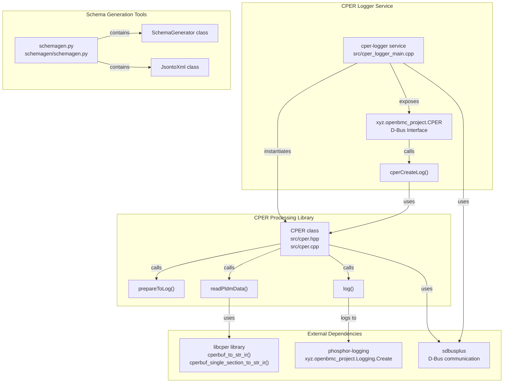
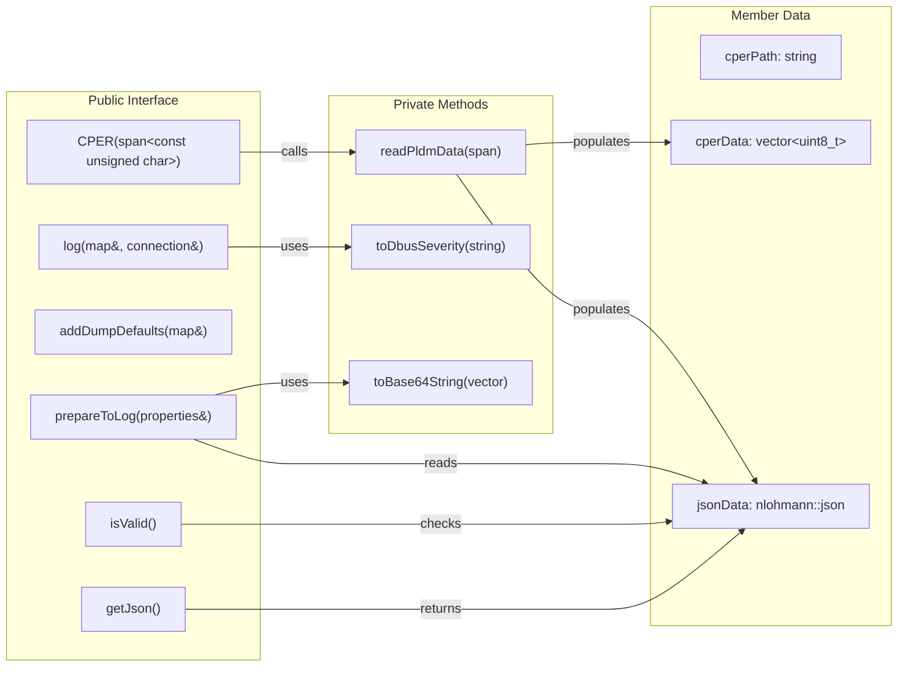

<!-- source: DeepWiki mcp.deepwiki.com · repo NVIDIA/cper-logger · page 2 Core Components · fetched 2026-10-26 -->

# Core Components

<details>
<summary>Relevant source files</summary>

The following files were used as context for generating this wiki page:

- [src/cper.cpp](src/cper.cpp)
- [src/cper.hpp](src/cper.hpp)
- [src/cper_logger_main.cpp](src/cper_logger_main.cpp)

</details>


The cper-logger system consists of three primary components: the CPER Processing Library, the CPER Logger Service, and the Schema Generation Tools. This page provides an overview of these components and their interactions. For detailed information about the build system, see [Build System](#3). For testing infrastructure, see [Testing](#4).

## Component Architecture

The following diagram illustrates the three core components and their relationships:



**Sources:** [src/cper.hpp:1-79](), [src/cper.cpp:1-405](), [src/cper_logger_main.cpp:1-68]()

## Component Overview

### CPER Processing Library

The CPER Processing Library is implemented in the `CPER` class and provides the core functionality for parsing, validating, and formatting CPER (Common Platform Error Record) data. Located in [src/cper.hpp]() and [src/cper.cpp](), this library handles the transformation of binary CPER data into structured formats suitable for logging.

**Key responsibilities:**
- Parse PLDM-encapsulated CPER data
- Convert binary CPER to JSON using libcper
- Extract individual sections and metadata
- Format data for D-Bus logging
- Encode binary data as Base64

For detailed documentation, see [CPER Processing Library](#2.1).

**Sources:** [src/cper.hpp:31-78](), [src/cper.cpp:55-404]()

### CPER Logger Service

The CPER Logger Service is a D-Bus service that exposes the `xyz.openbmc_project.CPER` interface for receiving and logging CPER data. Implemented in [src/cper_logger_main.cpp](), this service acts as the entry point for external systems to submit CPER records.

**Key responsibilities:**
- Expose D-Bus interface `xyz.openbmc_project.CPER`
- Implement `CreateLog` method for receiving CPER data
- Coordinate CPER object lifecycle
- Manage D-Bus connection pooling

For detailed documentation, see [CPER Logger Service](#2.2).

**Sources:** [src/cper_logger_main.cpp:1-68]()

### Schema Generation Tools

The Schema Generation Tools consist of Python utilities that convert JSON schemas from the libcper project into Redfish-compliant XML schema definitions. This tooling operates independently of the runtime components and serves a development/documentation role.

**Key responsibilities:**
- Parse libcper JSON schemas
- Resolve `$ref` directives across multiple files
- Generate Redfish OData XML schemas
- Provide schema validation capabilities

For detailed documentation, see [Schema Generation Tools](#2.3).

**Note:** This component is development-time infrastructure and is not part of the runtime system.

## CPER Class Structure

The following diagram maps the `CPER` class methods to their roles in the processing pipeline:



**Sources:** [src/cper.hpp:31-78](), [src/cper.cpp:55-404]()

## Data Flow Through Components

The following diagram shows how CPER data flows through the system with actual function and interface names:

```mermaid
sequenceDiagram
    participant Client as "D-Bus Client"
    participant Service as "cper-logger<br/>main()"
    participant Interface as "xyz.openbmc_project.CPER"
    participant CreateLog as "cperCreateLog()"
    participant CPER as "CPER class"
    participant libcper as "libcper<br/>cperbuf_to_str_ir()"
    participant PhosphorLog as "xyz.openbmc_project.Logging"
    
    Client->>Interface: "CreateLog(vector&lt;uchar&gt;)"
    Interface->>CreateLog: "invoke"
    CreateLog->>CPER: "CPER(span)"
    CPER->>CPER: "readPldmData()"
    CPER->>libcper: "cperbuf_to_str_ir() or<br/>cperbuf_single_section_to_str_ir()"
    libcper-->>CPER: "char* JSON string"
    CPER-->>CreateLog: "CPER object"
    
    CreateLog->>CPER: "prepareToLog(prop)"
    CPER->>CPER: "readHeader()"
    CPER->>CPER: "constructDiagnosticData()"
    CPER->>CPER: "toBase64String()"
    CPER-->>CreateLog: "properties vector"
    
    loop "for each section"
        CreateLog->>CPER: "log(section, conn)"
        CPER->>CPER: "toDbusSeverity()"
        CPER->>PhosphorLog: "Create(message, severity, props)"
    end
    
    PhosphorLog-->>Client: "log entries created"
```

**Sources:** [src/cper_logger_main.cpp:30-48](), [src/cper.cpp:55-309]()

## Component Interaction Details

### PLDM Data Format

The CPER Processing Library expects PLDM-encapsulated data with a specific format defined in [src/cper.cpp:329-372]():

| Byte Offset | Size | Field | Description |
|-------------|------|-------|-------------|
| 0-3 | 4 bytes | PLDM Header | Protocol header (removed before processing) |
| 4 | 1 byte | Type | `0` = Full CPER, `1` = Single section |
| 5+ | Variable | CPER Data | Raw CPER binary payload |

The type byte at offset 4 determines which libcper function is invoked:
- Type `0`: Calls `cperbuf_to_str_ir()` for full CPER with header and sections
- Type `1`: Calls `cperbuf_single_section_to_str_ir()` for single section without header

**Sources:** [src/cper.cpp:329-372]()

### D-Bus Interface Specification

The service exposes a single method on the D-Bus system bus:

| Property | Value |
|----------|-------|
| Service Name | `xyz.openbmc_project.CPERLogger` |
| Object Path | `/xyz/openbmc_project/cperlogger` |
| Interface | `xyz.openbmc_project.CPER` |
| Method | `CreateLog` |
| Signature | `ay` (array of bytes) → void |

The `CreateLog` method is implemented by the `cperCreateLog()` function in [src/cper_logger_main.cpp:30-48]().

**Sources:** [src/cper_logger_main.cpp:50-67]()

### Logging Properties Format

The `CPER::prepareToLog()` method generates a properties vector where each element represents one CPER section. Each property map contains:

| Key | Description | Source |
|-----|-------------|--------|
| `diagnosticDataType` | `"CPER"` or `"CPERSection"` | Header presence |
| `diagnosticData` | Base64-encoded binary CPER | [src/cper.cpp:242]() |
| `jsonDiagnosticData` | JSON representation of section | [src/cper.cpp:249]() |
| `REDFISH_MESSAGE_ID` | `"Platform.1.0.PlatformError"` | [src/cper.cpp:243]() |
| `cperSeverity` | `"Fatal"`, `"Recoverable"`, etc. | Header severity field |
| `cperSeverityCode` | Numeric severity code | Header severity code |
| `notificationType` | GUID of notification type | Header notification type |
| `timestamp` | ISO 8601 timestamp | Header timestamp (if present) |
| `sectionType` | Section type GUID | Section descriptor |

**Sources:** [src/cper.cpp:160-267](), [src/cper.cpp:68-76]()

## Severity Mapping

The `CPER::toDbusSeverity()` method maps CPER severity strings to D-Bus logging levels:

| CPER Severity | D-Bus Level |
|---------------|-------------|
| `"Recoverable"` | `xyz.openbmc_project.Logging.Entry.Level.Warning` |
| `"Fatal"` | `xyz.openbmc_project.Logging.Entry.Level.Critical` |
| `"Corrected"` | `xyz.openbmc_project.Logging.Entry.Level.Informational` |
| `"Informational"` | `xyz.openbmc_project.Logging.Entry.Level.Informational` |
| Other/Unknown | `xyz.openbmc_project.Logging.Entry.Level.Warning` (default) |

**Sources:** [src/cper.cpp:375-390]()

## Error Handling

The CPER Processing Library performs validation at multiple stages:

1. **PLDM Format Validation** ([src/cper.cpp:336-348]()):
   - Minimum size check (header + section descriptor)
   - Type field validation (must be 0 or 1)

2. **JSON Structure Validation** ([src/cper.cpp:162-205]()):
   - Presence of `sectionDescriptors` array
   - Presence of `sections` array
   - Array size matching between descriptors and sections

3. **libcper Parse Validation** ([src/cper.cpp:364-368]()):
   - NULL pointer check from libcper functions
   - JSON parse validation

Invalid CPER data results in an empty properties vector, which is detected by `cperCreateLog()` and logged as an error without creating log entries.

**Sources:** [src/cper.cpp:162-205](), [src/cper.cpp:329-372](), [src/cper_logger_main.cpp:36-40]()

---

