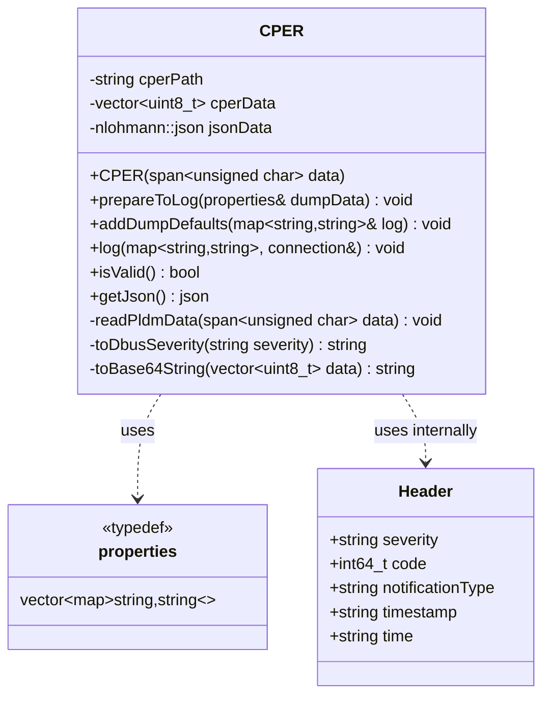
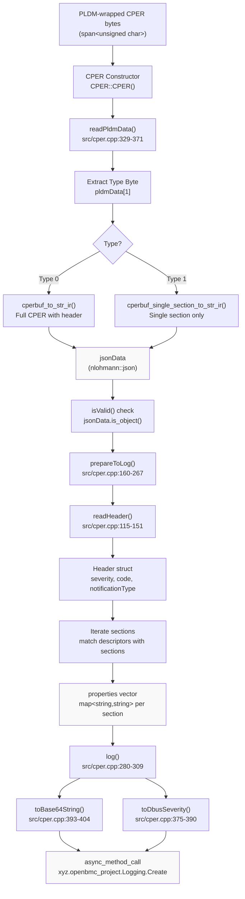
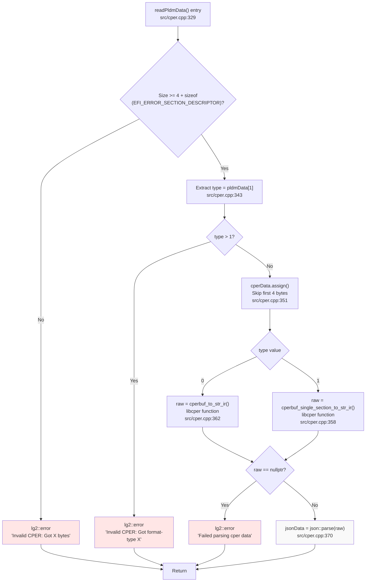
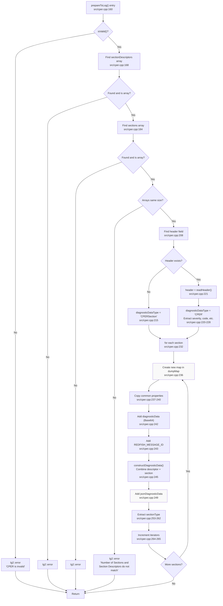
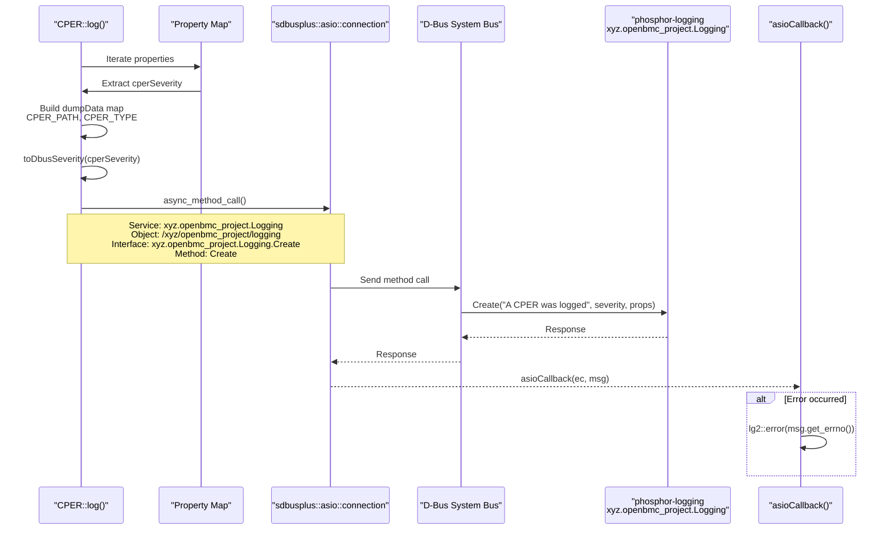

<!-- source: DeepWiki mcp.deepwiki.com · repo NVIDIA/cper-logger · page 2.1 CPER Processing Library · fetched 2026-10-26 -->

# CPER Processing Library

<details>
<summary>Relevant source files</summary>

The following files were used as context for generating this wiki page:

- [src/cper.cpp](src/cper.cpp)
- [src/cper.hpp](src/cper.hpp)

</details>


## Purpose and Scope

The CPER Processing Library provides the core functionality for parsing, validating, and formatting Common Platform Error Record (CPER) data within the cper-logger system. This library is implemented as the `CPER` class in [src/cper.cpp]() and [src/cper.hpp](), and serves as the primary interface between raw CPER binary data and the OpenBMC logging infrastructure.

This page documents the internal workings of the CPER class and its associated utility functions. For information about the D-Bus service that invokes this library, see [CPER Logger Service](#2.2). For details on the overall data format specifications, see [CPER Data Format](#6.1).

**Sources:** [src/cper.hpp:1-79](), [src/cper.cpp:1-405]()

---

## CPER Class Structure

The `CPER` class encapsulates all processing logic for CPER data. It provides a stateless, single-use interface where each instance processes one CPER record from construction through logging.



**Class Responsibilities:**

| Component | Responsibility | Key Methods |
|-----------|---------------|-------------|
| Constructor | Parse PLDM-wrapped CPER data into JSON | `CPER(span<unsigned char>)` [src/cper.cpp:55-66]() |
| Data Validation | Verify JSON structure and completeness | `isValid()` [src/cper.hpp:47-50]() |
| Property Preparation | Transform JSON to logging properties | `prepareToLog()` [src/cper.cpp:160-267]() |
| Logging | Send formatted data to phosphor-logging | `log()` [src/cper.cpp:280-309]() |
| Conversion Utilities | Format data for D-Bus transmission | `toDbusSeverity()`, `toBase64String()` |

**Sources:** [src/cper.hpp:31-78](), [src/cper.cpp:55-404]()

---

## Data Flow Architecture

The following diagram illustrates how data flows through the CPER class from raw binary input to structured D-Bus logging calls.



**Sources:** [src/cper.cpp:55-66](), [src/cper.cpp:160-267](), [src/cper.cpp:280-309](), [src/cper.cpp:329-371]()

---

## PLDM Data Parsing

The `readPldmData()` method handles the initial parsing of PLDM-wrapped CPER data. PLDM messages contain a 4-byte header followed by raw CPER data.

### PLDM Header Structure

The PLDM header format is parsed in [src/cper.cpp:329-371]():

| Byte Offset | Field | Description |
|-------------|-------|-------------|
| 0 | Reserved | PLDM header byte 0 |
| 1 | Type | 0 = Full CPER (header + sections)<br/>1 = Single section (no header) |
| 2-3 | Reserved | PLDM header bytes 2-3 |
| 4+ | CPER Data | Raw CPER binary data |

### Parsing Flow



**Key Implementation Details:**

- **Size Validation:** Minimum size is `pldmHeaderSize (4) + sizeof(EFI_ERROR_SECTION_DESCRIPTOR)` [src/cper.cpp:336-340]()
- **Type Extraction:** Type byte at offset 1 determines parsing mode [src/cper.cpp:343]()
- **CPER Data Storage:** Raw binary stored in `cperData` member for later Base64 encoding [src/cper.cpp:351]()
- **libcper Integration:** Calls either `cperbuf_to_str_ir()` or `cperbuf_single_section_to_str_ir()` from libcper [src/cper.cpp:356-363]()
- **JSON Parsing:** Uses nlohmann::json to parse the libcper string output [src/cper.cpp:370]()

**Sources:** [src/cper.cpp:329-371]()

---

## Property Preparation

The `prepareToLog()` method transforms the JSON representation into a vector of property maps suitable for D-Bus logging. Each CPER section generates one property map.

### Property Map Structure

Each property map in the output contains the following fields:

| Property Key | Source | Description |
|--------------|--------|-------------|
| `diagnosticDataType` | Derived from CPER type | "CPER" or "CPERSection" |
| `diagnosticData` | Raw CPER data | Base64-encoded binary CPER |
| `REDFISH_MESSAGE_ID` | Static | "Platform.1.0.PlatformError" |
| `cperSeverity` | Header | "Fatal", "Recoverable", "Corrected", "Informational" |
| `cperSeverityCode` | Header | Numeric severity code |
| `notificationType` | Header | GUID string |
| `timestamp` | Header | Timestamp string (if present) |
| `sectionType` | Section descriptor | GUID data for section type |
| `jsonDiagnosticData` | Constructed | JSON string with section data |

### Preparation Algorithm



**Header Parsing Details:**

The `readHeader()` function [src/cper.cpp:115-151]() extracts:
- `severity.name` and `severity.code` from the severity object
- `notificationType.guid` from the notification type object
- `timestamp` field if present

**Section Iteration:**

Each iteration [src/cper.cpp:232-266]():
1. Creates a new property map
2. Copies common properties (severity, notification type, timestamp)
3. Adds Base64-encoded `diagnosticData`
4. Constructs `jsonDiagnosticData` by combining the section descriptor and section data
5. Extracts `sectionType` from the descriptor's `/sectionType/data` JSON pointer

**Sources:** [src/cper.cpp:160-267](), [src/cper.cpp:115-151](), [src/cper.cpp:41-53]()

---

## Logging Interface

The `log()` method sends formatted CPER data to the phosphor-logging service via D-Bus asynchronous method calls.

### D-Bus Communication Flow



**Method Implementation:**

The `log()` method [src/cper.cpp:280-309]() performs these steps:

1. **Extract Severity:** Iterates through properties to find `cperSeverity` [src/cper.cpp:286-298]()
2. **Build Additional Data:** Creates `dumpData` map with `CPER_PATH` and `CPER_TYPE` [src/cper.cpp:289-293]()
3. **Convert Severity:** Calls `toDbusSeverity()` to map CPER severity strings to D-Bus severity levels [src/cper.cpp:308]()
4. **Async Call:** Invokes `async_method_call()` with:
   - Callback: `asioCallback` function [src/cper.cpp:270-277]()
   - Service: `xyz.openbmc_project.Logging`
   - Object path: `/xyz/openbmc_project/logging`
   - Interface: `xyz.openbmc_project.Logging.Create`
   - Method: `Create`
   - Arguments: message string, severity, and properties map

**Sources:** [src/cper.cpp:280-309](), [src/cper.cpp:270-277]()

---

## Conversion Utilities

The CPER class provides two key conversion utilities for formatting data appropriately for D-Bus transmission.

### Severity Conversion

The `toDbusSeverity()` method [src/cper.cpp:375-390]() maps CPER severity strings to D-Bus logging levels:

| CPER Severity | D-Bus Level | Return Value |
|---------------|-------------|--------------|
| `"Recoverable"` | Warning | `"xyz.openbmc_project.Logging.Entry.Level.Warning"` |
| `"Fatal"` | Critical | `"xyz.openbmc_project.Logging.Entry.Level.Critical"` |
| `"Corrected"` | Informational | `"xyz.openbmc_project.Logging.Entry.Level.Informational"` |
| `"Informational"` | Informational | `"xyz.openbmc_project.Logging.Entry.Level.Informational"` |
| Other/Unknown | Warning | `"xyz.openbmc_project.Logging.Entry.Level.Warning"` (default) |

### Base64 Encoding

The `toBase64String()` method [src/cper.cpp:393-404]() encodes raw CPER binary data for transmission:

**Implementation:**
1. Calculates encoded size using `boost::beast::detail::base64::encoded_size()` [src/cper.cpp:396]()
2. Allocates string buffer with extra byte for null terminator [src/cper.cpp:397]()
3. Performs encoding using `boost::beast::detail::base64::encode()` [src/cper.cpp:399-400]()
4. Resizes string to actual written bytes [src/cper.cpp:401]()

This ensures the binary CPER data is safely encoded as ASCII for inclusion in the `diagnosticData` property field.

**Sources:** [src/cper.cpp:375-404]()

---

## Helper Functions and Data Structures

### Header Structure

The internal `Header` struct [src/cper.cpp:106-113]() captures header metadata:

```cpp
struct Header {
    std::string severity;
    int64_t code = std::numeric_limits<int64_t>::max();
    std::string notificationType;
    std::string timestamp;
    std::string time;
};
```

### Key Reading Functions

The library provides utility functions for safely extracting typed values from JSON:

- **`readIntKey()`** [src/cper.cpp:78-90]() - Extracts int64_t values from JSON objects
- **`readStrKey()`** [src/cper.cpp:92-104]() - Extracts string values from JSON objects

These functions perform null checks and type validation before assignment.

### Diagnostic Data Construction

The `constructDiagnosticData()` function [src/cper.cpp:41-53]() is a public utility that combines a section descriptor and section into a JSON object:

```cpp
int constructDiagnosticData(nlohmann::json& out, 
                           const nlohmann::json& secdIt,
                           const nlohmann::json& secIt)
```

This function:
1. Creates a `sectionDescriptors` array containing the descriptor
2. Creates a `sections` array containing the section data
3. Populates the output JSON object with both arrays

**Sources:** [src/cper.cpp:41-53](), [src/cper.cpp:78-113]()

---

## Type Definitions

The library defines a key type alias used throughout the system:

```cpp
using properties = std::vector<std::map<std::string, std::string>>;
```

This type represents a vector of property maps, where each map corresponds to one CPER section to be logged. The type is defined in [src/cper.hpp:29]() and used extensively in:

- `CPER::prepareToLog(properties& dumpMap)` - Output parameter for prepared log data
- Service layer interfaces that consume CPER-processed data

**Sources:** [src/cper.hpp:29]()

---

## Dependencies

The CPER Processing Library relies on the following external libraries:

| Dependency | Purpose | Include Files |
|------------|---------|---------------|
| **libcper** | CPER binary parsing | `<libcper/cper-parse-str.h>`, `<libcper/Cper.h>` |
| **nlohmann_json** | JSON manipulation | `<nlohmann/json.hpp>` |
| **boost** | Base64 encoding, ASIO | `<boost/beast/core/detail/base64.hpp>` |
| **sdbusplus** | D-Bus communication | `<sdbusplus/asio/connection.hpp>` |
| **phosphor-logging** | Logging macros | `<phosphor-logging/lg2.hpp>` |

The library acts as a bridge between libcper's C-based parsing functions and the C++/D-Bus infrastructure of OpenBMC.

**Sources:** [src/cper.cpp:18-38](), [src/cper.hpp:18-25]()

---

