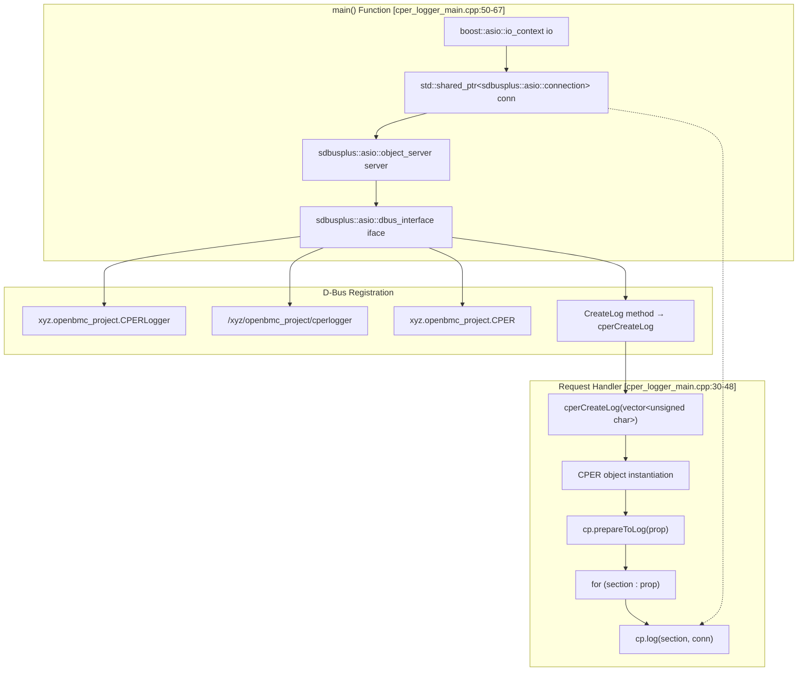
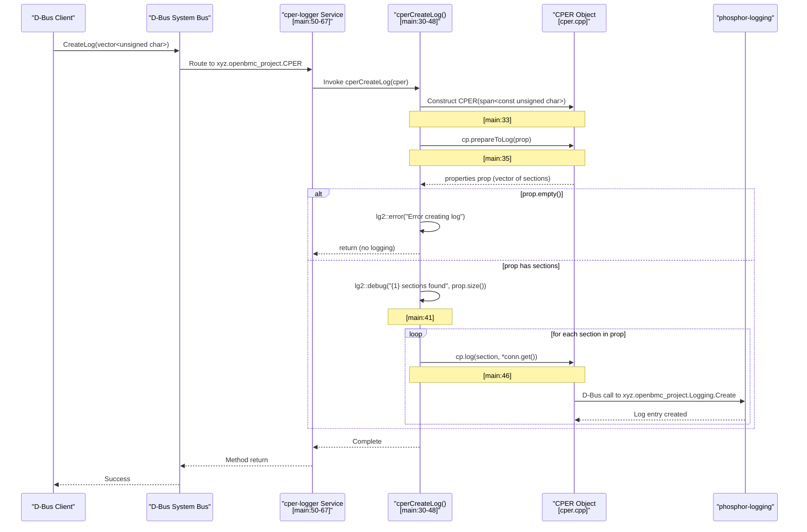
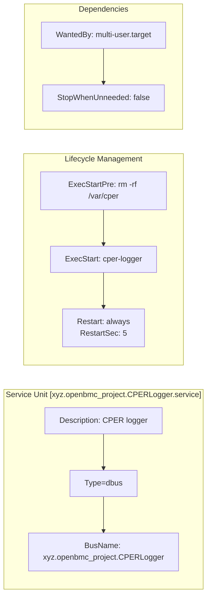

<!-- source: DeepWiki mcp.deepwiki.com · repo NVIDIA/cper-logger · page 2.2 CPER Logger Service · fetched 2026-10-26 -->

# CPER Logger Service

<details>
<summary>Relevant source files</summary>

The following files were used as context for generating this wiki page:

- [src/cper_logger_main.cpp](src/cper_logger_main.cpp)
- [xyz.openbmc_project.CPERLogger.service](xyz.openbmc_project.CPERLogger.service)

</details>


## Purpose and Scope

This document describes the CPER Logger Service, the primary D-Bus service component that provides the runtime interface for receiving and processing CPER (Common Platform Error Record) data in the OpenBMC environment. The service acts as the entry point for CPER data submitted by external components (such as PLDM handlers) and coordinates the parsing and logging operations.

For details on the underlying CPER parsing and formatting logic, see [CPER Processing Library](#2.1). For information on schema generation tools, see [Schema Generation Tools](#2.3). For build configuration details, see [Build System](#3).

**Sources**: [src/cper_logger_main.cpp:1-68]()

---

## Service Architecture

The CPER Logger Service is implemented as a minimal D-Bus service daemon that bridges external CPER data sources with the OpenBMC logging infrastructure. The service maintains a single shared D-Bus connection and processes incoming CPER records in a stateless manner.

### Component Overview



**Sources**: [src/cper_logger_main.cpp:27-67]()

---

## D-Bus Interface Specification

The service exposes a single D-Bus interface with one method for creating log entries from CPER data.

| Property | Value |
|----------|-------|
| **Bus Name** | `xyz.openbmc_project.CPERLogger` |
| **Object Path** | `/xyz/openbmc_project/cperlogger` |
| **Interface Name** | `xyz.openbmc_project.CPER` |
| **Service Type** | Type=dbus (systemd D-Bus activation) |

### CreateLog Method

The `CreateLog` method is the sole entry point for CPER data submission.

| Attribute | Details |
|-----------|---------|
| **Method Name** | `CreateLog` |
| **Implementation** | `cperCreateLog` function |
| **Input Parameter** | `std::vector<unsigned char>` (raw CPER bytes) |
| **Return Type** | `void` |
| **D-Bus Signature** | `"ay"` (byte array) |

**Implementation Location**: [src/cper_logger_main.cpp:30-48]()

The method accepts a byte vector containing either:
- A complete CPER record (type 0: header + multiple sections)
- A single CPER section (type 1: single section without header)

The type distinction is handled by the CPER Processing Library (see [CPER Processing Library](#2.1)).

**Sources**: [src/cper_logger_main.cpp:59-63]()

---

## Request Processing Flow

The following diagram illustrates the complete lifecycle of a CPER logging request, mapping each step to specific code entities.



### Processing Steps

1. **Connection Establishment** [src/cper_logger_main.cpp:52-53]()
   - Creates `boost::asio::io_context` for async I/O
   - Instantiates shared D-Bus connection: `conn = std::make_shared<sdbusplus::asio::connection>(io)`

2. **Service Registration** [src/cper_logger_main.cpp:55-65]()
   - Requests bus name: `conn->request_name("xyz.openbmc_project.CPERLogger")`
   - Creates object server
   - Adds interface at `/xyz/openbmc_project/cperlogger`
   - Registers `CreateLog` method bound to `cperCreateLog` function

3. **Request Handling** [src/cper_logger_main.cpp:30-48]()
   - Receives raw CPER byte vector
   - Constructs `CPER` object with `std::span` wrapper for zero-copy access
   - Invokes `prepareToLog(prop)` to parse and structure data
   - Validates that parsing succeeded (`prop.empty()` check)
   - Logs number of sections found via `lg2::debug`

4. **Section Iteration** [src/cper_logger_main.cpp:43-47]()
   - Iterates through each section in the properties vector
   - Calls `cp.log(section, *conn.get())` for each section
   - Each section is logged individually to phosphor-logging

**Sources**: [src/cper_logger_main.cpp:30-67]()

---

## Global State Management

The service maintains minimal global state for operational efficiency.

### Shared D-Bus Connection

```cpp
std::shared_ptr<sdbusplus::asio::connection> conn = nullptr;
```

**Location**: [src/cper_logger_main.cpp:27]()

This global shared pointer serves several purposes:
- **Efficiency**: Reuses a single D-Bus connection across all logging operations
- **Thread Safety**: The `shared_ptr` ensures proper lifetime management
- **Access Pattern**: Dereferenced in the logging loop via `*conn.get()`

The connection is initialized once in `main()` and shared with all invocations of `cperCreateLog()`. This design avoids the overhead of creating a new D-Bus connection for each CPER section logged.

**Stateless Request Processing**: Despite the shared connection, request processing remains stateless. Each invocation of `cperCreateLog()` creates a new `CPER` object, processes it independently, and destroys it upon completion. No state is preserved between requests.

**Sources**: [src/cper_logger_main.cpp:27](), [src/cper_logger_main.cpp:46]()

---

## Systemd Service Integration

The CPER Logger Service is managed by systemd and configured for automatic lifecycle management.

### Service Unit Configuration



### Key Configuration Properties

| Directive | Value | Purpose |
|-----------|-------|---------|
| `Type` | `dbus` | Signals systemd that this is a D-Bus service |
| `BusName` | `xyz.openbmc_project.CPERLogger` | The D-Bus name to acquire |
| `Restart` | `always` | Automatically restart on failure |
| `RestartSec` | `5` | Wait 5 seconds before restart attempt |
| `StopWhenUnneeded` | `false` | Keep service running even when idle |
| `ExecStartPre` | `rm -rf /var/cper` | Clean up legacy file storage |
| `WantedBy` | `multi-user.target` | Start during normal multi-user boot |

**Sources**: [xyz.openbmc_project.CPERLogger.service:1-20]()

### Pre-Start Cleanup

The service includes a pre-start cleanup step:

```ini
ExecStartPre=rm -rf /var/cper
```

**Location**: [xyz.openbmc_project.CPERLogger.service:11]()

**Rationale**: Historical versions of the CPER logger wrote CPER data to disk in `/var/cper`. The current implementation logs exclusively via D-Bus to phosphor-logging. This cleanup step removes obsolete files on service start. According to the inline comment, this can be removed for non-GB200 platforms that never used the file-based approach.

**Sources**: [xyz.openbmc_project.CPERLogger.service:9-11]()

### Restart Behavior

The service is configured for aggressive automatic recovery:

```ini
Restart=always
RestartSec=5
```

**Location**: [xyz.openbmc_project.CPERLogger.service:6-7]()

This configuration ensures:
- The service restarts regardless of exit status (success, failure, crash)
- A 5-second delay prevents restart storms if the service fails immediately
- CPER logging functionality is always available to the system

**Sources**: [xyz.openbmc_project.CPERLogger.service:6-7]()

---

## Error Handling

The service implements minimal error handling, delegating most error conditions to the CPER Processing Library.

### Empty Properties Vector

```cpp
if (prop.empty())
{
    lg2::error("Error creating log");
    return;
}
```

**Location**: [src/cper_logger_main.cpp:36-40]()

This is the only explicit error check in the request handler. If `prepareToLog()` returns an empty properties vector, it indicates a parsing failure. The service:
1. Logs an error message via structured logging (`lg2::error`)
2. Returns early without attempting to log
3. Does not propagate an exception or error code to the D-Bus caller

This design prioritizes service availability—a malformed CPER record will not crash the service or block subsequent valid requests.

**Sources**: [src/cper_logger_main.cpp:36-40]()

### Dependency on CPER Library

The service assumes the CPER Processing Library handles:
- CPER format validation
- Section parsing and extraction
- Conversion to logging properties
- Actual D-Bus communication with phosphor-logging

All error conditions within CPER processing (invalid formats, missing sections, logging failures) are handled by the library. See [CPER Processing Library](#2.1) for details on library-level error handling.

**Sources**: [src/cper_logger_main.cpp:33-47]()

---

## Service Lifecycle

The following diagram illustrates the complete service lifecycle from systemd activation through shutdown.

```mermaid
stateDiagram-v2
    [*] --> Systemd_Start: systemd starts service
    
    Systemd_Start --> Pre_Cleanup: ExecStartPre
    Pre_Cleanup --> Main_Initialization: rm -rf /var/cper
    
    Main_Initialization --> IO_Context_Created: boost::asio::io_context io
    IO_Context_Created --> Connection_Created: conn = make_shared<connection>(io)
    Connection_Created --> Bus_Name_Requested: conn->request_name()
    Bus_Name_Requested --> Object_Server_Created: object_server(conn)
    Object_Server_Created --> Interface_Added: add_interface()
    Interface_Added --> Method_Registered: register_method("CreateLog", cperCreateLog)
    Method_Registered --> Interface_Initialized: iface->initialize()
    Interface_Initialized --> Running: io.run()
    
    Running --> Processing_Request: D-Bus CreateLog() call
    Processing_Request --> Running: Request complete
    
    Running --> [*]: SIGTERM/SIGINT
    
    note right of Processing_Request
        Per-request processing:
        1. CPER object construction
        2. prepareToLog()
        3. Section iteration
        4. cp.log() per section
    end note
    
    Running --> Crashed: Unhandled exception/error
    Crashed --> Systemd_Restart: RestartSec=5
    Systemd_Restart --> Pre_Cleanup: Restart=always
```

### Initialization Sequence

1. **Systemd Pre-Start**: Executes cleanup command to remove legacy file storage
2. **I/O Context**: Creates `boost::asio::io_context` for async event processing
3. **D-Bus Connection**: Establishes shared connection to system bus
4. **Bus Name Acquisition**: Claims `xyz.openbmc_project.CPERLogger`
5. **Object Server Setup**: Creates infrastructure for hosting D-Bus objects
6. **Interface Registration**: Adds CPER interface at designated path
7. **Method Binding**: Registers `CreateLog` method handler
8. **Interface Activation**: Finalizes interface, making it available to clients
9. **Event Loop**: Enters `io.run()` to process asynchronous events

**Sources**: [src/cper_logger_main.cpp:50-66]()

### Shutdown Sequence

The service does not implement explicit shutdown logic. Termination occurs via:
- **Signal Handling**: The `io.run()` event loop exits when interrupted (SIGTERM/SIGINT)
- **Destructor Chain**: Automatic cleanup of RAII objects (connection, server, interface)
- **Systemd Management**: systemd handles process termination and restart if configured

**Sources**: [src/cper_logger_main.cpp:66]()

---

## Integration Points

The CPER Logger Service integrates with multiple external systems:

| System | Interface Type | Purpose | Reference |
|--------|----------------|---------|-----------|
| **PLDM Handlers** | D-Bus client | Submit CPER data via `CreateLog()` | External to this repo |
| **phosphor-logging** | D-Bus service | Target for log entry creation | [src/cper_logger_main.cpp:46]() |
| **systemd** | Process manager | Service lifecycle and restart management | [xyz.openbmc_project.CPERLogger.service]() |
| **D-Bus System Bus** | IPC transport | All inter-service communication | [src/cper_logger_main.cpp:53]() |
| **CPER Library** | In-process library | CPER parsing and formatting | See [CPER Processing Library](#2.1) |

**Sources**: [src/cper_logger_main.cpp:1-68](), [xyz.openbmc_project.CPERLogger.service:1-20]()

---

