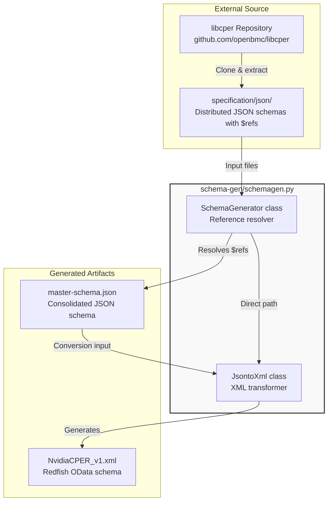
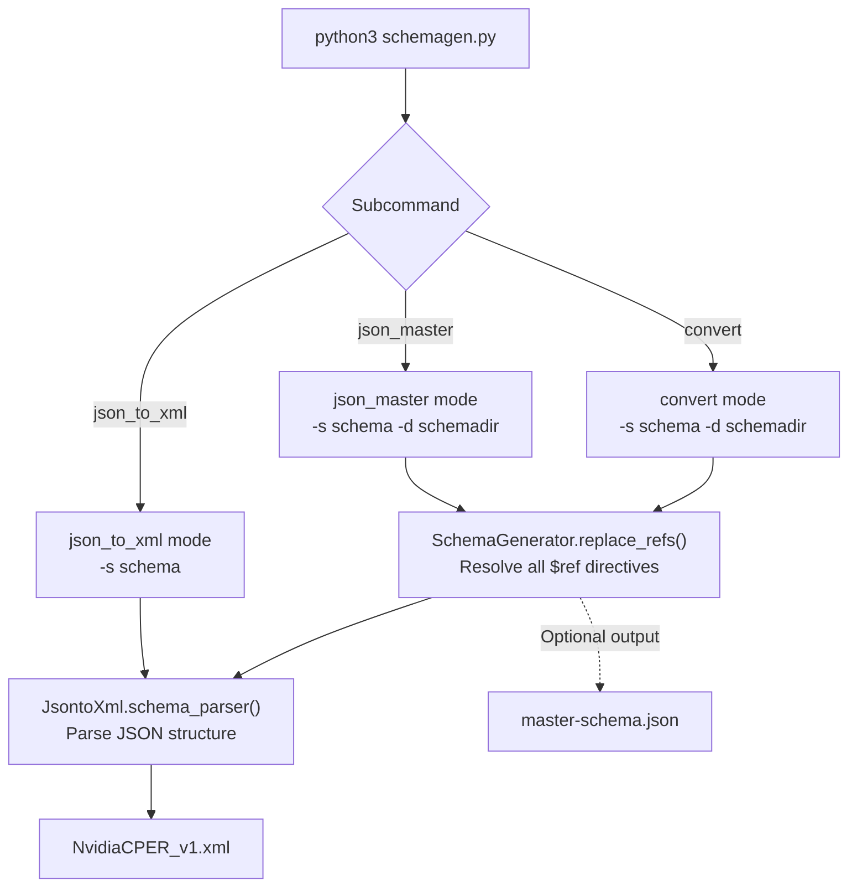
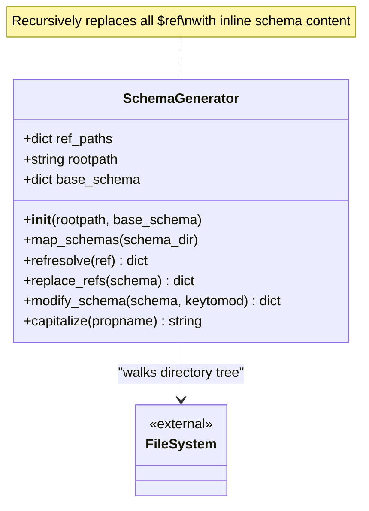
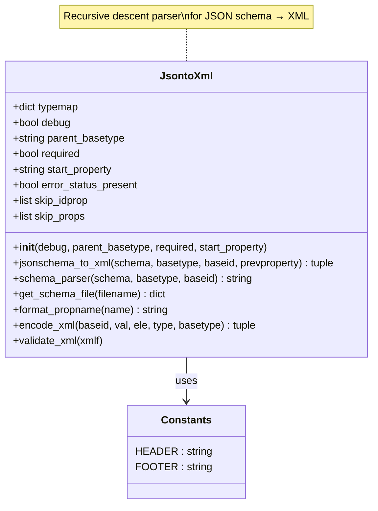
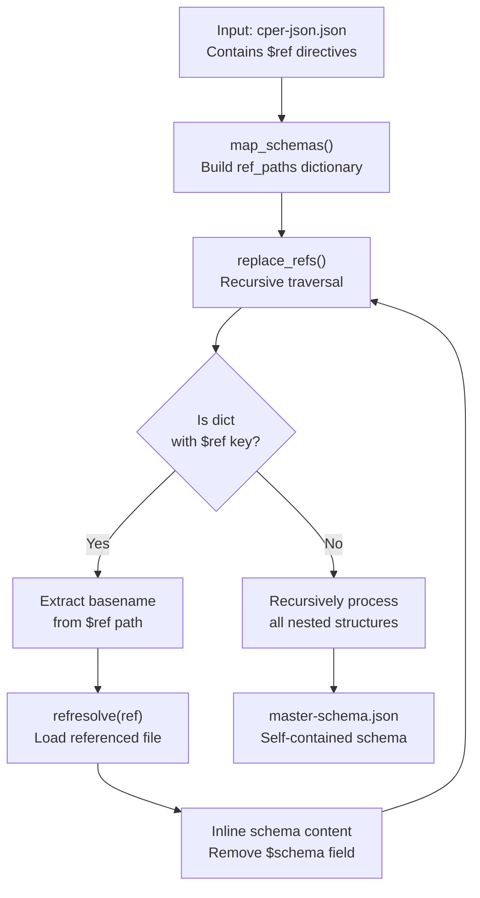
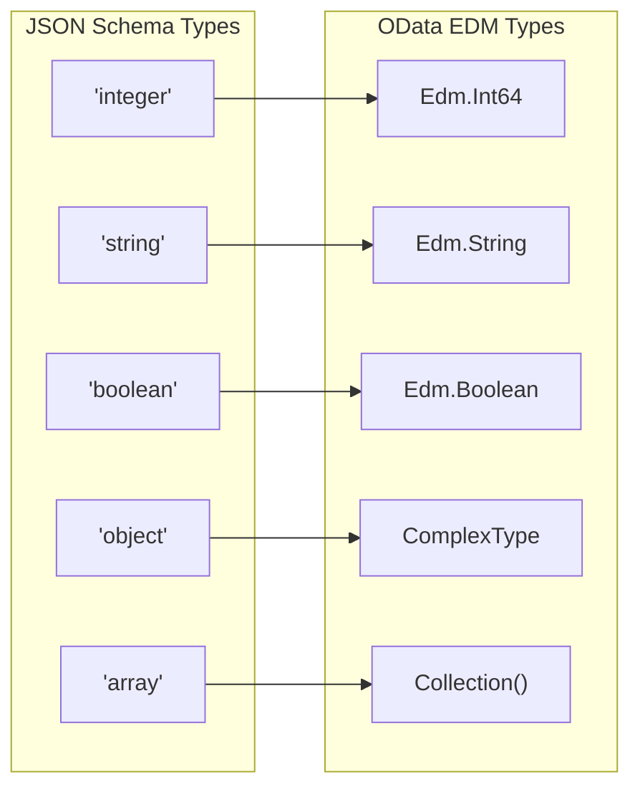
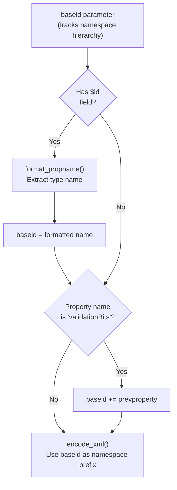

<!-- source: DeepWiki mcp.deepwiki.com · repo NVIDIA/cper-logger · page 2.3 Schema Generation Tools · fetched 2026-10-26 -->

# Schema Generation Tools

<details>
<summary>Relevant source files</summary>

The following files were used as context for generating this wiki page:

- [schema-gen/NvidiaCPER_v1.xml](schema-gen/NvidiaCPER_v1.xml)
- [schema-gen/README.md](schema-gen/README.md)
- [schema-gen/master-schema.json](schema-gen/master-schema.json)
- [schema-gen/schemagen.py](schema-gen/schemagen.py)

</details>


## Purpose and Scope

This page documents the Python-based schema generation tooling that converts JSON schemas from the libcper library into Redfish-compliant XML schemas. This tooling operates independently of the cper-logger runtime service and serves a development-time role in generating schema definitions that document CPER data formats.

For information about how CPER data is processed at runtime, see [CPER Processing Library](#2.1). For details on the generated Redfish schema structure, see [Redfish Schema](#6.2).

**Sources:** [schema-gen/README.md:1-42](), [schema-gen/schemagen.py:1-12]()

## System Position



**Diagram: Schema Generation Tool Position**

The schema generation tool is a standalone Python utility located in the `schema-gen/` directory. It does not participate in the runtime CPER processing flow but instead generates documentation artifacts that describe the CPER data format in Redfish-compatible XML.

**Sources:** [schema-gen/schemagen.py:41-128](), [schema-gen/README.md:1-42]()

## Operational Modes

The `schemagen.py` tool provides three command-line modes:

| Mode | Purpose | Input | Output |
|------|---------|-------|--------|
| `convert` | One-step JSON→XML transformation | Root JSON schema with `$ref` directives | `NvidiaCPER_v1.xml` |
| `json_master` | Consolidate distributed schemas | Root JSON schema + schema directory | `master-schema.json` |
| `json_to_xml` | Convert consolidated schema to XML | `master-schema.json` (no `$ref`) | `master-schema.xml` |

**Sources:** [schema-gen/schemagen.py:491-717](), [schema-gen/README.md:11-26]()

### Mode Selection Flow



**Diagram: Operational Mode Selection**

**Sources:** [schema-gen/schemagen.py:607-717]()

## Core Components

### SchemaGenerator Class

The `SchemaGenerator` class handles JSON schema consolidation by resolving `$ref` directives.



**Diagram: SchemaGenerator Class Structure**

**Key Methods:**

- **`map_schemas(schema_dir)`** [schema-gen/schemagen.py:58-68](): Walks the directory tree and builds `ref_paths` dictionary mapping JSON filenames to absolute paths
- **`refresolve(ref)`** [schema-gen/schemagen.py:70-75](): Loads a JSON schema file given a reference filename
- **`replace_refs(schema)`** [schema-gen/schemagen.py:77-98](): Recursively traverses the schema structure, replacing all `$ref` keys with the actual schema content from the referenced file

**Sources:** [schema-gen/schemagen.py:41-128]()

### JsontoXml Class

The `JsontoXml` class transforms JSON schemas into Redfish OData XML format.



**Diagram: JsontoXml Class Structure**

**Key Attributes:**

- **`typemap`** [schema-gen/schemagen.py:153-158](): Maps JSON data types (`integer`, `string`, `boolean`) to OData EDM types (`Edm.Int64`, `Edm.String`, `Edm.Boolean`)
- **`skip_idprop`** [schema-gen/schemagen.py:168-190](): List of schema `$id` values that should be flattened instead of creating separate XML ComplexTypes
- **`start_property`** [schema-gen/schemagen.py:165](): Entry point in JSON schema (default: `"sections"`) to begin XML generation

**Key Methods:**

- **`jsonschema_to_xml(schema, basetype, baseid, prevproperty)`** [schema-gen/schemagen.py:194-333](): Recursive core that traverses JSON schema structure and generates XML ComplexTypes
- **`encode_xml(baseid, val, ele, type, basetype)`** [schema-gen/schemagen.py:416-473](): Formats individual XML elements (ComplexType or Property tags)
- **`format_propname(name)`** [schema-gen/schemagen.py:375-400](): Converts CPER schema naming convention (`cper-json-error-status`) to XML naming (`ErrorStatus`)

**Sources:** [schema-gen/schemagen.py:130-489]()

## Reference Resolution Process

The schema consolidation process resolves all `$ref` directives by inlining referenced schema content.



**Diagram: Reference Resolution Algorithm**

The `replace_refs()` method performs a depth-first traversal:

1. **Dictionary with `$ref`**: Extract the referenced filename from the `$ref` value (using `os.path.basename()`)
2. **Load referenced schema**: Use `refresolve()` to load the JSON file
3. **Inline content**: Replace the entire `{"$ref": "..."}` object with the loaded schema content
4. **Remove metadata**: Pop the `$schema` field from the inlined content
5. **Recurse**: Continue processing the inlined structure for nested `$ref` directives

**Sources:** [schema-gen/schemagen.py:77-98]()

## XML Transformation Process

The XML generation process converts JSON schema structures into Redfish OData ComplexTypes and Properties.

### Type Mapping



**Diagram: JSON to XML Type Mapping**

**Sources:** [schema-gen/schemagen.py:153-158](), [schema-gen/schemagen.py:439-471]()

### XML Structure Generation

The `jsonschema_to_xml()` method generates nested XML structures based on JSON schema fields:

**For objects with `required` field:**
1. Check for `$id` field to determine ComplexType name (via `format_propname()`)
2. Generate opening `<ComplexType Name="...">` tag
3. Iterate through `properties` dictionary
4. For each property, generate `<Property Name="..." Type="...">` tag
5. Recursively process nested structures
6. Generate closing `</ComplexType>` tag

**For arrays:**
- Properties with `"type": "array"` generate `Type="Collection(BaseName.PropertyName)"`

**For oneOf constructs:**
- Create a parent ComplexType containing Properties for each alternative

**Sources:** [schema-gen/schemagen.py:194-333]()

### Namespace Handling



**Diagram: Namespace ID Tracking**

The `baseid` parameter accumulates namespace prefixes as the recursion descends through nested object structures. This ensures unique XML ComplexType names like `MemoryErrorStatus`, `Memory2ErrorStatus`, etc.

**Sources:** [schema-gen/schemagen.py:246-265]()

## Usage Examples

### Convert Mode (Recommended)

```bash
python3 schemagen.py convert \
    -s cper-json.json \
    -d ../libcper/specification/json/ \
    -a sections
```

**Outputs:** `NvidiaCPER_v1.xml`

**Sources:** [schema-gen/README.md:11-12]()

### Two-Step Process

**Step 1: Generate master schema**
```bash
python3 schemagen.py json_master \
    -s cper-json.json \
    -d ../libcper/specification/json/
```

**Outputs:** `master-schema.json`

**Step 2: Convert to XML**
```bash
python3 schemagen.py json_to_xml \
    -s master-schema.json \
    -a sections
```

**Outputs:** `master-schema.xml`

**Sources:** [schema-gen/README.md:16-25]()

### Command-Line Options

| Option | Modes | Description |
|--------|-------|-------------|
| `-s, --schema` | All | Input JSON schema file path |
| `-d, --schemadir` | `convert`, `json_master` | Root directory containing all JSON schemas |
| `-a, --argstart` | `convert`, `json_to_xml` | Property name to start parsing from (default: `"sections"`) |
| `-p, --parent-basetype` | `convert`, `json_to_xml` | Base XML namespace (default: `"NvidiaCPER.v0_8_0"`) |
| `-r, --required` | `convert`, `json_to_xml` | Only include required fields in XML |
| `-v, --verbose` | All | Enable debug output |
| `-z, --validate` | `convert`, `json_to_xml` | Validate generated XML for duplicate ComplexTypes |

**Sources:** [schema-gen/schemagen.py:514-603]()

## Generated Output Structure

### XML Header and Namespace Declarations

The generated XML follows Redfish OData v4 structure with namespace declarations:

```xml
<?xml version="1.0" encoding="UTF-8"?>
<edmx:Edmx xmlns:edmx="http://docs.oasis-open.org/odata/ns/edmx" Version="4.0">
  <edmx:Reference Uri="http://docs.oasis-open.org/odata/odata/v4.0/errata03/csd01/complete/vocabularies/Org.OData.Core.V1.xml">
    <edmx:Include Namespace="Org.OData.Core.V1" Alias="OData"/>
  </edmx:Reference>
  <edmx:Reference Uri="http://redfish.dmtf.org/schemas/v1/RedfishExtensions_v1.xml">
    <edmx:Include Namespace="Validation.v1_0_0" Alias="Validation"/>
    <edmx:Include Namespace="RedfishExtensions.v1_0_0" Alias="Redfish"/>
  </edmx:Reference>
  <edmx:DataServices>
    <Schema xmlns="http://docs.oasis-open.org/odata/ns/edm" Namespace="NvidiaCPER"> </Schema>
    <Schema xmlns="http://docs.oasis-open.org/odata/ns/edm" Namespace="NvidiaCPER.v0_8_0">
      <!-- ComplexTypes generated here -->
    </Schema>
  </edmx:DataServices>
</edmx:Edmx>
```

**Sources:** [schema-gen/schemagen.py:22-38](), [schema-gen/NvidiaCPER_v1.xml:1-12]()

### ComplexType Example

A typical generated ComplexType structure for a memory error section:

```xml
<ComplexType Name="MemoryErrorStatus">
    <Property Name="ErrorType" Type="NvidiaCPER.v0_8_0.ErrorStatusErrorType"></Property>
    <Property Name="AddressSignal" Type="Edm.Boolean"></Property>
    <Property Name="ControlSignal" Type="Edm.Boolean"></Property>
    <Property Name="DataSignal" Type="Edm.Boolean"></Property>
    <Property Name="DetectedByResponder" Type="Edm.Boolean"></Property>
    <Property Name="DetectedByRequester" Type="Edm.Boolean"></Property>
    <Property Name="FirstError" Type="Edm.Boolean"></Property>
    <Property Name="OverflowDroppedLogs" Type="Edm.Boolean"></Property>
</ComplexType>
```

**Sources:** [schema-gen/NvidiaCPER_v1.xml:558-567]()

## Validation and Debugging

### Duplicate Detection

The `validate_xml()` method checks for duplicate ComplexType names:

```python
def validate_xml(self, xmlf):
    entity_names = []
    with open(xmlf, "r") as f:
        for line in f:
            if "ComplexType Name" in line:
                name = line.strip().split("=")[1]
                if name in entity_names:
                    print("Duplicate: ", name)
                else:
                    entity_names.append(name)
```

**Invoke with:** `python3 schemagen.py convert -s schema.json -d dir/ -z`

**Sources:** [schema-gen/schemagen.py:478-488]()

### Debug Mode

Enable verbose output with `-v` flag to print JSON schema structures at each recursion level:

```bash
python3 schemagen.py convert -s cper-json.json -d ../libcper/specification/json/ -v
```

**Sources:** [schema-gen/schemagen.py:204-207](), [schema-gen/schemagen.py:261-262](), [schema-gen/schemagen.py:283-284]()

## Special Case Handling

### Skip ID Properties

Certain schema `$id` values in `skip_idprop` list are flattened instead of creating separate ComplexTypes:

```python
self.skip_idprop = [
    "GenericProcessor",
    "Ia32X64Processor",
    "ArmProcessor",
    "Memory",
    "Memory2",
    "Pcie",
    # ... etc
]
```

When encountered, the method returns the first property's XML directly instead of wrapping it in a ComplexType.

**Sources:** [schema-gen/schemagen.py:168-190](), [schema-gen/schemagen.py:229-239]()

### Error Status Deduplication

The `error_status_present` flag prevents duplicate ErrorStatus ComplexType generation across multiple section types:

```python
if (baseid + basetype).lower() == "errorstatuserrortype":
    if not self.error_status_present:
        self.error_status_present = True
    else:
        return ("", "")
```

**Sources:** [schema-gen/schemagen.py:166](), [schema-gen/schemagen.py:211-215]()

### Validation Bits Namespace

Properties named `validationBits` append their parent type to the `baseid` to ensure unique namespaces:

```python
if "validationbits" in basetype.lower():
    baseid += prevproperty
```

**Sources:** [schema-gen/schemagen.py:252-253]()

---

