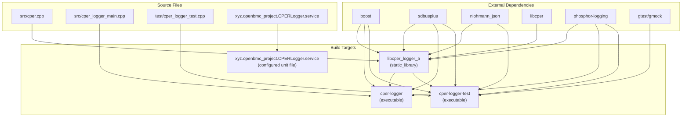
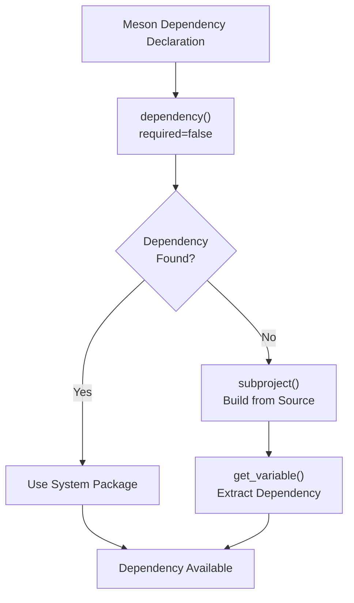
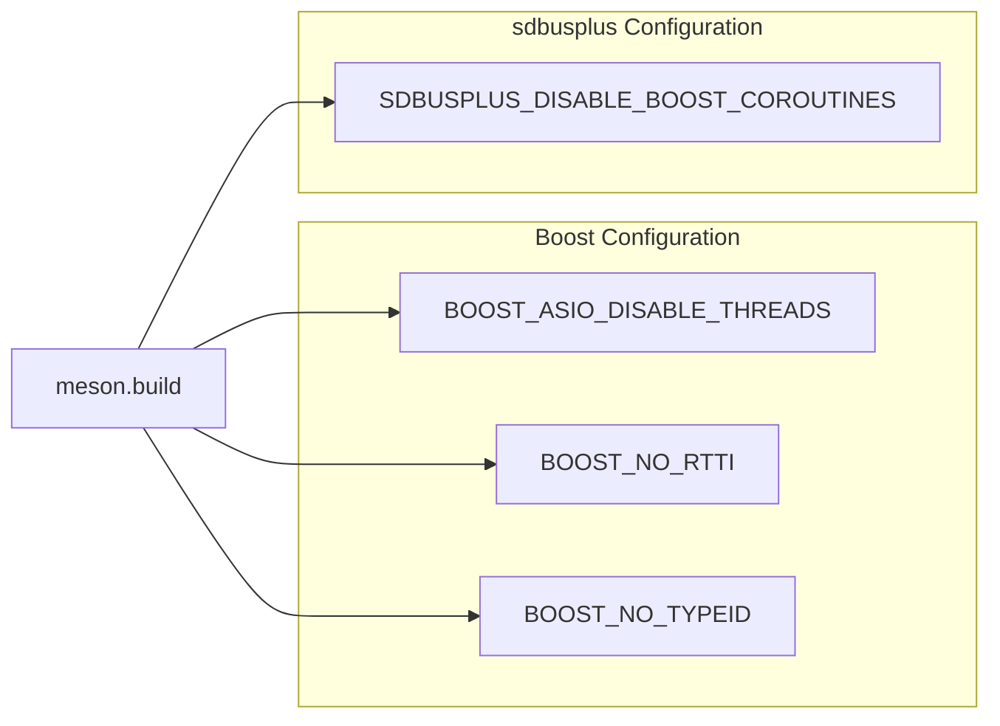
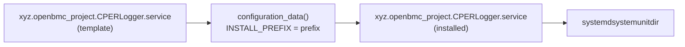
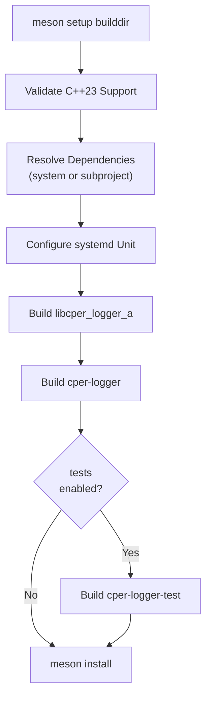

<!-- source: DeepWiki mcp.deepwiki.com · repo NVIDIA/cper-logger · page 3 Build System · fetched 2026-10-26 -->

# Build System

Relevant source files

The following files were used as context for generating this wiki page:

- [meson.build](meson.build)
- [meson_options.txt](meson_options.txt)

## Purpose and Scope

This document provides an overview of the cper-logger build system, which uses Meson as its build configuration tool. The build system manages compilation of the CPER processing library and service, dependency resolution, and generation of test executables. 

For detailed information about compiler flags and build targets, see [Build Configuration](#3.1). For information about specific external dependencies and subproject wraps, see [Dependencies](#3.2). For instructions on actually building the project, see [Building the Project](#5.1).

## Build Tool

The cper-logger project uses **Meson** (minimum version 1.3.0) as its build system. Meson is configured through the root `meson.build` file and generates native build files for the target platform.

**Sources:** [meson.build:1-16]()

## Build Artifacts

The build system produces three primary artifacts:

| Artifact | Type | Source | Purpose |
|----------|------|--------|---------|
| `libcper_logger_a.a` | Static Library | `src/cper.cpp` | Core CPER processing logic, reusable across executables |
| `cper-logger` | Executable | `src/cper_logger_main.cpp` | D-Bus service that receives and processes CPER data |
| `cper-logger-test` | Executable | `test/cper_logger_test.cpp` | Test suite (only built when tests are enabled) |
| `xyz.openbmc_project.CPERLogger.service` | systemd Unit | `xyz.openbmc_project.CPERLogger.service` | Service configuration for systemd |

**Sources:** [meson.build:107-127](), [meson.build:159-175]()

### Build Artifact Dependency Graph

**Sources:** [meson.build:107-127](), [meson.build:159-175](), [meson.build:90-96]()

## Dependency Resolution Strategy

The build system employs a **dual-mode dependency resolution strategy** that attempts to use system-installed packages first, falling back to Meson subprojects when necessary. This approach supports both development environments (where all dependencies are built locally) and production deployments (where system packages are preferred).

### Dependency Resolution Flow

**Sources:** [meson.build:23-79]()

### Dependency Resolution Examples

The following table shows how each major dependency is resolved:

| Dependency | System Search | Subproject Fallback | Special Handling |
|------------|---------------|---------------------|------------------|
| `boost` | `dependency('boost', version: '>=1.84.0')` | `cmake.subproject('boost')` | Uses CMake subproject with custom defines |
| `sdbusplus` | `dependency('sdbusplus')` | `subproject('sdbusplus')` | None |
| `nlohmann_json` | `dependency('nlohmann_json', version: '>=3.11.2')` | `subproject('nlohmann_json')` | None |
| `libcper` | `dependency('libcper')` | `subproject('libcper')` | Adds `subprojects/` to include directories |
| `phosphor-logging` | `dependency('phosphor-logging')` | None | Required from system (no fallback) |
| `systemd` | `dependency('systemd')` | None | Required from system (no fallback) |
| `gtest/gmock` | `dependency('gtest')`, `dependency('gmock')` | `cmake.subproject('gtest')` | Only when tests are enabled |

**Sources:** [meson.build:23-105](), [meson.build:130-158]()

## Build Options

The build system exposes configurable options through `meson_options.txt`:

| Option | Type | Default | Description |
|--------|------|---------|-------------|
| `tests` | feature | `enabled` | Controls whether test executables are built |

The `tests` option can be set to `enabled`, `disabled`, or `auto`. When enabled, the build system will build `cper-logger-test` and attempt to resolve GTest/GMock dependencies.

**Sources:** [meson_options.txt:1]()

## Compiler and Build Settings

The build system enforces strict compilation standards:

### C++ Standard
- **Required:** C++23 (`cpp_std=c++23`)
- The build fails if C++23 is not available

### Optimization and Binary Size
- **Link-Time Optimization (LTO):** Enabled (`b_lto=true`)
- **RTTI:** Disabled (`cpp_rtti=false`) for smaller binary size
- **Warning Level:** 3 (`warning_level=3`)
- **Warnings as Errors:** Enabled (`werror=true`)

### Preprocessor Definitions

The following preprocessor macros are defined globally:
- `BOOST_ASIO_DISABLE_THREADS` - Disables threading in Boost.Asio
- `BOOST_NO_RTTI` - Disables RTTI in Boost
- `BOOST_NO_TYPEID` - Disables typeid in Boost
- `SDBUSPLUS_DISABLE_BOOST_COROUTINES` - Disables Boost coroutines in sdbusplus

**Sources:** [meson.build:5-21](), [meson.build:53-58](), [meson.build:67]()

## systemd Integration

The build system generates and installs a systemd service unit file:

### Configuration Data Substitution

The `configure_file()` function substitutes `@INSTALL_PREFIX@` in the service unit template with the actual installation prefix (typically `/usr` or `/usr/local`).

**Sources:** [meson.build:83-96]()

## Include Directories

The build system configures include directories to locate headers:

| Directory | Purpose | Configured By |
|-----------|---------|---------------|
| `src/` | Main source headers | `include_directories('src')` |
| `subprojects/` | libcper headers when built as subproject | Conditional based on libcper source |
| `test/` | Test-specific headers | Only for test executable |

**Sources:** [meson.build:97-105](), [meson.build:170]()

## Build Workflow Overview

**Sources:** [meson.build:1-175]()

## Version and Licensing

- **Project Version:** 0.1
- **License:** Apache-2.0
- **Meson Version Requirement:** >= 1.3.0

**Sources:** [meson.build:1-16]()

---

