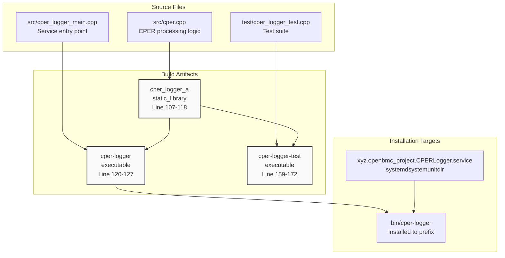
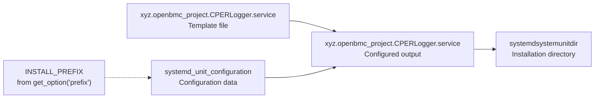
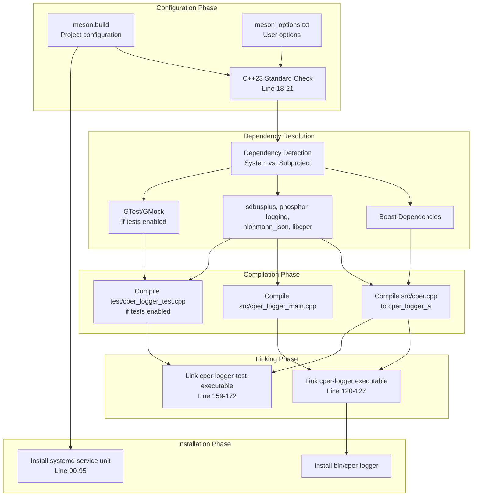

<!-- source: DeepWiki mcp.deepwiki.com · repo NVIDIA/cper-logger · page 3.1 Build Configuration · fetched 2026-10-26 -->

# Build Configuration

<details>
<summary>Relevant source files</summary>

The following files were used as context for generating this wiki page:

- [meson.build](meson.build)
- [meson_options.txt](meson_options.txt)

</details>


This page documents the Meson build configuration for the cper-logger project, including compiler requirements, build options, optimization flags, and build targets. For information on external dependencies and how they are resolved, see [Dependencies](#3.2). For practical instructions on building the project, see [Building the Project](#5.1).

## Project Configuration

The cper-logger project is configured through [meson.build:1-16](), which defines fundamental build parameters and requirements.

### Basic Project Setup

```
Project Name: cper-logger
Language: C++
Minimum Meson Version: >=1.3.0
License: Apache-2.0
Version: 0.1
```

The project enforces C++23 standard compliance with strict validation at [meson.build:18-21]():

| Setting | Value | Purpose |
|---------|-------|---------|
| `cpp_std` | `c++23` | C++23 standard required |
| Validation | Enforced | Build fails if standard not met |

### Default Build Options

The build system applies aggressive optimization and strict warning settings by default [meson.build:5-13]():

| Option | Value | Rationale |
|--------|-------|-----------|
| `warning_level` | `3` | Maximum compiler warnings |
| `werror` | `true` | Treat warnings as errors |
| `cpp_std` | `c++23` | Modern C++ features required |
| `cpp_rtti` | `false` | Disable RTTI for binary size reduction |
| `b_lto` | `true` | Enable Link-Time Optimization |

**RTTI Disabled**: The project explicitly disables C++ Run-Time Type Information [meson.build:11](). This reduces binary size at the cost of `dynamic_cast` and `typeid` functionality, which are not required by the application.

**Sources**: [meson.build:1-21]()

## Build Targets

The build system produces three primary artifacts: a static library, the main service executable, and an optional test executable.

### Build Target Architecture



**Sources**: [meson.build:107-127](), [meson.build:159-172]()

### Static Library: `cper_logger_a`

The core CPER processing logic is compiled into a static library [meson.build:107-118]():

| Property | Value |
|----------|-------|
| Target Name | `cper_logger_a` |
| Type | `static_library` |
| Source Files | `src/cper.cpp` |
| Include Directories | `src/`, `subprojects/` (conditional) |
| Dependencies | boost, libcper_parse_dep, nlohmann_json_dep, phosphor_logging, sdbusplus |

The static library approach allows code sharing between the main executable and test executable while ensuring consistent compilation settings.

**Include Directory Handling**: The include directories are configured at [meson.build:97-105](). When libcper is built as a subproject, an additional include path for `subprojects/` is added to work around libcper's directory structure differences.

### Main Executable: `cper-logger`

The service executable is built at [meson.build:120-127]():

| Property | Value |
|----------|-------|
| Target Name | `cper-logger` |
| Type | `executable` |
| Source Files | `src/cper_logger_main.cpp` |
| Dependencies | boost, sdbusplus, phosphor_logging |
| Links With | `cper_logger_a` |
| Installation | Enabled (`install: true`) |

The executable depends on the static library via `link_with` and includes only the dependencies needed for D-Bus service initialization, as the CPER processing logic is encapsulated in the library.

### Test Executable: `cper-logger-test`

The test executable is conditionally built based on the `tests` feature option [meson.build:129-175]():

| Property | Value |
|----------|-------|
| Target Name | `cper-logger-test` |
| Type | `executable` |
| Source Files | `test/cper_logger_test.cpp` |
| Build Condition | `get_option('tests').enabled()` |
| Dependencies | boost, gmock_dep, gtest_dep, nlohmann_json_dep, sdbusplus, phosphor_logging |
| Links With | `cper_logger_a` |
| Test Registration | `test('test_cper_logger', cper_logger_test)` |

The test build is controlled by [meson_options.txt:1](), which enables tests by default.

**Sources**: [meson.build:107-127](), [meson.build:129-175](), [meson_options.txt:1]()

### Systemd Service Unit

The systemd service file is generated from a template and installed [meson.build:87-96]():



The configuration process substitutes `@INSTALL_PREFIX@` placeholders in the template with the actual installation prefix [meson.build:88](). The output is installed to the systemd unit directory obtained from pkg-config [meson.build:83]().

**Sources**: [meson.build:83-96]()

## Build Options and Feature Flags

The build system exposes a single user-configurable option defined in [meson_options.txt:1]():

| Option | Type | Default Value | Description |
|--------|------|---------------|-------------|
| `tests` | `feature` | `enabled` | Build tests |

This option controls whether the test executable and its dependencies (GTest/GMock) are built. The `feature` type allows three states:
- `enabled`: Tests are built (default)
- `disabled`: Tests are not built
- `auto`: Tests are built if dependencies are available

**Sources**: [meson_options.txt:1](), [meson.build:129-175]()

## Compiler Flags and Optimizations

### Optimization Settings

The build applies several optimization techniques [meson.build:12]():

| Optimization | Setting | Effect |
|--------------|---------|--------|
| Link-Time Optimization | `b_lto=true` | Cross-module optimization, improved binary size and performance |
| RTTI Elimination | `cpp_rtti=false` | Removes type information from binary, reduces size |

### Warning Configuration

Strict warning settings enforce code quality [meson.build:6-7]():

| Setting | Value | Effect |
|---------|-------|--------|
| `warning_level` | `3` | Maximum compiler warnings enabled |
| `werror` | `true` | All warnings treated as compilation errors |

This configuration prevents warnings from accumulating in the codebase by failing the build when any warning is detected.

**Sources**: [meson.build:5-13]()

## Preprocessor Definitions

The build system adds several preprocessor definitions to configure library behavior at compile time.

### Boost Configuration

Three Boost-specific macros are defined [meson.build:53-58]():

```
BOOST_ASIO_DISABLE_THREADS
BOOST_NO_RTTI
BOOST_NO_TYPEID
```

| Macro | Purpose |
|-------|---------|
| `BOOST_ASIO_DISABLE_THREADS` | Disable threading support in Boost.Asio, reducing dependencies |
| `BOOST_NO_RTTI` | Inform Boost that RTTI is disabled |
| `BOOST_NO_TYPEID` | Inform Boost that `typeid` is unavailable |

These definitions align Boost's configuration with the project's RTTI-disabled build settings.

### sdbusplus Configuration

The sdbusplus library is configured with [meson.build:67]():

```
SDBUSPLUS_DISABLE_BOOST_COROUTINES
```

This macro disables Boost coroutine support in sdbusplus, simplifying the asynchronous I/O model to use only Boost.Asio's native facilities.

**Sources**: [meson.build:53-58](), [meson.build:67]()

## Build Flow Diagram

The following diagram illustrates the complete build process from source to installed artifacts:



**Sources**: [meson.build:1-175](), [meson_options.txt:1]()

## Configuration Variables

The build system queries systemd for installation directories [meson.build:83-85]():

| Variable | Source | Purpose |
|----------|--------|---------|
| `systemd_system_unit_dir` | `systemd.get_variable(pkgconfig: 'systemdsystemunitdir')` | Systemd unit installation directory |
| `system_conf_dir` | `systemd.get_variable(pkgconfig: 'sysconfdir')` | System configuration directory |

These variables ensure the service unit is installed to the correct location for the target system's systemd configuration.

**Sources**: [meson.build:83-85]()

---

