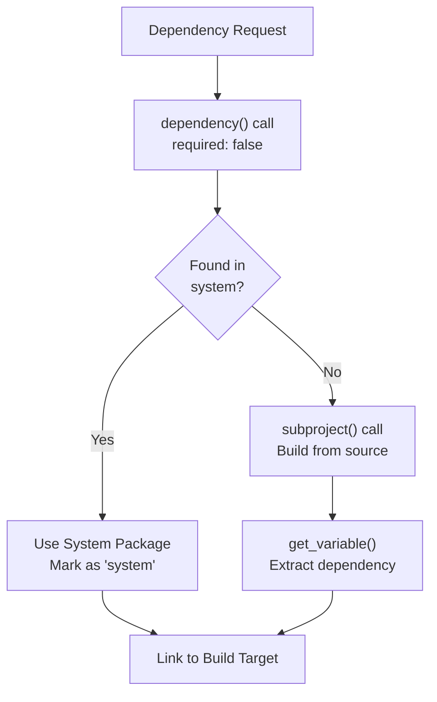
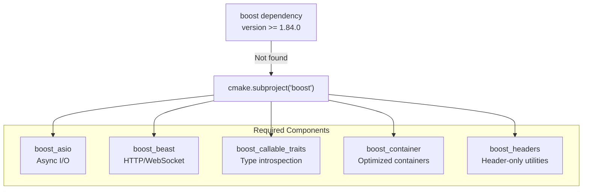
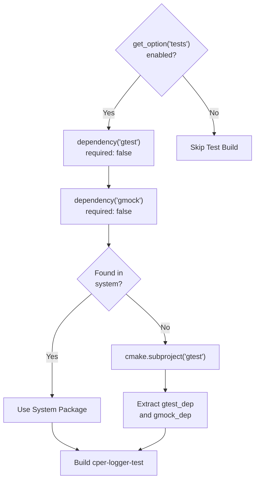
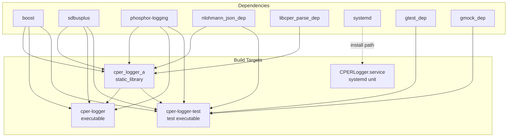

<!-- source: DeepWiki mcp.deepwiki.com · repo NVIDIA/cper-logger · page 3.2 Dependencies · fetched 2026-10-26 -->

# Dependencies

<details>
<summary>Relevant source files</summary>

The following files were used as context for generating this wiki page:

- [meson.build](meson.build)
- [subprojects/libcper.wrap](subprojects/libcper.wrap)
- [subprojects/nlohmann_json.wrap](subprojects/nlohmann_json.wrap)
- [subprojects/phosphor-logging.wrap](subprojects/phosphor-logging.wrap)

</details>


## Purpose and Scope

This page documents the external dependencies required by cper-logger and how they are managed through the Meson build system. It covers dependency resolution strategies, version requirements, subproject fallback mechanisms, and dependency-specific compiler flags.

For information about how these dependencies are used in the build process, see [Build Configuration](#3.1). For details on testing-specific dependencies, see [Test Framework](#4.1).

---

## Dependency Resolution Strategy

The cper-logger build system employs a dual-mode dependency resolution strategy. Meson first attempts to locate dependencies in the host system using `pkg-config`. If a system-wide installation is not found, Meson automatically falls back to building the dependency from source using the subproject mechanism.



**Sources:** [meson.build:23-105]()

---

## Required Dependencies

The following table lists all mandatory dependencies for building the cper-logger service:

| Dependency | Minimum Version | Purpose | Resolution Method |
|------------|----------------|---------|-------------------|
| **boost** | 1.84.0 | ASIO event loop, BEAST HTTP components, type traits | System or CMake subproject |
| **sdbusplus** | (unspecified) | D-Bus communication and message handling | System or Meson subproject |
| **phosphor-logging** | (unspecified) | OpenBMC logging service interface | System or Meson subproject |
| **nlohmann_json** | 3.11.2 | JSON parsing and manipulation | System or Meson subproject |
| **libcper** | (unspecified) | CPER binary format parsing | Meson subproject (git) |
| **systemd** | (unspecified) | Service lifecycle management | System only |

**Sources:** [meson.build:23-105]()

---

### Boost Libraries

Boost is resolved using either the system package manager or CMake subproject. The build only requires specific Boost components rather than the full distribution:



**Boost Configuration:**

The build applies the following preprocessor definitions when using Boost:

- `BOOST_ASIO_DISABLE_THREADS` - Disables thread support in ASIO
- `BOOST_NO_RTTI` - Disables runtime type information
- `BOOST_NO_TYPEID` - Disables typeid operator support

These flags align with the project's C++ configuration that disables RTTI globally ([meson.build:11]()).

**Sources:** [meson.build:23-58]()

---

### sdbusplus

The `sdbusplus` library provides C++ bindings for D-Bus communication. It is used for both the service's D-Bus interface and communication with the phosphor-logging service.

**Resolution Logic:**
```
dependency('sdbusplus', required: false, include_type: 'system')
  ↓ (if not found)
subproject('sdbusplus', required: true)
  ↓
get_variable('sdbusplus_dep').as_system('system')
```

**Configuration:**

The build defines `SDBUSPLUS_DISABLE_BOOST_COROUTINES` to prevent sdbusplus from using Boost coroutines, ensuring compatibility with the asynchronous execution model.

**Sources:** [meson.build:61-67]()

---

### phosphor-logging

This dependency provides the interface to OpenBMC's logging infrastructure. Unlike most other dependencies, `phosphor-logging` is resolved via `dependency()` without an explicit fallback in the main build file. The subproject wrap file [subprojects/phosphor-logging.wrap]() provides automatic fallback.

**Wrap Configuration:**
```
url: https://github.com/openbmc/phosphor-logging.git
revision: HEAD
provides: phosphor_logging_dep
```

**Sources:** [meson.build:69](), [subprojects/phosphor-logging.wrap:1-7]()

---

### nlohmann_json

The JSON library is used for parsing CPER data into intermediate JSON representation before formatting for logging.

**Version Requirement:** `>= 3.11.2`

**Resolution Strategy:**
```
dependency('nlohmann_json', required: false, version: '>=3.11.2')
  ↓ (if not found)
subproject('nlohmann_json', required: true)
  ↓
get_variable('nlohmann_json_dep')
```

**Subproject Source:**
The wrap file downloads a pre-built header-only distribution:
- Version: 3.11.3
- Source: GitHub releases (include-only zip)
- SHA256: `a22461d13119ac5c78f205d3df1db13403e58ce1bb1794edc9313677313f4a9d`

**Sources:** [meson.build:70-79](), [subprojects/nlohmann_json.wrap:1-12]()

---

### libcper

The `libcper` library provides low-level CPER binary format parsing capabilities. This is the only dependency that is exclusively resolved via git subproject.

**Resolution:**
```
dependency('libcper', required: false)
  ↓ (if not found)
subproject('libcper')
  ↓
get_variable('libcper_parse_dep')
```

**Subproject Configuration:**
```
url: https://github.com/openbmc/libcper.git
revision: HEAD
provides: libcper_parse_dep
```

**Include Path Handling:**

The build includes a workaround for libcper's directory structure discrepancy:
```cpp
inc += [include_directories('subprojects')]
```
This adds the subprojects directory to the include path because libcper's install directory differs from its subproject directory ([meson.build:102-104]()).

**Sources:** [meson.build:98-105](), [subprojects/libcper.wrap:1-7]()

---

### systemd

The `systemd` dependency is only used to determine installation paths for the service unit file. It is resolved exclusively from the system and has no subproject fallback.

**Usage:**
- `systemdsystemunitdir` - Determines where to install `.service` files
- `sysconfdir` - System configuration directory path

**Sources:** [meson.build:60](), [meson.build:83-86]()

---

## Optional Dependencies

### Testing Framework (GTest/GMock)

Testing dependencies are only resolved when the `tests` feature is enabled via `meson_options.txt`.



**Resolution Logic:**

The test framework follows a three-tier fallback:
1. System `gtest` and `gmock` packages
2. CMake subproject build
3. Assertion failure if tests are explicitly enabled but not found

**Sources:** [meson.build:129-175]()

---

## Dependency Graph

The following diagram shows how dependencies are linked to build targets:



**Target Details:**

- **`cper_logger_a`** - Static library containing CPER processing logic ([meson.build:107-118]())
- **`cper-logger`** - Main service executable ([meson.build:120-127]())
- **`cper-logger-test`** - Test executable ([meson.build:159-172]())
- **Service unit** - Systemd service file ([meson.build:90-96]())

**Sources:** [meson.build:107-175]()

---

## Subproject Wrap Files

Meson uses `.wrap` files in the `subprojects/` directory to define how to fetch and build dependencies. These files support both archive downloads and git repositories.

### Archive-Based Wraps

**nlohmann_json** uses a pre-built archive:

| Field | Value |
|-------|-------|
| Format | ZIP archive (header-only) |
| Version | 3.11.3 |
| Source URL | `https://github.com/nlohmann/json/releases/download/v3.11.3/include.zip` |
| Fallback URL | WrapDB mirror |
| Hash Verification | SHA256 checksum |

**Sources:** [subprojects/nlohmann_json.wrap:1-12]()

### Git-Based Wraps

Both **libcper** and **phosphor-logging** use git subprojects:

| Dependency | Repository | Revision |
|------------|------------|----------|
| libcper | `https://github.com/openbmc/libcper.git` | HEAD |
| phosphor-logging | `https://github.com/openbmc/phosphor-logging.git` | HEAD |

These dependencies always track the latest version of their respective repositories.

**Sources:** [subprojects/libcper.wrap:1-7](), [subprojects/phosphor-logging.wrap:1-7]()

---

## Dependency-Specific Compiler Flags

Several dependencies require specific preprocessor definitions to configure their behavior:

| Flag | Dependency | Purpose |
|------|------------|---------|
| `BOOST_ASIO_DISABLE_THREADS` | Boost.Asio | Disable thread support for single-threaded event loop |
| `BOOST_NO_RTTI` | Boost | Align with project's RTTI-disabled configuration |
| `BOOST_NO_TYPEID` | Boost | Disable typeid operator (requires RTTI) |
| `SDBUSPLUS_DISABLE_BOOST_COROUTINES` | sdbusplus | Prevent Boost coroutine usage |

These flags are applied project-wide using `add_project_arguments()`:

```
add_project_arguments('-DBOOST_ASIO_DISABLE_THREADS', language: 'cpp')
add_project_arguments('-DBOOST_NO_RTTI', language: 'cpp')
add_project_arguments('-DBOOST_NO_TYPEID', language: 'cpp')
add_project_arguments('-DSDBUSPLUS_DISABLE_BOOST_COROUTINES', language: 'cpp')
```

**Sources:** [meson.build:53-58](), [meson.build:67]()

---

## Build Requirements

The dependency resolution strategy requires:

1. **Meson** >= 1.3.0 ([meson.build:4]())
2. **C++ Compiler** with C++23 support ([meson.build:8](), [meson.build:18-21]())
3. **pkg-config** for system dependency detection
4. **Git** for git-based subprojects
5. **CMake** (optional) for Boost and GTest subprojects when system packages are unavailable

**Sources:** [meson.build:1-21]()

---

